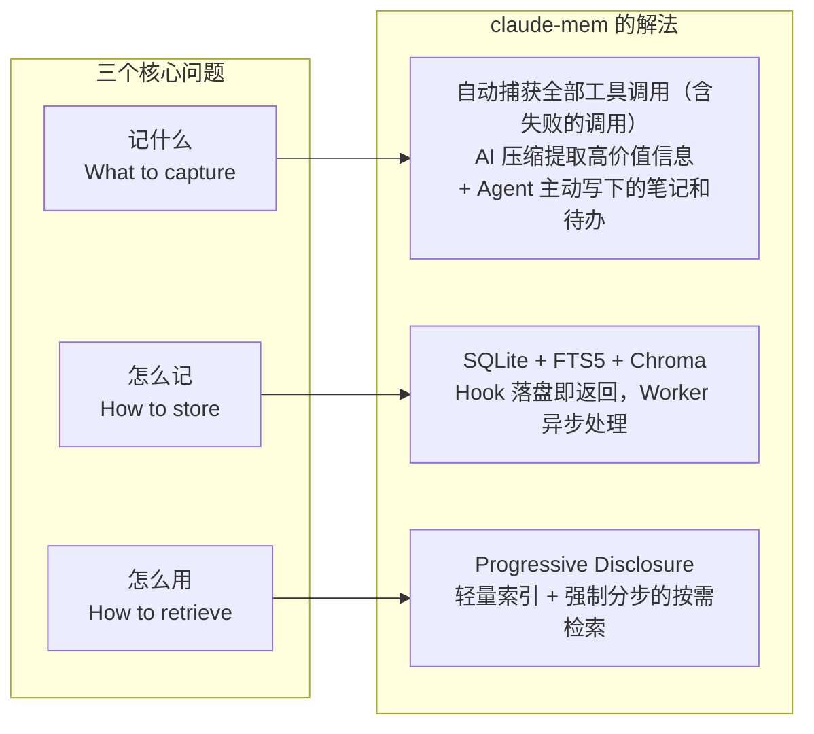

## 5 分钟体验：先感受问题，再理解问题

在讲理论之前，先花 5 分钟亲自体验“有记忆”和“无记忆”的区别。

**实验步骤**（需要已安装 Claude Code 和 Node.js 20.12 以上）：

```bash
# 1. 安装 claude-mem，只为 Claude Code 安装，观察者使用你自己的 Anthropic 账号
npx claude-mem install --ide claude-code --provider claude

# 2. 重启 Claude Code，开始第一次会话
claude
# 输入："帮我在当前目录创建一个 hello.ts，里面导出一个 greet 函数"
# Claude 会创建文件。完成后退出会话（/exit）

# 3. 开始第二次会话
claude
# 输入："继续刚才的工作"
# 观察：Claude 知道你刚才创建了 hello.ts，并能在此基础上继续
```

不带参数直接运行 `npx claude-mem install` 会进入交互式安装：选择要接入的 Agent（Claude Code 之外还有 Codex、Cursor 等十几种），选择观察者用的模型来源，并可能打开浏览器登录 claude-mem 的云服务。上面的写法显式指定了 `--provider claude`，安装器会跳过登录，记忆完全留在本机。

如果你不想现在安装，也没关系，这个体验贯穿全书，任何时候都可以回来做。关键是理解：**第二次会话中 Claude 之所以“记得”第一次做了什么，是因为 claude-mem 在 SessionStart 时自动注入了历史上下文。**

下面开始分析这个问题的本质。

## AI Agent 的“金鱼记忆”困境

打开一个新的 Claude Code 会话，输入“继续昨天的工作”。

没有记忆系统时，Claude 的回答大概率是：“我没有之前会话的上下文，能否告诉我昨天在做什么？”

这就是 Agent Memory 问题的本质：**每次会话都是一张白纸**。LLM 没有持久化的工作记忆，上一轮对话中积累的认知（对代码结构的理解、Bug 的定位过程、做出的设计决策）在会话结束时全部消失。

对一次性的问答场景，这无所谓。但软件工程是持续数天甚至数月的工作，记忆缺失的代价很高：

```
第 1 天：花 30 分钟探索项目结构，理解核心模块关系
第 2 天：新会话，Agent 再花 30 分钟做同样的事
第 3 天：同上
...
第 N 天：同样的 30 分钟浪费了 N 次
```

更严重的是决策记忆的丢失。第 1 天你和 Agent 讨论后决定用方案 A 而非方案 B，第 2 天 Agent 可能又建议方案 B，因为它不记得 A 的选择以及背后的理由。

## 会话间上下文断裂的代价

把这个问题量化（下面的数字是量级估计，用来说明问题的规模）：

**时间成本**：一个中等复杂度的项目，每次新会话需要 3–5 分钟重建上下文。按每天 5 次会话计算，一周要花 1–2 小时纯粹在“让 Agent 回忆”上。

**质量成本**：没有历史决策记录，Agent 可能给出与之前矛盾的建议。更危险的是，当它“忘记”某个已知的 Bug 或边界条件，可能重新引入已经修复过的问题。

**认知成本**：工程师被迫充当 Agent 的外部记忆，每次都要手动复述背景。这违背了用 Agent 提升效率的初衷。

现实中，工程师们发展出各种变通办法：

- 维护一个 CLAUDE.md 文件，手动写入项目约定
- 每次会话开头粘贴一段背景信息
- 把重要决策记在自己的笔记里，需要时复制给 Agent

这些做法有用，但都是手动的、不完整的、容易遗忘的。一个好的 Memory 系统应该把这个过程自动化。宿主自己也在往这个方向走：Claude Code 有内置的 auto-memory，Codex 有自己的 memories 目录。它们和 claude-mem 这类插件是什么关系，第 15 章会讨论。

## Memory 系统的三个核心问题

设计 Agent Memory 系统时，必须回答三个问题：记什么、怎么记、怎么用。三个问题与 claude-mem 给出的答案的对应关系如图 1-1 所示，下面逐一展开。



*图 1-1：Memory 系统的三个核心问题与 claude-mem 的对应解法*

### 记什么（What to capture）

不是所有信息都值得记录。一次 `ls` 命令的输出、一个临时的变量赋值，这些是噪音。值得记忆的是：

- **决策**：为什么选择方案 A 而非方案 B
- **发现**：关键的 Bug 根因、性能瓶颈所在
- **变更**：架构级别的代码修改及其意图
- **踩坑**：已知的边界条件、已修复的问题，以及试过但失败的方案
- **进展**：任务完成状态、下一步计划

claude-mem 的主路线是记录所有工具调用（文件读写、命令执行、搜索等，包括执行失败的调用），再用 AI 压缩提取高价值信息：原始数据全量捕获，摘要按需生成。

v13 又补了一条路线：让 Agent 自己写。`save_memory` 工具让 Agent 主动记下用户的偏好、纠正和口头决定，这些东西不会以工具调用的形式出现；`work_state_write` 让 Agent 维护一份跨会话的待办清单（第 8 章）。前一条路线记录“发生了什么”，后一条路线记录“Agent 认为必须记住什么”，两者互补。

### 怎么记（How to store）

存储层面有两个维度的选择。

**结构化还是非结构化**：

- 纯文本存储（如 Markdown 笔记）：简单，但难以精确检索
- 结构化数据库（如 SQLite）：支持精确查询，需要预先定义 Schema
- 向量存储（如 Chroma）：支持语义搜索。它把文本转化为向量（Embedding），通过向量距离判断“意思是否接近”，质量依赖 Embedding 模型

**实时还是批量**：

- 实时写入：每个操作立即持久化，不丢数据，但可能影响性能
- 批量处理：积攒后统一处理，性能好，但有丢数据的风险

claude-mem 选择了混合方案：SQLite 做结构化存储，加 FTS5 全文搜索（SQLite 内置的全文搜索引擎，不需要额外部署 Elasticsearch），再加 Chroma 做语义搜索。写入分成两段：Hook 把事件原子地写成一个文件就返回，宿主不需要等待；常驻的 Worker 进程随后取走文件，在后台完成压缩和存储。持久化发生在交接点，后台处理在内存里进行，第 6 章会解释为什么这样切分。

### 怎么用（How to retrieve）

这是三个问题中最关键的。记了 10,000 条观察，新会话开始时该注入哪些？

**全量注入**：把所有历史数据塞进上下文。问题是 Token 窗口有限，大部分信息与当前任务无关，注意力被稀释。

**智能检索**：系统预判哪些信息与当前任务相关，只注入这部分。问题是系统不知道用户接下来要做什么，预判准确率低。

**渐进式披露**：先给一个轻量级索引（标题、类型、时间），让 Agent 自己决定需要深入了解哪些。它要求 Agent 有主动搜索的意识。

claude-mem 选择第三种，即 Progressive Disclosure。背后的判断是：**Agent 比系统更清楚当前任务需要什么信息**。与其让系统猜，不如给 Agent 一张地图，让它自己导航。v13 进一步把“先看目录、再挑详情”做成了检索工具的强制协议，Agent 无法跳过目录直接取全文（第 8 章）。

## 现有方案对比

市面上的 Agent Memory 方案可以分为几类。

### RAG（Retrieval-Augmented Generation）

经典做法：把历史信息 Embedding 后存入向量库，每次会话开始时检索最相关的 K 条注入上下文。

```
优点：概念简单，实现成熟
缺点：预检索无法感知当前任务意图
      检索出的内容有相当一部分与当前任务无关，Token 被浪费
      对 Embedding 质量依赖大
```

### 结构化笔记（Structured Notes）

Agent 在工作过程中主动写笔记（如 TODO.md、NOTES.md），下次会话加载。

```
优点：Agent 主动管理，信息质量高
缺点：依赖 Agent "记得"写笔记
      笔记格式不统一，难以系统化检索
      笔记放在仓库里会产生合并冲突
```

### 压缩摘要（Compaction）

会话结束时生成结构化摘要，下次会话注入摘要而非原始对话。

```
优点：信息密度高，Token 效率好
缺点：摘要过程有信息损失
      无法精确回溯原始细节
      摘要质量取决于压缩 Prompt 设计
```

### claude-mem 的组合方案

claude-mem 不是上述任何一种的简单实现，而是把三者组合起来：

| 维度 | claude-mem 的做法 |
|------|-----------------|
| 捕获 | 自动观察所有工具调用，不依赖 Agent 主动写；同时提供显式写入的工具 |
| 压缩 | AI 生成结构化 Observation（type、title、narrative、facts），会话结束时生成摘要 |
| 存储 | SQLite + Chroma 双引擎；原始工具输入输出另存一份，摘要不够时可回溯 |
| 检索 | Progressive Disclosure，注入索引 + 按需分步获取详情 |

## claude-mem 的设计哲学：Observe → Compress → Inject

claude-mem 的核心工作流可以浓缩为三个动词。

### Observe（观察）

通过宿主的 Hook 系统，非侵入式地监听每次工具调用。Agent 读了什么文件、改了什么代码、执行了什么命令、哪条命令失败了，全部被 PostToolUse 或 PostToolUseFailure Hook 捕获。

关键约束：**观察不能影响被观察者**。claude-mem 的写类 Hook 在宿主那边是异步执行的，宿主根本不等它；Hook 自己只做一件事，把事件写进一个文件。任何内部错误都以退出码 0 结束，绝不阻塞用户的会话（第 4、5 章）。

### Compress（压缩）

后台 Worker 取出事件，交给观察者模型（默认是通过 Claude Agent SDK 调用的 Claude，也可以换成 Gemini、OpenRouter 或任意 OpenAI 兼容接口）做 AI 压缩。从一大段工具输入和输出中提取出：

- 一个类型（decision、bugfix、discovery 等 9 种之一）
- 一个简短的标题
- 一段叙述
- 若干条关键事实
- 关联的文件路径和概念标签

这个过程把几千 Token 的原始数据浓缩成几百 Token 的结构化观察。观察者自己被关在一个没有任何工具权限的会话里，只能“看”和“写 XML”。

### Inject（注入）

下次会话开始时，SessionStart Hook 注入一段上下文：先是 Agent 自己维护的待办清单，然后是最近观察的索引，每条一行，只有 ID、时间、类型和标题。整段内容严格控制在 10,000 字符以内，超出部分按优先级裁掉（第 8 章）。Agent 看到索引后，通过 MCP 搜索工具按需获取完整内容。

```
Observe：全量捕获，不遗漏，不阻塞
Compress：AI 提取高价值信息，降低噪音
Inject：渐进式披露，让 Agent 自主决定
```

这三步形成一个正向循环：观察越多，记忆越丰富，Agent 在未来会话中能获取的上下文越精准。

---

**思考题**

1. 如果你正在做的项目只有 3 个文件、开发周期 1 天，Agent Memory 还有必要吗？Memory 系统的投入产出拐点在哪里？
2. claude-mem 以工具调用而非对话消息作为记忆单元，又补了 `save_memory` 让 Agent 主动记录。如果你要为一个前端组件库的 AI 助手设计 Memory，你会选择什么作为观察单元？哪些信息必须由 Agent 显式写下？
3. Progressive Disclosure 让 Agent 自己决定“看什么”。如果 Agent 判断失误（明明相关但跳过了），系统有什么兜底机制？（提示：第 5 章的文件读取钩子、第 8 章的待办清单）

---

下一章具体认识 claude-mem 这个项目：它的能力全景、安装方式和日常使用场景。

> 本书开源发布于 [inferloop.dev](https://inferloop.dev)，转载请注明出处。

---

> 本章来自《Agent Memory 工程实战》开源版 · 作者「递归客」  
> 在线阅读完整书系：[inferloop.dev](https://inferloop.dev)  
> 源码仓库：[github.com/diguike/book-claude-mem](https://github.com/diguike/book-claude-mem)
