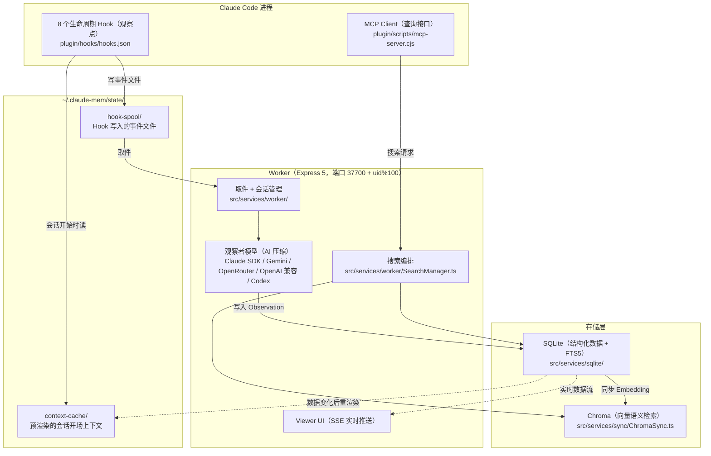

本书以 claude-mem v13.35.0（2026-10-08 发布）为准，许可证为 Apache-2.0（v13.0.0 起从 AGPL-3.0 改为 Apache-2.0）。

## claude-mem 是什么

一句话定义：**claude-mem 是一个记忆插件，自动观察 Coding Agent 的工具调用，用 AI 压缩成结构化记忆，并在之后的会话里按需提供，实现跨会话的持久记忆。**

它最早只为 Claude Code 设计，名字也由此而来。到 v13，同一套记忆可以接入 Codex CLI、Cursor、Windsurf、OpenCode、Pi、DeepSeek Harness 等十几种 Agent（第 18 章）。本书前四部分以 Claude Code 为主线讲解。

安装后不需要做任何事。你正常使用 Claude Code 写代码，claude-mem 在后台观察、记录、压缩；下次开会话时，相关的历史上下文自动出现在 Claude 的视野里。

从运行结构看，claude-mem 分三层：宿主进程里的 Hook 和 MCP 客户端负责观察和查询，常驻的 Worker 进程负责压缩和编排，存储层负责持久化。数据自上而下写入，查询请求从 MCP 一路穿到存储，如图 2-1 所示。



*图 2-1：claude-mem 的三层运行结构。写入经文件交接给 Worker，查询由 MCP 经搜索编排分发到 SQLite 和 Chroma*

## 六项核心能力

### 1. 自动观察（Observe）

PostToolUse 和 PostToolUseFailure 两个 Hook 捕获每次工具调用：文件读取、代码编辑、命令执行、搜索，也包括执行失败或被中断的调用。你不需要手动标记哪些操作值得记录，系统全量捕获，再由 AI 判断价值。

### 2. AI 压缩（Compress）

Worker 把工具调用交给一个观察者模型，压缩成结构化的 Observation。一次代码编辑可能产生几千 token 的原始数据，压缩后是一条一两百 token 的记录，大致长这样：

```
类型：● bugfix（概念：problem-solution, gotcha）
标题：修复会话收尾时的竞态条件
叙述：SessionEnd 在 Worker 完成摘要之前触发，导致摘要丢失……
事实：
  - 原因：SessionEnd 与摘要生成存在竞争
  - 修复：SessionEnd 只写一个事件文件，由 Worker 按顺序处理
文件：src/cli/handlers/session-end.ts
```

每条 Observation 上有两个容易混淆的分类字段：**type**（类型）和 **concept**（概念）。它们是同一条记录上正交的两个维度。

type 回答“这条记录是什么性质的动作”。默认的 `code` 模式（`plugin/modes/code.json`）定义了 9 种，每种在索引里用一个符号表示：

| type | 符号 | 含义 |
|------|------|------|
| `bugfix` | ● | 修复缺陷 |
| `feature` | ◆ | 新功能 |
| `refactor` | ↻ | 重构 |
| `change` | ✓ | 一般变更（文档、配置等） |
| `discovery` | ○ | 对现有系统的了解 |
| `decision` | ⚖ | 架构或设计决策 |
| `security_alert` | ⚠ | 需要先处理的安全问题 |
| `security_note` | ⚷ | 值得记录但不紧急的安全信息 |
| `sensitive` | ⊘ | 不算私密、但不该流进其他内容的信息 |

concept 回答“这条记忆属于哪类知识”，共 7 种：how-it-works、why-it-exists、what-changed、problem-solution、gotcha、pattern、trade-off。它没有符号，用于检索和上下文注入时的过滤。上面的例子 type 是 bugfix，concept 同时是 problem-solution 和 gotcha。

观察者模型默认是 Claude（通过 Claude Agent SDK，用你自己的 Claude 账号额度），模型是 `claude-haiku-4-5-20251001`。如果你把默认模型换成更强也更贵的模型，只由 Read、Glob、Grep 这类只读工具组成的批次仍会自动走 haiku 档（`CLAUDE_MEM_TIER_SIMPLE_MODEL`）。也可以换成 Gemini、OpenRouter、任意 OpenAI 兼容接口（内置 deepseek、ollama、vllm 等预设）或 Codex。

### 3. 上下文注入（Inject）

SessionStart Hook 在每次新会话开始时注入一段上下文。最前面是 Agent 维护的待办清单，然后是最近观察的索引（每条一行，依次是 ID、时间、类型符号、标题）和最近一次会话摘要。整段严格控制在 10,000 字符以内，这是 Claude Code 原样交付 Hook 输出的上限。Agent 看到某条记录与当前任务相关时，再通过 MCP 工具取完整内容。

### 4. 渐进式搜索（Search）

通过 MCP（Model Context Protocol，Anthropic 提出的开放协议，规定 LLM 应用如何调用外部工具，类似 LSP 之于编辑器）暴露一组检索工具：

| 工具 | 用途 | 成本 |
|------|------|------|
| `mem_search` | 推荐的搜索入口。guided 模式分三步：索引、时间线、详情，每一步只能选上一步出现过的 ID；auto 模式一次走完 | 索引每条几十 token，详情每条几百 token |
| `get_tool_uses` | 取原始工具输入输出，摘要不够时才用 | 可能数千 token |
| `search` / `timeline` / `get_observations` | 旧的三步工具，保留给高级过滤和旧客户端 | 同上 |
| `important_workflow` | 工作流说明 | 固定 |

完整的工具清单有 19 个（本地运行时），第 9 章逐一介绍。

### 5. 显式记忆与待办（Remember）

自动观察记录的是“发生了什么”。有些信息不会以工具调用的形式出现：你的偏好、对 Agent 的纠正、一个口头决定。v13 提供了两个写入工具：

- `save_memory`：Agent 主动记一条笔记，不经过 AI 压缩，直接存入
- `work_state_write` / `work_state_read`：Agent 维护一份跨会话的待办清单，未完成的项目会出现在每次会话的最前面

### 6. 知识库（Knowledge Agent）

从历史观察中编译出聚焦某个主题的知识库（Corpus），让一个专门的模型会话读完它，然后可以反复提问：

```
build_corpus name="auth-architecture" project="my-app" concepts="trade-off" types="decision"
prime_corpus name="auth-architecture"
query_corpus name="auth-architecture" question="认证模块的刷新策略是什么？为什么这么选？"
```

适合对某个领域做深度沉淀，比如“所有关于部署流程的决策”或“过去一个月的 Bug 修复模式”（第 11 章）。

## 安装与配置

### 安装

要求 Node.js 20.12 以上。最常用的安装命令：

```bash
npx claude-mem install
```

交互式安装会依次：

1. 检查并安装 Bun（Worker 的运行时，内置 SQLite 驱动、启动快）
2. 检查并安装 uv（Python 包管理器，用来运行 Chroma 的 MCP 服务 `chroma-mcp`）
3. 让你选择要接入的 Agent，检测到的会预先勾选，没检测到任何 Agent 时默认 Claude Code
4. 让你选择观察者模型的来源，可能会打开浏览器登录 claude-mem 的云服务 cmem.ai（它提供托管的观察者和云同步，带 30 天免费试用）
5. 对 Claude Code，询问是否关闭它内置的 auto-memory（默认推荐保持开启）
6. 写入插件和 Hook 配置，启动 Worker

不想登录云服务、只想用自己的 Anthropic 账号，可以显式指定：

```bash
npx claude-mem install --ide claude-code --provider claude
```

带了 `--provider`、设置了 `CLAUDE_MEM_ONLINE_OPTIN=false` 或者在 CI 这类非交互环境里运行时，安装不会涉及任何账号交互。安装完成后重启 Claude Code，记忆系统自动开始工作。

也可以通过 Claude Code 的插件市场安装：

```bash
# 在 Claude Code 中执行
/plugin marketplace add thedotmack/claude-mem
/plugin install claude-mem
```

注意 `npm install -g claude-mem` 只安装库文件，不会注册 Hook，也不会启动 Worker。

### 遥测

v13.5.0 起，claude-mem 默认开启匿名使用统计（PostHog）。按源码里的白名单清洗器（`src/services/telemetry/scrub.ts`），只有版本、平台、耗时、计数这类预先列出的字段能离开本机，prompt、文件路径、项目名、搜索词都不会发送。关闭方式任选其一：

```bash
npx claude-mem telemetry disable
# 或者设置环境变量
export DO_NOT_TRACK=1
export CLAUDE_MEM_TELEMETRY=0
```

`npx claude-mem telemetry status` 显示当前状态以及是哪个设置决定的。

### 验证安装

```bash
npx claude-mem status     # Worker 是否在运行、版本、端口
npx claude-mem doctor     # 逐项诊断 Bun、uv、Worker、tree-sitter CLI、Chroma
```

Worker 自带一个 Web 界面（Viewer），地址是 `http://localhost:<端口>`。端口默认是 `37700 + (uid % 100)`，在 macOS 和 Linux 上因用户而异；Windows 上取不到 uid，按 77 计算，固定是 37777。在 Claude Code 里正常对话几轮，Viewer 里出现新的 Observation 卡片，说明一切正常。

### 核心配置

配置文件是 `~/.claude-mem/settings.json`，首次运行自动创建，文件权限是 0600。字段名统一用大写下划线风格，值一律是字符串，全部定义和默认值在 `src/shared/SettingsDefaultsManager.ts`：

```json
{
  "CLAUDE_MEM_CONTEXT_OBSERVATIONS": "50",
  "CLAUDE_MEM_CONTEXT_SESSION_COUNT": "10",
  "CLAUDE_MEM_PROVIDER": "claude",
  "CLAUDE_MEM_MODEL": "claude-haiku-4-5-20251001",
  "CLAUDE_MEM_MODE": "code--zh"
}
```

常用配置项：

| 配置项 | 默认值 | 说明 |
|--------|--------|------|
| `CLAUDE_MEM_CONTEXT_OBSERVATIONS` | `50` | SessionStart 索引里最多放多少条观察 |
| `CLAUDE_MEM_CONTEXT_SESSION_COUNT` | `10` | 注入的会话摘要数 |
| `CLAUDE_MEM_WORKER_PORT` | `37700 + uid % 100` | Worker 端口 |
| `CLAUDE_MEM_WORKER_HOST` | `127.0.0.1` | Worker 监听地址 |
| `CLAUDE_MEM_PROVIDER` | `claude` | 观察者模型来源：claude、gemini、openrouter、openai-compatible、codex |
| `CLAUDE_MEM_MODEL` | `claude-haiku-4-5-20251001` | provider 为 claude 时用的模型 |
| `CLAUDE_MEM_MODE` | `code` | 观察模式；中文用户可设 `code--zh`，观察会用中文书写 |
| `CLAUDE_MEM_DATA_DIR` | `~/.claude-mem` | 数据目录 |
| `CLAUDE_MEM_EXCLUDED_PROJECTS` | 空 | 不记录的目录，逗号分隔的 glob |
| `CLAUDE_MEM_FILE_READ_GATE_ENABLED` | `true` | 是否拦截对大代码文件的整文件读取（第 8 章） |
| `CLAUDE_MEM_CHROMA_ENABLED` | `true` | 关掉后只用 SQLite 搜索 |
| `CLAUDE_MEM_REDACT_ENABLED` | `false` | 自动脱敏常见密钥格式（第 10 章） |
| `CLAUDE_MEM_LOG_LEVEL` | `INFO` | 日志级别 |

每个配置项都可以用**同名环境变量**覆盖，环境变量优先于 settings.json。这也是字段名直接采用环境变量命名风格的原因：两边共用同一套 key。

## 日常使用场景

### 场景 1：跨会话连续开发

第一天你和 Claude 讨论了数据库 Schema 的设计，做出了几个关键决策。第二天开新会话时，不需要重述这些决策，注入的索引里会有一行：

```
342 3:15p ⚖ 用 jsonb 而非单独表存 metadata
```

Claude 看到这一行就知道 metadata 的存储方案已经定了，不会再给出冲突的建议。需要细节时，它会用 `mem_search` 取 #342 的全文。

### 场景 2：代码考古

三个月前做过一次性能优化，现在需要回忆具体做了什么：

```
"搜索之前关于 API 响应时间优化的记录"
```

Claude 用 `mem_search` 找到相关观察，挑出最相关的几条取详情，包括当时的叙述和修改过的文件列表。比翻 git log 或 grep 代码更快。开场索引只列最近的几十条观察，更早的记录要靠搜索取回。

### 场景 3：决策追溯

产品经理问“为什么选了 PostgreSQL 而不是 MongoDB”。如果当初的选型讨论留下了观察，可以直接查：

```
search(query="postgresql mongodb", obs_type="decision")
```

找到当时的决策记录，包括理由、对比和当时的约束。

### 场景 4：团队 Onboarding

新成员接手项目，通过 Knowledge Agent 快速建立认识：

```
build_corpus name="project-overview" project="my-app" limit=200
prime_corpus name="project-overview"
query_corpus name="project-overview" question="项目的核心架构是什么？主要模块有哪些？"
```

claude-mem 的记忆默认只在一台机器上。要在团队之间共享，需要 Server 运行时（第 16 章）或者云同步（第 19 章）。

## Viewer UI：实时观察面板

Viewer 是 Worker 自带的 React 页面，地址同上。主要功能：

- **Timeline 视图**：通过 SSE（Server-Sent Events，服务端向浏览器单向推送）实时显示新生成的观察和会话摘要
- **Sessions 视图**：按会话浏览，每个会话一页，可以按类型筛选
- **删除**：观察和摘要卡片上有删除按钮，删除会同步到其他打开的标签页，开启云同步时也会同步到其他设备
- **设置**：大部分配置项可以在页面上修改，包括观察者模型来源和 File Read Gate 开关
- **重启**：Worker 出问题时，`http://localhost:<端口>/restart` 页面上有一个重启按钮

Viewer 是可选的。claude-mem 的核心功能完全通过 Hook 和 MCP 运作，Viewer 只是一个可视化补充。

## Skills 体系

claude-mem 随插件安装 22 个 Skill。Skill 是 Claude Code 的一种扩展机制：一份带说明的 Markdown 文件，Claude 在合适的时机自动加载，也可以用 `/` 命令手动触发。按用途大致分三类：

**和记忆直接相关**

| Skill | 用途 |
|-------|------|
| `mem-search` | 回答“之前做过什么”这类问题，内部走强制分步的搜索 |
| `knowledge-agent` | 构建和查询知识库 |
| `timeline-report` | 生成项目完整开发历程的叙事报告 |
| `weekly-digests` | 按 ISO 周把项目历史写成连载式周报 |
| `handoff` | 生成一份 HANDOFF.md（目标、现状、相关文件、失败的尝试、下一步、记忆指针），交给新会话接续 |
| `how-it-works` | 解释 claude-mem 怎么捕获、什么时候注入、数据存在哪 |
| `mode-creator` | 通过对话为自己的领域定制一个观察模式 |
| `cloud-sync` | 配置和检查云同步 |

**开发工作流**

| Skill | 用途 |
|-------|------|
| `learn-codebase` | 通读一个代码库的源文件，让后续会话有可用的记忆 |
| `smart-explore` | 基于 tree-sitter 的结构化代码浏览，不用读全文件 |
| `make-plan` / `do` | 生成分阶段的实现计划，再用子代理执行 |
| `pathfinder` | 把代码库按功能画成流程图，找出重复的关注点 |
| `babysit` | 盯住一个 PR 的检查和评审意见，直到可以合并 |
| `standup`、`oh-my-issues`、`design-is`、`version-bump` | 站会、Issue 归并、设计评审、版本发布 |

**其他**：`agent-cost-report`、`ccs-align`、`what-the`、`wowerpoint`，与本书主题无关，不展开。

## 配置调优

### 控制注入量

觉得 SessionStart 注入的内容太多或太少：

```json
{
  "CLAUDE_MEM_CONTEXT_OBSERVATIONS": "30",
  "CLAUDE_MEM_CONTEXT_SESSION_COUNT": "5"
}
```

不用担心设得太大会撑爆上下文：渲染结果超过 10,000 字符时，系统会按优先级自动裁掉一部分（第 8 章）。设得太大的代价是，繁忙的项目里会被频繁裁剪，最终留下的条数并不比设小时多。

### 不记录某些目录

claude-mem 默认对所有项目生效。临时实验目录、个人笔记目录这类不需要记忆的地方，用 glob 排除：

```json
{
  "CLAUDE_MEM_EXCLUDED_PROJECTS": "~/tmp/**,~/scratch/**"
}
```

被排除的目录既不记录观察，也不在会话开始时注入上下文。claude-mem 没有 `.claude-mem-ignore` 这类忽略文件，排除规则只能写在设置里。

### 项目怎么识别

记忆按“项目”隔离。项目名默认取 git 仓库根目录的名字；worktree 会算成 `父项目/worktree 名`，同时能读到父项目的记忆；git 子模块用 `父项目/子模块路径`。还有几种可选方式：

- `CLAUDE_MEM_PROJECT_NAME_SOURCE=git-remote`：用 origin 远端的 `org/repo` 作为项目名，换了本地目录名也不受影响
- 在非 git 目录的根放一个空的 `.claude-mem-project` 文件：所有子目录都算同一个项目
- `CLAUDE_MEM_PROJECT_ENVIRONMENTS`：用 glob 把多个目录归到一个命名的“环境”下，共享记忆
- `npx claude-mem project merge <from> <into>`：把一个项目的记忆并入另一个

### 隐私

对敏感信息使用 `<private>` 标签：

```
<private>这段内容不会被 claude-mem 存储</private>
```

标签里的内容在 Worker 收到事件后、交给观察者模型之前被整段删除，不会进入数据库，也不会发给模型。如果一条 prompt 整个被包在标签里，这一轮的所有工具调用都不会被记录。担心忘记加标签，可以打开 `CLAUDE_MEM_REDACT_ENABLED`，自动替换 11 种常见密钥格式（第 10 章）。

### 多实例

在同一台机器上运行多套互相隔离的记忆（比如工作和个人）：

```bash
# 工作环境
export CLAUDE_MEM_DATA_DIR="$HOME/.claude-mem-work"
export CLAUDE_MEM_WORKER_PORT=37800

# 个人环境（默认）
export CLAUDE_MEM_DATA_DIR="$HOME/.claude-mem"
```

---

**思考题**

1. Worker 端口是 `37700 + (uid % 100)`。这个设计解决什么问题？如果两个用户的 uid 对 100 取模相同会怎样？Windows 上为什么固定是 37777？
2. `<private>` 标签在 Worker 端剥离。在剥离之前，原始内容在本机经过了哪些地方？如果你对这一点不放心，有哪些办法？
3. Knowledge Agent 的“构建、读完、提问”和“给 ChatGPT 发一段长文然后问问题”有什么本质区别？

---

> 本书开源发布于 [inferloop.dev](https://inferloop.dev)，转载请注明出处。

下一章进入 Context Engineering 的理论基础，理解 claude-mem 设计决策背后的原则。

---

> 本章来自《Agent Memory 工程实战》开源版 · 作者「递归客」  
> 在线阅读完整书系：[inferloop.dev](https://inferloop.dev)  
> 源码仓库：[github.com/diguike/book-claude-mem](https://github.com/diguike/book-claude-mem)
