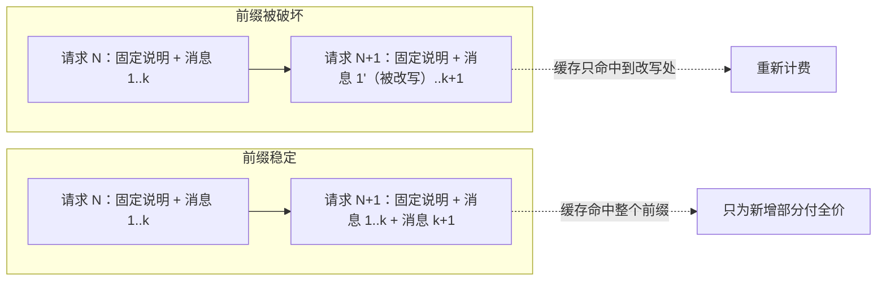

本章介绍 Context Engineering（上下文工程）的核心概念，这些概念直接决定了 claude-mem 为什么这样设计。每个理论点都配一个 claude-mem 的实际行为，帮助你建立“设计原则 → 系统实现”的因果关系。

## Token 预算即注意力预算

LLM 的上下文窗口有一个容易被忽视的性质：**它不是一块均匀的存储空间，而是一个会衰减的注意力场**。

往上下文里塞 100,000 Token，不等于模型对其中每一个都“读到了”。Transformer 的注意力机制意味着：

- 每个 Token 要与其他所有 Token 计算注意力权重（n² 关系）
- 上下文越长，单个 Token 平均分到的注意力越少
- 长序列中间位置的信息容易被忽略（Lost in the Middle 效应），模型对开头和结尾更敏感
- 模型对超长序列的训练经验不如短序列充分

把上下文窗口当成一笔预算：

| 类比 | 含义 |
|------|------|
| 总预算 | 上下文窗口大小（如 200K Token） |
| 每笔支出 | 注入的每段上下文 |
| 投资回报率 | 这段上下文对完成任务有多大帮助 |
| 机会成本 | 占用了本该留给“真正工作”的空间 |

预算之外还有硬性的交付上限。Claude Code 只原样交付 Hook 输出的前 10,000 个字符，多出一个字符，整段都会被换成一个预览，模型实际上什么都收不到（第 8 章）。上下文工程不只是“少放点”，还要知道每个通道的边界在哪里。

claude-mem 的设计原则是：**最大化每个 Token 的投资回报率**。Progressive Disclosure 的本质是让 Agent 自己管理预算，而不是系统替它花钱。

## 上下文腐烂（Context Rot）与信噪比

Context Rot 是实践中频繁出现、但少有人命名的问题：

**随着对话轮次增加，早期注入的上下文逐渐失去有效性。**

原因有几个：

1. 任务目标可能已经转变（用户从“修 Bug”转到“加新功能”）
2. 早期的代码状态可能已被修改
3. 中间产出的大量工具输出稀释了关键信息
4. 模型对更早的 Token 注意力衰减

传统 RAG 在会话开始时一次性注入大量“可能相关”的内容。短会话里问题不大；多轮长会话里，这些内容很快就“腐烂”了，占着空间但不再提供价值。

信噪比可以这样定义：

```
SNR = 有效 Token 数 / 总消耗 Token 数
```

全量注入的信噪比通常很低：注入了上万 Token，真正被用到的只有一小部分。Progressive Disclosure 的设计目标是让信噪比尽可能高：Agent 消耗的每个 Token 都是它根据当前任务主动选择的。

## System Prompt 的“正确高度”

System Prompt 是上下文工程中最核心的元素之一。“正确高度”指在两个极端之间找平衡。

### 过于具体（Too Prescriptive）

```
如果用户说 "fix bug"，先运行 git status，然后...
如果用户说 "add feature"，先检查 package.json，然后...
```

问题：脆性高，覆盖不了所有场景，维护成本高。

### 过于模糊（Too Vague）

```
你是一个有帮助的编程助手。请做好你的工作。
```

问题：没有提供任何可操作的指导。

### 正确高度

```
你是一个代码工程助手。在修改代码前先阅读相关文件。
优先使用项目已有的模式和约定。如果不确定，先问。
```

claude-mem 的上下文注入遵循同样的原则：不注入具体的指令（“当你修 auth bug 时记得看 #342”），而是提供一个索引让 Agent 自主判断。

这对 Memory 系统的启示是：**注入的上下文应该是 Enabling（赋能）而非 Prescribing（规定）**。给 Agent 信息，而不是命令。

v13 的注入里有一段例外值得注意：开场上下文的最后附了一段“记忆使用说明”，明确告诉模型用 `mem_search` 搜、用 `save_memory` 记、用 `work_state_write` 管待办（`src/shared/memory-instructions.ts`）。这是规定性的，但它规定的是“怎么用工具”，不是“做什么任务”，仍然在正确的高度上。

## Just-In-Time Context vs Pre-Inference Retrieval

两种检索策略的对比。

### Pre-Inference Retrieval（预推理检索）

```
用户输入 → Embedding → 向量检索 → Top-K 结果注入 → LLM 推理
```

LLM 开始思考之前，系统已经决定了注入哪些上下文。这是传统 RAG 的做法。

**适用场景**：静态知识库问答、短会话、上下文与查询关系明确。

**局限**：系统不知道 Agent 后续会做什么；多步任务中第一步的检索对第三步可能无用；无法适应任务中途的方向变化。

### Just-In-Time Context（即时上下文）

```
用户输入 → LLM 开始推理 → Agent 判断需要什么 → 调用工具检索 → 继续推理
```

Agent 在推理过程中按实际需要动态获取上下文。

**适用场景**：多步骤任务、探索性工作、长会话。

**局限**：比预检索多一轮工具调用；需要 Agent 有主动搜索的意识；工具描述本身占用 Token。

### claude-mem 的混合策略

claude-mem 两者都用：

1. **Pre-Inference**：SessionStart 注入一张“地图”，包括待办清单和最近观察的索引，整体不超过 10,000 字符
2. **Just-In-Time**：MCP 检索工具让 Agent 在推理过程中按需取详情；读代码文件之前，PreToolUse Hook 也会把这个文件的历史观察即时附上

claude-mem 自己做过一次反向的尝试：`CLAUDE_MEM_SEMANTIC_INJECT` 会在用户每次提交 prompt 时，用 prompt 做一次语义检索，把最相关的 5 条观察预先注入。这个功能至今默认关闭（第 5 章）。

## 长任务三板斧

软件工程任务经常需要几十轮工具调用，上下文很容易在中途耗尽或腐烂。三种应对策略如下。

### 策略 1：Compaction（压缩）

当对话接近上下文上限时，把历史消息交给模型生成摘要，用摘要替换原始消息继续。

```
原始对话（90,000 Token）
    ↓ 压缩
摘要（3,000 Token）+ 最近 5 轮对话（7,000 Token）
    ↓
继续在 10,000 Token 基础上工作
```

**调优思路**：

- 先最大化 Recall（不漏掉关键信息）
- 再优化 Precision（去除冗余）
- 优先清理旧的工具调用输出（量大但价值衰减快）

**claude-mem 的关联**：会话摘要就是一种 Compaction，把整个会话压缩成 request、investigated、learned、completed、next_steps、notes 六个字段。

claude-mem 内部还有一个更有意思的例子。它的观察者模型本身也是一段越来越长的对话，每次工具调用都追加一条。v13 没有选择压缩这段对话，而是在它接近模型窗口的一半时整代退休，开一段新对话，并用本会话已经写下的观察作为新对话的开场（第 6 章）。源码注释的说法是：连续性由这个产品本来就在生产的记忆承载，而不是由原始对话轮次承载。如果你的系统已经有一份结构化的工作记录，它往往就是现成的、质量更好的“压缩结果”。

### 策略 2：Structured Note-Taking（结构化笔记）

Agent 在工作过程中把笔记写到外部存储，需要时再读回来。笔记不在上下文窗口里，不占 Token。

```typescript
// Agent 完成第一阶段后
await writeFile('PROGRESS.md', `
## 已完成
- 数据库 Schema 设计
- API 路由定义

## 待做
- 实现认证中间件
- 写入测试
`);

// 下一步开始时
const progress = await readFile('PROGRESS.md');
```

**claude-mem 的关联**：整个 Observation 系统就是自动化的结构化笔记，区别在于不需要 Agent 记得写。v13 又补了 Agent 主动写的那一半：`work_state_write` 把待办和进度存进 claude-mem，未完成的项目出现在每次会话的最前面；`save_memory` 记下偏好和决定（第 8、10 章）。存在数据库而不是仓库里的文件中，好处是不会产生合并冲突，代价是不随代码一起版本化。

### 策略 3：Sub-Agent Architecture（子代理架构）

把复杂任务拆给专门的子代理，每个子代理有独立、干净的上下文窗口。

```
Main Agent（协调者）
  ├── Sub-Agent A：调研现有实现（读 20 个文件，返回 2000 Token 摘要）
  ├── Sub-Agent B：分析依赖关系（查 5 个包，返回 1000 Token 报告）
  └── Sub-Agent C：实现代码（基于 A、B 的摘要，专注写代码）
```

每个子代理可以深入探索（消耗数万 Token），只向主代理返回浓缩结果（1–2K Token）。

**claude-mem 的关联**：Knowledge Agent 就是一种子代理，由一个独立的会话读完某个主题的全部观察，只把答案交回主会话（第 11 章）。claude-mem 的观察者本身也是一个子代理，只是它不向主会话返回任何东西，结果写进数据库。

子代理也会产生记忆噪音。v13 默认不把子代理产生的观察放进 SessionStart 的窗口（`CLAUDE_MEM_CONTEXT_MAIN_AGENT_ONLY=true`），子代理的停止事件也不生成摘要；搜索时仍能找到它们。

### 选择策略的决策框架

| 场景 | 推荐策略 |
|------|---------|
| 长对话接近上下文上限 | Compaction |
| 迭代开发，需要跟踪进度 | Structured Note-Taking |
| 需要大量信息收集后做决策 | Sub-Agent |
| 跨会话的持久记忆 | 三者组合（claude-mem 的做法） |

把这张表画成流程，如图 3-1 所示：先判断记忆是否需要跨会话保留，再看单会话内的上下文压力来自哪里。

```mermaid
flowchart TD
    S[长任务上下文管理] --> Q0{记忆需要<br/>跨会话保留？}
    Q0 -->|是| R0["三种策略组合使用<br/>（claude-mem 的做法）"]
    Q0 -->|否，单会话内| Q1{上下文压力<br/>来自哪里？}
    Q1 -->|长对话接近上限| R1["Compaction<br/>压缩历史消息，保留摘要"]
    Q1 -->|迭代开发，需要跟踪进度| R2["Structured Note-Taking<br/>进度写入外部存储"]
    Q1 -->|大量信息收集后才能决策| R3["Sub-Agent<br/>子代理深入探索，返回浓缩结果"]
```



*图 3-1：长任务三板斧的选择决策流程*

## 前缀稳定：Prompt Cache 也是上下文工程的一部分

前面讨论的都是“放什么”。还有一个维度在旧版书里没有展开：**放的顺序和放进去之后能不能改**。

主流模型服务都提供 Prompt Cache：两次请求的开头部分逐字节相同，第二次请求可以复用第一次的计算结果，相同的部分按更低的价格计费，延迟也更低。命中的条件只有一个：前缀完全相同。这给上下文工程加了一条约束：已经发出去的内容最好不要再改，新内容尽量追加在后面，稳定的内容放在最前面。

claude-mem v13 在这件事上留下了三个案例。

**案例 1：恢复会话时不注入**。用户用 `claude --resume` 恢复一个旧会话时，模型已经有当时的完整上下文。v13.30.1 之前，SessionStart 仍会注入一份新渲染的记忆索引，这段新内容改变了对话的前缀，宿主侧的缓存全部失效。现在 resume 不再注入（`src/cli/handlers/context.ts` L74-79），只有 startup、clear、compact 三种开场才注入。

**案例 2：固定说明放最前**。观察者模型的 prompt 由两部分组成：只取决于观察模式的固定说明（角色、记录标准、输出格式），以及每个会话不同的内容（用户请求、日期、项目名）。v13.30.0 之前两者交织在一起，不同会话的 prompt 只有前 422 个字符相同；把固定说明全部挪到最前面后，code 模式下的共享前缀达到约 7,260 个字符（#4415）。内容没有变，只是顺序变了。

**案例 3：裁剪历史的代价**。v13.29.0 为了控制观察者对话的长度，在每次请求前把较早的工具输出替换成一个简短的占位符。请求确实变小了，但这一步改写了已经发送过的消息：从第 5 次观察开始，每次请求的前缀都和上一次不同，缓存无法命中，被改写的部分每次都要按新输入重新计费。v13.34.2 撤销了这项裁剪，同一代对话里已经发出的消息原样重发，每次请求都是上一次的延伸；对话过长的问题交给“整代退休”去解决。发布说明也坦白说明了代价：不再压缩旧内容后，一代对话会更快达到上限、更频繁地换代，对成本的净影响还没有在生产环境测量过。

三个案例的变化方向如图 3-2 所示。



*图 3-2：改写已发送内容与只追加新内容，对 Prompt Cache 的影响*

可以从中提炼出三条做法：

1. 稳定的内容放前面，变化的内容放后面
2. 已经发出的内容只追加、不改写；需要缩短时整段换掉（开一段新对话），而不是逐条修改
3. 往一个已有的对话里注入新内容之前，先问一句：模型是不是已经知道了

## 小结

Context Engineering 的核心认知：

1. **Token 是稀缺资源**，每个通道还有自己的硬上限
2. **注入的上下文会腐烂**，越早注入的信息在长会话中越容易失去价值
3. **让 Agent 自主管理上下文**比系统替它决定更有效
4. **混合策略优于单一策略**：预注入轻量索引，再按需深度获取
5. **前缀要稳定**：只追加、少改写，否则会为同一段内容反复付费

这些原则是理解后续 claude-mem 架构的基础。为什么用 Progressive Disclosure 而不是传统 RAG？为什么 Hook 只把事件写进文件就返回？为什么检索工具要强制分步？这些决策都能追溯到本章的原则。

---

**思考题**

1. 如何为你自己的项目量化 Context Rot？设计一个实验：在长对话的不同轮次注入同一条信息，观察 Agent 对该信息的引用准确率变化曲线。
2. 如果你的模型上下文窗口只有 8K（比如本地小模型），三种长任务策略中你会优先选哪个？claude-mem 的观察者在小窗口模型上是怎么调整的？（提示：第 6 章“分代”）
3. 案例 3 中，裁剪历史省下了单次请求的 Token，却破坏了缓存。设计一个实验，比较“裁剪”和“整代退休”两种方案在一个长会话里的总成本，你需要记录哪些指标？

---

> 本书开源发布于 [inferloop.dev](https://inferloop.dev)，转载请注明出处。

下一章开始进入架构篇，从 claude-mem 的系统全景开始，逐层拆解每个组件的设计与实现。

---

> 本章来自《Agent Memory 工程实战》开源版 · 作者「递归客」  
> 在线阅读完整书系：[inferloop.dev](https://inferloop.dev)  
> 源码仓库：[github.com/diguike/book-claude-mem](https://github.com/diguike/book-claude-mem)
