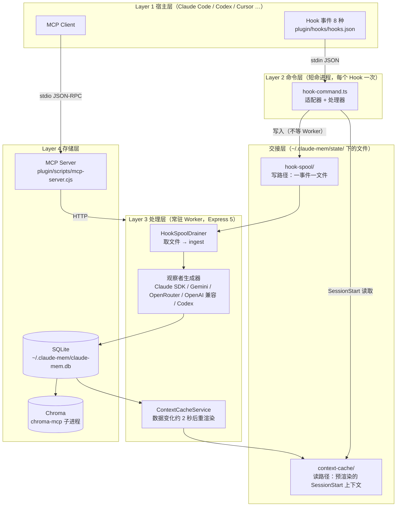
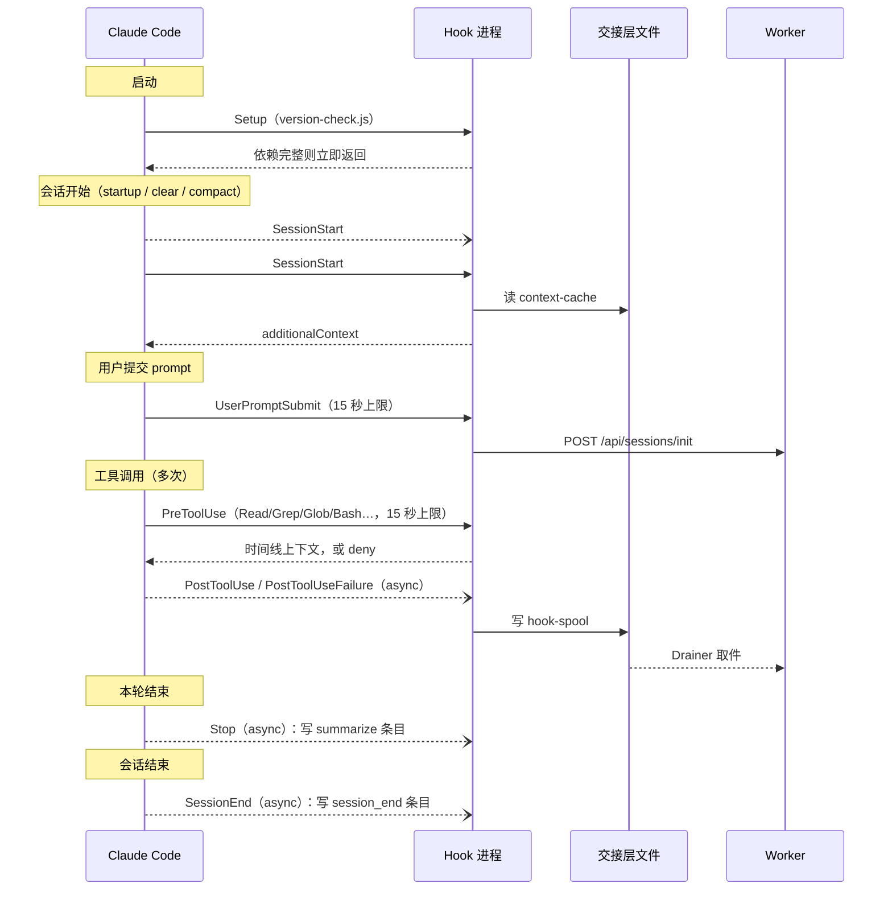
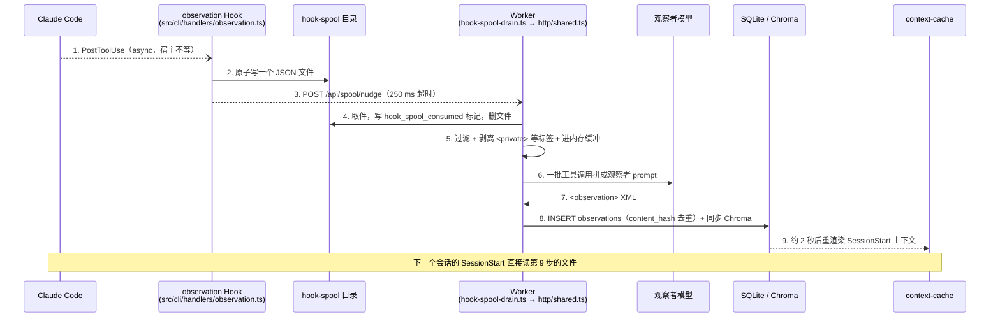

本章以 claude-mem v13.35.0 为准。v12 到 v13 之间，系统的四层骨架没有变，变的是层与层之间怎么交接：写入从“Hook 直接 POST 给 Worker”改成“Hook 落盘、Worker 来取”，读取从“每次现查”改成“Worker 预先渲染、Hook 直接读文件”。理解了这两处交接，后面几章的细节都能挂到正确的位置上。

## 源码探索路线图：从哪里开始读

如果你想自己读 claude-mem 源码，推荐沿着一条观察数据的去向走，30 分钟能走完：

```
1. plugin/hooks/hooks.json                  ← 入口：注册了哪些 Hook、哪些是 async
   ↓ 追踪 command 末尾的 "hook claude-code observation"
2. src/cli/hook-command.ts                  ← 所有 Hook 的统一入口（171 行）
   ↓ getEventHandler(event)
3. src/cli/handlers/observation.ts          ← PostToolUse 的处理器
   ↓ spoolHookEvent('observation', ...)
4. src/shared/hook-spool.ts                 ← 一个事件写一个 JSON 文件
   ↓ Worker 侧 HookSpoolDrainer 取走文件
5. src/services/worker/hook-spool-drain.ts  ← 把文件交给 ingestObservation
6. src/services/worker/http/shared.ts       ← 过滤、剥离隐私标签、入内存缓冲
7. src/services/worker/ClaudeProvider.ts    ← 观察者模型把工具调用压缩成 Observation
8. src/services/sqlite/SessionStore.ts      ← 落库
```

每一步都在追问“这条数据接下来去了哪里”。走通这条链路，系统的大半结构就清楚了。

## 四层架构与两处交接

claude-mem 的系统仍然分四层，每层职责边界清楚。v13 在第 2 层和第 3 层之间多了一个“交接层”，它不是独立进程，而是数据目录下的两组文件。整体结构如图 4-1 所示。



*图 4-1：v13 的四层架构与交接层。写路径经 hook-spool 解耦，读路径经 context-cache 解耦*

### Layer 1：宿主层

Claude Code 是闭源程序，claude-mem 只能通过它暴露的两个扩展点工作。

**Hook 系统**。v13.35.0 的 `plugin/hooks/hooks.json` 注册了 8 个事件：Setup、SessionStart、UserPromptSubmit、PreToolUse、PostToolUse、PostToolUseFailure、Stop、SessionEnd。v12.6.2 只注册了其中 6 个，没有 PostToolUseFailure（失败的工具调用，比如 Bash 非零退出）和 SessionEnd。另一个变化是 PostToolUse、PostToolUseFailure、Stop、SessionEnd 以及 SessionStart 里启动 Worker 的那一步都标了 `"async": true`，Claude Code 不再等它们返回。第 5 章逐个展开。

**MCP Client**。claude-mem 注册了一个名为 `mcp-search` 的 MCP Server，在本地 Worker 运行时下向模型暴露 19 个工具（第 9 章）。

过去 claude-mem 只能观察和注入，不能拦截。v13.32 之后有了一个例外：PreToolUse 钩子在满足一组严格条件时会返回 `permissionDecision: 'deny'`，拒绝 Claude 整文件读取一个大代码文件，改为引导它走结构化的局部读取（File Read Gate，第 8 章）。这是 claude-mem 目前唯一一处主动改变宿主行为的地方。

宿主也不再只有 Claude Code。`npx claude-mem install` 的宿主列表里有 17 个选项，从 Codex CLI、Cursor、Windsurf 到 Pi、DeepSeek Harness、OpenCode。不同宿主接入方式差别很大，第 18 章专门讲适配层。

### Layer 2：命令层

Hook 被触发后执行的是同一个打包文件里的 `hook` 子命令，入口是 `src/cli/hook-command.ts`。下面是去掉遥测和注释后的主干：

```typescript
// src/cli/hook-command.ts（v13.35.0，简化）
export async function hookCommand(rawPlatform: string, event: string): Promise<number> {
  const platform = canonicalIntegrationId(rawPlatform);

  // 环境变量可以直接关掉高频的工具 Hook（CLAUDE_MEM_DISABLE_TOOL_HOOKS 等）
  if (isToolHookDisabledByEnv(event)) {
    emitModelContext(getPlatformAdapter(platform), buildNoOpResult(event));
    return HOOK_EXIT_CODES.SUCCESS;
  }

  // 缓冲 stderr：第三方库的输出不会漏进模型上下文（L107）
  const stderrBuffer = installHookStderrBuffer();
  const adapter = getPlatformAdapter(platform);
  const handler = getEventHandler(event);

  try {
    const input = adapter.normalizeInput(await readJsonFromStdin());
    const result = await handler.execute(input);
    emitModelContext(adapter, result);      // stdout 只在这里写一次 JSON
    await settleHookSpoolNudges();          // 最多等 250 ms，让“唤醒 Worker”的请求发出去
    return result.exitCode ?? HOOK_EXIT_CODES.SUCCESS;
  } catch (error) {
    if (isWorkerUnavailableError(error)) {
      await recordWorkerUnreachable();      // 连续失败计数，达到阈值才提示一次
      return HOOK_EXIT_CODES.SUCCESS;
    }
    // 意外错误：记日志、写一行诊断，仍然返回 no-op 和 exit 0（L142-165）
    emitDiagnostic(`claude-mem: hook error, continuing without memory: ${String(error)}\n`);
    emitModelContext(adapter, buildNoOpResult(event));
    return HOOK_EXIT_CODES.SUCCESS;
  } finally {
    stderrBuffer.restore();
  }
}
```

命令层只做四件事：读 stdin、用平台适配器把输入标准化、调用事件处理器、把结果按平台格式写回 stdout。`src/cli/handlers/index.ts`（L94-104）注册了 9 个处理器：

| Handler | 对应事件 | 做什么 |
|---------|---------|--------|
| `context` | SessionStart | 读预渲染缓存或请求 Worker，注入记忆上下文 |
| `session-init` | UserPromptSubmit | 同步向 Worker 登记会话和本轮 prompt |
| `observation` | PostToolUse / PostToolUseFailure | 把工具调用写进 hook-spool |
| `file-context` | PreToolUse | 给文件读取附加历史时间线，必要时拒绝整文件读取 |
| `summarize` | Stop | 从 transcript 尾部取最后一条回复，写进 hook-spool |
| `session-end` | SessionEnd | 写一个 session_end 条目进 hook-spool |
| `file-edit` | Cursor 等宿主的编辑事件 | 以 `write_file` 工具的形式写进 hook-spool |
| `user-message` | 部分宿主的提示横幅 | 生成给用户看的 systemMessage |
| `session-init-context` | Kimi 的 UserPromptSubmit | 组合 session-init 和 context，因为 Kimi 不读 SessionStart 的输出 |

适配器在 `src/cli/adapters/` 下，覆盖 claude-code、codex、cursor、kimi、windsurf、antigravity-cli，未识别的平台走 `raw`。

### 交接层：hook-spool 与 context-cache

v12 的观察 Hook 会 `POST /api/sessions/observations`，等 Worker 回应后才退出。Worker 正在重启、正在启动或者卡住时，Hook 要么等到超时，要么丢数据。v13.30.0（#4368，标题是 “Liveness over deadlines”）把写路径改成了落盘：

```typescript
// src/cli/spool-hook-event.ts L174（v13.35.0）
export function spoolHookEvent<K extends HookSpoolKind>(kind: K, payload: HookSpoolPayloadByKind[K]): string {
  const entryPath = new HookSpool().enqueue(kind, payload); // 原子写一个 JSON 文件
  void nudgeWorkerToDrainHookSpool();                       // POST /api/spool/nudge，250 ms 超时，失败无所谓
  return entryPath;
}
```

文件写在 `~/.claude-mem/state/hook-spool/` 下，一个事件一个文件。文件名就是去重键：有 `tool_use_id` 时是“会话哈希-工具调用 ID”，没有时是事件内容的 SHA-256。同一个事件被宿主重复投递，只会覆盖同一个文件。下面是第 5 章的测试命令用合成输入写出的一个条目：

```json
{
  "kind": "observation",
  "payload": {
    "contentSessionId": "b",
    "platformSource": "claude",
    "toolName": "Edit",
    "toolInput": {},
    "toolResponse": {},
    "cwd": "/path/to/project",
    "toolUseId": "toolu_c1"
  },
  "enqueuedAtEpochMs": 1791791700841
}
```

Worker 侧的 `HookSpoolDrainer`（`src/services/worker/hook-spool-drain.ts`）从四个方向来取：启动时取一次，收到 Hook 的唤醒请求时取，`fs.watch` 发现目录变化时取，另外每 30 秒兜底扫一次（`SAFETY_SWEEP_INTERVAL_MS = 30_000`）。消费过的条目会在 Worker 数据库的 `hook_spool_consumed` 表里留一个标记，再删除文件；崩溃发生在两步之间也不会重复入库。超过 7 天还没被成功消费的条目移到 `expired/`，格式坏掉的移到 `corrupt/`，都不会静默删除。

读路径的思路相同。Worker 的 `ContextCacheService` 在数据变化后防抖 2 秒（`CONTEXT_CACHE_RENDER_DEBOUNCE_MS = 2_000`）重新渲染 SessionStart 上下文，写到 `~/.claude-mem/state/context-cache/`。SessionStart Hook 命中缓存就直接返回，不需要 Worker 在线。缓存超过 24 小时视为失效，Hook 改走实时请求。

### Layer 3：处理层

Worker 是一个常驻的 Express 5 HTTP 服务，由 Bun 运行。它承担所有耗时操作：

- **取件与过滤**：从 hook-spool 取事件，经过一串过滤（排除的项目、跳过的工具、子代理、私有 prompt 等）后放进每个会话的内存缓冲区
- **观察者生成**：把缓冲区里的工具调用交给观察者模型，解析出结构化 Observation 写库
- **上下文预渲染**：维护 context-cache
- **向量同步**：把新记录写进 Chroma
- **可选的外部同步**：cmem.ai 云同步（第 19 章）、transcript 监听（第 18 章）
- **SSE 广播**：给 Viewer 推送实时更新
- **进程管理**：端口与健康检查、单一 spawn 锁、优雅关闭（第 6 章）

Worker 的端口默认是 `37700 + (uid % 100)`（`src/shared/SettingsDefaultsManager.ts` L375），同一台机器上不同用户的 Worker 互不冲突；拿不到 uid 的平台（Windows）按 77 计算，得到 37777。

### Layer 4：存储层

**SQLite**（`~/.claude-mem/claude-mem.db`）：v13.35.0 新建一个库，`schema_versions` 的最大版本是 64。核心业务表仍是 `sdk_sessions`、`observations`、`session_summaries`、`user_prompts`，另有 `tool_uses`（原始工具输入输出）、`work_state_entries`（Agent 的待办清单）、`hook_spool_consumed` 以及一组 `sync_*` 表。全文索引 `observations_fts`、`session_summaries_fts` 由搜索层单独创建。第 7 章逐表展开。

**Chroma**：所有项目共用一个名为 `cm__claude-mem` 的 collection（`src/services/worker/DatabaseManager.ts` L45），按文档 metadata 里的 `project` 字段过滤。Worker 通过 uvx 启动 `chroma-mcp` 子进程，以 stdio 通信。

**MCP Server**：`plugin/scripts/mcp-server.cjs`，把 MCP 的 JSON-RPC 调用翻译成对 Worker 的 HTTP 请求。

### 第二种运行时：Server

v13.0.0 引入了一个可选的 Server 运行时：Postgres 存储、BullMQ 队列、API Key 鉴权、`/v1` REST 接口。Hook 侧用 `src/services/hooks/runtime-selector.ts` 决定往哪写：

```typescript
// src/services/hooks/runtime-selector.ts L39-45
export function selectRuntime(): SelectedRuntime {
  const settings = loadFromFileOnce();
  const raw = (settings.CLAUDE_MEM_RUNTIME ?? 'worker').trim().toLowerCase();
  if (raw === 'server' || raw === 'server-beta') return 'server';
  return 'worker';
}
```

选了 `server` 但服务端配置不完整时，`resolveRuntimeContext()` 回落到 `worker`；观察 Hook 发 `/v1/events` 失败且错误可回落时，也会退回本地 spool。默认安装始终是 `worker`，本书第 2 至 15 章讨论的都是它。Server 运行时放在第 16 章。

## 一次会话里的八个 Hook

八个事件在一次会话中的触发顺序如图 4-2 所示。实线箭头表示宿主要等 Hook 返回，虚线表示 async，宿主不等。



*图 4-2：v13.35.0 一次会话中八个 Hook 的触发时序*

图中能看出 v13 的取舍：除了启动时运行一次的 Setup，只有三类 Hook 仍是同步的。SessionStart 的 context 必须同步，因为它的输出要进模型上下文；UserPromptSubmit 要先登记本轮 prompt，后续观察才能挂到正确的轮次上；PreToolUse 需要同步才能拒绝一次读取。其余写操作都改成了“落盘即返回”，而且是 async，Claude Code 根本不等。

## 数据流全链路

以最高频的 PostToolUse 为例，一条观察从产生到能被下一个会话用上，经过图 4-3 中的路径。



*图 4-3：一次 PostToolUse 观察从产生到被下个会话使用的完整链路*

和 v12 相比，第 2、3、4 步取代了原来的“Hook 同步 POST，Worker 写 `pending_messages` 表”。第 5 步的内存缓冲也是新设计：v13.4.0 删掉了 `pending_messages` 持久队列，原因在第 6 章讲。

## 为什么用 Hook 采集，而不做成 Middleware

claude-mem 选择 Hook（外部命令触发）而不是嵌入式拦截，约束条件没有变：

1. **宿主大多是闭源的**：没法往里面塞中间件
2. **记忆故障不能影响宿主**：任何错误都不能让用户的会话卡住
3. **要覆盖多个宿主**：Claude Code、Codex、Cursor 等各有自己的事件格式
4. **安装要简单**：只改宿主的插件配置

Hook 模式带来的好处：宿主和 claude-mem 之间只有 stdin/stdout 上的 JSON，宿主升级不会牵连插件；每个 Hook 可以单独测试；支持一个新宿主通常只需要一个适配器（`src/cli/adapters/`）。

代价也很明确：每次 Hook 都是一次进程启动。本书在一台 4 核 Xeon 8255C 上用 v13.35.0 的打包文件实测，空的 Bun 进程启动约 12 ms，但加载 3.4 MB 的 `worker-service.cjs` 约 470 ms，再经过 `node bun-runner.js` 一层转发总计约 600 ms（第 5 章给出测法）。这笔开销放在同步路径上不可接受，这也是 v13 把绝大多数写 Hook 改成 async 的直接原因。

## 优雅降级：记忆挂了不能影响 IDE

v12 的错误处理分两级：Worker 不可用时 exit 0，代码错误（4xx、TypeError）时 exit 2。exit 2 在 Claude Code 里的含义是“阻断”：UserPromptSubmit 返回 2 会丢掉用户的 prompt，PreToolUse 返回 2 会拒绝这次工具调用，Stop 返回 2 会把 Agent 重新唤醒。一个记忆插件的 bug 因此能让用户的会话进入循环。v13.29.0（plan-17，#3161）取消了这一级，`hook-command.ts` 里任何意外错误都返回 no-op 和 exit 0，错误进日志、写一行诊断、发一条不含内容的遥测。

Worker 不可用的判定在 `src/shared/worker-utils.ts` L1902：

```typescript
// src/shared/worker-utils.ts L1902（v13.35.0，节选）
export function isWorkerUnavailableError(error: unknown): boolean {
  const lower = (error instanceof Error ? error.message : String(error)).toLowerCase();
  const transportPatterns = [
    'econnrefused', 'econnreset', 'epipe', 'etimedout', 'enotfound',
    'econnaborted', 'enetunreach', 'ehostunreach', 'fetch failed',
    'unable to connect', 'socket hang up', 'socket connection was closed', 'connection closed',
  ];
  if (transportPatterns.some(p => lower.includes(p))) return true;
  if (lower.includes('timed out') || lower.includes('timeout')) return true;
  if (/failed:\s*5\d{2}/.test(lower) || /status[:\s]+5\d{2}/.test(lower)) return true;
  if (/failed:\s*429/.test(lower) || /status[:\s]+429/.test(lower)) return true;
  return false;
}
```

这个函数现在只决定一件事：要不要累加“连续连不上 Worker”的计数。计数达到 `CLAUDE_MEM_HOOK_FAIL_LOUD_THRESHOLD`（默认 3）时，每个会话只提示一次“请运行 `npx claude-mem restart`”。不管哪条分支，退出码都是 0。

降级原则贯穿各层：

| 层 | 出错时的行为 |
|----|------------|
| Hook | 一律 exit 0；连续 3 次连不上 Worker 才提示一次 |
| 交接层 | 写不进 Worker 也已落盘；7 天内 Worker 回来就能补上 |
| Worker | 观察者遇到配额耗尽会熔断，冷却后只放一个探测请求（第 6 章） |
| 存储 | Chroma 不可用时搜索退回 SQLite；FTS5 不可用时退回 LIKE |

记忆是锦上添花，不是生命线。v13 的改动让这句话从“尽量做到”变成了代码层面的保证。

---

**思考题**

1. v13 把观察 Hook 改成“落盘即返回”，Worker 不在线时数据也不会丢。如果你要给一个需要强一致的场景（比如审计）设计记忆系统，spool 文件这一层还缺什么保证？
2. 四层架构里，交接层没有独立进程，只是两组文件。用文件而不是本地消息队列（比如一个常驻的 Redis）做交接，换来了什么，又放弃了什么？
3. File Read Gate 让 claude-mem 第一次拒绝了宿主的操作。如果你要给自己的插件加一个类似的“拦截”能力，至少要满足哪些条件才不会伤害用户？

---

下一章深入 Hook 系统，逐个解析八个事件的配置、超时和处理逻辑。

> 本书开源发布于 [inferloop.dev](https://inferloop.dev)，转载请注明出处。

---

> 本章来自《Agent Memory 工程实战》开源版 · 作者「递归客」  
> 在线阅读完整书系：[inferloop.dev](https://inferloop.dev)  
> 源码仓库：[github.com/diguike/book-claude-mem](https://github.com/diguike/book-claude-mem)
