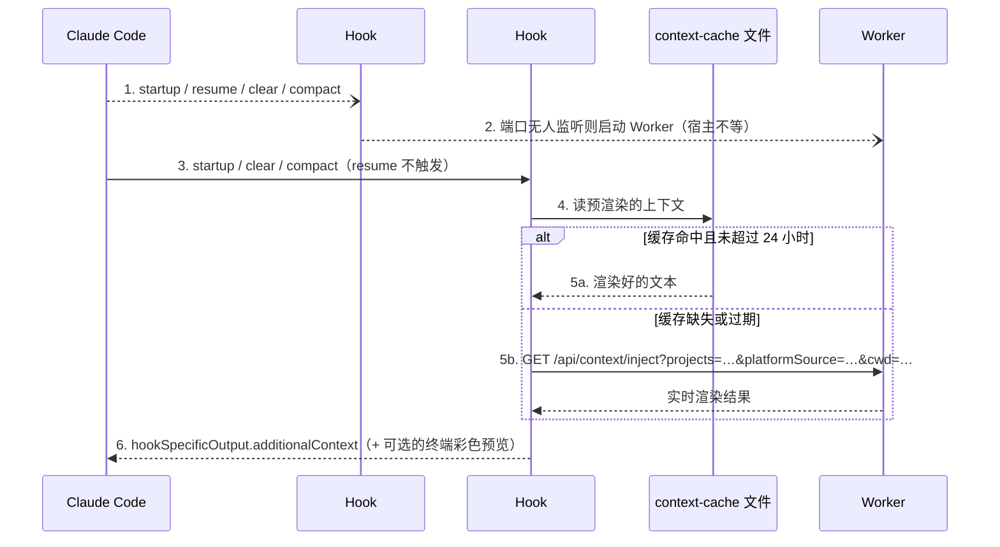
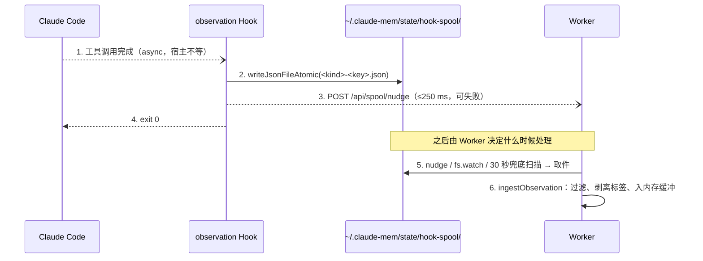

## Claude Code Hook 系统原理

如果你用过 Git Hooks（pre-commit、pre-push），Claude Code Hook 是同一类东西：特定事件发生时，宿主执行一条注册好的命令。区别在于 Git Hook 关注提交事件，Claude Code Hook 关注 AI 会话事件：会话开始、用户提交 prompt、工具调用前后、本轮结束、会话结束。

执行模型：

```
Claude Code 触发事件
  → 查找 matcher 命中的 Hook 配置
  → 构造 JSON，通过 stdin 交给 Hook 命令
  → 同步 Hook：等待 stdout 上的 JSON 和退出码，据此决定后续行为
  → async Hook：不等待，命令在后台跑完
```

claude-mem v13.35.0 的配置在 `plugin/hooks/hooks.json`，单条配置的结构如下（`command` 省略了前面一长段 PATH 和插件目录解析）：

```json
{
  "hooks": {
    "PostToolUse": [
      {
        "matcher": "*",
        "hooks": [
          {
            "type": "command",
            "shell": "bash",
            "command": "... node \"$_P/scripts/bun-runner.js\" \"$_P/scripts/worker-service.cjs\" hook claude-code observation ...",
            "timeout": 120,
            "async": true
          }
        ]
      }
    ]
  }
}
```

关键属性：

- `matcher`：匹配规则。`"*"` 匹配所有工具，`"startup|clear|compact"` 匹配 SessionStart 的触发源；也支持正则，比如 PreToolUse 的 `Read|^Bash$|^Grep$|^Glob$|^memory_search$|^memory$|^mcp__.+__memory_search$`
- `timeout`：秒。超时后宿主终止 Hook 进程
- `async`：为 `true` 时宿主不等 Hook 返回。这是 v13 新增的用法，v12.6.2 的六个 Hook 全是同步的
- `shell`：指定 bash，保证 PATH 和变量展开的行为一致

### 八个事件的配置一览

| 事件 | matcher | 处理器 | timeout | async | v12.6.2 时 |
|------|---------|--------|---------|-------|-----------|
| Setup | `*` | version-check.js | 300 | 否 | 同 |
| SessionStart #1 | `startup\|resume\|clear\|compact` | `worker-service.cjs start` | 60 | 是 | 同步，不含 resume |
| SessionStart #2 | `startup\|clear\|compact` | `hook … context` | 60 | 否 | 同 |
| UserPromptSubmit | 无 | `hook … session-init` | 15 | 否 | 60 秒 |
| PreToolUse | 见上文正则 | `hook … file-context` | 15 | 否 | 只匹配 `Read`，60 秒 |
| PostToolUse | `*` | `hook … observation` | 120 | 是 | 同步 |
| PostToolUseFailure | `*` | `hook … observation` | 120 | 是 | 无此 Hook |
| Stop | 无 | `hook … summarize` | 120 | 是 | 同步 |
| SessionEnd | 无 | `hook … session-end` | 宿主默认 | 是 | 无此 Hook |

每条命令末尾都包了一层 `|| { echo "claude-mem: hook command failed (exit $_S)" >&2; exit 0; }`。即使 Node、Bun 或打包文件出了问题，宿主看到的退出码仍然是 0。唯一的例外是 Setup：找不到 `version-check.js` 时它返回 1（非阻塞错误，Claude Code 只把 stderr 展示给用户）。

### 输入与输出

Claude Code 通过 stdin 传入的字段因事件而异。下面列出 claude-mem 的适配器（`src/cli/adapters/claude-code.ts`）实际读取的字段：

```typescript
// 通用字段
{ session_id, cwd, transcript_path, hook_event_name, agent_id?, agent_type? }

// SessionStart
{ source: 'startup' | 'resume' | 'clear' | 'compact' }
// UserPromptSubmit
{ prompt }
// PreToolUse / PostToolUse
{ tool_name, tool_input, tool_use_id, tool_response? }
// PostToolUseFailure（没有 tool_response，适配器把这两个字段拼成 tool_response）
{ tool_name, tool_input, tool_use_id, error, is_interrupt }
// Stop / SessionEnd
{ reason? }
```

`agent_id` 和 `agent_type` 只在子代理触发 Hook 时出现，claude-mem 用它们跳过子代理的观察和摘要。

Hook 的输出写在 stdout 上，常用的几种形态：

```typescript
// 不做任何事
{ continue: true, suppressOutput: true }

// SessionStart：把文本注入模型上下文
{ hookSpecificOutput: { hookEventName: 'SessionStart', additionalContext: '...' } }

// PreToolUse：附加上下文，或拒绝这次调用
{ hookSpecificOutput: { hookEventName: 'PreToolUse', additionalContext: '...' } }
{ hookSpecificOutput: { hookEventName: 'PreToolUse', permissionDecision: 'deny',
                        permissionDecisionReason: '...' } }

// 任意事件：给用户看的一行提示（不进模型上下文）
{ systemMessage: '...' }
```

## Hook 的 IO 纪律

v12 的 Hook 入口第一行是 `process.stderr.write = (() => true)`，把 stderr 整个吞掉，防止依赖库的警告混进输出。这么做的代价是真正的错误也看不见了。v13 换成了 `src/shared/hook-io.ts` 里的一套约定，把 Hook 的输出分成四种意图：

| 意图 | 去向 | 用途 |
|------|------|------|
| MODEL_CONTEXT | stdout 上的 JSON | 给模型看的内容，只能由 `emitModelContext` 写一次 |
| USER_HINT | `HookResult.systemMessage` | 给人看的短提示 |
| DIAGNOSTIC | stderr | 运维日志，不进模型 |
| EXIT_SIGNAL | 退出码 | 恒为 0 |

处理器（handler）被要求是“纯”的：只返回 `HookResult`，不直接碰 `process.stdout`、`process.stderr`、`console.*` 或 `process.exit`。执行期间 stderr 被 `installHookStderrBuffer()` 缓冲，任何一条退出路径都会丢弃缓冲；确实需要输出的诊断走 `emitDiagnostic` 绕过缓冲。这样第三方库的噪音不会进模型，claude-mem 自己的诊断又不会丢。

## Setup：依赖不全时在这里自愈

Setup 在每次 Claude Code 启动时运行一次，脚本是 `plugin/scripts/version-check.js`（v13.35.0 为 398 行，v12.6.2 只有 36 行）。

v12 的设计是“不打扰”：只比较 `.install-version` 标记文件，不一致就往 stderr 写一句 `run: npx claude-mem repair`，把修复留给用户。v13 改了主意。从插件市场安装或 `claude plugin update` 升级的用户，依赖可能从没装过，Worker 一启动就因缺模块崩溃，而用户根本没机会看到那句提示。现在的逻辑是：

- 依赖完整：只检查声明的模块能否解析，必要时补写标记文件，立即返回
- 依赖不完整：在 Setup 里执行 `bun install`（`BUN_INSTALL_TIMEOUT_MS = 120_000`），装完再验证一次，不完整就打印缺了哪些模块
- 不管结果如何，最终 `process.exit(0)`

这个取舍的依据是 Setup 的位置：它每次启动只跑一次，有 300 秒超时，不在每轮 prompt 的路径上。把可能耗时的自愈放在这里，比让每个后续 Hook 撞上一个起不来的 Worker 划算。

## SessionStart：两个 Hook，一个异步一个同步

SessionStart 在新会话开始时触发，claude-mem 注册了两条配置，执行顺序如图 5-1 所示。



*图 5-1：SessionStart 两个 Hook 的分工（处理逻辑在 `src/cli/handlers/context.ts`）*

两点和 v12 不同。

**启动 Worker 改成了 async**。v12 的 Hook #1 同步等 Worker 起来，冷启动时会把会话开始拖慢几秒。现在它在后台跑，Hook #2 先读缓存，读不到才去请求 Worker。

**resume 不注入**。用户用 `--continue`、`--resume` 或 `/resume` 恢复一个旧会话时，模型已经拥有当时的完整上下文。v13.30.1（#4423）发现，如果这时再注入一份新渲染的时间线，会改变对话的前缀，宿主侧的 prompt cache 全部失效。所以 Hook #2 的 matcher 去掉了 `resume`，处理器里还有一道兜底：

```typescript
// src/cli/handlers/context.ts L74-79
// --continue, --resume and /resume restore the existing conversation.
// A fresh timeline would change its prompt prefix and invalidate the cache.
if (input.platform === 'claude-code' && input.sessionSource === 'resume') {
  return emptyResult;
}
```

`contextHandler` 的其余步骤：

1. 当前目录命中 `CLAUDE_MEM_EXCLUDED_PROJECTS` 时返回空
2. 用 `getProjectContext(cwd)` 算出项目键。一个检出目录可能对应多个键（worktree 的父项目、改名前的旧名），全部传给 Worker
3. 默认只取当前宿主（`platformSource`）产生的记忆；`CLAUDE_MEM_SESSION_START_INCLUDE_ALL_SOURCES=true` 可以合并所有宿主
4. 先读 context-cache，未命中再走 HTTP
5. 在结果末尾追加一段“记忆使用说明”（`MEMORY_PLUGIN_INSTRUCTIONS`，可用 `CLAUDE_MEM_MEMORY_INSTRUCTIONS_ENABLED=false` 关闭），告诉模型用 `mem_search` 搜、用 `save_memory` 记、用 `work_state_write` 管待办
6. `CLAUDE_MEM_CONTEXT_SHOW_TERMINAL_OUTPUT` 为 true 时（默认），另取一份带颜色的版本放进 `systemMessage`，显示在用户终端里

注入的文本长什么样、为什么限定在 10,000 字符以内，是第 8 章的主题。这里只看开头几行：

```
# Work state: your to-do lists and working state
...
# [my-app] recent context, 2026-10-12 3:45pm GMT+8
Mode: Code Development (code)

Legend: 🎯session ●bugfix ◆feature ↻refactor ✓change ○discovery ⚖decision ⚠security_alert ⚷security_note ⊘sensitive
Format: ID TIME TYPE TITLE
...
```

## UserPromptSubmit：本轮 prompt 的登记

用户每提交一次 prompt，`sessionInitHandler`（`src/cli/handlers/session-init.ts`，417 行）同步执行。它的主干：

```typescript
// src/cli/handlers/session-init.ts（v13.35.0，简化）
if (!shouldTrackProject(cwd)) return noop;                         // 排除的项目
if (rawPrompt && isInternalProtocolPayload(rawPrompt)) return noop; // 只含 <task-notification> 的内部消息
if (isCodexInternalPrompt(rawPrompt)) return noop;                  // Codex 为自己的辅助线程发的 prompt

const initResult = await executeWithWorkerFallback('/api/sessions/init', 'POST', {
  contentSessionId: sessionId,
  project,
  prompt,
  platformSource,
  cwd,
}, { timeoutMs: sessionInitTimeoutMs });  // 整个往返只有一个预算

if (initResult.skipped && initResult.reason === 'private') return noop; // 整条 prompt 都在 <private> 里
```

这一步仍然同步，因为后面每一条观察都要挂到“第几轮 prompt”上，登记必须先于工具调用。v13 给它加了严格的时间预算：宿主超时从 60 秒降到 15 秒，处理器内部整个往返只有 `CLAUDE_MEM_SESSION_INIT_TIMEOUT_MS`（默认 10 秒，Windows 上 7 秒，因为 Windows 的进程启动更慢，预算看不到那部分开销）。

v13 还取消了“每条 prompt 一次观察者请求”。v12 会把用户 prompt 单独发给观察者模型，绝大多数时候得到一句“没什么可记的”。v13.30.0（#4336）改成把 prompt 带在下一次工具观察或摘要的请求里一起发，省掉一次模型调用；想恢复旧行为可以设 `CLAUDE_MEM_OBSERVE_BARE_PROMPTS=true`。

这个 Hook 还有一个默认关闭的能力：`CLAUDE_MEM_SEMANTIC_INJECT=true` 时，它会用本轮 prompt 去 `/api/context/semantic` 检索最相关的 5 条观察，作为 `additionalContext` 注入。默认关闭的原因和第 3 章讨论的一致：在用户刚说完话的瞬间由系统替模型挑记忆，命中率并不高。

## PostToolUse 与 PostToolUseFailure：落盘即返回

这是触发最频繁的 Hook，每次工具调用之后都会运行。v13.35.0 的处理器全文 122 行，主干如下：

```typescript
// src/cli/handlers/observation.ts（v13.35.0，简化）
export const observationHandler: EventHandler = {
  async execute(input) {
    const { sessionId, cwd, toolName } = input;
    const platformSource = normalizePlatformSource(input.platform);

    if (!toolName) return noop;
    if (isRecursiveMemoryTool(toolName)) return noop;       // claude-mem 自己的搜索工具不记
    if (!shouldTrackProject(cwd)) return noop;
    if (shouldSkipAgentObservation(input.agentId, input.agentType, settings).skip) return noop;

    const runtime = resolveRuntimeContext();
    if (runtime.runtime === 'server') {
      // Server 运行时：直接 POST /v1/events；可回落的错误继续往下走本地 spool
    }

    spoolHookEvent('observation', {
      contentSessionId: sessionId,
      platformSource,
      toolName,
      toolInput: input.toolInput,
      toolResponse: input.toolResponse,
      cwd,
      agentId: input.agentId,
      agentType: input.agentType,
      toolUseId: input.toolUseId,
    });
    return { continue: true, suppressOutput: true };
  },
};
```

处理器不解析、不压缩、不等 Worker。`spoolHookEvent` 写一个文件就返回，另起一个 250 ms 超时的 `POST /api/spool/nudge` 提醒 Worker 来取；Worker 不在线，这个请求失败也无所谓，文件已经落盘。数据流如图 5-2 所示。



*图 5-2：PostToolUse 的落盘交接（Hook 侧逻辑在 `src/cli/handlers/observation.ts`，Worker 侧在 `src/services/worker/hook-spool-drain.ts`）*

PostToolUseFailure 复用同一个处理器。Claude Code 对失败的调用（Bash 非零退出、被用户中断）发的是 PostToolUseFailure，输入里没有 `tool_response`，只有 `error` 和 `is_interrupt`。适配器把它们拼成 `{ error, is_interrupt }` 放进 `toolResponse`，观察者模型就能看到“这条命令失败了，失败原因是什么，是不是用户主动打断的”。v12 根本收不到这类事件，失败的尝试不会留下任何记忆。

## PreToolUse：文件上下文与读取闸门

PreToolUse 的 matcher 从 v12 的 `Read` 扩展到了 Read、Bash、Grep、Glob 以及宿主自带的记忆工具（`memory_search`、`memory`）。`fileContextHandler`（`src/cli/handlers/file-context.ts`，513 行）按顺序做三件事：

1. **记忆工具桥接**：如果这次调用的是宿主自己的记忆搜索（比如 Claude Code 的原生 memory 工具，或读取 `~/.claude/projects/<目录>/memory/` 下的笔记），用同一个查询在 claude-mem 里跑一次自动模式的渐进搜索，结果作为附加上下文。宿主的工具照常执行
2. **文件时间线**：要读的文件有历史观察时，把这些观察的标题按天列出来，附在这次读取前面。同一会话里同一文件只附一次，有了新观察才重新附
3. **整文件读取闸门**：满足全部条件时拒绝这次读取，引导模型改用 `smart_outline` / `smart_unfold` 和带 `offset`、`limit` 的局部读取

第 3 点需要同步执行才能生效，所以这个 Hook 是同步的，但 Worker 往返只有 3 秒预算（`FILE_CONTEXT_WORKER_BUDGET_MS = 3_000`），超时就放行。闸门的条件、实测收益和失效保护放在第 8 章讲。

## Stop 与 SessionEnd：收尾也不等待

### Stop：摘要请求

Claude 结束一轮回复时触发 Stop。`summarizeHandler` 的步骤：

1. `agent_id` 存在（子代理）则跳过，子代理的每次停止都生成摘要只会制造噪音
2. 取最后一条 assistant 消息。宿主在输入里直接给了就用它；没给就从 transcript 文件尾部倒着读。v13.30.0 起按块倒序读取，一个 2.16 GB 的 transcript 读取耗时约 1 ms、内存约 27 MB，此前整文件加载会在 2 GB 以上直接 `ENOMEM`
3. 同一次读取顺便拿到用户会话用的是哪个模型（`observed_model`），用于遥测
4. `CLAUDE_MEM_CAPTURE_ADVISOR_CALLS=true` 时，额外记录本轮 `advisor` 工具调用的建议原文（默认关闭）
5. 把 `{ contentSessionId, lastAssistantMessage, ... }` 写进 hook-spool，类型是 `summarize`

摘要本身由 Worker 生成，观察者模型按固定的 XML 结构输出：

```xml
<summary>
  <request>用户这轮要做什么</request>
  <investigated>查了什么</investigated>
  <learned>发现了什么</learned>
  <completed>完成了什么</completed>
  <next_steps>下一步</next_steps>
  <notes>补充说明</notes>
</summary>
```

没有值得总结的内容时，观察者应当回复 `<skip_summary reason="nothing durable" />`，而不是一段散文（`src/sdk/prompts.ts` 的 `buildSummaryPrompt`）。摘要只有这 6 个字段；`session_summaries` 表里的 `files_read`、`files_edited` 由 Worker 从本会话的观察里汇总，不是模型写的。

### SessionEnd：1.5 秒的预算

v12 的 hooks.json 里没有 SessionEnd Hook。v13 注册了 SessionEnd，处理器只有 40 行：

```typescript
// src/cli/handlers/session-end.ts（v13.35.0，节选）
// Claude Code gives plugin SessionEnd hooks a 1.5-second budget, so this hook
// only spools the request and pokes the worker; it never waits on the worker.
spoolHookEvent('session_end', { contentSessionId: sessionId, platformSource });
```

注释里的 1.5 秒是关键约束：宿主在关闭时只给插件这么一点时间。所以 SessionEnd 只写一个 `session_end` 条目，键只由会话和平台决定，宿主重复投递也只会覆盖同一个文件。Worker 取到后把会话标记为结束，未完成的摘要照常生成。v12 时代为了弥补 SessionEnd 缺失而存在的“SessionEnd 重放队列”目录，在 v13.30.0 被迁移进 hook-spool 后删除。

## Hook 的性能

上游文档 `docs/public/hooks-architecture.mdx` 给了一张耗时表（PostToolUse 平均 8 ms、p95 15 ms 等），但没有附测量脚本，从数量级看测的是处理器本身的逻辑。用户真正付出的是整个 Hook 进程的耗时，本书用 v13.35.0 的打包产物在本地实测了一组数据：

| 测量对象 | 耗时（3 次） |
|---------|------------|
| `node -e 0`（空 Node 进程） | 82–89 ms |
| `bun -e 0`（空 Bun 进程） | 12–15 ms |
| `bun worker-service.cjs hook claude-code <未知事件>`（只加载打包文件，走 no-op） | 466–480 ms |
| `bun worker-service.cjs hook claude-code observation`（加载 + 写 spool，无 Worker） | 501–554 ms |
| `node bun-runner.js worker-service.cjs hook claude-code observation`（hooks.json 实际的调用方式） | 591–639 ms |

测试环境：Intel Xeon Platinum 8255C（4 核）、Linux x86_64、Node 24.14.0、Bun 1.3.11，`CLAUDE_CONFIG_DIR` 和 `CLAUDE_MEM_DATA_DIR` 指向空目录，`CLAUDE_MEM_WORKER_AUTOSTART=false`。复现方法：

```bash
# 在 claude-mem v13.35.0 的检出目录里
IN='{"session_id":"b","cwd":"'$PWD'","tool_name":"Edit","tool_use_id":"toolu_1","tool_input":{},"tool_response":{}}'
time (echo "$IN" | CLAUDE_CONFIG_DIR=/tmp/cc CLAUDE_MEM_DATA_DIR=/tmp/cm \
  CLAUDE_MEM_WORKER_AUTOSTART=false \
  node plugin/scripts/bun-runner.js plugin/scripts/worker-service.cjs hook claude-code observation)
ls /tmp/cm/state/hook-spool/   # 应该多出一个 observation-<会话哈希>-toolu_1.json
```

注意 `CLAUDE_CONFIG_DIR`：如果你本机的 Claude Code 设置里禁用了 claude-mem 插件，Hook 会直接退出，什么都不写，测出来的时间没有意义。

数据说明两件事。第一，处理器逻辑只占 30–50 ms，大头是加载 3.4 MB 的打包文件，这部分开销与业务无关，只能靠“不让宿主等”来消化。第二，这正是 v13 把 PostToolUse、PostToolUseFailure、Stop、SessionEnd 都设成 async 的原因：每轮对话可能有几十次工具调用，每次多等 600 ms 是能感觉到的卡顿。每个会话里仍然同步的 Hook 中，SessionStart 一次会话只跑一次，UserPromptSubmit 一轮只跑一次，PreToolUse 在 Read 这类调用上每次都会付这笔启动开销，这是 File Read Gate 必须付出的代价。

### 其他工程细节

**PATH 不再走登录 shell**。v12 的每条命令都先执行 `$SHELL -lc 'echo $PATH'` 以拿到用户的完整 PATH，这会把用户 `.zshrc` 里的慢操作带进每个 Hook。v13.24.9（#3453）去掉了它，改为显式拼接几个常见位置：nvm 下最新的 Node、`~/.local/bin`、`/usr/local/bin`、`/opt/homebrew/bin`。

**插件目录按版本号选**。命令里那段很长的 shell 负责在 `CLAUDE_PLUGIN_ROOT` 不可用时自己找插件目录：遍历 `~/.claude/plugins/cache/thedotmack/claude-mem/` 下的版本目录，按语义版本号排序，跳过带 `.orphaned_at` 标记的旧版本。v13.12.1 之前按目录修改时间排序，Claude Code 给旧版本打孤儿标记时会更新它的 mtime，结果每次都选中旧版本，触发了一场 Worker 反复重启的事故（#3371）。

**bun-runner.js 桥接**。hooks.json 用 `node` 启动 `bun-runner.js`，再由它找到 Bun 去执行打包文件。宿主保证有 Node，不保证 Bun 在 PATH 上；`bun-runner.js` 负责在常见安装位置（包括 `BUN_INSTALL`、Volta 的 shim）里找到 Bun。

---

**思考题**

1. 本章实测中，加载打包文件占了 Hook 耗时的大头。如果让你把 PreToolUse 这个同步 Hook 的耗时降到 100 ms 以内，你会从哪里下手？（提示：是否一定要加载整个 Worker 的打包文件？）
2. hook-spool 用“文件名即去重键”避免同一事件重复入库。如果宿主在两次投递之间修改了事件内容（同一个 `tool_use_id`，不同的 `tool_response`），会发生什么？这是期望的行为吗？
3. SessionEnd 只有 1.5 秒。如果你的记忆系统需要在会话结束时做一件必须完成的事（比如把本地数据推到服务端），你会怎么设计？

---

> 本书开源发布于 [inferloop.dev](https://inferloop.dev)，转载请注明出处。

下一章深入 Worker Service：spool 取件、内存缓冲、观察者生成器和进程生命周期。

---

> 本章来自《Agent Memory 工程实战》开源版 · 作者「递归客」  
> 在线阅读完整书系：[inferloop.dev](https://inferloop.dev)  
> 源码仓库：[github.com/diguike/book-claude-mem](https://github.com/diguike/book-claude-mem)
