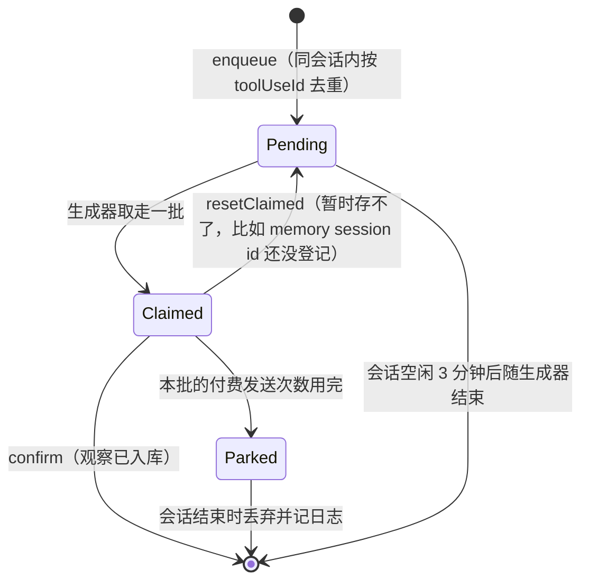
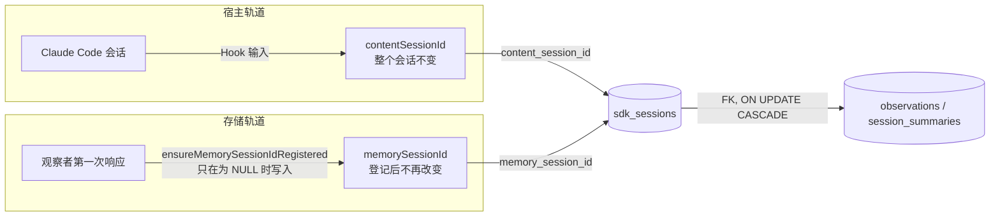
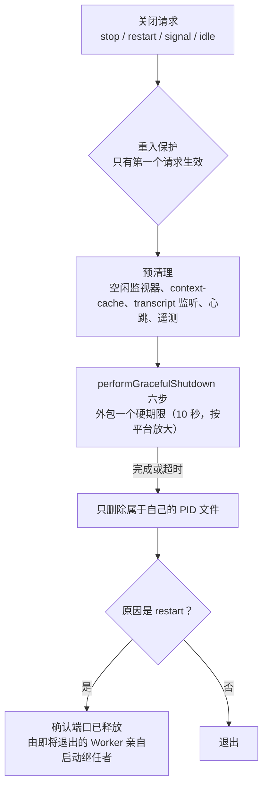

## 为什么需要后台 Worker

第 5 章实测过，一个 Hook 进程光是加载打包文件就要几百毫秒；观察者模型把一批工具调用压缩成 Observation，又要几秒到几十秒。两者都不能放在宿主的等待路径上，这决定了 claude-mem 必须有一个常驻进程来承担慢活：

```
Hook 进程（短命，每次事件一个）        Worker（常驻，每用户一个）
┌──────────────────────────┐         ┌───────────────────────────────┐
│ 读 stdin                  │  文件   │ 从 hook-spool 取件              │
│ 写 hook-spool/xxx.json   │───────→│ 过滤、剥离隐私标签              │
│ 唤醒 Worker（可失败）      │         │ 放进本会话的内存缓冲            │
│ exit 0                   │         │ 观察者模型压缩 → 写 SQLite     │
└──────────────────────────┘         │ 同步 Chroma、刷新 context-cache │
                                     └───────────────────────────────┘
```

Worker 是一个由 Bun 运行的 Express 5 服务（`src/services/worker-service.ts`，2,054 行）。第一次 SessionStart 时由 Hook 拉起，之后常驻；v13.32 起可以用 `CLAUDE_MEM_IDLE_EXIT_SEC` 让它在空闲一段时间后自行退出，下一个 Hook 会再把它拉起来。

## HTTP 层：路由按调用方分组

Worker 监听 `127.0.0.1` 上的用户专属端口（`37700 + uid % 100`）。`worker-service.ts` 的 `registerRoutes()`（L500 起）把路由按功能拆成十几个类。按调用方归纳如下：

| 调用方 | 代表端点 | 说明 |
|--------|---------|------|
| Hook | `POST /api/sessions/init`、`POST /api/spool/nudge`、`GET /api/context/inject` | 只有 session-init 和上下文读取是同步等待的 |
| MCP Server | `POST /api/mem-search`、`GET /api/search`、`GET /api/timeline`、`POST /api/observations/batch`、`POST /api/tool-uses/batch`、`/api/work-state` | 第 9 章 |
| Knowledge Agent | `POST /api/corpus/:name/prime` 等 | 第 11 章 |
| Viewer | `GET /stream`（SSE）、`GET /api/observations`、`DELETE /api/observation/:id` | 浏览器界面 |
| 运维 | `/health`、`/api/health`、`/api/readiness`、`/api/ready`、`/restart`、`/api/admin/*` | 健康检查与重启 |
| Server 运行时 | `/v1/*` | 第 16 章 |

v12 时代 Hook 调用的 `/api/sessions/observations` 和 `/api/sessions/summarize` 仍然存在，现在主要给其他宿主的集成和直接 API 调用者用。Claude Code 的 Hook 已经改走 hook-spool。

Worker 只监听本机地址，但浏览器也能访问它，这带来了 DNS 重绑定风险：恶意网页把自己的域名解析到 `127.0.0.1`，就能从浏览器里调用 Worker 的接口。v13.29.0（#3514）给 Worker 加了 Host 头检查，只接受 `localhost`、`*.localhost`、IP 地址、`CLAUDE_MEM_WORKER_HOST` 以及 `CLAUDE_MEM_ALLOWED_ORIGINS` 里声明的来源，其余一律 403。通过反向代理或 `.local` 域名访问 Viewer 的用户，需要把来源加进这个白名单。

## 取件：hook-spool 的“恰好一次”交接

Hook 写下的文件由 `HookSpoolDrainer`（`src/services/worker/hook-spool-drain.ts`，147 行）取走。触发取件的有四个来源：Worker 启动、Hook 的 `POST /api/spool/nudge`、`fs.watch` 发现目录变化，以及每 30 秒一次的兜底扫描。

每个条目交给与 HTTP 路由相同的 ingest 函数处理（`ingestObservation`、`ingestSummarize`、`ingestSessionEnd`）。交接点要防两类事故：Worker 在处理到一半时崩溃，条目丢了；或者崩溃后重启，同一条目被处理两次。`HookSpool.drain` 用一张小表 `hook_spool_consumed(entry_key, consumed_at_epoch_ms)` 解决：

1. 先查这个条目的键在不在表里。在，说明上次已经交接过、只是文件没来得及删，直接删文件
2. 调用 ingest。ingest 在把消息放进内存缓冲的那一刻，同步回调 `markHandedOff()`，往表里写入标记
3. 删除文件，再删除标记

崩溃发生在第 2 步写标记之前，文件还在、没有标记，下次重新处理；崩溃发生在写标记之后、删文件之前，下次看到标记就只删文件。后一种情况的代价是：这条事件已经进了内存缓冲，随进程一起丢了，对应的观察不会生成。“恰好一次”保证的是交接点不重复、不遗漏，不保证交接之后的处理一定完成。配套示例 `examples/ch06-worker-queue/` 模拟了这两种崩溃时机，可以直接看到两种结果。`ingestObservation` 里写标记的位置刻意放在入缓冲之后、启动生成器之前（`src/services/worker/http/shared.ts`）：

```typescript
// src/services/worker/http/shared.ts（v13.35.0，节选）
sessionManager.queueObservation(sessionDbId, { tool_name, tool_input, tool_response, ... });
// Enqueued: the hand-off point. Synchronously, before the generator kick.
handoff.markHandedOff?.();
await ensureGeneratorRunning?.(sessionDbId, 'observation');
```

取件还要守一个顺序：同一会话还有观察条目没被接收时，它的 summarize 和 session_end 条目留在目录里排队，摘要不会跑到它要总结的工作前面。session-init 还没到达时，这两类条目会返回 `unknown_session`，同样留到下一次取件；超过 7 天仍未成功的移进 `expired/` 并记错误日志。

## 内存缓冲：为什么删掉了持久队列

v12 的 Worker 收到观察后写进 SQLite 的 `pending_messages` 表，状态从 pending 到 processing 再到删除，崩溃重启后从表里恢复。v13.4.0（提交 61fe70a20）删掉了这套机制，换成每个会话一个内存缓冲 `SessionMessageBuffer`（328 行）。源码头部的注释交代了原因，大意是：

> 缓冲里的每条消息，是喂给一个有状态、非确定性的 reducer 的片段：观察者模型借助内存里的对话上下文，把 N 次工具调用合并成 M 条 Observation。持久队列保存了片段，却丢掉了 reducer 的状态。崩溃后重放这些行，要么生成和上次不同的观察，要么重复生成，要么陷入死循环，这就是当时的“重试风暴”。Claude Code 的 transcript JSONL 才是真正持久的事实来源，恢复路径是重放 transcript。

这段话值得记住的是它对“持久化”的判断：持久化一段中间状态，前提是重放这段状态能得到确定的结果。观察者生成不满足这个前提，所以 v13 只在 Hook 到 Worker 的交接点做持久化（hook-spool），交接之后的处理全在内存里，Worker 进程死了缓冲也就没了。`pending_messages` 表在新库里仍会创建，但已经没有代码写它。

内存缓冲里的消息有一个简单的生命周期，如图 6-1 所示。



*图 6-1：SessionMessageBuffer 中一条消息的状态流转（`src/services/worker/SessionMessageBuffer.ts`）*

`Parked` 是 v13.30.0 加的一个状态。观察者请求失败时，有时无法判断模型到底有没有处理（比如连接在响应途中断开），重发可能被计费两次。`PaidSendBudget`（`src/services/worker/paid-send-budget.ts`）给每一批消息最多 2 次付费发送：第一次，加上结果不明确时的一次重发。用完仍不成功，这批消息被“停放”，不再重试，也不再计入待处理数，后面的消息可以继续流动。

## 观察者生成器

每个活跃会话有一个“生成器”负责把缓冲里的消息交给观察者模型。对 Claude 来说，它是一次长期运行的 Agent SDK 调用，prompt 不是一个字符串，而是一个异步迭代器：

```typescript
// src/services/worker/ClaudeProvider.ts（v13.35.0，简化）
const messageGenerator = this.createMessageGenerator(session, ...); // 从缓冲里一批批取消息，拼成 prompt
const queryResult = query({
  prompt: messageGenerator,
  options: buildHardenedSdkOptions({
    source: 'Observer',
    model: modelId,
    env: isolatedEnv,                       // 来自 ~/.claude-mem/.env 的隔离凭据
    pathToClaudeCodeExecutable: claudePath,
    spawnClaudeCodeProcess: createSdkSpawnFactory(..., ['--no-session-persistence']),
  }),
});
for await (const message of queryResult) {
  // 解析 <observation> / <summary>，写库，confirm 缓冲里对应的消息
}
```

几个关键点：

**观察者不能动手**。`buildHardenedSdkOptions`（`src/sdk/hardened-options.ts`）给观察者会话关掉了所有工具，并且用了 6 层互相冗余的限制，第 10 章展开。`--no-session-persistence` 让观察者会话不写 transcript，不会污染用户的项目目录。

**不止一种模型**。`CLAUDE_MEM_PROVIDER` 可选 `claude`（默认，走 Claude Agent SDK 和用户的 Claude 账号）、`gemini`、`openrouter`、`openai-compatible`（任意 OpenAI 兼容接口，内置 deepseek、ollama、vllm 等预设）和 `codex`（走 Codex CLI 和 ChatGPT 订阅）。后四种在 Worker 里共用 `OpenAICompatibleProvider` 这个基类的会话生命周期。

**按批次复杂度选模型**。Claude 路径下，如果待处理的消息全是 Read、Glob、Grep 这类只读工具，用 `CLAUDE_MEM_TIER_SIMPLE_MODEL`（默认 `haiku`）；包含摘要请求时用 `CLAUDE_MEM_TIER_SUMMARY_MODEL`（默认为空，即默认模型）。这段逻辑在 `SessionRoutes.applyTierRouting()`，可以用 `CLAUDE_MEM_TIER_ROUTING_ENABLED=false` 关掉。

### 分代：对话满了就换一代

观察者和用户会话一样，是一段越来越长的对话：每次工具调用都追加一条消息。v12 没有给它设上限，一个繁忙的会话最终会撞上“Prompt is too long”，之后每次请求都必然失败。v13 的解法不是裁剪对话，而是“分代”（`src/shared/observer-recycle.ts`）：

- 一代对话的字符数接近上限时，主动结束这一代，开一个新的
- 上限默认 400,000 字符（约 10 万 token，200K 窗口的一半）；模型窗口更小时取窗口的一半
- 新一代不是从零开始，而是用本会话已经写下的 Observation 播种，用的正是 SessionStart 注入给用户会话的那份上下文

源码注释里的一句话概括了这个设计：“Continuity is carried by the memory the product exists to produce, not by raw turns.” 记忆系统自己的产出，正好可以用来压缩它自己的工作上下文。第 3 章讨论 Compaction 时会回到这个例子。

### 配额熔断：不为必然失败的请求付费

观察者和用户共用账号额度。额度用完以后，每次工具调用都会触发一次注定被拒绝的请求：生成器因拒绝退出，下一次工具调用又拉起一个新生成器，再被拒一次。v13 的修复说明里记录过一个数据：11 个额度耗尽的用户一天产生了几万次拒绝，大约每成功写一条观察就有 100 次无效请求。

`src/shared/quota-cooldown.ts` 是一个按 provider 区分的熔断器：

- 收到“额度耗尽”后打开，冷却期内不发请求
- 冷却期结束后只放行一个探测请求，成功就关闭，失败继续冷却
- 打开状态写在磁盘上，Worker 重启不会清空；“谁在探测”的占位不落盘，避免一个已经死掉的进程永远占着探测名额

可选的 `CLAUDE_MEM_QUOTA_FALLBACK_PROVIDER` 允许在主 provider 冷却期间临时切到另一个 provider，鉴权失败则永远不会被这样绕过。

## Session ID 双轨制

claude-mem 里有两个会话 ID：

| ID | 来源 | 用途 |
|----|------|------|
| `contentSessionId` | 宿主分配（Claude Code 的 `session_id`） | 关联 Hook 输入，按宿主会话查询 |
| `memorySessionId` | 观察者 SDK 会话第一次返回的 `session_id` | `observations`、`session_summaries` 的外键 |

两条轨道在 `sdk_sessions` 表里汇合，如图 6-2 所示。



*图 6-2：两条 Session ID 轨道（`src/services/sqlite/SessionStore.ts` L2712 起）*

v12 时代 `memorySessionId` 是观察者 SDK 会话的 resume 句柄，Worker 重启后会换新值。v13 里它的语义收窄成了“首次登记后固定的存储键”，原因来自一次事故。v13 的观察者每一代都是全新的 SDK 进程，从不 resume（`ClaudeProvider` 里 `shouldResume` 固定为 false），每一轮都会拿到一个新的 SDK session_id。旧代码的判断条件是“新值和库里不同就覆盖”，于是每一轮都在改写这个外键，而 `ON UPDATE CASCADE` 会把这个会话的全部观察一起改写，云同步的发件箱再为每次改写排一条同步任务。源码注释里记录了一个用户库的实测：`sync_outbox` 积压了 1,100,783 行，对应 6,930 条 prompt，放大 158.8 倍，占用 393 MB。v13.24.17（#4027）把条件改成了“只在为 NULL 时写入”。

## 进程管理：以端口和健康检查为准

### 存活的判定

v12 用 PID 文件判断 Worker 是否存活。PID 会被操作系统复用，进程可能活着但已经卡死，一个正在退出的 Worker 还可能删掉继任者刚写下的 PID 文件。v13.5.6（#2894）把判定标准改成“端口上有没有一个能回答 `/api/health` 的 Worker”，PID 文件降级为诊断信息，所有删除 PID 文件的地方都要先确认文件属于自己。

启动阶段也不再靠猜。`GET /api/ready` 以流的形式报告启动进度（`src/services/server/init-phase.ts`）：

```
starting → db_ready → routes_ready → ready
                                  ↘ failed{message}
```

Hook 读一次这个流就知道 Worker 是在启动中、已就绪还是启动失败，不必再按“启动超过 300 秒就当它卡死了”这样的经验值判断。

### 只允许一个进程去启动 Worker

多个 Hook 和 MCP Server 可能同时发现 Worker 不在，各自去启动一个，结果是多个 Worker 抢同一个端口。`src/shared/worker-spawn-gate.ts` 用一个锁文件 `<DATA_DIR>/spawn.lock` 串行化所有启动路径：用 `wx` 标志（`O_CREAT|O_EXCL`）原子创建，创建成功的进程去启动，失败的等它的结果；锁文件 90 秒没刷新视为陈旧，可以被接管。

### 版本不一致时谁来重启

插件升级后，正在运行的 Worker 可能还是旧版本。v13.12.3 之前的处理是让 Hook 请求旧 Worker 自己重启，而旧 Worker 会用旧版本的代码拉起继任者，于是继任者还是旧版，下一个 Hook 再要求重启……有用户一天里记录到 2,424 次回收，每次 UserPromptSubmit 都卡满 40 秒超时。现在的做法是 Hook 自己动手：读取经过所有者校验的 PID 文件，对旧 Worker 发 `SIGKILL`，等端口真正释放，再用解析出的新版本启动。`SIGKILL` 是唯一保证不执行任何旧版本代码的退出方式。

### 后台清理

- supervisor 每 30 秒清理一次进程注册表里已经死掉的条目（`src/supervisor/health-checker.ts`）
- Worker 启动时扫描一遍进程表，找出不属于任何 Worker 的 `chroma-mcp` 进程树并终止（`src/supervisor/orphan-chroma-sweep.ts`）。注释里记录过有机器积累了 619 和 808 对这样的孤儿进程
- MCP Server 每 30 秒检查一次父进程是否还在，父进程退出就自行退出

上游的 `docs/architecture-overview.md` 里写有一个“每 5 分钟执行一次的 Orphan Reaper”，在 v12.6.2 和 v13.35.0 的代码里都找不到对应实现，这里以代码为准。

## 优雅关闭：六步加一个硬期限

`src/services/infrastructure/GracefulShutdown.ts`（93 行）里的 `performGracefulShutdown()` 仍是六步，顺序从外到内：

```typescript
// src/services/infrastructure/GracefulShutdown.ts（v13.35.0，简化）
export async function performGracefulShutdown(config: GracefulShutdownConfig): Promise<void> {
  if (config.server) await closeHttpServer(config.server); // 1. 断开连接、停止监听
  await config.sessionManager.shutdownAll();                 // 2. 结束所有会话和生成器
  if (config.mcpClient) await config.mcpClient.close();      // 3. 关闭 MCP client
  if (config.chromaMcpManager) await config.chromaMcpManager.stop(); // 4. 停止 chroma-mcp
  if (config.dbManager) await config.dbManager.close();      // 5. 关闭 SQLite
  await getSupervisor().stop();                              // 6. 停止子进程管理器
}
```

`closeHttpServer` 先 `closeAllConnections()` 再 `close()`；Windows 上前后各等 500 ms 让系统回收端口。v13.12.4 修了一个细节：`server.close()` 返回 `ERR_SERVER_NOT_RUNNING` 时视为已经关闭，不再当作致命错误跳过后面五步（这曾导致 Windows 上端口一直被占）。

v12 的这个流程有两个缺口：没有超时兜底，也不清理 PID 文件。v13.5.6 把外层调用改成了 `src/services/worker-shutdown.ts` 里的 `runShutdownSequence()`，补上了这两点，如图 6-3 所示。



*图 6-3：v13 的 Worker 关闭序列（`src/services/worker-shutdown.ts`，193 行）*

期限存在的理由写在注释里：会话收尾曾被观察到需要 35–40 秒。超时后不再等待，直接进入后续步骤。重启时由即将退出的 Worker 亲自启动继任者，新旧两个进程永远不会同时存在，也没有第三方进程能在端口释放的空当里抢先启动。

---

**思考题**

1. v13 选择“交接点持久化、处理过程放内存”。如果观察者生成是确定性的（比如纯规则提取），你还会删掉持久队列吗？给出你的判断标准。
2. 付费重发预算固定为 2 次。如果你的观察者跑在本地免费模型上，这个值应该怎么调？哪些场景下重发本身就是错误的？
3. 版本不一致时，v13 宁可用 `SIGKILL` 也不让旧 Worker 优雅退出。优雅退出能保证什么、`SIGKILL` 会丢掉什么？在这个场景里为什么后者是可以接受的？

---

> 本书开源发布于 [inferloop.dev](https://inferloop.dev)，转载请注明出处。

下一章深入存储层：SQLite 表结构、FTS5 查询构造、Chroma 文档拆分和搜索路由。

---

> 本章来自《Agent Memory 工程实战》开源版 · 作者「递归客」  
> 在线阅读完整书系：[inferloop.dev](https://inferloop.dev)  
> 源码仓库：[github.com/diguike/book-claude-mem](https://github.com/diguike/book-claude-mem)
