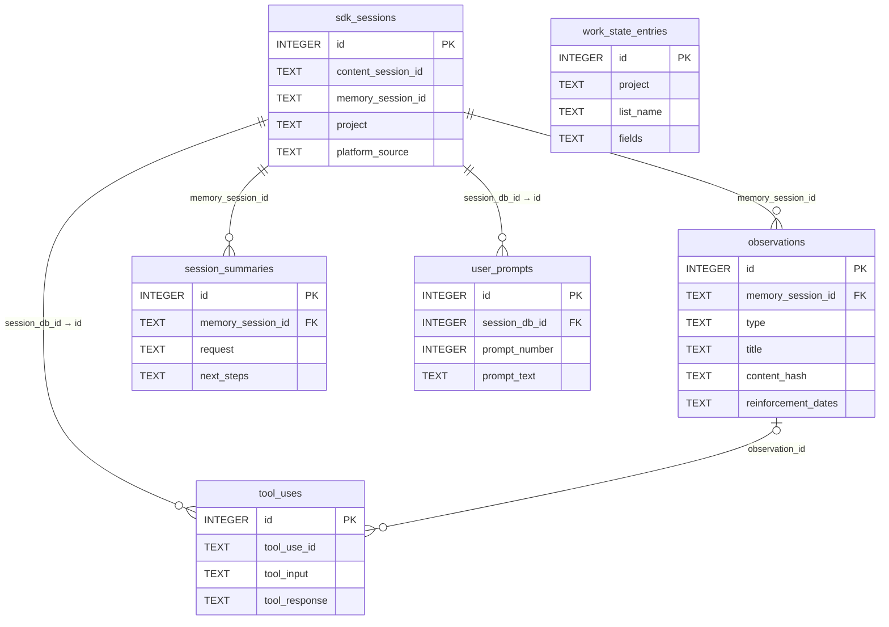
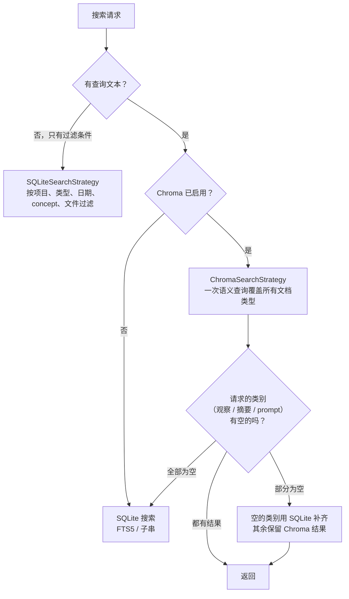

## SQLite：从 6 张表到 21 张表

claude-mem 的持久化存储是一个 SQLite 文件 `~/.claude-mem/claude-mem.db`，通过 Bun 内置的 `bun:sqlite` 访问。为了不凭记忆描述表结构，本书分别用 v12.6.2 和 v13.35.0 的 `SessionStore` 初始化了一个空库，再读出 `sqlite_master`：

| | v12.6.2 | v13.35.0 |
|---|---|---|
| `schema_versions` 最大版本 | 32 | 64 |
| 表（含 `schema_versions`，不含 FTS 虚拟表及其影子表、`sqlite_sequence`） | 6 | 21 |

v13.35.0 新库里的表按用途分组：

| 用途 | 表 |
|------|----|
| 核心记忆 | `sdk_sessions`、`observations`、`session_summaries`、`user_prompts` |
| 原始证据 | `tool_uses`（工具调用的原始输入输出）、`advisor_calls` |
| Agent 的工作状态 | `work_state_entries` |
| 交接与去重 | `hook_spool_consumed`、`observation_dedup_candidates`、`dedup_meta`、`token_df` |
| 云同步 | `sync_outbox`、`sync_content_outbox`、`sync_dead_letter`、`sync_entity_heads`、`sync_launch_exclusions`、`sync_pull_quarantine`、`sync_state` |
| 通知 | `telegram_wrapups` |
| 遗留 | `pending_messages`（仍会创建，已无代码写入） |

另有两张 FTS5 虚拟表 `observations_fts` 和 `session_summaries_fts`，由搜索层 `SessionSearch` 在构造时创建，不在上面的初始化流程里。有些介绍 claude-mem 的资料提到过一张 `observation_feedback` 表，用来记录 viewed、fetched、cited 三种使用信号。这张表只存在于 v12.6.2 一个已经不被调用的迁移文件和一篇架构文档里，实际建库流程从未创建过它，v13 中相关代码也已删除。第 10 章会介绍 v13 里真正承担“使用反馈”作用的机制。

### 核心表的字段

下面只列每张表里与本书相关的字段，完整列名可以用 `PRAGMA table_info(<表名>)` 查到：

```sql
-- 会话：一行对应宿主里的一个会话
sdk_sessions (
  id, content_session_id, memory_session_id, project, platform_source,
  user_prompt, status, prompt_counter, custom_title,
  observed_model, observed_billing,        -- v13.22：用户会话用的模型与计费类型（遥测）
  cwd, project_key_source,                 -- 项目键是怎么算出来的：path / git-remote / environment
  started_at_epoch, completed_at_epoch
)

-- 观察：AI 压缩后的记忆单元
observations (
  id, memory_session_id, project, type, title, subtitle, narrative, text,
  facts, concepts, files_read, files_modified,         -- JSON 数组字符串
  prompt_number, discovery_tokens, content_hash, generated_by_model,
  agent_type, agent_id, merged_into_project, metadata,
  occurrence_count, title_norm_key,                     -- 近重复去重
  reinforcement_dates, last_reinforced,                 -- ACT-R 强化历史
  synced_at, origin_device_id, origin_local_id, sync_rev, -- 云同步
  created_at, created_at_epoch
)

-- 会话摘要：注意是 files_edited，不是 files_modified
session_summaries (
  id, memory_session_id, project, request, investigated, learned, completed,
  next_steps, notes, files_read, files_edited, prompt_number, discovery_tokens, ...
)

-- 用户 prompt
user_prompts (
  id, session_db_id, content_session_id, prompt_number, prompt_text,
  native_prompt_id, native_prompt_hash,    -- v13.34：宿主侧的 prompt 身份，重试幂等
  ...
)

-- 原始工具调用（v51 起，get_tool_uses 的数据来源）
tool_uses (
  id, tool_use_id, content_session_id, memory_session_id, session_db_id, project,
  platform_source, tool_name, tool_input, tool_response, cwd, prompt_number,
  agent_type, agent_id, observation_id, content_hash, created_at_epoch, ...
)

-- Agent 的待办与工作状态（v61 起，只追加不修改）
work_state_entries (id, project, list_name, fields, created_at, created_at_epoch)
```

几张表之间的关系如图 7-1 所示。



*图 7-1：v13.35.0 的核心表关系（字段只列关键项；`work_state_entries` 按项目独立存放，不挂在会话下）*

`observations` 和 `session_summaries` 到 `sdk_sessions` 的外键带 `ON UPDATE CASCADE`，改动一个会话的 `memory_session_id` 会改写它的全部记忆。第 6 章讲过，这正是 v13.24.17 把这个字段改成“只登记一次”的原因。

`tool_uses` 是 v13 的一个重要补充。v12 只保存观察者写出的摘要，原始的工具输入输出在观察生成后就丢了。现在 Worker 在入缓冲的同时把原始数据写一份到 `tool_uses`（`ingestObservation` 里的“dual-write”），摘要说不清楚时，模型可以通过 MCP 工具 `get_tool_uses` 拿到原文。这一层是渐进披露的第 4 层，第 8 章会讲到。

### 迁移：每一步都可以重复执行

v13 的 schema 演进没有用独立的迁移文件，而是在 `SessionStore` 构造时依次调用一串 `ensureXxx()` 方法。每个方法先检查“表或列是否已经存在”，不存在才执行，执行完往 `schema_versions` 插一行。重复执行没有副作用，旧库升级和新库初始化走同一条路径。

这种写法的代价是 `SessionStore.ts` 很长（v13.35.0 为 4,637 行），好处是升级过程中崩溃不会留下“版本号写了一半、列没加上”的状态：下次启动时会重新检查列，而不是相信版本号。v13 还给 schema 修复加过几次兜底，比如历史上存在没有父会话的孤儿观察时，迁移会先补一个占位父会话再重建表（v13.12.4），用户数据从不删除。

### 为 SessionStart 建的索引

SessionStart 要取“这个项目最新的 50 条观察”。v13.31.0 之前的查询会把项目（包括合并进来的 worktree）的所有观察全部取出再排序，一个 1.2 GB 的库每次会话开始要读约 21,700 行（63 MB），冷缓存时耗时 0.8–1.7 秒。schema 版本 63、64 加了按项目（大小写不敏感）和时间倒序的复合索引，以及覆盖索引，同样的查询读几百个页面即可，约 4 ms；解析项目别名的查询从读 7,499 个页面降到 355 个，约 9 ms：

```sql
CREATE INDEX idx_observations_project_nocase_recent
  ON observations(project COLLATE NOCASE, created_at_epoch DESC);
CREATE INDEX idx_observations_merged_into_nocase_recent
  ON observations(merged_into_project COLLATE NOCASE, created_at_epoch DESC);
```

`COLLATE NOCASE` 来自另一个修复：大小写不同的同名目录（`MyApp` 与 `myapp`）在 macOS 上是同一个目录，项目键应当相同（v13.29.0）。

## PRAGMA 与并发

SQLite 连接的初始化在 `src/services/sqlite/connection.ts`：

```typescript
// src/services/sqlite/connection.ts L44-55（v13.35.0）
runRequiredPragma(db, 'PRAGMA busy_timeout = 5000', 'busy_timeout');
runRequiredPragma(db, 'PRAGMA foreign_keys = ON', 'foreign_keys');
runRequiredPragma(db, 'PRAGMA synchronous = NORMAL', 'synchronous');
runRequiredPragma(db, 'PRAGMA journal_size_limit = 4194304', 'journal_size_limit');
if (enableIncrementalAutoVacuum && !hasUserTables(db)) {
  runRequiredPragma(db, 'PRAGMA auto_vacuum = INCREMENTAL', 'auto_vacuum'); // 只能在空库上设置
}
if (enableWal) {
  runRequiredPragma(db, 'PRAGMA journal_mode = WAL', 'journal_mode');
}
```

和 v12.6.2 比，`temp_store = memory`、`mmap_size = 256MB`、`cache_size = 10000` 三项被移除，新增了三项：

- `busy_timeout = 5000`：Worker、Hook 和 MCP 进程会同时访问这个文件，遇到写锁时最多等 5 秒，而不是立刻抛 `SQLITE_BUSY`（v13.10.2）
- `journal_size_limit = 4MB`：限制 WAL 文件在检查点之后保留的大小，防止它无限增长
- `auto_vacuum = INCREMENTAL`：删除数据后可以逐步回收空间。这个设置只能在建表前生效，所以只对新库执行

WAL 模式的作用没有变：读写互不阻塞。v13 还做了一件事：SessionStart 生成上下文时以只读方式打开数据库（`new Database(DB_PATH, { readonly: true })`，#3233），多个会话同时开始时不会争写锁。

## FTS5 全文搜索

### 建表

```sql
-- src/services/sqlite/SessionSearch.ts（v13.35.0）
CREATE VIRTUAL TABLE IF NOT EXISTS observations_fts USING fts5(
  title, subtitle, narrative, text, facts, concepts,
  content='observations',
  content_rowid='id'
);
```

没有显式指定 `tokenize`，使用默认的 `unicode61` 分词器。同步靠三个触发器。v13.29.0（#3284）把更新触发器改成只在被索引的列变化时触发：

```sql
CREATE TRIGGER IF NOT EXISTS observations_au
AFTER UPDATE OF title, subtitle, narrative, text, facts, concepts ON observations BEGIN
  INSERT INTO observations_fts(observations_fts, rowid, title, subtitle, narrative, text, facts, concepts)
  VALUES('delete', old.id, old.title, old.subtitle, old.narrative, old.text, old.facts, old.concepts);
  INSERT INTO observations_fts(rowid, title, subtitle, narrative, text, facts, concepts)
  VALUES (new.id, new.title, new.subtitle, new.narrative, new.text, new.facts, new.concepts);
END;
```

v12 的触发器是 `AFTER UPDATE ON observations`，任何一列变化都会删一次、插一次索引。云同步每次给一行打上 `synced_at` 时间戳，强化排序每次追加一个日期，都会触发一次无意义的重建，FTS 索引因此膨胀。同一个版本还删掉了从没被查询过的 `user_prompts_fts`，并在 Worker 启动一分钟后分小步合并已有的索引碎片。

### 查询构造

v12.6.2 把用户输入整体包成一个短语：

```typescript
// v12.6.2 src/services/sqlite/SessionSearch.ts
const escapedQuery = '"' + query.replace(/"/g, '""') + '"';
```

整体包成短语能防住语法注入，代价是 `auth timeout` 只能匹配这两个词紧挨着出现的记录。v13.29.0（#4180）改成“每个词都要出现，位置不限”：

```typescript
// src/services/sqlite/SessionSearch.ts L360-371（v13.35.0）
private static buildFTSMatchQuery(query: string): string {
  // 没有字母或数字的 token（单独的 -、&、—）直接丢掉：unicode61 不会为它们建索引，
  // 留着会变成一个永远匹配不到的空短语，AND 进去会让整个查询返回空
  const tokens = (query.match(/\S+/g) ?? []).filter(token => /[\p{L}\p{N}]/u.test(token));
  if (tokens.length === 0) {
    return `"${query.replace(/"/g, '""')}"`;
  }
  return tokens
    .map(token => `"${token.replace(/"/g, '""')}"`)
    .join(' AND ');
}
```

每个 token 仍然各自包在双引号里、内部引号翻倍，所以 `NOT`、`OR`、`*`、`:`、`.` 都只是普通字符；连接它们的 `AND` 是程序拼的，用户写不进去。输入 `auth.ts "timeout`，生成的 MATCH 表达式是 `"auth.ts" AND """timeout"`。

不做这一步会怎样？配套示例 `examples/ch07-storage-layer/`（`npm run demo`）把几种常见输入原样交给 MATCH，再和安全构造的结果对比：

| 用户输入 | 原样交给 MATCH | 经过 `buildFTSMatchQuery` |
|---------|---------------|-------------------------|
| `Next.js` | 报错 `fts5: syntax error near "."` | `"Next.js"`，1 条 |
| `claude-mem` | 报错 `no such column: mem` | `"claude-mem"`，4 条 |
| `Express SQLite` | 1 条 | `"Express" AND "SQLite"`，1 条 |
| `auth "unclosed` | 报错 `unterminated string` | `"auth" AND """unclosed"`，0 条 |

`claude-mem` 这一行最容易被忽略：连字符在 FTS5 语法里有含义，一个再普通不过的项目名就能让查询失败。

### 中日韩文本：FTS5 搜不到时用子串

`unicode61` 按空白和标点切词。中文、日文假名、韩文、泰文这些文字在词之间不加空格，一整段连续的字会被当成一个 token。源码注释里记录了直接对 `unicode61` 的实测：

```
설정   在 설정을 里           → 0 行
项目   在 修改了项目配置 里   → 0 行
```

这意味着用这些文字搜索时，FTS5 几乎永远返回空。v13 的处理（#3801、#3810）分两步：

1. 查询里含有这类文字时，直接改用 `LIKE '%…%'` 子串匹配。查询先被切成“连续的 CJK 段”和“其他段”，每段生成一组 `(title LIKE ? OR subtitle LIKE ? OR …)`，组与组之间用 AND，最多取 500 段。`%`、`_`、`\` 先转义
2. 查询是纯拉丁字母但 FTS5 一条都没命中时，也用子串再试一次。这覆盖了 `payload优先使用LLM` 这种拉丁字母粘着汉字的情况：`unicode61` 把整串当成一个 token，搜 `payload` 永远命中不了

子串匹配不能用索引，数据量大时会慢。对一个个人记忆库（几万条观察）来说这个代价可以接受；第 13 章的 mini-mem 会用同样的思路修掉它的中文搜索问题。

FTS5 在某些平台上不可用时（编译时没开），搜索退回 Chroma 加 `LIKE`。

## Chroma 向量存储

### 文档怎么拆

`ChromaSync.formatObservationDocs()`（`src/services/sync/ChromaSync.ts` L512 起）把一条观察拆成多个文档，各自生成 embedding：

| 文档 ID | 内容 | 条件 |
|--------|------|------|
| `obs_<id>_narrative` | narrative | 有值时 |
| `obs_<id>_text` | text | 有值时 |
| `obs_<id>_fact_<i>` | 每条 fact 一个文档 | 每条 |
| `obs_<id>_title` | title（加 subtitle） | 前面都没有时兜底 |

会话摘要同理，按 request、investigated、learned、completed、next_steps、notes 各拆一个文档。拆开的好处是一条具体的 fact 能单独被命中，不会被整条观察的“平均语义”稀释。所有文档的 metadata 里带 `doc_type`、`project`、`type` 等字段，查询时用它们过滤。

### 部署与模型

- 所有项目共用一个 collection `cm__claude-mem`，按 metadata 的 `project` 过滤
- Worker 用 uvx 启动 `chroma-mcp` 子进程，通过 MCP 协议在 stdio 上通信，不占端口；chromadb 版本固定在 1.5.9（v13.29.0）
- 写入超时单独设为 10 分钟（`CLAUDE_MEM_CHROMA_MUTATION_TIMEOUT_MS = 600000`），大批量回填时不会因为默认的 60 秒超时杀掉 chroma-mcp
- 写入失败的行标记为待同步，后台回填会补上；确认索引段损坏时丢弃 collection 并从 SQLite 重建

embedding 函数默认是 `default`，即本地运行的 all-MiniLM-L6-v2。这个模型以英文语料为主，对中文语义检索效果有限，中文用户应当留意。`CLAUDE_MEM_CHROMA_EMBEDDING_FUNCTION` 也可以选 openai、cohere、jina、voyageai，这些都需要对应厂商的 API Key，并且会把记忆文本发给该厂商；改了这个设置只对新建的 collection 生效，已有数据需要重建索引。

## 搜索路由：Chroma 优先，SQLite 补齐

混合检索常被描述成“FTS5 和向量搜索并行执行、按分数合并去重”，claude-mem 并不是这样做的。v13.35.0 的 `SearchOrchestrator`（`src/services/worker/search/SearchOrchestrator.ts`）的路由逻辑如图 7-2 所示。



*图 7-2：SearchOrchestrator 的搜索路由（v13.35.0）*

几个要点：

- 有查询文本时，语义检索是主路径，不是两路之一
- Chroma 一次查询返回所有文档类型的 top-N。源码注释提到，用中文等 CJK 文字查询时 prompt 文档常常挤占名额，或者日期、类型过滤把命中全部过滤掉，某个类别就会为空。这时用 SQLite 补齐这个类别（`supplementEmptyCategories`），而且补齐时不加“最近 90 天”的窗口，一条 90 天前的精确关键词命中正是这里要找回的东西
- 名为 `HybridSearchStrategy` 的类确实存在，但它用在“按文件找观察”这类场景：先用 SQLite 按文件路径精确筛出候选 ID，再用 Chroma 给这些候选排序，最后按排序回表取数据

两种检索的分工可以这样总结：

| 场景 | 主要依靠 |
|------|---------|
| 只给过滤条件（类型、日期、项目） | SQLite |
| 自然语言描述，换了说法 | Chroma |
| 精确关键词、文件路径 | SQLite（FTS5 或子串） |
| 中日韩文本 | SQLite 子串，Chroma 结果为空时尤其如此 |

## 去重：重复不再被丢弃，而是变成证据

### 会话内的精确去重

`observations` 上的唯一索引没有变：

```sql
CREATE UNIQUE INDEX ux_observations_session_hash ON observations(memory_session_id, content_hash);
```

`content_hash` 的算法也没有变（`src/services/sqlite/observations/store.ts` L16）：`memory_session_id`、`title`、`narrative` 用 `\x00` 拼接后做 SHA-256，取前 16 个十六进制字符。插入语句仍然是 `ON CONFLICT(memory_session_id, content_hash) DO NOTHING`。

变化在冲突之后。v12 遇到冲突就静默丢弃；v13 会找到已有的那一行，给它追加一次“强化”：

```typescript
// src/services/sqlite/SessionStore.ts storeObservations()（v13.35.0，节选）
const existing = lookupExistingStmt.get(memorySessionId, contentHash);
// An exact duplicate re-confirms the stored observation instead of being
// dropped silently.
reinforceObservation(this.db, existing.id, reconfirmedOn);
```

`reinforceObservation` 把今天的日期追加到这一行的 `reinforcement_dates`（最多保留 10 个，同一天重复不计）。同一件事被再次观察到，本身就是“这条记忆仍然有效”的证据。这份历史在默认配置下不影响任何东西，开启 ACT-R 排序后才会参与 SessionStart 的选择，第 10 章展开。

### 跨会话的近重复去重（默认关闭）

唯一索引管不到跨会话的重复：每天都在修同一个 bug，会产生几十条标题几乎一样的观察。v13.29.0（#3038）加了一个可选的两级去重，`CLAUDE_MEM_DEDUP_ENABLED=true` 时生效（`src/services/dedup/`）：

- **第 0 级，精确归一**：标题转小写、去掉标点、合并空白后完全相同，在同一项目、同一宿主、同一类代理（主会话或子代理）范围内，直接合并进已有行：`occurrence_count + 1`，并追加一次强化，不插入新行
- **第 1 级，候选**：标题按空白切词后计算 IDF 加权的余弦相似度，超过阈值且“否决规则”没有触发，就记一条近重复候选。否决规则检查两个标题差异部分里有没有罕见词，比如 `fix ffmpeg-7.1.conf` 和 `fix ffmpeg-6.0.conf` 相似度很高，但版本号是罕见词，不能合并。候选只记录，不自动合并，可以通过 `GET /api/dedup/candidates` 查看

模块注释里提到，这个方案在一个 7,651 条观察的真实库上验证过，对叙述文本做 simhash 的方案假阳性太多而被放弃。切词只按空白，不按标点，是为了让 `ffmpeg-7.1.conf` 这样的复合标识符保持为一个罕见词。

两级的取舍体现了一个原则：确定性的、可解释的重复可以自动处理；概率性的判断只给出建议，合并与否留给人或者以后更强的判定器。

---

**思考题**

1. 本章的 CJK 子串回退不能用索引。如果你的记忆库是团队共享的、有几百万条中文观察，你会怎么改？至少给出两种方案，并比较它们对写入路径的影响。
2. Chroma 默认的 embedding 模型以英文为主。在不改 claude-mem 源码的前提下，中文用户有哪些办法改善语义检索效果？每种办法的隐私代价是什么？
3. 第 0 级去重把同一标题的观察合并成一行，并累加 `occurrence_count`。如果两条观察标题相同、叙述相反（比如“X 方案可行”后来发现“X 方案不可行”，但模型给了同一个标题），这种合并会造成什么问题？

---

> 本书开源发布于 [inferloop.dev](https://inferloop.dev)，转载请注明出处。

下一章进入核心机制篇，从 SessionStart 注入的真实文本开始，拆解渐进式披露的每一层。

---

> 本章来自《Agent Memory 工程实战》开源版 · 作者「递归客」  
> 在线阅读完整书系：[inferloop.dev](https://inferloop.dev)  
> 源码仓库：[github.com/diguike/book-claude-mem](https://github.com/diguike/book-claude-mem)
