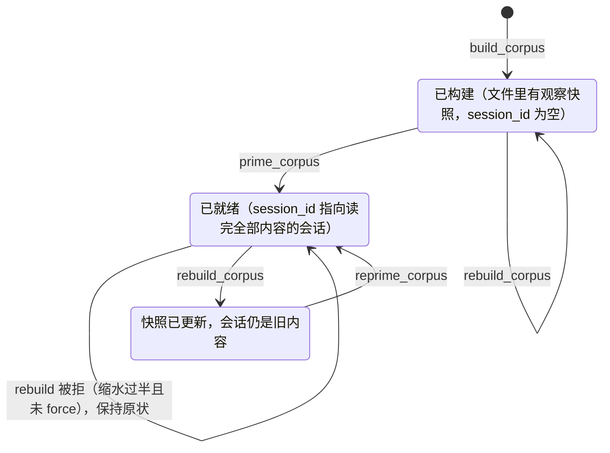

## 从 Observations 到 Corpus

单条 Observation 记录的是一个“点”：某个时刻发生了什么。工程师经常需要的是一个“面”：关于某个主题，整个项目历史上积累了哪些知识。

Knowledge Agent 做的事情是把散落在时间线上的观察按条件挑出来，编译成一个聚焦主题的知识库（Corpus），然后让一个专门的模型会话“读完”它，之后可以反复提问。整个功能由 6 个 MCP 工具组成：`build_corpus`、`list_corpora`、`prime_corpus`、`query_corpus`、`rebuild_corpus`、`reprime_corpus`，在 v12.1.0 加入。Worker 侧代码在 `src/services/worker/knowledge/`，共 5 个文件、672 行。

## Corpus 是一个 JSON 文件

Corpus 存的不只是一组 Observation ID。每个 Corpus 是 `~/.claude-mem/corpora/<名称>.corpus.json` 这样一个文件（`CorpusStore`），结构如下：

```typescript
// src/services/worker/knowledge/types.ts（v13.35.0，字段节选）
interface CorpusFile {
  version: 1;
  name: string;
  description: string;
  created_at: string;
  updated_at: string;
  filter: CorpusFilter;          // 构建条件：project / types / concepts / files / query / date_start / date_end / limit
  stats: {
    observation_count: number;
    token_estimate: number;      // 渲染后全文的 token 估算
    date_range: { earliest: string; latest: string };
    type_breakdown: Record<string, number>;
  };
  system_prompt: string;         // 由 filter 和 stats 生成
  session_id: string | null;     // prime 之后的模型会话 ID
  observations: CorpusObservation[]; // 观察的完整快照：标题、叙述、事实、概念、文件……
}
```

三点值得注意：

- 文件里存的是观察的**完整快照**，不是 ID 引用。之后原观察被删除或修改，已构建的 Corpus 不受影响，直到下一次 rebuild
- `filter` 是 Corpus 的“定义”，rebuild 时按它重新查询
- `session_id` 把这个 Corpus 和一个已经读完全部内容的模型会话绑定在一起

## Build → Prime → Query

### Build：按条件查询并固化

```
build_corpus name="hooks-expertise"
  description="Everything about the hooks lifecycle"
  project="claude-mem"
  concepts="gotcha,how-it-works"
  limit=500
```

参数：

| 参数 | 说明 |
|------|------|
| `name` | 必填，也用作文件名 |
| `description` | 这个知识库关于什么 |
| `project` | 限定项目 |
| `types` | 观察类型，逗号分隔。`CorpusFilter` 的类型定义只接受 decision、bugfix、feature、refactor、discovery、change 这 6 种 |
| `concepts` | 概念标签，逗号分隔：how-it-works、gotcha、trade-off 等 |
| `files` | 文件路径，逗号分隔 |
| `query` | 语义查询 |
| `dateStart` / `dateEnd` | 日期范围（ISO 格式） |
| `limit` | 最多多少条，工具描述里写的默认值是 500 |

`CorpusBuilder.build()`（`src/services/worker/knowledge/CorpusBuilder.ts`）把这些条件交给第 7 章的 `SearchOrchestrator`，只搜观察这一类（摘要和 prompt 不占候选名额），然后按时间正序取回完整记录。有一处特意的处理：

```typescript
// The stored filter is the whole definition of a corpus; the 90-day window interactive
// search applies to date-less Chroma queries would shrink it on every rebuild.
searchArgs.ignoreDefaultRecencyWindow = true;
```

交互式搜索在没有日期条件时默认只看最近 90 天的语义命中，这对“随手搜一下”合理，但对一个知识库来说，每次 rebuild 都会悄悄丢掉更老的内容。所以构建时关掉这个窗口（v13.29.0，#4168）。

### Prime：让一个模型会话读完它

```
prime_corpus name="hooks-expertise"
```

Prime 不是“作为系统消息加载”，而是一次普通的 SDK 调用，prompt 是三段拼接：

```typescript
// src/services/worker/knowledge/KnowledgeAgent.ts（v13.35.0，简化）
const primePrompt = [
  corpus.system_prompt,             // "You are a knowledge agent with access to N observations from the ... corpus." + 过滤条件
  '',
  'Here is your complete knowledge base:',
  '',
  renderedCorpus,                   // 所有观察渲染成文本
  '',
  "Acknowledge what you've received. Summarize the key themes and topics you can answer questions about.",
].join('\n');

const queryResult = query({
  prompt: primePrompt,
  options: buildHardenedSdkOptions({ source: 'KnowledgeAgent', model, env: isolatedEnv, ... }),
});
// 从返回消息里拿到 session_id，写回 corpus 文件
```

和观察者一样，Knowledge Agent 的会话也用 `buildHardenedSdkOptions` 关掉了所有工具（第 10 章）。它只能根据读到的内容回答，不能去读文件或执行命令。

几百条观察的 Corpus，prime 可能要很长时间。v13.30.0 起，客户端支持时 `prime_corpus` 和 `query_corpus` 以流的形式返回，每 10 秒发一次心跳，一次 prime 最长可以跑 15 分钟，而不是撞上原来 30 秒的请求超时；客户端断开连接，后台工作随之停止。

### Query：在同一个会话里追问

```
query_corpus name="hooks-expertise"
  question="SessionStart Hook 的超时时间是多少？为什么设为这个值？"
```

每次 query 都是一次新的 SDK 调用，带着 `resume: corpus.session_id`，所以模型保留了 prime 时读过的全部内容和之前的问答，可以追问“你刚才说的 X 具体指什么”。SDK 每次返回的 `session_id` 可能变化，Knowledge Agent 会把新值写回文件。

如果会话已经无法恢复（CLI 报告找不到这个会话的记录），`query()` 会自动重新 prime 一次再回答，调用方不需要处理。

## 过滤与聚焦

**聚焦的 Corpus 效果远好于宽泛的 Corpus。** 模型的上下文窗口有限，500 条各种主题的观察塞进去，回答具体问题时仍然要在大量无关信息里找答案；Corpus 越大，prime 越慢、每次 query 的成本也越高（每次都要带着整个会话的上下文）。

推荐做法：

| 场景 | 过滤条件 |
|------|---------|
| 了解某个模块 | `files="src/services/auth"` |
| 回顾架构决策 | `types="decision"` |
| 收集踩坑记录 | `concepts="gotcha"` |
| 某段时间的工作 | `dateStart="2026-09-01" dateEnd="2026-09-30"` |
| 某类问题的修复模式 | `types="bugfix" query="timeout"` |

组合条件比单一条件更聚焦：`types="decision" concepts="trade-off"` 找的是“有明确取舍的决策”。不要写成 `types="decision,trade-off"`：`trade-off` 是 concept 不是 type，按 type 过滤不会命中任何记录。

构建完先用 `list_corpora` 看一眼 `observation_count` 和 `token_estimate`，再决定要不要 prime。

## 维护：Rebuild 与 Reprime

### Rebuild

新的观察不会自动进入已有的 Corpus。`rebuild_corpus` 按存储的 `filter` 重新查询，用结果覆盖文件里的观察快照。

v13.29.0 给 rebuild 加了一道保护：

```typescript
// src/services/worker/http/routes/CorpusRoutes.ts（v13.35.0）
// A rebuild that keeps more than half of a non-trivial corpus is treated as a
// routine refresh; keeping half or less is a destructive shrink that must be confirmed.
private isDestructiveShrink(previousCount: number, newCount: number): boolean {
  return previousCount >= 4 && newCount <= previousCount / 2;
}
```

一个原本有 4 条以上观察的 Corpus，重建后只剩一半或更少时，默认拒绝并保留原文件，返回的提示建议检查存储的日期条件，确认无误后带 `force: true` 再执行。这类缩水通常不是“知识变少了”，而是条件出了问题，比如 Chroma 暂时不可用、项目被重命名、上面提到的 90 天窗口。

### Reprime

Rebuild 只更新文件，不动已经 prime 过的会话，那个会话还停留在旧内容上。`reprime_corpus` 把 `session_id` 清空，重新 prime。它也适合在对话已经跑偏、或者会话上下文太长影响回答质量时使用。

### 状态流转

把几个工具串起来，Corpus 的状态如图 11-1 所示。



*图 11-1：Corpus 的生命周期（`src/services/worker/knowledge/` 与 `CorpusRoutes.ts`）*

注意 rebuild 之后的中间状态：快照已经更新，但会话还基于旧知识，必须 reprime 才能让 query 用上新内容。

## Knowledge Agent 与 mem_search 的分工

v13.35 有了强制分步的 `mem_search`（第 8 章），Knowledge Agent 的定位更清楚了：

| | mem_search | Knowledge Agent |
|---|---|---|
| 适合的问题 | “上次那个连接池问题是怎么修的” | “我们在认证模块上做过哪些决策，它们之间有没有矛盾” |
| 答案来自 | 主会话的模型读几条详情后自己归纳 | 一个专门读完整个主题的模型会话 |
| 成本 | 每次几百到几千 token | prime 一次（可能几万 token），之后每次 query 都带着整个会话 |
| 时效 | 实时 | 取决于上次 rebuild 和 reprime |

第一类问题的答案在少数几条记录里，第二类问题需要横向比较几十上百条记录，这正是一个“读完再答”的子代理擅长的事。第 3 章把它归为 Sub-Agent 模式：用一个独立的上下文窗口消化大量材料，只把结论交回主会话。

---

**思考题**

1. Corpus 存的是观察快照而不是 ID。原观察被用户在 Viewer 里删除后，已构建的 Corpus 仍然包含它。从隐私和数据治理的角度，这算不算一个问题？如果算，你会怎么改？
2. 一个 500 条观察、每条平均 200 token 的 Corpus，prime 一次大约多少 token？之后每次 query 呢？什么情况下应该拆成几个小 Corpus？
3. rebuild 的缩水保护阈值是“原本不少于 4 条，重建后不超过一半”。为什么要有“不少于 4 条”这个下限？你会怎么为自己的场景定这两个数？

---

> 本书开源发布于 [inferloop.dev](https://inferloop.dev)，转载请注明出处。

至此，第三部分（核心机制篇）完成。从注入的预算和格式，到强制分步的检索协议，到观察的生成与校正，再到知识库的编译，这四章覆盖了 claude-mem 在“记什么、怎么取”上的核心设计。

下一部分（实战篇）带你从零构建一个可运行的简版 Memory Plugin。

---

> 本章来自《Agent Memory 工程实战》开源版 · 作者「递归客」  
> 在线阅读完整书系：[inferloop.dev](https://inferloop.dev)  
> 源码仓库：[github.com/diguike/book-claude-mem](https://github.com/diguike/book-claude-mem)
