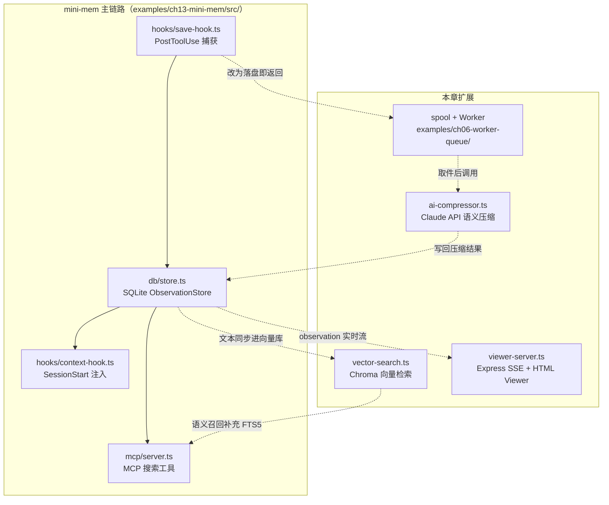

## 扩展全景

第 13 章的 mini-mem 走通了“捕获 → 存储 → 注入 / 检索”的最小闭环。本章在这条主链路上挂几个扩展：异步处理、AI 压缩、时间线、向量检索、实时 Viewer 和项目识别。图 14-1 标出了每个扩展的挂接位置。



*图 14-1：扩展模块与 mini-mem 主链路的挂接关系。实线是第 13 章已有链路，虚线是本章新增的数据通路*

配套代码 `examples/ch14-extensions/src/` 下有三个可独立运行的演示（`npm run demo:compress` / `demo:search` / `demo:viewer`），异步处理的演示在第 6 章的 `examples/ch06-worker-queue/`。把它们真正接进 mini-mem 属于设计层面的工作，正文会区分两类代码：标注了文件名的是可运行节选，标注“设计示意”的留作练习。

## 异步化：先做这一步

AI 压缩一次要几秒，不能放在 Hook 进程里。第 4、6 章分析过 claude-mem v13 的做法：Hook 把事件原子地写成一个文件就退出，常驻的 Worker 来取件，取件后的处理放在内存里。把 mini-mem 改成这样，需要三处改动：

1. `save-hook.ts` 不再写 SQLite，改为把事件写进 `~/.mini-mem/spool/<键>.json`。键用 `session_id` 加 `tool_use_id`，宿主重复投递时覆盖同一个文件
2. 新增一个 Worker 进程，用 `fs.watch` 加定时扫描取件，交给压缩器，写库成功后删除文件
3. 取件和删除之间用一张“已交接”表做标记，崩溃重启后不会重复入库

`examples/ch06-worker-queue/` 就是这个模式的可运行实现，包括模拟 Worker 崩溃后的恢复。为什么交接之后不再持久化中间状态，第 6 章“内存缓冲”一节给了 claude-mem 的理由：观察者生成不是确定性的，重放一段中间状态并不能得到同样的结果。

## 添加 AI 压缩

mini-mem 的规则提取只能写出“编辑 src/index.ts”这样的标题。接入模型后可以写出“把 JWT 签发改为异步”这种有信息量的标题。

配套代码 `examples/ch14-extensions/src/ai-compressor.ts` 是一个可运行的压缩演示（`npm run demo:compress`，需要 Anthropic API 凭据），它把一批 observation 压缩成一段摘要：

```typescript
// examples/ch14-extensions/src/ai-compressor.ts（节选）
import Anthropic from '@anthropic-ai/sdk';

const client = new Anthropic(); // 从 ANTHROPIC_API_KEY 等环境变量读取凭据
const MODEL = process.env.ANTHROPIC_MODEL || 'claude-opus-5-5';

const message = await client.messages.create({
  model: MODEL,
  max_tokens: 4096,
  output_config: { effort: 'low' },   // 摘要是简单任务，用低 effort 控制思考开销
  messages: [{ role: 'user', content: `你是一个记忆压缩助手……\n\nObservations:\n${observationText}` }],
});

if (message.stop_reason === 'refusal') throw new Error('请求被拒绝');
const summary = message.content
  .filter((block): block is Anthropic.TextBlock => block.type === 'text')
  .map((block) => block.text)
  .join('');
```

默认模型是 `claude-opus-5-5`，可以用环境变量换成更便宜的 `claude-haiku-5-5`。claude-mem 自己的观察者默认用的是 Haiku 档（`claude-haiku-4-5-20251001`），观察量大的场景里模型单价是主要成本。

挂进 mini-mem 时，更实用的形态是按单条工具调用压缩、输出一条结构化 observation。下面这一版参考了 claude-mem 观察者的几条约定（第 10 章）：

```typescript
// 设计示意：单条工具调用的语义压缩，接入 mini-mem 的完整实现留作练习
const TYPES = ['bugfix', 'feature', 'refactor', 'change', 'discovery', 'decision'] as const;

export async function compressObservation(toolName: string, toolInput: unknown, outcome: unknown) {
  const response = await client.messages.create({
    model: MODEL,
    max_tokens: 4096,
    output_config: { effort: 'low' },
    messages: [{
      role: 'user',
      content: `分析下面这次工具调用，判断是否值得记住。
值得记住时，只输出一个 JSON 对象：
{"type": ${TYPES.map(t => `"${t}"`).join(' | ')}, "title": "一句话标题", "narrative": "50 字以内", "facts": ["事实"]}
只是例行操作（空的状态检查、无输出的列表、没有结果的搜索）时，只输出 {"skip": true}。

<what_happened>${toolName}</what_happened>
<parameters>${truncate(JSON.stringify(toolInput))}</parameters>
<outcome>${truncate(JSON.stringify(outcome))}</outcome>`,
    }],
  });
  // 解析失败时不要重试到无限：记一条日志，这一次就不记了
}

// 保留开头 60% 和结尾 30%，中间标注省略了多少字符（claude-mem 的 truncateObservationField 同款）
function truncate(text: string, max = 4000): string {
  if (text.length <= max) return text;
  const head = text.slice(0, Math.floor(max * 0.6));
  const tail = text.slice(-Math.floor(max * 0.3));
  return `${head}\n... <elided chars="${text.length - head.length - tail.length}" /> ...\n${tail}`;
}
```

三个细节值得照搬：允许模型说“这条不值得记”（`skip`），否则每次 `ls` 都会变成一条记忆；超长字段保留头尾，因为路径、命令通常在开头，错误信息通常在结尾；type 只列真正的类型，像 `how-it-works` 这样的 concept 不该混进来。

## 实现 Timeline 时间线视图

Timeline 提供某条 Observation 前后的上下文：

```typescript
// 设计示意：在 ch13-mini-mem 的 src/db/store.ts 中添加
getTimeline(anchorId: number, before = 3, after = 3) {
  const anchor = this.db.prepare('SELECT created_at, project FROM observations WHERE id = ?').get(anchorId) as
    { created_at: number; project: string } | undefined;
  if (!anchor) return { before: [], anchorId: null, after: [] };

  // 时间相同的记录用 id 打破平局，否则同一秒写入的几条会被漏掉或重复（claude-mem #4104 修过同类问题）
  const beforeRows = this.db.prepare(`
    SELECT id, type, title, created_at FROM observations
    WHERE project = ? AND (created_at, id) < (?, ?)
    ORDER BY created_at DESC, id DESC LIMIT ?
  `).all(anchor.project, anchor.created_at, anchorId, before);

  const afterRows = this.db.prepare(`
    SELECT id, type, title, created_at FROM observations
    WHERE project = ? AND (created_at, id) > (?, ?)
    ORDER BY created_at ASC, id ASC LIMIT ?
  `).all(anchor.project, anchor.created_at, anchorId, after);

  return { before: beforeRows.reverse(), anchorId, after: afterRows };
}
```

mini-mem 的 `created_at` 精确到秒，一个 Hook 批量写入时同一秒会有多条记录。行值比较 `(created_at, id) < (?, ?)` 让排序是全序的。

在 MCP Server 里注册时，参数要有上下限，并声明只读：

```typescript
{
  name: 'timeline',
  description: 'Show observations before and after one ID from search.',
  inputSchema: {
    type: 'object',
    properties: {
      anchor: { type: 'integer', description: 'Observation ID from search' },
      before: { type: 'integer', minimum: 0, maximum: 5 },
      after: { type: 'integer', minimum: 0, maximum: 5 },
    },
    required: ['anchor'],
    additionalProperties: false,
  },
  annotations: { readOnlyHint: true },
}
```

## 向量检索集成

配套代码 `examples/ch14-extensions/src/vector-search.ts` 用 Chroma 的 Node.js 客户端（chromadb 3.x）实现了写入和检索。embedding 在本地计算，用的是 `@chroma-core/default-embed`，也就是 all-MiniLM-L6-v2，与 claude-mem 的默认 embedding 函数相同。核心部分：

```typescript
// examples/ch14-extensions/src/vector-search.ts（节选）
import { ChromaClient } from 'chromadb';
import { DefaultEmbeddingFunction } from '@chroma-core/default-embed';

const embeddingFunction = new DefaultEmbeddingFunction();
const url = new URL(process.env.CHROMA_URL || 'http://localhost:8000');
const chroma = new ChromaClient({ host: url.hostname, port: Number(url.port), ssl: url.protocol === 'https:' });

const collection = await chroma.getOrCreateCollection({ name: 'observations', embeddingFunction });
await collection.add({
  ids: observations.map((obs) => obs.id),
  documents: observations.map((obs) => obs.content),
  metadatas: observations.map((obs) => ({ category: obs.category, timestamp: obs.timestamp })),
});

const results = await collection.query({ queryTexts: ['用户的技术栈是什么'], nResults: 3 });
const filtered = await collection.query({
  queryTexts: ['部署方式'], nResults: 3,
  where: { category: { $eq: 'preference' } },
});
```

先启动 Chroma 服务：

```bash
# 用 uv（claude-mem 也是这样启动 chroma-mcp 的）
uvx --from chromadb chroma run --path ./chroma-data --port 8000
# 或者用 Docker
docker run -p 8000:8000 chromadb/chroma
```

接入 mini-mem 时，有两点可以参考 claude-mem 的实现（第 7 章）：

- **按字段拆文档**：一条观察的 narrative 和每条 fact 各自生成一个文档，id 形如 `obs_<id>_fact_<i>`。一条具体的事实可以被单独命中，不会被整条观察的平均语义稀释
- **语义为主、关键词补齐**：有查询文本时先查向量库，某一类结果为空（中文查询时很常见）再用 FTS5 或子串补齐，而不是两路并行再按分数硬合并

还有一个要提前想好的问题：默认的 all-MiniLM-L6-v2 以英文语料为主，对中文语义的区分度有限。本书在 Chroma 1.5.9（与 claude-mem 固定的版本相同）上运行这个演示，5 条中文观察、查询“用户的技术栈是什么”，返回的前三名是：

```
[1] (距离: 0.3860) 用户正在写一本关于 LLM 基础设施的技术书籍
[2] (距离: 0.5830) 用户对 Agent 架构很感兴趣，正在研究多 Agent 协作模式
[3] (距离: 0.6536) 用户的包管理器是 npm，不用 yarn 或 pnpm
```

真正回答问题的那条“用户是前端工程师，主要使用 React 和 TypeScript 开发”没有进入前三，排第一的只是字面上共享了“技术”二字。中文场景下，这个默认模型更接近一个字面匹配器。换成多语言 embedding 模型，或者调用外部 embedding API，效果会好得多，但都会改变隐私边界：前者要自己部署模型，后者会把记忆文本发给第三方。

运行这个演示时，`@chroma-core/default-embed` 第一次会从 HuggingFace 下载模型文件；它依赖的 `onnxruntime-node` 在 Linux x64 上安装时默认还会下载 CUDA 运行库，网络受限时可以设 `ONNXRUNTIME_NODE_INSTALL_CUDA=skip` 跳过（CPU 版本已经包含在 npm 包里），需要走代理时设 `NODE_USE_ENV_PROXY=1`（Node 24 起支持）。

## Viewer UI：实时展示面板

配套代码 `examples/ch14-extensions/src/viewer-server.ts` 实现了一个完整的 SSE 服务（`npm run demo:viewer` 启动），核心部分节选如下：

```typescript
// examples/ch14-extensions/src/viewer-server.ts（节选）
import express from 'express';
import type { Request, Response } from 'express';

const app = express();
app.use(express.json());

const observations: Observation[] = [];
const sseClients: Set<Response> = new Set();

// SSE 端点：连接时先推全量数据，之后接收增量广播
app.get('/api/stream', (req: Request, res: Response) => {
  res.setHeader('Content-Type', 'text/event-stream');
  res.setHeader('Cache-Control', 'no-cache');
  res.setHeader('Connection', 'keep-alive');
  res.write(`data: ${JSON.stringify({ type: 'init', observations })}\n\n`);
  sseClients.add(res);
  req.on('close', () => sseClients.delete(res));
});

function broadcast(observation: Observation) {
  const payload = `data: ${JSON.stringify({ type: 'new', observation })}\n\n`;
  for (const client of sseClients) client.write(payload);
}
```

演示版把 observation 存在内存数组里，通过 POST 写入并实时广播。接到 mini-mem 时，把内存数组换成 `ObservationStore`，用 `store.getAfter(lastId)` 轮询新数据即可。

两个 claude-mem 踩过的坑：

- **一个坏连接不能拖垮所有人**。广播时某个客户端的 `write` 抛异常，要把它从集合里移除，继续给其他客户端发（v13.31.1）
- **只监听本机也有风险**。Viewer 在 `localhost` 上，浏览器里的恶意网页可以通过 DNS 重绑定访问它。claude-mem 的 Worker 会检查 `Host` 头，只接受本机名称和白名单里的来源（第 6 章）。你的 Viewer 只要提供了写入或删除接口，就应该做同样的检查

## 多项目识别

mini-mem 用工作目录的最后一级当项目名。在第 2 章介绍过，claude-mem 的规则要细得多，优先级从高到低（`src/utils/project-name.ts`）：

1. **命名环境**：`CLAUDE_MEM_PROJECT_ENVIRONMENTS` 里配置的 glob 命中时，用环境名
2. **git 远端**（可选）：`CLAUDE_MEM_PROJECT_NAME_SOURCE=git-remote` 时用 origin 的 `org/repo`
3. **目录推导**：git 仓库根目录名；worktree 用 `父项目/worktree 名`，且 worktree 名与父项目同名时只用父项目名（Codex 把 worktree 放在 `~/.codex/worktrees/<id>/<repo>` 下，否则会得到 `repo/repo`）；git 子模块用 `父项目/子模块相对路径`；非 git 目录向上找 `.claude-mem-project` 标记文件；都没有就用当前目录名

另外，项目键在比较时大小写不敏感（`COLLATE NOCASE`），一个检出目录可以对应多个键（worktree 同时读父项目的记忆、改名前的旧键仍能被搜到）。

mini-mem 可以先实现最常用的两级：

```typescript
// 设计示意：升级 ch13-mini-mem 的 src/utils/project.ts
import { execFileSync } from 'node:child_process';
import path from 'node:path';

export function projectNameOf(cwd: string): string {
  try {
    // git 仓库根目录；在子目录里启动也能得到同一个项目
    const top = execFileSync('git', ['rev-parse', '--show-toplevel'], { cwd, stdio: ['ignore', 'pipe', 'ignore'] })
      .toString().trim();
    return path.basename(top).toLowerCase();
  } catch {
    return path.basename(path.resolve(cwd)).toLowerCase();
  }
}
```

“先读 `package.json` 的 `name` 字段”看起来很自然，claude-mem 却没有这样做，原因是：monorepo 里每个子包都有自己的 `name`，同一个仓库会被拆成十几个项目；`name` 改一次，历史记忆就断了。用 git 根目录作为默认、让用户显式声明例外，是更稳定的选择。

`execFileSync` 而不是 `execSync`：不经过 shell，目录名里有特殊字符也不会被解释。Hook 每次都会调用它，要注意多启动一个 git 进程的耗时。

---

**思考题**

1. 按单条工具调用压缩，每天几百次调用就是几百次模型请求。claude-mem 的观察者是把一批调用放进同一段对话里压缩的（第 6 章）。比较两种方式在成本、延迟和质量上的差别。
2. 向量检索和 FTS5 各有优劣。为你自己的项目设计一个路由策略：什么时候只用 FTS5，什么时候先查向量库，什么时候两者都查？
3. 多项目识别里，“git 根目录”在 monorepo 里会把所有子项目合成一个。什么时候这是你想要的，什么时候不是？claude-mem 的哪个配置能处理后一种情况？

---

> 本书开源发布于 [inferloop.dev](https://inferloop.dev)，转载请注明出处。

至此，mini-mem 的扩展路径都已经给出：异步处理有第 6 章的可运行实现，AI 压缩、向量检索、实时 Viewer 各有独立演示，时间线和项目识别给出了设计。下一部分讨论如何把这类系统从个人工具升级成团队和企业可用的平台。

---

> 本章来自《Agent Memory 工程实战》开源版 · 作者「递归客」  
> 在线阅读完整书系：[inferloop.dev](https://inferloop.dev)  
> 源码仓库：[github.com/diguike/book-claude-mem](https://github.com/diguike/book-claude-mem)
