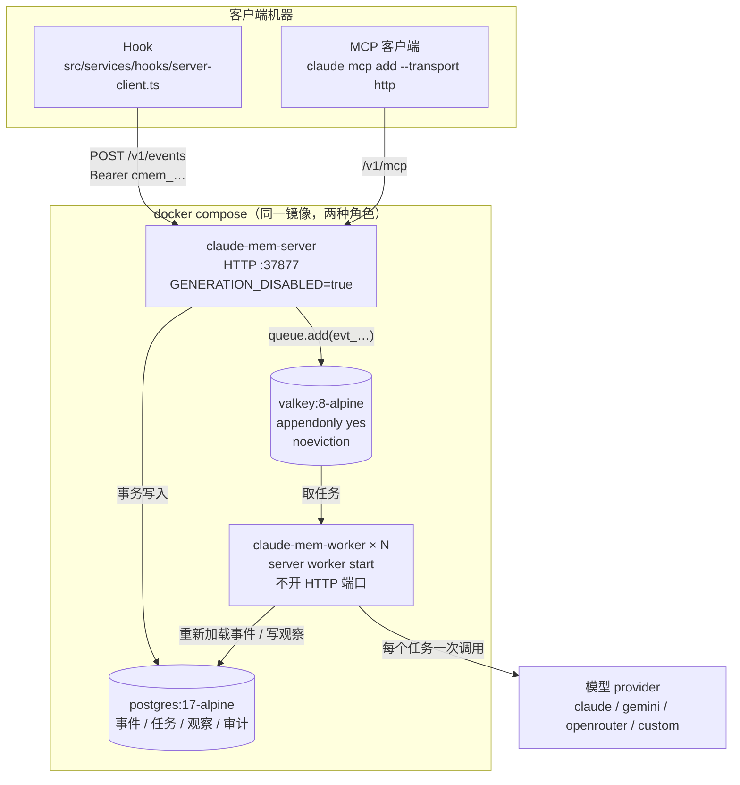
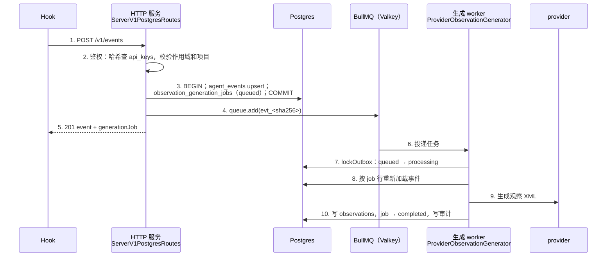
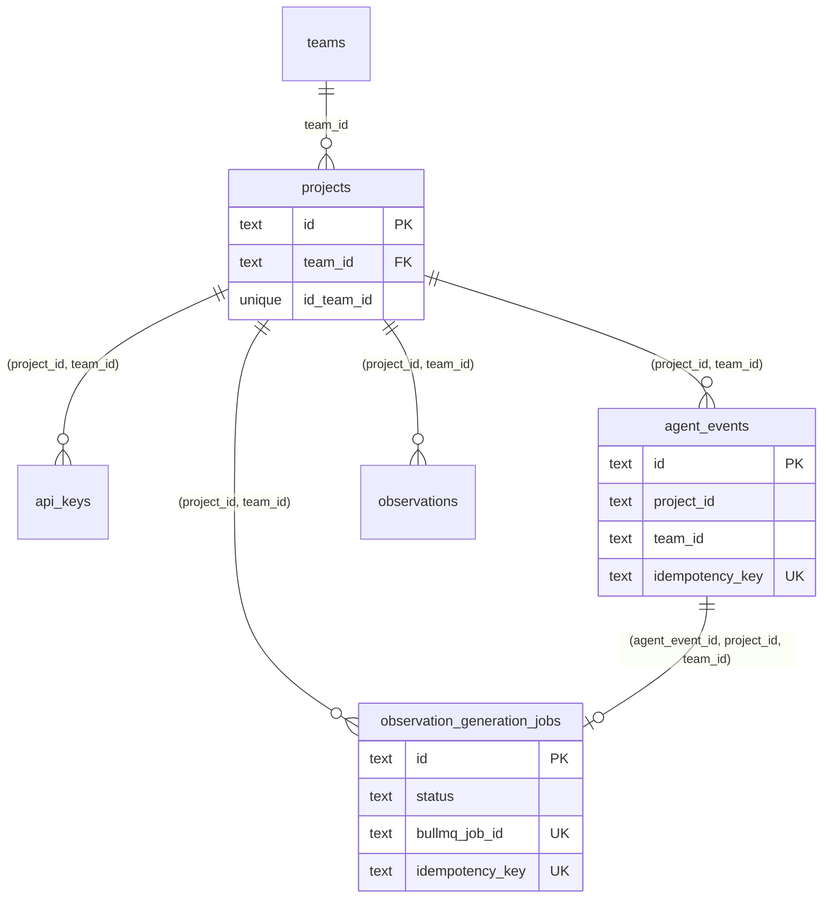
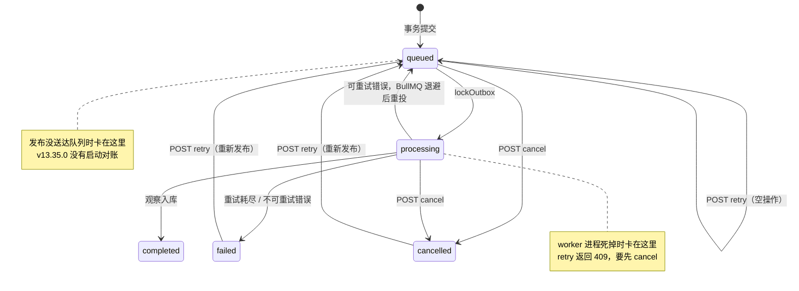

本书第一版写这一章时，claude-mem 只有单机插件一种形态，这一章只能是设想：给它加 JWT 认证、PostgreSQL 行级安全（RLS）、pgvector 和 BullMQ 队列，把它改造成多用户平台。到了 v13，claude-mem 自己做出了这个平台：`src/server/` 下的 Server 运行时，Postgres 存储、BullMQ 队列、API Key 鉴权，随 v13 的 Apache-2.0 许可一起开源，官方文档 `docs/server.md` 标注为 Beta。

所以这一版改了写法：拿官方实现对照当初的设想，看哪些地方和直觉方案一致，哪些地方做了不同选择，以及它目前还缺什么。本章的结论来自 v13.35.0 源码，以及一次本地实跑：Postgres 16 容器、Redis、一个不调模型的假 provider（`CLAUDE_MEM_SERVER_PROVIDER=custom`），把事件写入、生成、故障、运维重试都走了一遍。

## 两种运行时

v13 里 claude-mem 有两套运行时，由 `settings.json` 的 `CLAUDE_MEM_RUNTIME` 选择，默认 `worker`。前面十几章讲的都是 worker 运行时；Server 运行时是另一套独立实现，两者共用 Hook 入口、观察 XML 格式和解析逻辑，其余几乎都不同：

| | worker 运行时（默认） | server 运行时 |
|---|---|---|
| 存储 | SQLite + Chroma | Postgres（14 张表，`src/storage/postgres/schema.ts`） |
| 队列 | 进程内 `SessionMessageBuffer`，不落盘（第 6 章） | BullMQ + Valkey/Redis，`event` 和 `summary` 两条通道 |
| 观察生成 | 每个会话一个常驻的观察者会话，有状态 | 每个任务从 Postgres 重新加载事件，单次调用 provider，无状态 |
| 鉴权 | 只监听回环地址，加 Host 头检查 | API Key（SHA-256 存储，带作用域） |
| 多租户 | 无，单用户 | `team_id × project_id` |
| MCP | stdio，24 个工具里暴露 19 个 | HTTP `/v1/mcp`，3 个只读工具：`search` / `context` / `recent` |
| 默认端口 | `37700 + uid % 100` | `37877 + uid % 100` |

安装时用 `npx claude-mem install --runtime server` 选 Server 运行时。Pi 和 DeepSeek Harness 两个宿主目前只支持 worker 运行时，安装器会直接报错。

部署形态见仓库根目录的 `docker-compose.yml`，如图 16-1 所示：



*图 16-1：Server 运行时的部署拓扑（`docker-compose.yml`，v13.35.0）*

把 HTTP 服务和生成 worker 拆成两个容器，是因为模型调用耗时长，不能占住 HTTP 进程；生成能力靠 `docker compose up -d --scale claude-mem-worker=N` 横向扩展；HTTP 服务重启时，排队中的任务在 Valkey 里，开了 AOF 持久化，不会丢。Valkey 必须配 `noeviction`：BullMQ 的任务就是 Redis 里的键，内存满时被淘汰就等于任务凭空消失。

启动时 `validateServerEnv()`（`src/server/runtime/create-server-service.ts`）会做硬性检查：Docker 里 `CLAUDE_MEM_QUEUE_ENGINE` 必须是 `bullmq`，`CLAUDE_MEM_AUTH_MODE` 不能是 `local-dev`。`local-dev` 模式只认“请求来自 127.0.0.1”，在容器网络里这个条件没有意义，所以直接拒绝启动。

## 一条事件的旅程

Server 运行时的核心是一条写入链路。如图 16-2 所示，从 Hook 发出事件到观察入库，中间经过两次持久化和一次队列投递：



*图 16-2：`POST /v1/events` 的完整链路*

### 事务发件箱

发件箱（outbox）是一种常见的可靠投递模式：要发出去的消息先作为一行数据，和业务数据写在同一个数据库事务里，再由单独的步骤投递到消息队列。数据库事务保证“业务数据和待发消息要么都在、要么都不在”，投递失败了也可以从表里找回来重发。

第 3 步和第 4 步的顺序是这条链路的关键。`IngestEventsService.ingestOne()`（`src/server/services/IngestEventsService.ts`）在一个 Postgres 事务里写三行：事件行、任务行（也就是发件箱）、一条任务生命周期记录。事务提交之后，才把任务发布到 BullMQ：

```typescript
const txResult = await withPostgresTransaction(this.options.pool, async (client) => {
  const inserted = await eventsRepo.create(input);
  // ...
  const outbox = await jobsRepo.create({
    id: outboxId,
    status: 'queued',            // 由仓储层写入
    bullmqJobId: buildServerJobId({ kind: 'event', team_id, project_id,
                                    source_type: 'agent_event', source_id: inserted.id }),
    payload: bullmqPayload,      // 发布用的 payload 也存进行里，运维重试时原样重发
  });
  await eventsLogRepo.append({ generationJobId: outbox.id, eventType: 'queued', ... });
  return { event: inserted, outbox };
});
// 事务外：发布到队列，失败只记日志，返回 'queued_only'
enqueueState = await this.publishEventJob(txResult.event, txResult.outbox);
```

反过来先发布再提交会出两种问题：worker 拿到任务时事务还没提交，读不到这一行；或者发布成功、事务回滚，队列里多出一个指向不存在数据的任务。发件箱模式让 Postgres 成为唯一的事实来源，队列只是“通知”，丢了可以从表里补。

“可以从表里补”需要有人去补，这一点放到“故障时会发生什么”一节说。

### 两层幂等

网络超时后客户端重发，是分布式写入的常态。Server 运行时在两层做去重。

**事件层**：`agent_events.idempotency_key` 有唯一约束，冲突时 `ON CONFLICT DO UPDATE` 只合并 metadata，返回已有的行。幂等键由 `buildAgentEventIdempotencyKey()`（`src/storage/postgres/agent-events.ts`）算出：带 `sourceEventId` 时用它，否则对 `(teamId, projectId, sourceAdapter, platformSource, contentSessionId, eventType, occurredAt, payload)` 整体取哈希。

v13.35.0 里有一个容易踩的细节：`/v1/events` 的请求体先经过 Zod 的 `CreateAgentEventSchema` 校验，这个 schema 里没有 `sourceEventId` 字段，Zod 默认会把未声明的字段剥掉。实测在请求体里带上 `sourceEventId`，入库后该字段为 `null`，去重走的是内容哈希：

| 两次请求的差别 | 结果 |
|---|---|
| 请求体完全相同 | 同一个事件、同一个任务 |
| 只有 `occurredAtEpoch` 差 1 毫秒 | 两个事件 |
| `sourceEventId` 相同、`occurredAtEpoch` 不同 | 两个事件（`sourceEventId` 被剥掉） |

所以客户端重试时必须原样重发同一个请求体，不能在重试时重新取时间戳。claude-mem 自己的 Hook 客户端（`server-client.ts`）不做重试，一次失败就交给回落规则处理（见“一个作用域不匹配的坑”一节），这个问题主要出在自己写的客户端上。

**任务层**：BullMQ 对相同 `jobId` 的重复 `add` 不会重复入队。`buildServerJobId()`（`src/server/jobs/job-id.ts`）把 `kind / team_id / project_id / source_type / source_id` 序列化后取 SHA-256，格式是 `evt_<64 位十六进制>` 或 `sum_<…>`。源码注释专门说明了为什么不直接拼接成 `event:team:project:…`：BullMQ 内部用冒号分隔 Redis 键，`jobId` 里带冒号会让扫描和状态判断出错。哈希还有一个附带好处，Redis 里看不到租户 ID。

### 为什么要锁发件箱行

BullMQ 保证同一时刻只有一个 worker 处理一个任务，但“卡住”（stalled）的任务会被重新投递给另一个 worker，而第一个 worker 可能只是慢，并没有死。两个 worker 同时调用 provider，就要付两次模型费用。

`ProviderObservationGenerator.lockOutbox()` 在调用 provider 前先读 Postgres 里的任务行：状态是 `completed / cancelled / failed` 直接返回；是 `processing` 也直接跳过，源码注释写明是为了避免“付费、限流”的外部调用发生两次；只有 `queued` 才转成 `processing` 继续。持久化层另有一道终态检查，但那道检查只能在调用之后丢弃重复结果，钱已经花了。

worker 对 BullMQ payload 也不信任：它按 `generation_job_id` 重新加载 Postgres 里的任务行，如果 payload 里的 `team_id / project_id` 与任务行不一致，拒绝生成并写一条 `generation_job.scope_violation` 审计。被篡改的队列消息越不过租户边界。

队列的重试参数在 `ServerJobQueue`（`src/server/jobs/ServerJobQueue.ts`）里：最多 3 次，指数退避起点 5 秒；完成的任务保留 7 天或 1,000 条，失败的保留 30 天或 1,000 条。并发由 `CLAUDE_MEM_SERVER_GENERATION_CONCURRENCY` 控制，默认 1，上限 64，按通道生效：设成 N，`event` 和 `summary` 两条通道合计最多 2N 个模型调用同时进行。

## 租户隔离写在 schema 里

第一版的设想是 PostgreSQL RLS：给每张表加策略，按会话变量过滤。claude-mem 走的是另一条路，隔离分两层，都不依赖 RLS。

第一层是外键。`projects` 表声明了 `UNIQUE (id, team_id)`，`api_keys`、`audit_log`、`server_sessions`、`agent_events`、`observation_generation_jobs`、`observations` 这 6 张表都同时带 `project_id` 和 `team_id`，并用复合外键指向 `projects(id, team_id)`，如图 16-3 所示。`observation_sources`、`observation_generation_job_events` 这类子表不带租户列，通过外键挂在上述父表下，跟随父表级联删除：



*图 16-3：复合外键把每一行钉在一个 (项目, 团队) 上（`src/storage/postgres/schema.ts`）*

单列外键只能保证“项目存在、团队存在”，挡不住“A 团队的行指向 B 团队的项目”。复合外键要求 `(project_id, team_id)` 这一对在 `projects` 里真实存在，错配的数据在数据库层就写不进去，哪怕是绕过 API 直接写 SQL。任务表更进一步，用 `(agent_event_id, project_id, team_id)` 三列外键指向事件，任务和它的事件不可能分属两个租户。

第二层是查询。每个读接口都在 `WHERE` 里带上调用方 API Key 所属的 `team_id`，项目级的 Key 再加 `project_id`。跨租户访问返回 404 而不是 403：`loadScopedById()` 的 `scopeMismatch: 'not-found'` 让“这个 ID 属于别的团队”和“这个 ID 不存在”返回完全相同的响应，调用方没法用 403 和 404 的差别探测别人的数据。

| | RLS（第一版设想） | 复合外键 + 应用层 WHERE（claude-mem） |
|---|---|---|
| 漏写过滤条件 | 数据库兜底 | 会泄露，靠代码审查和测试 |
| 错配写入 | 策略可以拦，要单独写 `WITH CHECK` | 外键直接拒绝 |
| 连接池 | 每个请求要 `SET` 会话变量，事务级连接池里容易串 | 无额外要求 |
| 调试 | 同一条 SQL 在不同会话里结果不同 | 所见即所得 |

两者不互斥。团队对“漏写 WHERE”这类风险更敏感时，可以在复合外键之上再加 RLS。

## 鉴权、作用域与配额

### API Key

命令行（`server api-key create`）签发的 Key 以 `cmem_` 开头，`POST /v1/keys` 签发的只读 Key 以 `cm_` 开头。原文只在创建时显示一次，库里只存 SHA-256（`api_keys.key_hash`）。`requirePostgresServerAuth()`（`src/server/middleware/postgres-auth.ts`）对每个请求都按哈希重新查一次库，检查 `revoked_at`、`expires_at` 和作用域。没有内存缓存，吊销立即生效，也不存在“缓存被污染”这一类问题。

缺 Key 返回 401，Key 无效或作用域不够返回 403。作用域检查是“要求的每一项都必须在已授予列表里”，只有 `*` 是通配：

```typescript
function hasRequiredScopes(grantedScopes: string[], requiredScopes: string[]): boolean {
  if (requiredScopes.length === 0 || grantedScopes.includes('*')) return true;
  return requiredScopes.every(scope => grantedScopes.includes(scope));
}
```

读接口要 `memories:read`，写接口要 `memories:write`。`memories:admin` 并不隐含读写，它只在一个地方生效：`GET /v1/jobs?include=payload` 要求管理员作用域才返回任务 payload，防止只读 Key 顺手把事件原文导出去。

### 一个作用域不匹配的坑

用 `npx claude-mem install --runtime server` 安装时，安装器会调用 `bootstrapServerApiKey()`（`src/services/hooks/server-bootstrap.ts`）给 Hook 生成一个 Key，作用域是 `events:write, sessions:write, observations:read, jobs:read`。而 `/v1/events` 要求的是 `memories:write`。两套作用域名对不上。

实测用这组作用域的 Key 调 `POST /v1/events`，返回 403。更麻烦的是 Hook 侧的回落规则。`server-client.ts` 的 `isFallbackEligible()` 只在传输错误、超时、缺 Key、5xx 和 429 时回落到本地 worker 的 spool；其他 4xx 被视为“客户端有 bug”，记一条错误日志后放弃。403 属于后者，所以事件既没进 Server，也没进本地 worker，Hook 照常以 0 退出，会话里看不出任何异常。

源码里已经有修复工具：`server-service.cjs server api-key migrate-scopes <id>` 会把 Key 的作用域改成 `memories:read, memories:write`，实测改完后同一个 Key 返回 201。但 `npx claude-mem server` 这层命令只转发了 `api-key create|list|revoke`，没有转发 `migrate-scopes`。用 npx 的话，直接新建一个 Key 更省事：

```bash
npx claude-mem server api-key create --name hooks --scope memories:read,memories:write
# 把输出里的 key 和 projectId 写进 ~/.claude-mem/settings.json：
#   CLAUDE_MEM_SERVER_API_KEY / CLAUDE_MEM_SERVER_PROJECT_ID
```

注意 `create` 不带 `--scope` 时默认只有 `memories:read`。

### 限流、配额与计量

这几项都默认关闭，由环境变量打开（`ServerV1PostgresRoutes.ts` 的 `setupRoutes()`）：

| 环境变量 | 作用 |
|---|---|
| `CLAUDE_MEM_RATE_LIMIT_PER_MIN` | 按 API Key 的 60 秒固定窗口限流，超限返回 429，带 `Retry-After` 和 `X-RateLimit-*` 头 |
| `CLAUDE_MEM_MONTHLY_REQUEST_CAP` | 按团队的月请求数上限 |
| `CLAUDE_MEM_MONTHLY_TOKEN_CAP` | 按团队的月 token 上限，**只拦写接口**：超预算的团队还能检索已有记忆 |
| `CLAUDE_MEM_USAGE_METERING=1` | 记录用量，`GET /v1/usage` 查本月汇总 |

限流和配额都是 fail open：计数表读写出错时放行请求，而不是让整个 API 不可用。对记忆服务来说这个取舍合理，多放过几个请求的代价远小于 Agent 全员失忆。

### 审计

每次写入、生成、运维操作都写 `audit_log`，每行带 `team_id / project_id / api_key_id / actor_id / request_id`。`request_id` 在 HTTP 入口生成，随 BullMQ payload 传到 worker，一条 `WHERE request_id = …` 就能串起一次请求的全部经过。本地实跑一轮后，审计表里出现的动作有：

```text
api_key.create
event.received
generation_job.processing
generation_job.completed
generation_job.cancelled_by_operator
generation_job.retried_by_operator
observation.created
observation.read
```

任务状态的每次变化另记在 `observation_generation_job_events`，审计表回答“谁做了什么”，生命周期表回答“这个任务经历了什么”。

## 故障时会发生什么

发件箱模式的前提是“队列丢了消息可以从表里补”。v13.35.0 的源码注释在好几处写着“行留在 queued 状态，启动对账（startup reconciliation）会重新发布它”，但这段对账逻辑在代码里找不到，`reconcileOnStartup` 只出现在注释里。也就是说，补发目前全靠运维手动操作。

我在本地把几种故障都制造了一遍，结果如下：

| 故障 | 实际表现 |
|---|---|
| Redis 停机，HTTP 服务正常 | `POST /v1/events` 挂起，30 秒没有响应（BullMQ 的连接在离线时把命令排队，不报错）。事件行和任务行已经提交，状态是 `queued`。Redis 恢复后，排队的命令自动补发，任务正常完成 |
| Redis 停机期间 HTTP 服务进程崩溃 | 离线排队的命令随进程消失。重启后任务一直停在 `queued`，没有任何机制去补发 |
| 对 `queued` 的任务调 `retry` | 返回 200 和 `alreadyQueued: true`，只写一条审计，不重新发布 |
| 对 `processing` 的任务调 `retry` | 409：要先等它结束或者先 `cancel` |
| 对 `completed` 的任务调 `retry` | 409，理由是模型输出不确定，重跑会产生一套平行的观察 |
| 先 `cancel` 再 `retry` | 任务回到 `queued` 并重新发布，随后完成。生命周期表记录 `queued → cancelled → queued → completed` |

任务状态的流转和卡住的位置见图 16-4：



*图 16-4：生成任务的状态机与两个卡住的位置（`ServerV1PostgresRoutes.ts` 的 `retryGenerationJob()` / `cancelGenerationJob()`）*

在对账逻辑补上之前，生产环境可以用一个定时任务兜底：找出创建时间超过某个阈值、仍停在 `queued` 或 `processing` 的任务，对它们先 `cancel` 再 `retry`。这两步不一定走 HTTP，`npx claude-mem server jobs status|failed|retry|cancel` 直接连 Postgres 操作（需要 `CLAUDE_MEM_SERVER_DATABASE_URL`），同样写审计；它的 `retry` 和 HTTP 接口一样，对 `queued` 的任务是空操作。

```sql
-- 卡住超过 10 分钟的任务
SELECT id, status, attempts, created_at
FROM observation_generation_jobs
WHERE status IN ('queued', 'processing')
  AND updated_at < now() - interval '10 minutes'
ORDER BY created_at;
```

`cancel` 对 `processing` 任务是安全的：真正在跑的 worker 写结果前会再看一次任务状态，发现已取消就不产生副作用。阈值要大于单个任务的最长执行时间，否则会把正常跑着的任务取消掉。

Redis 故障还会影响 Hook 侧。HTTP 请求一直挂着，Hook 客户端超时后按规则回落到本地 worker 的 spool；而 HTTP 服务那边事件已经入库，Redis 恢复后照样会生成。把这两段代码路径连起来看，本地也开着 worker 时，同一个工具调用可能在 Server 和本地各留一份观察。这是“宁可多记、不能漏记”的取舍，排查重复数据时要想到这一层。

## 检索：tsvector，以及还没用上的 embedding

Server 运行时的检索是 Postgres 全文搜索。`observations` 表有一个生成列：

```sql
content_search TSVECTOR GENERATED ALWAYS AS (to_tsvector('english', content)) STORED
```

查询用 `websearch_to_tsquery('english', $query)`，按 `ts_rank` 排序。表里还有一个 `embedding JSONB` 列，生成时可以写入，但 v13.35.0 的检索路径没有读它，也没有用 pgvector。第一版设想里的“tsvector + 向量混合检索”，官方目前只做了前一半。

`'english'` 配置对中文的问题和第 7 章 FTS5 的问题同源：它按空白和标点切词，一整段连续的中文会成为一个词。实测：

```text
to_tsvector('english', 'fake: 修复登录超时问题 generated')
  → 'fake':1 'generat':3 '修复登录超时问题':2
```

| 查询 | 命中 |
|---|---|
| `修复登录超时问题`（整句） | 1 |
| `登录` | 0 |
| `登录超时` | 0 |

中文团队部署 Server 运行时，检索要自己补。改动最小的办法是 `pg_trgm`：它能从中文里抽三元组，`ILIKE '%连接池%'` 这样 3 个字及以上的查询可以走 GIN 索引。实测（Postgres 16，库的 `LC_CTYPE` 为 `en_US.utf8`，2 万行）：

```sql
CREATE EXTENSION pg_trgm;
CREATE INDEX observations_content_trgm ON observations USING gin (content gin_trgm_ops);
-- '%连接池%'：Bitmap Index Scan on observations_content_trgm
-- '%登录%'  ：Seq Scan（两个字凑不出三元组，退化为全表扫描，结果仍然正确）
```

要做语义检索，就把 `embedding` 列换成 pgvector 的 `vector` 类型，再给检索路径加一路向量召回。这部分需要改 claude-mem 的检索代码，超出本章范围。

## 从 worker 迁到 Server

官方的迁移文档（`docs/migration-worker-to-server.md`）只有一段，核心意思是两套运行时长期并存，客户端逐步迁移。具体有三条路径。

**Hook 按配置选择运行时，失败时回落。** `runtime-selector.ts` 读 `CLAUDE_MEM_RUNTIME`，选了 `server` 但缺 URL、Key 或项目 ID 时，记一条 `[server-fallback]` 日志后走 worker。发请求失败时按“一个作用域不匹配的坑”一节的规则决定是否回落到本地 spool。

**旧 Hook 协议有兼容层。** `src/server/compat/` 下的两个适配器在 Server 上挂了 `/api/sessions/observations` 和 `/api/sessions/summarize`，把 worker 时代的请求体翻译成 `/v1/events` 事件，事件的 `sourceAdapter` 记为 `claude-code-compat`。兼容层要求项目级 Key，跨项目的调用直接返回 400。

**MCP 改走 HTTP。** Server 在 `/v1/mcp` 上提供可流式 HTTP 传输的 MCP 端点，鉴权和 `/v1/search` 相同（`memories:read`），工具只有 `search`、`context`、`recent` 三个。`GET /v1/connect` 返回现成的接入命令：

```bash
claude mcp add --transport http claude-mem https://<your-host>/v1/mcp \
  --header "Authorization: Bearer <YOUR_API_KEY>"
```

`POST /v1/keys` 可以为当前团队签发一个只读、可设过期时间的 Key，适合分发给只需要检索的成员。安装器的提示文本里写的端点是 `<baseUrl>/mcp`，实际路由是 `/v1/mcp`，以路由为准。

有一项能力目前留在 worker 上：`UserPromptSubmit` 阶段的语义上下文注入（`/api/context/semantic`）。Server 还没有对应接口，官方的发布评估报告把它列为待办。

## 和第一版设想的对照

| 维度 | 第一版设想 | claude-mem v13.35.0 Server |
|---|---|---|
| 认证 | JWT，解析 `userId / orgId` | API Key，SHA-256 存储，每请求查库 |
| 隔离 | RLS | 复合外键 + 应用层 WHERE，跨租户返回 404 |
| 事件入口 | `/api/events` 里直接入队 | `/v1/events`，事务发件箱，提交后发布 |
| 幂等 | 未设计 | 事件内容哈希 + 确定性任务 ID + 发件箱行锁 |
| 队列划分 | 按组织分队列 | 按任务类型分 `event` / `summary` 两条通道 |
| 检索 | tsvector + pgvector | 只有 `'english'` tsvector；embedding 存了但没用 |
| 配额 | 未设计 | 限流 / 请求配额 / token 配额 / 计量，全部 fail open |
| 运维 | 按队列深度扩缩容 | 横向扩 worker；卡住的任务手动 cancel + retry |

设想里最有价值、实现里也确实做到了的，是发件箱和幂等这一组设计。它们决定了一个记忆服务在网络抖动和进程重启下会不会丢数据、会不会重复付费。设想里低估的是“运维面”：启动对账还没做；卡住的任务只能靠运维手动 `cancel + retry`；修正 Key 作用域的 `migrate-scopes` 做了，但没接到 `npx claude-mem` 命令上。

开源版也有明确的边界。`docs/ip-boundary.md` 列出了不会进入 Apache-2.0 仓库的部分，包括团队/组织级记忆同步、SSO/SAML/SCIM、企业级 RBAC、审计日志界面、DLP 策略引擎。下一章讨论这些企业特性，在开源版的基础上要补什么、怎么补。

## 运行示例

`examples/ch16-platform-arch` 用 SQLite 和 Express 5 把本章的几条设计压进一个进程，不需要 Postgres 和 Redis：

```bash
cd examples/ch16-platform-arch
npm install
npm run demo
```

示例覆盖六个场景：发件箱写入、原样重发去重、重复投递跳过、租户隔离与作用域、任务没送达队列后的 `cancel + retry` 恢复、审计日志。其中租户隔离部分的输出：

```text
[4] 租户隔离与作用域
  Globex 读 Acme 的事件：404
  Globex 读不存在的事件：404
  Globex 往 Acme 的项目写：403
  只读 key 写事件：403
  只读 key 读事件：200
  绕过 API 直接写错配的租户：FOREIGN KEY constraint failed
```

最后一行是复合外键在起作用：即使绕过 HTTP 层直接写 SQL，`(project_id, team_id)` 错配的行也进不了库。

---

**思考题**

1. 事件幂等键包含 `occurredAt`，客户端必须原样重发请求体。如果你的客户端是一个会在重试时重新构造请求的 SDK，你会怎么改：改客户端、改服务端的幂等键，还是让 schema 接受 `sourceEventId`？各自的代价是什么？
2. “故障时会发生什么”一节的兜底定时任务用 `updated_at` 判断“卡住”。如果某类任务正常就要跑 15 分钟，阈值设 10 分钟会发生什么？有没有比时间阈值更可靠的判断方式？
3. `CLAUDE_MEM_MONTHLY_TOKEN_CAP` 只拦写不拦读。反过来设计，只拦读不拦写，会在什么场景下更合理？

---

> 本书开源发布于 [inferloop.dev](https://inferloop.dev)，转载请注明出处。

---

> 本章来自《Agent Memory 工程实战》开源版 · 作者「递归客」  
> 在线阅读完整书系：[inferloop.dev](https://inferloop.dev)  
> 源码仓库：[github.com/diguike/book-claude-mem](https://github.com/diguike/book-claude-mem)
