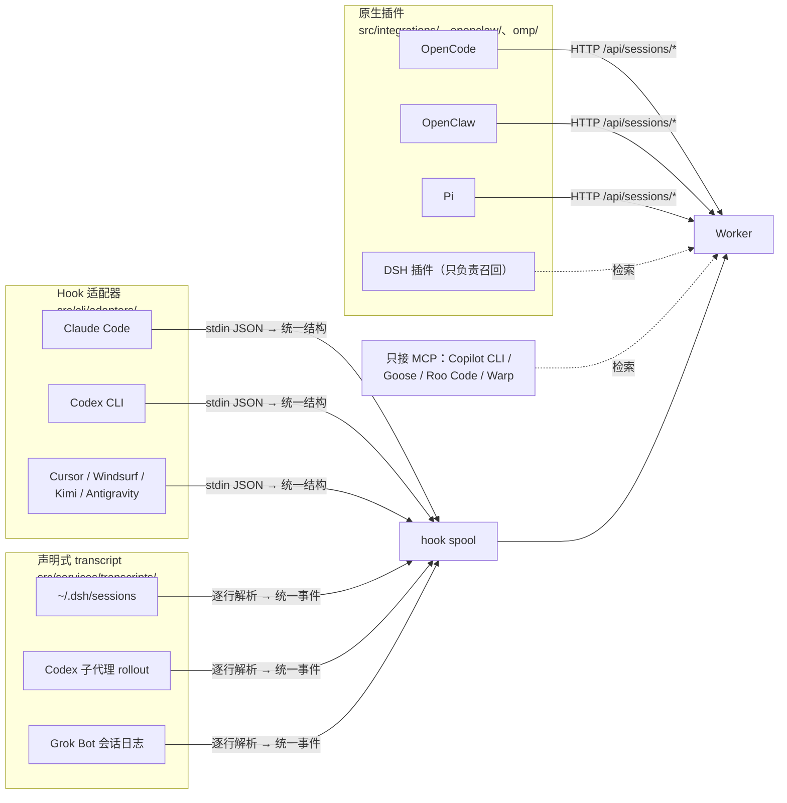
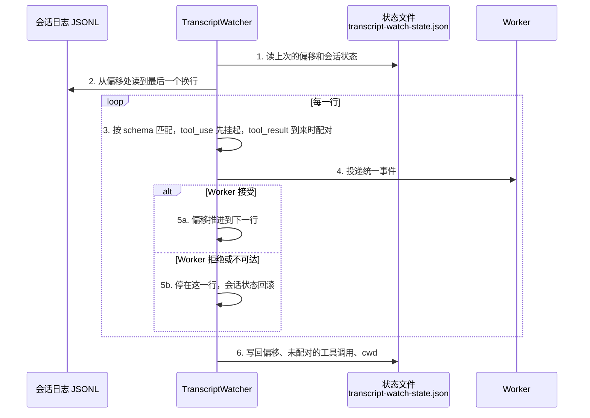

claude-mem 的名字里有 Claude，但 v13.35.0 的安装器已经列出 17 个宿主：Claude Code、Codex CLI、Cursor、Windsurf、Kimi Code、Antigravity、T3 Code、OpenCode、OpenClaw、OMP、Pi、DeepSeek Harness、Grok Bot、Copilot CLI、Goose、Roo Code、Warp（`src/npx-cli/commands/ide-detection.ts`）。

一个开发者白天在 Claude Code 里修 bug，晚上用 Codex 跑重构，周末在 Cursor 里看代码，三处产生的观察进的是同一个库，任何一个宿主开新会话时都能看到另外两处留下的记录。前面十几章讲的 Hook、Worker、观察生成都是围绕 Claude Code 展开的，本章回答另一个问题：怎么把形态各异的宿主接到同一套记忆上，而不让每接一个宿主就复制一套管道。

## 三种接入方式

宿主之间最大的差别是“它把会话里发生的事暴露给外部的方式”。claude-mem 按这个差别分了三条接入路径，最终都汇到同一个 Worker，如图 18-1 所示：



*图 18-1：三条采集路径与只读的 MCP 接入，最终都汇到同一个 Worker*

| 方式 | 适用的宿主 | 采集 | 注入开场上下文 | 检索 |
|---|---|---|---|---|
| Hook 适配器 | 宿主提供命令式 Hook（stdin 进、stdout 出） | 有 | 有 | MCP |
| 原生插件 | 宿主有进程内插件 API | 有 | 有 | 插件工具或 MCP |
| 声明式 transcript | 宿主把会话写成 JSONL 日志 | 有 | 视宿主而定 | 另配 |
| 只接 MCP | 宿主只支持 MCP | 无 | 无 | MCP |

只接 MCP 的四个宿主只能检索已有的记忆，自己的会话不会产生新观察。这是这类宿主的能力上限：没有 Hook、没有插件 API、也没有可读的会话日志，claude-mem 无从得知会话里发生了什么。

## Hook 适配器：把不同的 stdin 翻译成同一个结构

各家宿主都学了 Claude Code 的 Hook 设计，但字段名各不相同。以 Cursor 为例，它的工具结果放在 `result_json` 而不是 `tool_response`，Shell 命令走单独的 Hook，载荷里只有 `command` 和 `output`，没有工具名。

适配器的工作就是把这些差别抹平，翻译成 `NormalizedHookInput`（`src/cli/types.ts`）。`src/cli/adapters/cursor.ts` 的核心部分：

```typescript
normalizeInput(raw) {
  const r = (raw ?? {}) as any;
  const isShellCommand = !!r.command && !r.tool_name;
  const cwd = r.workspace_roots?.[0] || r.cwd || process.cwd();
  if (!isValidCwd(cwd)) throw new AdapterRejectedInput('invalid_cwd'); // 非法目录直接拒收
  const sessionId = r.conversation_id || r.generation_id || r.id;
  return {
    sessionId,
    cwd,
    toolName: isShellCommand ? 'Bash' : r.tool_name,
    toolInput: isShellCommand ? { command: r.command } : r.tool_input,
    toolResponse: isShellCommand ? { output: r.output } : r.result_json,
    toolUseId: typeof r.tool_use_id === 'string' ? r.tool_use_id
             : (typeof r.tool_call_id === 'string' ? r.tool_call_id : undefined),
    // Cursor 的 stop Hook 不给 transcript 路径，按 cwd + 会话 ID 推出磁盘上的位置
    transcriptPath: deriveCursorTranscriptPath(cwd, sessionId),
  };
}
```

工作目录和会话 ID 都来自 stdin，适配器先校验再用：`isValidCwd()` 不通过就抛 `AdapterRejectedInput`，这次调用被拒收。推导 transcript 路径时还有一个细节：会话 ID 同样来自 stdin，代码先用 `^[A-Za-z0-9_-]+$` 校验，防止 `../` 之类的值把路径拼到 `~/.cursor/projects` 之外。适配器是外部输入进入系统的第一站，凡是要拼进文件路径的字段都要先校验。

Shell 命令被统一成工具名 `Bash`，后面的过滤链、观察者提示词、文件读取门控（第 8 章）都按 Claude Code 的工具名写，不需要为每个宿主各写一套。

v13.35.0 有 7 个适配器：`claude-code`、`codex`、`cursor`、`kimi`、`windsurf`、`antigravity-cli`、`raw`。`raw` 是兜底，未知平台名也落到它上面。宿主侧的 Hook 配置统一调用同一个入口，只是平台名和事件名不同：

```text
worker-service.cjs hook <platform> <event>
# 例：Codex 的 PostToolUse
worker-service.cjs hook codex observation
```

各宿主的 Hook 能力也不对等，配置要跟着调整。Codex 的 `PreToolUse` 匹配器里没有 `Read`，因为 Codex 读文件走 Shell 或 MCP 工具，文件读取门控只能挂在 `^Bash$` 和 `mcp__…__read_file` 一类工具上（`plugin/hooks/codex-hooks.json`）。

## 声明式 transcript：用配置描述日志格式

有些宿主没有合适的 Hook，但会把完整的会话写成 JSONL 日志：Codex 写在 `~/.codex/sessions`，DeepSeek Harness 写在 `~/.dsh/sessions`。claude-mem 为这类宿主做了一个通用的 transcript watcher（`src/services/transcripts/`），宿主之间的差别全部写在 JSON 配置里，代码不分宿主。

### schema 的写法

一份 schema 是一组“匹配规则 → 动作 → 字段映射”。下面是 `transcript-watch.example.json` 里 Codex schema 的两条：

```json
{
  "name": "user-message",
  "match": {
    "all": [
      { "path": "payload.type", "equals": "message" },
      { "path": "payload.role", "equals": "user" },
      { "path": "payload.content[0].text", "exists": true },
      { "path": "payload.content[0].text", "not_starts_with": "<recommended_plugins>" },
      { "path": "payload.content[0].text", "not_starts_with": "<skills_instructions>" }
    ]
  },
  "action": "session_init",
  "fields": { "prompt": "payload.content[0].text" }
},
{
  "name": "tool-use",
  "match": { "path": "payload.type", "in": ["function_call", "custom_tool_call", "web_search_call"] },
  "action": "tool_use",
  "fields": {
    "toolId": "payload.call_id",
    "toolName": { "coalesce": ["payload.name", "payload.type"] },
    "toolInput": { "coalesce": ["payload.arguments", "payload.input", "payload.command", "payload.action"] }
  }
}
```

匹配规则支持 `equals / not_equals / in / not_in / exists / starts_with / not_starts_with / contains / regex`，用 `all / any` 组合。第一条规则里的 `not_starts_with` 值得注意：Codex 会把技能说明、插件推荐当作 user 消息塞进日志，不排除的话，这些预置文本会被当成用户的提问记下来。类型定义里专门有一行注释提醒：排除宿主注入的前言要用 `not_starts_with`，不要用 `not_contains`，否则用户正文里只要提到这个词也会被排除。

字段可以是路径字符串，也可以是 `{ coalesce: [...] }`（取第一个非空的候选）、`{ value: ... }`（常量）、`{ path, default }`。动作一共 9 种：`session_init`、`session_context`、`user_message`、`assistant_message`、`tool_use`、`tool_result`、`observation`、`file_edit`、`session_end`。

### 增量读取与检查点

watcher 要处理的不只是解析，还有“读到哪了”。如图 18-2 所示，它按字节偏移增量读取，每一行被 Worker 接受之后才推进检查点：



*图 18-2：transcript watcher 的增量读取与检查点*

状态文件里存的不只是偏移（`src/services/transcripts/state.ts`）：

| 字段 | 作用 |
|---|---|
| `offsets` | 每个文件读到的字节位置 |
| `pendingTools` | 已经看到调用、还没看到结果的工具，重启后结果行仍能配上 |
| `cwds` | 每个文件最后报告的工作目录。DSH 只在会话第一行写 cwd，watcher 从中间恢复时读不到 |
| `fileIdentities` + `checkpointFingerprints` | 设备号 / inode 加检查点前 4 KiB 的哈希，区分“文件被替换”和“同步工具做了临时文件 + rename” |

配套示例 `examples/ch18-multi-host` 用约 150 行代码实现了同样的匹配规则和字段写法，直接复用 claude-mem 的两份 schema。写这个示例时我先犯了一个错误：Worker 拒收时只把偏移停住，没有回滚会话状态。工具调用在处理结果行时已经从挂起表里删掉，重试时结果行找不到它的调用，观察就丢了。修正后的输出：

```text
[4] 下游拒收（Worker 没起来）：检查点停在这一行，恢复后从这一行重试
  Worker 离线：投递 0 条，停在字节偏移 848
  observation  [dsh-7f3a] read_file → # shop
  Worker 恢复：投递 1 条
```

偏移和会话状态必须一起推进、一起回滚。claude-mem 把挂起的工具调用持久化进状态文件，处理的就是同一个问题。

## 原生插件

宿主有进程内插件 API 时，插件可以拿到比 Hook 更完整的生命周期。几个插件挂接的事件：

| 宿主 | 代码位置 | 采集 | 注入 |
|---|---|---|---|
| OpenCode | `src/integrations/opencode-plugin/` | `tool.execute.after`；`session.idle` 时总结 | `experimental.chat.system.transform`（V1）/ `ctx.session.hook("context")`（V2） |
| OpenClaw | `openclaw/` | `after_tool_call`；`agent_end` 时总结 | `before_prompt_build` 写进系统提示词 |
| Pi | `src/integrations/pi-extension/` | `tool_result` | `context_with_system` 阶段改写首条系统消息 |
| OMP | `omp/hooks/claude-mem.ts` | 按 REST V1 事件格式上报 | 同左 |

原生插件的代价是跟着宿主版本走。OpenCode 有新旧两套插件契约，claude-mem 两套都实现了，而且源码注释特意说明两者之间不能机械转换，每个挂接点都要在 V2 的命令式 API 上重新注册。Pi 的文档写得很直白：自动采集只针对 Pi 1.0.2 和 1.0.4 做过源码核对，0.79.6 缺 `context_with_system` 阶段，只能手动检索，其他版本需要自行确认。Hook 是宿主对外承诺的契约，插件 API 往往是内部实现，宿主一次重构就可能让插件失效。

OpenClaw 和 DeepSeek Harness 在本系列各有一本源码精读，对这两个宿主的插件机制感兴趣的读者可以对照着看。

## 单写者原则

一个宿主可能同时满足多条接入路径。Codex 既有原生 Hook，又写会话日志；DSH 既有插件 API，又写会话日志。两条路径都打开，同一次工具调用会被采集两遍：库里多出重复观察，观察者也被调用两次，成本翻倍。

claude-mem 的做法是每个宿主只指定一个写入者：

**Codex：Hook 负责顶层会话，transcript 只补子代理。** Codex 派生的子代理线程不触发 Hook，只能从 rollout 日志里读。`scopeNativeHookBackedCodexWatches()`（`src/services/transcripts/config.ts`）默认把 Codex 的 transcript watch 整个移除；打开 `CLAUDE_MEM_CODEX_SUBAGENT_INGESTION` 后，watch 保留但标记为 `subagentOnly`，只读第一行带 `payload.source.subagent.thread_spawn` 的 rollout。这个开关默认关闭，源码注释给的理由是成本：每个子代理每一轮的每次工具调用都是一次观察者请求。

**DSH：transcript 负责采集，插件只负责召回。** DSH 插件的 `ingest` 和 `summarize` 两个开关默认关闭（`src/integrations/dsh-plugin/index.ts`），采集交给安装器配置好的 watcher。插件只提供 `mem_search`、`mem_timeline`、`mem_get_observations`、`mem_save`、`mem_context` 几个工具，以及在 `agent/created` 时注入开场上下文。文档的原话是“live capture has one writer”。

示例的第 5 个场景演示了 Codex 的规则：

```text
[5] 单写者：Codex 原生 Hook 已经记录顶层会话，transcript 只补子代理会话
  顶层会话 codex-rollout.jsonl：投递 0 条（交给原生 Hook）
  observation  [019a-codex-2] shell → Tests: 48 passed
  子代理会话 codex-subagent.jsonl：投递 1 条
```

## 身份：会话 ID 和 prompt ID 要用宿主给的

接入新宿主时最容易出错的地方是身份。观察要挂在“哪个会话的哪一轮提问”下面，这两个 ID 如果是适配器自己编的，重启、重试、分叉之后就会对不上。

v13.35.0 给 `/api/sessions/init` 加了一个可选字段 `nativePromptId`（`docs/native-prompt-identity.md`）：宿主自己的轮次 ID，原样传入，不能改写。Worker 在 `user_prompts` 上建了 `(session_db_id, native_prompt_id)` 唯一索引，语义如下：

| 情况 | 结果 |
|---|---|
| 同一个 ID、同样的文本再发一次（响应丢了、Worker 重启） | 返回原来的 prompt 编号 |
| 同一个 ID、不同的文本 | 409 |
| 不同 ID、完全相同的文本，哪怕 10 秒内 | 两轮独立的提问 |
| 不带 `nativePromptId` 的旧调用方 | 沿用原来的规则：10 秒内文本相同视为重复 |

最后一行是旧规则的问题所在：用户连问两次“继续”，第二次会被当成重复丢掉。只有宿主给的 ID 能区分“同一轮的重试”和“两轮相同的提问”。

Pi 插件对身份的处理最严格。它使用 Pi 会话管理器的真实会话 ID 和活动分支上最后一条用户消息的条目 ID，文档写明“绝不生成适配器 ID，也不从 prompt 文本、时间戳、轮次序号推导身份”。拿不到 ID 或者对不上时，宁可这一轮不采集。

## 接入新宿主的检查清单

把本章的内容收拢成一张表。给一个新的 Agent 宿主接记忆时，按顺序回答这些问题：

| 问题 | 决定了什么 |
|---|---|
| 宿主有命令式 Hook、插件 API、JSONL 会话日志，还是只有 MCP？ | 走哪条接入路径 |
| 有多条路径可用时，哪一条是唯一的写入者？ | 会不会重复采集、重复付费 |
| 工具名和载荷字段怎么映射到 Claude Code 的命名？ | 下游的过滤链、门控、提示词能不能直接复用 |
| 会话 ID 和轮次 ID 从哪来？重试、重启、分叉时是否稳定？ | 观察会不会挂错轮次 |
| 宿主会往会话里注入哪些预置文本？ | 要排除哪些“假的用户消息” |
| 哪些字段会被拼进文件路径或命令？ | 适配器的输入校验 |
| 宿主的插件 API 是公开契约还是内部实现？ | 宿主升级后要不要重新核对 |

## 运行示例

```bash
cd examples/ch18-multi-host
npm install
npm run demo
```

示例用同一个引擎读 Codex 和 DSH 的日志，前两个场景的输出：

```text
[1] Codex 会话日志（schemas/codex.json）
  prompt       [019a-codex-1] 支付回调偶尔重复入账，查一下
  observation  [019a-codex-1] shell → src/pay/webhook.ts:42: export async function han
  summarize    [019a-codex-1] webhook 没有按事件 ID 去重，已加唯一索引。

[2] DSH 会话日志（schemas/dsh.json），引擎代码完全相同
  prompt       [dsh-7f3a] 把订单导出改成流式
  observation  [dsh-7f3a] read_file → export function exportOrders() { const rows = aw
```

Codex 日志的第二行是宿主注入的 `<skills_instructions>`，被 `not_starts_with` 规则排除，没有出现在输出里。

---

**思考题**

1. “声明式 transcript：用配置描述日志格式”一节的 watcher 在 Worker 拒收时停住整个文件。如果某一行因为内容问题永远会被拒收（比如超出大小限制），后面的行就永远读不到。你会怎么区分“暂时性失败”和“永久性失败”，后者又该怎么处理？
2. 单写者原则下，Codex 子代理的采集默认关闭。如果一个团队大量使用子代理，关闭它意味着丢掉哪些信息？你会用什么指标决定要不要打开？
3. 一个宿主既不提供轮次 ID，会话日志里也没有，只能退回“10 秒内文本相同视为重复”的规则。你能想到什么办法降低误判，又不自己编造 ID？

---

> 本书开源发布于 [inferloop.dev](https://inferloop.dev)，转载请注明出处。

下一章从多个宿主走到多台设备：同一个人在笔记本和台式机上各有一个本地库，claude-mem 的云同步怎么让两边的记忆保持一致。

---

> 本章来自《Agent Memory 工程实战》开源版 · 作者「递归客」  
> 在线阅读完整书系：[inferloop.dev](https://inferloop.dev)  
> 源码仓库：[github.com/diguike/book-claude-mem](https://github.com/diguike/book-claude-mem)
