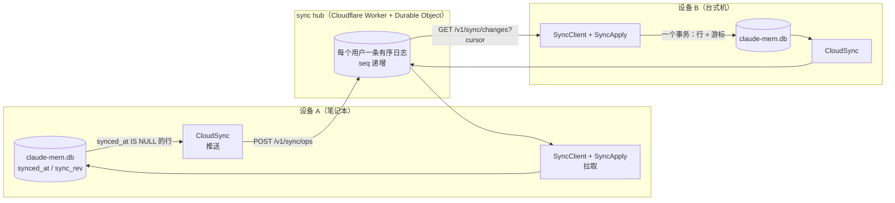
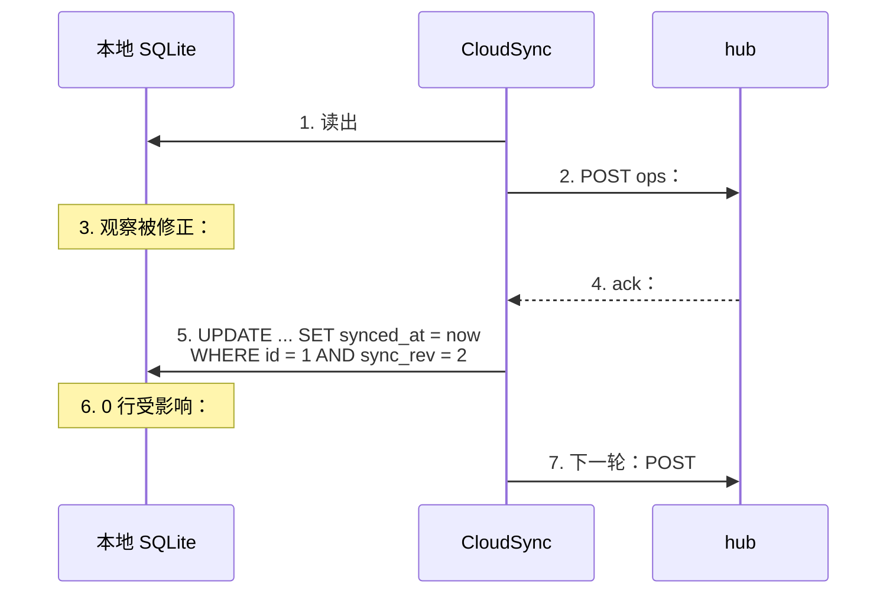

第 16 章的 Server 运行时解决的是“多个人共用一份记忆”。还有一个更常见的场景是“一个人、多台设备”：白天在公司台式机上干活，晚上在笔记本上接着干，两台机器上各有一个 `~/.claude-mem/claude-mem.db`，互相看不到对方的记录。

v13 给 worker 运行时加了云同步（`src/services/sync/`）。它没有把本地库换成远程库，每台设备仍然读写自己的 SQLite，同步只负责把各自新增和修改的行搬到对方那里。离线时照常工作，联网后自动追平。

这一章拆解它的设计。同步是分布式系统里最容易出错的部分，claude-mem 的实现在源码注释里把每一条不变量都写了出来，值得逐条看。

## 整体结构

云同步默认关闭：`CLAUDE_MEM_CLOUD_SYNC_HUB_URL` 为空时什么都不做。打开它需要 cmem.ai 的账户，安装器的 Pro 试用流程会写入令牌、用户 ID 和 hub 地址（默认 `https://sync.cmem.ai`）。hub 的代码在仓库的 `workers/sync-hub/` 里，同样以 Apache-2.0 开源，但令牌校验指向 cmem.ai 的接口，自建需要自己实现这一段。

整个系统由三部分组成，如图 19-1 所示：



*图 19-1：两台设备通过每个用户一条的有序日志同步*

hub 是每个用户一个 Durable Object，里面是一条只追加的有序日志，每条操作有一个递增序号 `seq`。设备推送时往日志里追加，拉取时从自己的游标位置往后读。一个用户最多 64 台设备。

hub 本身不做冲突合并，它负责三件事：日志有序；同一个“实体版本”只记录一次；把追加进来的数据投影（projection，即同步写一份）到 cmem.ai 的检索服务，并且等投影的检查点覆盖了这批操作才返回 200。合并规则全部在客户端的应用逻辑里，下面分推送和拉取两边讲。

第三件事意味着自建 hub 时要补的不只是令牌校验：投影服务的地址（`wrangler.jsonc` 里的 `INTERNAL_PROJECTOR_URL`）也指向 cmem.ai 的内部接口，要么自己实现，要么改掉“等投影完成才确认”这条约束。

## 推送：数据库就是队列

### 两层：脏标记和不可变快照

`CloudSync.ts` 文件头第一句就是“the database is the queue”。每张同步表都有一列 `synced_at`，`NULL` 表示“还不在 hub 的日志里”。找出要推送的行就是一条查询：

```sql
SELECT ... FROM observations
WHERE synced_at IS NULL AND origin_device_id IS NULL
```

`origin_device_id IS NULL` 表示这一行是本机产生的；从别的设备拉来的行带着来源设备 ID，不会被推回去。

选出来的行并不直接发送。`drainKind()` 先把每一行冻结成一份规范化的快照，写进 `sync_content_outbox` 表（`(entity_id, entity_rev)` 唯一），再只发送快照里存下的字节。注释给的理由是：之后的本地修改改变不了一次重试的请求体和哈希。如果直接从业务表现读现发，第一次推送超时、hub 其实已经收下了 rev 2，而重试时这一行恰好又被改过，同一个 rev 2 就会带着不同的内容再发一次，撞上 hub 的 `revision_hash_conflict`。所以这里是两层：`synced_at` 是“哪些行脏了”的标记，`sync_content_outbox` 是“这一版准备发出去的确切内容”。改标题、项目重映射这类变更操作走另一张 `sync_outbox` 表。

本地每次写入后调用 `notify()`，1.5 秒防抖后执行一次 `flush()`，按每页 40 行排空。注释特别说明了这种设计的好处：上线后的实时同步、离线后的追赶、失败后的重试是同一个机制，不需要历史回填、第二个进程或游标文件。设备离线三天，回来后 `synced_at IS NULL` 的行自然就是这三天的积压。

每页 40 行这个数字来自线上事故：原来一次推 200 条，hub 那边的投影处理不过来，请求在 30 秒时超时。客户端超时现在设为 90 秒，与 hub 的投影租约时长一致。投影租约是 hub 处理一批投影时持有的一把带时限的锁，同一时刻只有持锁者能写投影；客户端如果在租约中途放弃、马上重试，会撞上“投影忙”。

### 每一行都有稳定的身份和版本

一行数据推到 hub 上，需要一个全局唯一、在所有设备上都一样的 ID。claude-mem 不用 UUID 列，而是从“哪台设备的第几行”算出来（`CanonicalContent.ts` 的 `stableDocumentId()`）：

```typescript
const input = canonicalJson(['cmem-doc-id-v1', 'device', kind, deviceId, localId]);
return `${kind}:${sha256Base64Url(input)}`;
```

设备 ID 在第一次启动同步时生成一个 UUID，立即写回 `settings.json`，之后不再改变。写回失败时，本次启动直接关闭同步，而不是先用这个没保存下来的 ID 上传：下次启动会生成另一个 UUID，同一台设备就分裂成了两个身份（`resolveDeviceId()`）。

版本号 `sync_rev` 从 1 开始，每次修改加 1。操作体是规范化 JSON：键排序、64 位整数用十进制字符串表示，再算 SHA-256 作为 `operation_sha256`。hub 按 `(origin_device, kind, origin_id, rev)` 去重，先写者胜；同一个键来了不同的哈希，hub 直接拒绝（`revision_hash_conflict`）。

### 拿到 ack 之后才盖戳

推送的关键在“什么时候把 `synced_at` 写上”。注释里写了两条检查：

1. 完整的 200 响应里，ack 必须与推送的 `(id, kind, rev, operation_sha256)` 构成**完全相同的多重集合**。hub 可以乱序返回，但不能多也不能少。缺了、多了、格式不对，这一轮整体不盖戳，进入退避重试
2. 盖戳时加条件：只有这一行**当前的** `sync_rev` 仍等于 ack 里的版本，才写 `synced_at`

第二条处理的是一个很真实的竞态。如图 19-2 所示，推送请求在路上时，本地又改了这一行：



*图 19-2：盖戳条件 `sync_rev = 已确认的版本` 防止丢失路上的修改*

如果第 5 步不加版本条件，rev 3 的修改会被当成已同步，永远不会推出去。注释里把这条称为活锁防护的一部分：排空循环只能通过 ack 前进，任何不完整的响应都不会改变确认状态。

示例 `examples/ch19-cloud-sync` 的第 2 个场景复现了这个过程：

```text
[2] 推送请求还在路上时，笔记本又改了第一条
  第一次推送（rev 2）：{"pushed":1,"stamped":0,"deadLettered":0}
  第一条现在：{..., "rev":3, "synced":0, ...}
  下一轮推送（rev 3）：{"pushed":1,"stamped":1,"deadLettered":0}
```

### 失败分类

不同的失败要区别对待，否则一条坏数据可以卡死整个队列：

| 失败 | 处理 |
|---|---|
| 单个操作体超过 256,000 字节，或字段校验不过 | 移入死信表并记录原因，后面的行继续推 |
| hub 点名拒绝某个操作（`invalid_ops`、`revision_hash_conflict`、`stale_revision`） | 同一个操作被拒 3 次后移入死信；一轮里超过 25 次，判定为系统性问题，停下退避 |
| 401 / 403 | 换了凭证才可能成功，暂停推送，每小时复查一次（试用续期后自动恢复） |
| 429 | 按 `Retry-After` 等待；Cloudflare 的 HTML 429 至少等 10 分钟 |
| 其他网络错误、5xx | 30 秒起步，翻倍到 10 分钟 |

单个请求另有总量限制：不超过 4,000,000 字节、500 个操作。

## 拉取：一个事务里应用数据和游标

### 恰好一次

拉取由 `SyncClient` 轮询 `GET /v1/sync/changes`，交给 `SyncApply.applyOps()` 应用。`SyncApply.ts` 文件头的第一段：

> 拉取到的一批操作在**一个事务**里应用到本地 SQLite，拉取游标在**同一个事务**里推进。要么这一批的行和游标一起落地，要么都不落地。应用是幂等的，重新应用日志的任意前缀会收敛到同一个状态，所以 epoch 重置时可以直接从 seq 0 重新拉。

这里的 epoch 是 hub 日志的“代号”：hub 的日志被重建时会换一个新 epoch，序号从头开始，客户端发现 epoch 变了就从 seq 0 重新拉一遍。

两层保证叠在一起：事务保证崩溃时不会出现“行写了一半、游标没动”；幂等保证即使重复应用也没有副作用。游标的写入只有 `SyncApply` 一处，`SyncClient` 从不自己写游标。

示例的第 4 个场景在一批的第二条处抛错：

```text
[4] 拉取中途崩溃：整批回滚，游标不动
  第二条处理时：模拟崩溃
  游标：5 → 5
  台式机行数：3
  重新拉取：{"applied":2,"skipped":0}
  台式机行数：5
```

单个永远无法应用的操作不算整页失败：它被放进 `sync_pull_quarantine`，游标照常前进。这与推送侧的死信是同一个思路。

### 版本规则

应用远程操作时按版本决定是否覆盖：

| 操作 | 条件 |
|---|---|
| 行操作（观察、摘要、prompt 的新增和修改，包括删除墓碑） | `op.rev > 本地 sync_rev` 才应用；版本相等跳过 |
| 变更操作 `set_prompt_session`、`remap_project` | `op.rev >= 目标行的 sync_rev` 才应用 |
| 变更操作 `set_title` | 不看版本，按日志顺序，后到者胜 |

行操作在版本相等时跳过，理由是 hub 的去重保证了同一个 `(设备, 类型, 行, 版本)` 只有一份内容，重复应用只会白白触发一遍 FTS 触发器。

变更操作的版本由发出方按规则铸造。以 `remap_project` 为例：发出方先算出被影响行的最大版本 R，在同一个事务里把这些行的版本都设成 R + 1，再以 R + 1 发出操作。这样接收方的 `>=` 判断才成立。注释里专门警告：发出方如果在需要升版本时发了 rev 1，接收方会静默跳过。

### 回声防护是结构性的

设备 A 推上去的操作，会出现在 A 自己下一次拉取的结果里。不处理的话，A 会把自己的数据当成远程数据再应用一遍，更糟的情况是再推一遍，形成循环。

`SyncApply` 用两条规则堵住它，注释里强调“是结构性的，不是启发式的”：

- 来源设备是自己的操作，直接跳过
- 应用远程行时，预先写上 `synced_at = now`。推送查询只选 `synced_at IS NULL`，所以拉来的行在结构上不可能被推回去

示例的第 3 个场景：

```text
[3] 回声：台式机写一条推上去，再拉一次
  台式机推送：{"pushed":1,"stamped":1,"deadLettered":0}
  台式机自己拉：{"applied":0,"skipped":1}
  笔记本拉：{"applied":1,"skipped":4}
```

### 拉取的节奏

| 状态 | 轮询间隔 |
|---|---|
| 有活跃会话 | 30 秒 |
| 空闲 | 5 分钟 |
| 1 小时没有会话活动 | 完全停止，连实时通道一起断开 |

另有两个提前触发拉取的信号：推送的响应里会带上 hub 当前的 `head_seq`，比本地游标大就立即拉一次；可选的实时通道（`CLAUDE_MEM_CLOUD_SYNC_WS`，默认开启，基于 Supabase Realtime）只推送“日志前进了”这一条通知，不携带任何数据，收到后仍然走普通的 HTTP 拉取。实时通道断了，同步依然正确，只是延迟回到轮询的水平。hub 的部署文档把这条原则写成“成本护栏是结构性的：熔断就退回轮询，永远不是停止工作”。

## 哪些东西不同步

同步的是记忆内容，不是设备状态。以下字段只留在本机（`SyncApply.ts` 文件头的排除清单）：

| 字段 | 不同步的原因 |
|---|---|
| `synced_at`、`origin_device_id`、`origin_local_id`、`sync_rev` | 同步自身的簿记，后三个随操作的元数据传输 |
| `relevance_count` | 本机的使用计数 |
| `occurrence_count`、`title_norm_key` | 本机的去重簿记（第 7 章），去重扫描会在本地重新计算 |
| `reinforcement_dates`、`last_reinforced` | ACT-R 强化历史：每个副本按自己的确认记录排序 |
| `session_db_id` | 本机的行号，应用时在本地重新解析 |

强化历史不同步是一个有意思的选择。同一条观察在笔记本上被反复确认了五次，台式机上一次也没有，两台设备的开场索引排序就会不同。设计者的判断是：强化反映的是“在这台机器上的工作里，这条知识被反复用到”，它属于设备而不属于知识本身。示例的第 5 个场景：

```text
[5] 设备本地字段：强化次数不同步
  笔记本 reinforced：5
  台式机 reinforced：0
  笔记本待推送：{"pushed":0,"stamped":0,"deadLettered":0}
```

`sdk_sessions` 表也不同步。远程观察引用了本地不存在的会话时，`SyncApply` 先建一个最小的会话占位行，满足外键约束。会话的自定义标题则可能比会话本身先到，这时标题被“停放”在 `sync_state` 里，等会话出现时再认领。

Chroma 向量索引不参与同步。远程行在事务提交后异步送进本机的 Chroma，失败了由启动时的回填扫描补上。

## 删除与墓碑

删除在同步系统里是一次“写入”：删掉的行要以墓碑的形式推出去，其他设备收到后才知道要删。第 17 章提到的几条删除限制，根源都在这里：

- **只能删本机产生的行**。worker 的删除接口只接受 `origin_device_id IS NULL` 的行。从笔记本同步到台式机的观察，要在笔记本上删
- **同步状态不可用时拒绝删除**。一行已经被 hub 确认过，而本机的同步身份暂时读不出来，删除接口返回 503，避免产生一个其他设备永远不知道的删除
- **浏览器页面不能发删除**。带 `Origin` 头的 DELETE 只接受 Viewer 自己的页面，理由是删除会生成墓碑、影响所有设备

推送时墓碑排在最前面：已经冻结的内容先排空，变更操作在新的行快照之前排空。示例的第 6 个场景：

```text
[6] 删除：墓碑同步到另一台设备
  笔记本推送墓碑：{"pushed":1,"stamped":1,"deadLettered":0}
  台式机拉取：{"applied":1,"skipped":0}
  台式机剩下：["订单导出改流式","Windows 下路径大小写","Redis 宕机时请求挂起","pg_trgm 两个字不走索引"]
  台式机删笔记本同步来的行：#2 不是本机产生的行
```

## 与第 16 章 Server 运行时的对照

两套机制都在解决“记忆不只在一台机器上”，选择却很不一样：

| | 云同步（worker 运行时） | Server 运行时 |
|---|---|---|
| 解决的问题 | 一个人、多台设备 | 一个团队、共享一份 |
| 事实来源 | 每台设备的本地库 + hub 上的有序日志 | 中心 Postgres |
| 离线 | 照常工作，联网后追平 | Hook 回落到本地 worker |
| 冲突 | 按行版本，后到的更高版本胜 | 没有冲突：只有一个写入点 |
| 发件箱 | `synced_at` 标记脏行 + `sync_content_outbox` 存不可变快照 | 单独的 `observation_generation_jobs` 表 |
| 恰好一次 | ack 多重集合核对 + 事务内推进游标 | 事件内容哈希 + 确定性任务 ID + 发件箱行锁 |
| 开源情况 | 客户端和 hub 代码开源，服务由 cmem.ai 提供 | 全部开源，自行部署 |

团队/组织级的记忆同步在 `docs/ip-boundary.md` 里列为保留区域。从这一章的设计看，把它扩展到团队并不只是“多几个用户共享一条日志”：版本规则是按“设备 + 行”设计的，团队场景里两个人修改同一条观察的冲突、谁有权删除别人的观察、强化历史归属于人还是设备，都需要新的规则。

## 运行示例

```bash
cd examples/ch19-cloud-sync
npm install
npm run demo
```

示例用两个内存 SQLite 库和一个进程内 hub 跑完 7 个场景：离线写入后推送、推送途中的修改、回声、拉取中途崩溃、设备本地字段、删除墓碑、超大行进死信。

---

**思考题**

1. “拿到 ack 之后才盖戳”一节的盖戳条件是“当前版本等于已确认的版本”。如果改成“当前版本小于等于已确认的版本”，会在什么情况下出错？
2. 强化历史不同步，所以两台设备的开场索引排序可能不同。如果你认为强化应该跟着知识走，你会怎么同步它？两台设备同时强化同一条观察时怎么合并？
3. hub 按 `(设备, 类型, 行, 版本)` 去重、先写者胜。设想一台设备的数据库从备份恢复，`sync_rev` 回退到了一周前，之后的新修改会生成和 hub 上已有记录相同的键、不同的内容。会发生什么？claude-mem 的哪条机制会发现它？

---

> 本书开源发布于 [inferloop.dev](https://inferloop.dev)，转载请注明出处。

下一章是全书的最后一章，讨论 Agent Memory 的前沿方向：记忆互操作、遗忘、多模态，以及宿主自带的记忆与外挂记忆系统的关系。

---

> 本章来自《Agent Memory 工程实战》开源版 · 作者「递归客」  
> 在线阅读完整书系：[inferloop.dev](https://inferloop.dev)  
> 源码仓库：[github.com/diguike/book-claude-mem](https://github.com/diguike/book-claude-mem)
