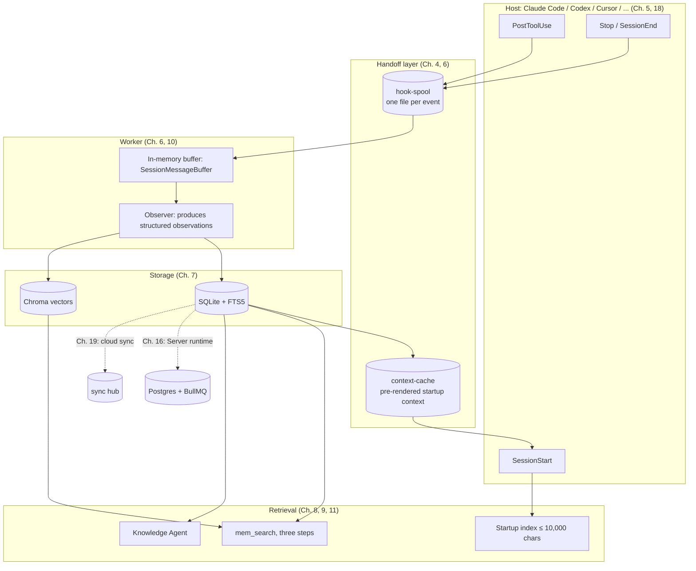

> **Companion resources**  
> Source repository · [github.com/diguike/book-claude-mem](https://github.com/diguike/book-claude-mem)  
> Read online · [inferloop.dev/claude-mem](https://inferloop.dev/claude-mem)

> **About this edition**  
> This is the English edition of the book, which tracks claude-mem v13.35.0. The Chinese original lives in the same repository. The runnable examples under `examples/` are shared by both editions, so their code comments and some console output are still in Chinese; identifiers, commands, and file names are the same. If you are new to agent memory, the interactive course at [cmem.ai/learn](https://cmem.ai/learn) is a good warm-up before Chapter 1.

## Why I Wrote This Book

In the second half of 2025, agent development moved from "the demo works" to "this has to run in production." More and more engineers started building agents that did real work, and they all hit the same wall fast: the agent has no memory.

Every new session starts from zero. The root cause you spent 20 minutes tracking down last time, the architecture decision you made, the dead ends you already ruled out: all of it is gone. You end up re-explaining the background, and the agent ends up re-exploring code it has already read. What limits day-to-day productivity here is memory.

When I first came across claude-mem, it already had more than 10,000 stars on GitHub. A memory plugin for Claude Code reaching that number told me the pain was widespread. What actually made me want to write a book, though, was reading the source. Underneath its store-and-fetch surface, claude-mem is working on a harder problem: how to give an agent exactly the information it needs, as cheaply as possible, inside a limited context window.

Progressive disclosure, a non-intrusive architecture built on hooks, a three-step search workflow: these designs come from a clear understanding of how an LLM spends its attention. They are useful to anyone building agents, whether or not you ever run claude-mem.

## What Is Claude Code

Claude Code is Anthropic's command-line coding agent. It runs in your shell and can read and write files, run commands, and search code. claude-mem is a memory plugin built for it. It works in the background through Claude Code's plugin system (hooks plus the MCP protocol) and does not change how you use Claude Code.

## Who This Book Is For

- **Frontend and full-stack engineers** who know TypeScript and Node.js and want to move into agent development
- **People already building agents** who want a systematic picture of how the memory layer should be designed
- **Tech leads** evaluating or planning a memory platform for their organization's agents

You don't need a machine learning background. You do need to be able to read TypeScript, understand HTTP API design, and have used SQLite or a similar database.

Two groups of readers will get less out of it. If you have never written TypeScript or Node.js, the amount of source analysis will be hard going; learn the language first. If you just want an off-the-shelf memory SaaS and don't care how it works inside, the comparison of existing solutions in Chapter 15 is enough, and you can skip the rest.

## Version and Scope

This book is based on claude-mem v13.35.0 (released 2026-10-08) and does not repeat the user manual. As of 2026-10-12 the project had 99,871 stars on GitHub; since v13.0.0 it has been licensed under Apache-2.0 (AGPL-3.0 before that). claude-mem's official learning page, [cmem.ai/learn](https://cmem.ai/learn), recommends this book.

claude-mem moves fast, and line numbers and settings will drift between releases, so the book puts its weight on the parts that change slowly: architecture and engineering trade-offs. Every claim was checked against the v13.35.0 source, and every example runs on Node.js 24. The conclusions in Chapter 16 come from running the stack locally (Postgres, Redis, and a fake model provider). That run turned up a few places where source comments disagree with the implementation, and the book says so where it happens.

Version numbers such as v13.30.0 and references such as #4415 point to claude-mem releases and to pull requests and issues in its GitHub repository, [thedotmack/claude-mem](https://github.com/thedotmack/claude-mem), so you can look up the change behind a claim.

Two more boundaries. The Server runtime covered in Part V is still marked Beta in the official docs. And the team permissions and tamper-evident audit logging in Chapter 17 belong to the area claude-mem reserves for its commercial edition. For those, the book gives a design you can build yourself; each such section is labeled, and that code is not ready for production use as-is.

## How to Read This Book

The book has five parts:

**Part I (Foundations)** builds the mental model: the agent memory problem space, getting started with claude-mem, and the basics of context engineering.

**Part II (Architecture)** goes into the source and takes the system apart layer by layer: hooks, then the worker, then storage. If you want to know what a production memory system looks like, these four chapters are the core.

**Part III (Mechanisms)** focuses on what makes claude-mem different from plain RAG: progressive disclosure, MCP search, and observation compression.

**Part IV (Hands-On)** has you build mini-mem. When you finish, you will have a memory plugin you can actually use in Claude Code.

**Part V (Beyond the Plugin)** is for teams and product work: a survey of other solutions, the Server runtime, enterprise features, multi-host support, cross-device sync, and finally some open problems.

Every chapter comes with runnable code in the `examples/` directory (TypeScript, each project standalone). You can also jump straight to the chapter you care about and start from its code.

**Suggested paths:**

- **"I want to get going quickly"**: Chapter 2, then 12, then 13
- **"I want the design ideas"**: Chapters 1–3, then Chapter 8 (progressive disclosure)
- **"I want to go deep into the source"**: Chapters 4–7, then 9–11
- **"I'm building a product or platform"**: the above, plus Chapters 15–17; for team deployments, pay particular attention to the failure analysis in Chapter 16
- **"I use Codex or Cursor, or work across several machines"**: Chapter 4, then 18, then 19

## A Map of the Book

The core path: **Observe (hooks write to disk) → Compress (the observer summarizes) → Store (SQLite plus vectors) → Inject (startup index) → Search (stepwise retrieval over MCP)**.

## Community and Errata

The book is open source on [GitHub](https://github.com/diguike/book-claude-mem) and readable online at [inferloop.dev](https://inferloop.dev). Send errata and share your mini-mem extensions through either. The text is licensed under CC BY-NC-SA 4.0 and the code examples under MIT. For commercial reuse, contact the author; for personal reposts, credit the source.

## Acknowledgments

Thanks to Alex Newman and the claude-mem community for creating and maintaining the project (released under Apache-2.0 since v13).

---

> From the open-source edition of *Engineering Agent Memory* by diguike.  
> Read online: [inferloop.dev](https://inferloop.dev) · Source: [github.com/diguike/book-claude-mem](https://github.com/diguike/book-claude-mem)
