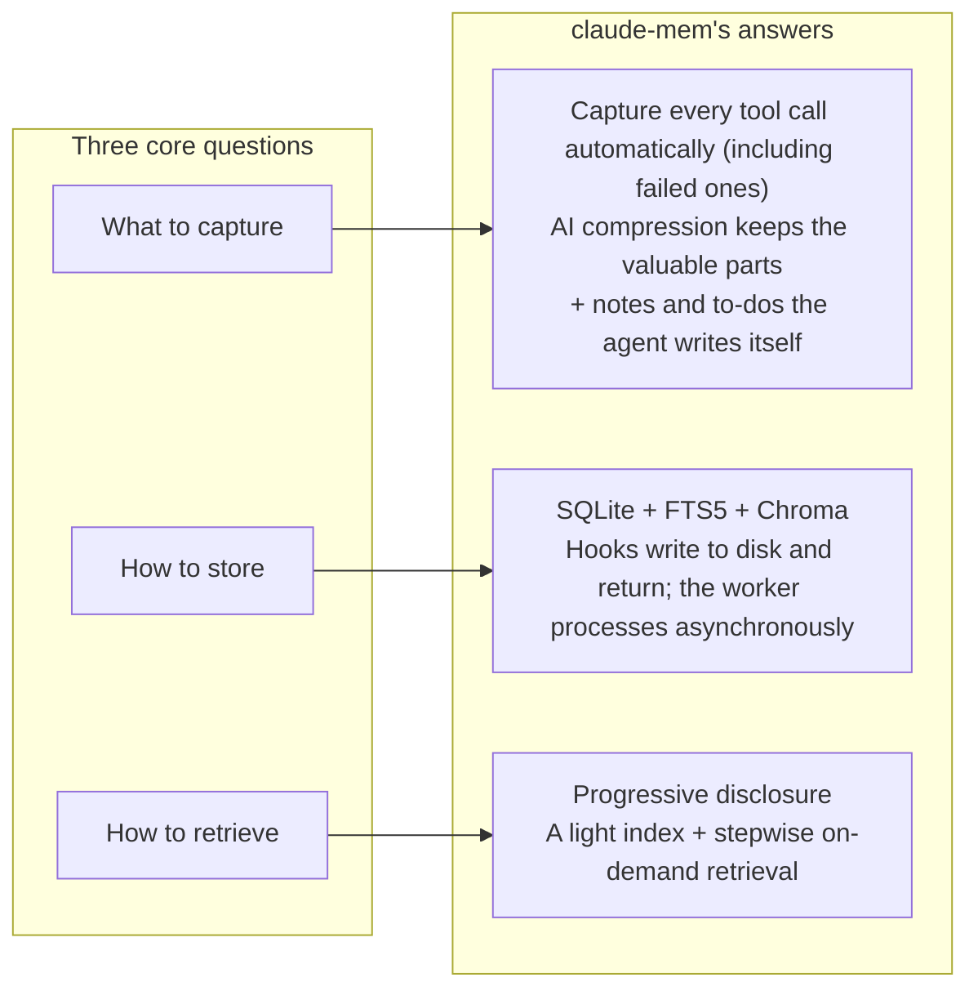

## A Five-Minute Experiment: Feel the Problem First

Before any theory, spend five minutes seeing the difference between an agent with memory and one without.

**Steps** (you need Claude Code and Node.js 20.12 or later):

```bash
# 1. Install claude-mem for Claude Code only; the observer uses your own Anthropic account
npx claude-mem install --ide claude-code --provider claude

# 2. Restart Claude Code and start a first session
claude
# Type: "Create hello.ts in the current directory that exports a greet function"
# Claude creates the file. When it's done, exit the session (/exit)

# 3. Start a second session
claude
# Type: "Pick up where we left off"
# Watch: Claude knows you just created hello.ts and continues from there
```

Running `npx claude-mem install` with no arguments starts an interactive installer. It asks which agents to connect (besides Claude Code there are more than a dozen, including Codex and Cursor), which model source the observer should use, and it may open a browser to sign in to claude-mem's cloud service. The command above passes `--provider claude` explicitly, so the installer skips the sign-in and your memory stays entirely on your machine.

If you'd rather not install anything yet, that's fine; you can come back to it any time, and later chapters explain each step of what happens. The point to take away: **Claude "remembers" the first session in the second one because claude-mem injected the earlier context automatically at SessionStart.**

The rest of this chapter looks at what the underlying problem actually is.

## The Goldfish Problem

Open a fresh Claude Code session and type "continue yesterday's work."

Without a memory system, the most likely answer is: "I don't have context from previous sessions. Could you tell me what you were working on?"

That is the agent memory problem in one line: **every session starts with a blank page.** An LLM has no persistent working memory. What it learned during the last conversation (how the code is structured, how a bug was tracked down, which design decisions were made) disappears when the session ends.

For one-off questions this doesn't matter. Software engineering, though, is work that runs for days or months, and losing memory gets expensive:

```
Day 1: 30 minutes exploring the project layout and how the core modules relate
Day 2: new session, the agent spends another 30 minutes doing the same thing
Day 3: same again
...
Day N: the same 30 minutes, wasted N times
```

Losing decisions is worse. On day 1 you and the agent talk it through and choose approach A over approach B. On day 2 the agent may suggest B again, because it remembers neither the choice nor the reasoning behind it.

## What Broken Context Costs

Here are some rough numbers to show the scale (order-of-magnitude estimates, not measurements):

**Time.** On a moderately complex project, each new session needs 3–5 minutes to rebuild context. At five sessions a day, that's 1–2 hours a week spent purely on getting the agent to remember.

**Quality.** With no record of past decisions, the agent can contradict its earlier advice. Worse, if it "forgets" a known bug or edge case, it can reintroduce a problem that was already fixed.

**Attention.** The engineer becomes the agent's external memory and has to restate the background by hand every time. That defeats the point of using an agent to save effort.

In practice, engineers have come up with workarounds:

- Keep a CLAUDE.md file and write project conventions into it by hand
- Paste a block of background at the start of every session
- Keep important decisions in personal notes and copy them to the agent when needed

These help, but they are manual, incomplete, and easy to forget. A good memory system should automate the process. The hosts are moving that way too: Claude Code has built-in auto-memory, and Codex has its own memories directory. Chapter 15 discusses how those relate to plugins like claude-mem.

## Three Questions Every Memory System Must Answer

Designing agent memory comes down to three questions: what to capture, how to store it, and how to retrieve it. Figure 1-1 maps each question to claude-mem's answer; the sections below take them one at a time.



*Figure 1-1: The three core questions for a memory system and claude-mem's answers*

### What to Capture

Not everything is worth keeping. The output of an `ls`, a temporary variable assignment: that's noise. What's worth remembering:

- **Decisions**: why approach A was chosen over B
- **Discoveries**: the root cause of a key bug, where a performance bottleneck lives
- **Changes**: architecture-level code changes and the intent behind them
- **Pitfalls**: known edge cases, fixed problems, and approaches that were tried and failed
- **Progress**: what's done and what comes next

claude-mem's main approach is to record every tool call (file reads and writes, commands, searches, and so on, including calls that failed) and then use AI compression to pull out the valuable parts. Raw data is captured in full; summaries are generated on demand.

v13 added a second approach: let the agent write things down itself. The `save_memory` tool lets the agent record the user's preferences, corrections, and verbal decisions, which never show up as tool calls. `work_state_write` lets the agent keep a to-do list that survives across sessions (Chapter 8). The first approach records what happened; the second records what the agent thinks it must not forget.

### How to Store

Storage involves two separate choices.

**Structured or unstructured:**

- Plain text (Markdown notes, say): simple, but hard to search precisely
- A structured database (such as SQLite): precise queries, but you have to define a schema up front
- A vector store (such as Chroma): semantic search. Text is turned into vectors (embeddings), and distance between vectors stands in for "similar meaning." Quality depends on the embedding model

**Real-time or batched:**

- Real-time writes: every operation is persisted immediately, so nothing is lost, but performance can suffer
- Batch processing: accumulate and process together, which is fast but risks losing data

claude-mem uses a hybrid. SQLite provides structured storage, FTS5 adds full-text search (SQLite's built-in full-text engine, so there's no Elasticsearch to run), and Chroma adds semantic search. Writes happen in two stages. A hook atomically writes the event to a file and returns, so the host never waits. A long-running worker process then picks up the file and does compression and storage in the background. Data is made durable at the handoff point, and the background processing happens in memory. Chapter 6 explains why the split falls there.

### How to Retrieve

This is the most important of the three. You've recorded 10,000 observations. When a new session starts, which ones should go into context?

**Inject everything.** Put the whole history into context. The token window is finite, most of the history is irrelevant to the current task, and the model's attention gets diluted.

**Smart retrieval.** The system predicts what's relevant to the current task and injects only that. The system doesn't know what the user is about to do, so its predictions are often wrong.

**Progressive disclosure.** Hand over a lightweight index first (titles, types, timestamps) and let the agent decide what to look at in detail. This requires an agent that knows to go and search.

claude-mem takes the third option. The judgment behind it: **the agent knows better than the system what the current task needs.** Rather than have the system guess, give the agent a map and let it navigate. v13 goes further and makes "read the index, then pick details" a protocol enforced by the search tools; the agent cannot skip the index and fetch full text directly (Chapter 8).

## Existing Approaches

The agent memory approaches out there fall into a few families.

### RAG (Retrieval-Augmented Generation)

The classic approach: embed past information into a vector store, and at the start of each session retrieve the top K matches and inject them into context.

```
Pros: simple concept, mature implementations
Cons: retrieval happens before the task is known, so it can't follow intent
      a good share of what comes back is irrelevant, wasting tokens
      heavily dependent on embedding quality
```

### Structured Notes

The agent writes notes as it works (TODO.md, NOTES.md, and so on), and the next session loads them.

```
Pros: the agent manages them, so quality is high
Cons: depends on the agent "remembering" to write notes
      no consistent format, hard to search systematically
      notes kept in the repo cause merge conflicts
```

### Compaction

At the end of a session, generate a structured summary, and inject the summary next time instead of the raw conversation.

```
Pros: dense information, efficient on tokens
Cons: summarizing loses information
      you can't trace back to exact original details
      summary quality depends on the compression prompt
```

### What claude-mem Combines

claude-mem isn't a plain implementation of any one of these. It combines all three:

| Aspect | What claude-mem does |
|------|-----------------|
| Capture | Observes every tool call automatically, without relying on the agent to write anything; also offers tools for explicit writes |
| Compression | The AI produces structured observations (type, title, narrative, facts) and a summary at the end of each session |
| Storage | Two engines, SQLite and Chroma; raw tool inputs and outputs are kept separately so you can go back when a summary isn't enough |
| Retrieval | Progressive disclosure: inject an index, then fetch details on demand, step by step |

## claude-mem's Design: Observe → Compress → Inject

claude-mem's core workflow fits in three verbs.

### Observe

claude-mem listens to every tool call through the host's hook system without getting in its way. What files the agent read, what code it changed, what commands it ran, which command failed: the PostToolUse or PostToolUseFailure hook catches all of it.

The key constraint is that **observing must not disturb what is being observed.** claude-mem's write hooks run asynchronously on the host side, so the host doesn't wait for them at all. The hook itself does exactly one thing: write the event to a file. Any internal error still ends with exit code 0, so it never blocks the user's session (Chapters 4 and 5).

### Compress

The background worker takes the event and hands it to the observer model for AI compression. By default the observer is Claude, called through the Claude Agent SDK; it can also be Gemini, OpenRouter, or any OpenAI-compatible API. From a long stretch of tool input and output, it extracts:

- A type (one of nine, such as decision, bugfix, or discovery)
- A short title
- A narrative
- A few key facts
- Related file paths and concept tags

This turns a few thousand tokens of raw data into a few hundred tokens of structured observation. The observer itself runs in a session with no tool permissions at all. It can only read and write XML.

### Inject

When the next session starts, the SessionStart hook injects a block of context. First comes the to-do list the agent maintains, then an index of recent observations, one line each with only the ID, time, type, and title. The whole block is held under 10,000 characters, with anything beyond that cut by priority (Chapter 8). After reading the index, the agent uses MCP search tools to fetch full details as needed.

```
Observe:  capture everything, miss nothing, block nothing
Compress: AI keeps the valuable parts and cuts noise
Inject:   progressive disclosure, the agent decides
```

---

**Questions to consider**

1. If your project has three files and takes one day, is agent memory worth it? Where is the point at which a memory system starts paying for itself?
2. claude-mem uses tool calls rather than chat messages as its unit of memory, and adds `save_memory` so the agent can record things on purpose. If you were designing memory for an AI assistant that works on a frontend component library, what would you use as the unit of observation? Which information would the agent have to write down explicitly?
3. Progressive disclosure lets the agent decide what to look at. If it judges wrong and skips something relevant, what does the system have as a fallback? (Hint: the file-read hook in Chapter 5 and the to-do list in Chapter 8.)

---

The next chapter looks at claude-mem itself: what it can do, how to install it, and how it fits into daily work.

---

> From the open-source edition of *Engineering Agent Memory* by diguike.  
> Read online: [inferloop.dev](https://inferloop.dev) · Source: [github.com/diguike/book-claude-mem](https://github.com/diguike/book-claude-mem)
