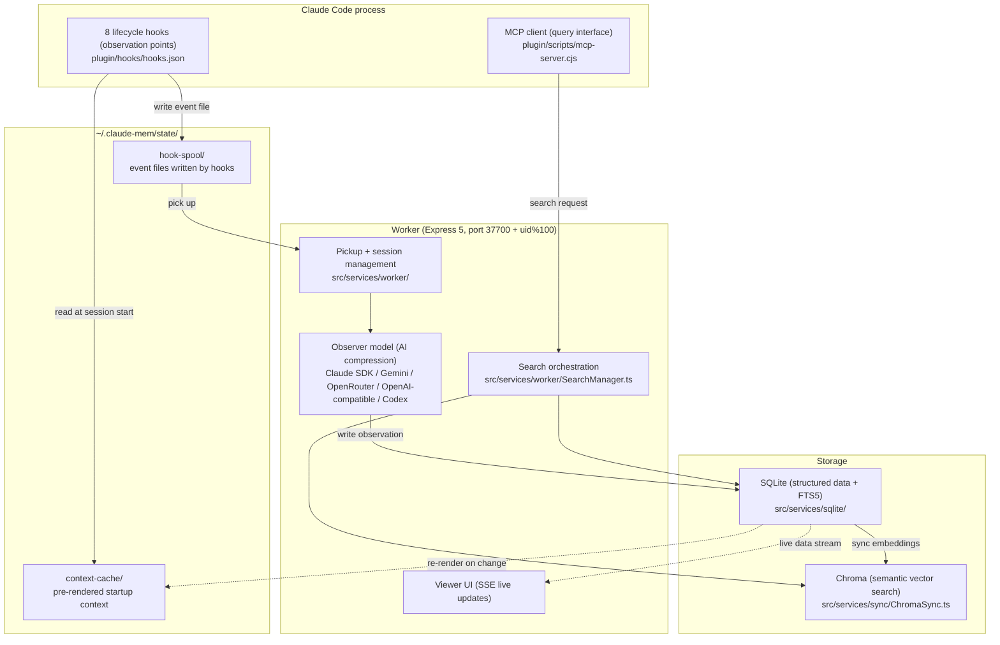

This book follows claude-mem v13.35.0 (released 2026-10-08), licensed under Apache-2.0. The license changed from AGPL-3.0 to Apache-2.0 in v13.0.0.

## What claude-mem Is

In one sentence: **claude-mem is a memory plugin that watches a coding agent's tool calls, compresses them into structured memories with AI, and serves them back on demand in later sessions, giving the agent persistent memory across sessions.**

It was originally built only for Claude Code, hence the name. As of v13, the same memory can be shared with more than a dozen agents, including Codex CLI, Cursor, Windsurf, OpenCode, Pi, and DeepSeek Harness (Chapter 18). Parts I through IV of this book use Claude Code as the main thread.

Once it's installed, you don't do anything. You use Claude Code as usual, and claude-mem watches, records, and compresses in the background. In the next session, relevant history shows up in Claude's context on its own.

At runtime claude-mem has three layers. Hooks and an MCP client inside the host process handle observation and queries. A long-running worker process handles compression and orchestration. A storage layer handles persistence. Writes flow from the top down, and query requests travel from MCP all the way to storage, as Figure 2-1 shows.



*Figure 2-1: claude-mem's three runtime layers. Writes reach the worker through files; queries go from MCP through search orchestration to SQLite and Chroma*

## Six Core Capabilities

### 1. Automatic Observation

Two hooks, PostToolUse and PostToolUseFailure, capture every tool call: file reads, edits, commands, and searches, including calls that failed or were interrupted. You never mark which operations are worth recording. The system captures everything and lets the AI judge what matters.

### 2. AI Compression

The worker hands each tool call to an observer model, which compresses it into a structured observation. One code edit can produce a few thousand tokens of raw data; after compression it's a record of one or two hundred tokens, roughly like this:

```
Type: ● bugfix (concepts: problem-solution, gotcha)
Title: Fix race condition during session teardown
Narrative: SessionEnd fired before the worker finished the summary, so the summary was lost...
Facts:
  - Cause: SessionEnd raced with summary generation
  - Fix: SessionEnd only writes an event file; the worker processes events in order
Files: src/cli/handlers/session-end.ts
```

Every observation carries two classification fields that are easy to mix up: **type** and **concept**. They are independent dimensions of the same record.

Type answers "what kind of action does this record describe?" The default `code` mode (`plugin/modes/code.json`) defines nine, and each has a symbol used in the index:

| type | Symbol | Meaning |
|------|------|------|
| `bugfix` | ● | Fixed a defect |
| `feature` | ◆ | New functionality |
| `refactor` | ↻ | Refactoring |
| `change` | ✓ | General change (docs, config, and so on) |
| `discovery` | ○ | Learned something about the existing system |
| `decision` | ⚖ | Architecture or design decision |
| `security_alert` | ⚠ | A security problem that needs attention first |
| `security_note` | ⚷ | Security information worth keeping, not urgent |
| `sensitive` | ⊘ | Not secret, but shouldn't leak into other content |

Concept answers "what kind of knowledge is this?" There are seven: how-it-works, why-it-exists, what-changed, problem-solution, gotcha, pattern, and trade-off. Concepts have no symbols; they're used for filtering during search and context injection. In the example above, the type is bugfix and the concepts are both problem-solution and gotcha.

The default observer is Claude, called through the Claude Agent SDK on your own Claude account, using the model `claude-haiku-4-5-20251001`. If you switch the default to a stronger and more expensive model, batches made up only of read-only tools such as Read, Glob, and Grep still go to the Haiku tier automatically (`CLAUDE_MEM_TIER_SIMPLE_MODEL`). You can also switch to Gemini, OpenRouter, any OpenAI-compatible API (with built-in presets for deepseek, ollama, vllm, and others), or Codex.

### 3. Context Injection

At the start of every new session, the SessionStart hook injects a block of context. First comes the to-do list the agent maintains, then an index of recent observations (one line each: ID, time, type symbol, title), then the most recent session summary. The whole block is held under 10,000 characters, which is the most Claude Code will pass through from a hook's output unchanged. When the agent sees an entry that looks relevant to the task, it fetches the full content through MCP tools.

### 4. Progressive Search

claude-mem exposes a set of retrieval tools over MCP (Model Context Protocol, an open protocol from Anthropic that defines how LLM applications call external tools, playing roughly the role LSP plays for editors):

| Tool | Purpose | Cost |
|------|------|------|
| `mem_search` | The recommended entry point. Guided mode has three steps (index, timeline, details), and each step can only pick IDs that appeared in the previous one. Auto mode runs all three at once | Tens of tokens per index entry, hundreds per detail |
| `get_tool_uses` | Raw tool inputs and outputs, for when the summary isn't enough | Can be thousands of tokens |
| `search` / `timeline` / `get_observations` | The older three-step tools, kept for advanced filters and older clients | Same as above |
| `important_workflow` | Workflow instructions | Fixed |

The full list has 19 tools in the local runtime; Chapter 9 goes through them one by one.

### 5. Explicit Memory and To-Dos

Automatic observation records what happened. Some information never appears as a tool call: your preferences, a correction you gave the agent, a decision made in conversation. v13 provides two write tools for that:

- `save_memory`: the agent writes a note directly, with no AI compression step
- `work_state_write` / `work_state_read`: the agent keeps a to-do list across sessions, and unfinished items appear at the top of every session

### 6. Knowledge Bases

You can compile observations on a particular topic into a knowledge base (a corpus), have a dedicated model session read all of it, and then ask it questions repeatedly:

```
build_corpus name="auth-architecture" project="my-app" concepts="trade-off" types="decision"
prime_corpus name="auth-architecture"
query_corpus name="auth-architecture" question="What is the token refresh strategy in the auth module, and why was it chosen?"
```

This works well for building deep knowledge of one area, such as "every decision about the deployment process" or "bug-fix patterns from the last month" (Chapter 11).

## Installation and Configuration

### Installing

You need Node.js 20.12 or later. The usual command:

```bash
npx claude-mem install
```

The interactive installer goes through these steps:

1. Checks for and installs Bun (the worker's runtime, which has a built-in SQLite driver and starts quickly)
2. Checks for and installs uv (a Python package manager, used to run Chroma's MCP server, `chroma-mcp`)
3. Asks which agents to connect. Detected agents are pre-selected; if none are detected, it defaults to Claude Code
4. Asks where the observer model should come from. This may open a browser to sign in to cmem.ai, claude-mem's cloud service, which offers a hosted observer and cloud sync with a 30-day free trial
5. For Claude Code, asks whether to turn off its built-in auto-memory (the recommended default is to leave it on)
6. Writes the plugin and hook configuration and starts the worker

If you don't want the cloud sign-in and just want to use your own Anthropic account, say so explicitly:

```bash
npx claude-mem install --ide claude-code --provider claude
```

If you pass `--provider`, if `CLAUDE_MEM_ONLINE_OPTIN=false` is set, or if the installer runs non-interactively (in CI, for example), there are no account prompts at all. Restart Claude Code afterward and memory starts working.

You can also install through Claude Code's plugin marketplace:

```bash
# Run inside Claude Code
/plugin marketplace add thedotmack/claude-mem
/plugin install claude-mem
```

Note that `npm install -g claude-mem` only installs the library files. It doesn't register any hooks or start the worker.

### Telemetry

Since v13.5.0, claude-mem sends anonymous usage statistics (PostHog) by default. According to the allowlist scrubber in the source (`src/services/telemetry/scrub.ts`), only pre-listed fields such as version, platform, timings, and counts can leave your machine. Prompts, file paths, project names, and search terms are never sent. Any of these turns it off:

```bash
npx claude-mem telemetry disable
# or set an environment variable
export DO_NOT_TRACK=1
export CLAUDE_MEM_TELEMETRY=0
```

`npx claude-mem telemetry status` shows the current state and which setting decided it.

### Verifying the Install

```bash
npx claude-mem status     # Is the worker running? Version, port
npx claude-mem doctor     # Checks Bun, uv, the worker, the tree-sitter CLI, and Chroma one by one
```

The worker comes with a web UI, the Viewer, at `http://localhost:<port>`. The port defaults to `37700 + (uid % 100)`, so on macOS and Linux it differs from user to user. Windows has no uid, so it uses 77 and the port is always 37777. Chat with Claude Code for a few turns; if new observation cards appear in the Viewer, everything is working.

### Core Settings

The settings file is `~/.claude-mem/settings.json`. It's created on first run with file mode 0600. Keys are all upper-case with underscores, values are always strings, and every key and default is defined in `src/shared/SettingsDefaultsManager.ts`:

```json
{
  "CLAUDE_MEM_CONTEXT_OBSERVATIONS": "50",
  "CLAUDE_MEM_CONTEXT_SESSION_COUNT": "10",
  "CLAUDE_MEM_PROVIDER": "claude",
  "CLAUDE_MEM_MODEL": "claude-haiku-4-5-20251001",
  "CLAUDE_MEM_MODE": "code"
}
```

Commonly used settings:

| Setting | Default | Description |
|--------|--------|------|
| `CLAUDE_MEM_CONTEXT_OBSERVATIONS` | `50` | Maximum number of observations in the SessionStart index |
| `CLAUDE_MEM_CONTEXT_SESSION_COUNT` | `10` | Number of session summaries injected |
| `CLAUDE_MEM_WORKER_PORT` | `37700 + uid % 100` | Worker port |
| `CLAUDE_MEM_WORKER_HOST` | `127.0.0.1` | Worker listen address |
| `CLAUDE_MEM_PROVIDER` | `claude` | Observer model source: claude, gemini, openrouter, openai-compatible, codex |
| `CLAUDE_MEM_MODEL` | `claude-haiku-4-5-20251001` | Model used when the provider is claude |
| `CLAUDE_MEM_MODE` | `code` | Observation mode. Language variants exist, such as `code--zh`, which makes the observer write in Chinese |
| `CLAUDE_MEM_DATA_DIR` | `~/.claude-mem` | Data directory |
| `CLAUDE_MEM_EXCLUDED_PROJECTS` | empty | Directories not to record, as comma-separated globs |
| `CLAUDE_MEM_FILE_READ_GATE_ENABLED` | `true` | Whether to intercept whole-file reads of large code files (Chapter 8) |
| `CLAUDE_MEM_CHROMA_ENABLED` | `true` | Turn off to use SQLite search only |
| `CLAUDE_MEM_REDACT_ENABLED` | `false` | Automatically redact common secret formats (Chapter 10) |
| `CLAUDE_MEM_LOG_LEVEL` | `INFO` | Log level |

Every setting can be overridden by an **environment variable with the same name**, and the environment variable wins over settings.json. That's why the keys use environment-variable naming in the first place: both sides share one set of names.

## Everyday Scenarios

### Scenario 1: Continuous Work Across Sessions

On day one you and Claude work out a database schema and make a few key decisions. When you open a new session on day two, you don't restate them. The startup index contains a line like:

```
342 3:15p ⚖ Store metadata in jsonb instead of a separate table
```

From that line Claude knows the metadata storage question is settled and won't propose something that conflicts. When it needs details, it uses `mem_search` to pull the full text of #342.

### Scenario 2: Code Archaeology

Three months ago you did a performance optimization, and now you need to remember exactly what was done:

```
"Search for earlier records about optimizing API response time"
```

Claude uses `mem_search` to find matching observations, then fetches details for the most relevant few, including the narrative from the time and the list of files changed. It's faster than digging through git log or grepping the code. The startup index only lists the few dozen most recent observations; anything older has to be retrieved by search.

### Scenario 3: Tracing a Decision

A product manager asks why the team chose PostgreSQL over MongoDB. If the original discussion left observations, you can look it up directly:

```
search(query="postgresql mongodb", obs_type="decision")
```

That returns the decision record, including the reasoning, the comparison, and the constraints at the time.

### Scenario 4: Team Onboarding

A new team member taking over the project can get oriented through the Knowledge Agent:

```
build_corpus name="project-overview" project="my-app" limit=200
prime_corpus name="project-overview"
query_corpus name="project-overview" question="What is the core architecture of this project? What are the main modules?"
```

By default, claude-mem's memory lives on one machine. Sharing it across a team requires the Server runtime (Chapter 16) or cloud sync (Chapter 19).

## The Viewer UI

The Viewer is a React page served by the worker, at the address above. Its main features:

- **Timeline view**: shows new observations and session summaries as they're created, via SSE (Server-Sent Events, a one-way push from server to browser)
- **Sessions view**: browse by session, one page per session, with filtering by type
- **Delete**: observation and summary cards have a delete button. Deletions propagate to other open tabs, and to other devices if cloud sync is on
- **Settings**: most settings can be changed from the page, including the observer model source and the File Read Gate switch
- **Restart**: if the worker misbehaves, the page at `http://localhost:<port>/restart` has a restart button

The Viewer is optional. claude-mem's core works entirely through hooks and MCP; the Viewer is just a visual add-on.

## Skills

claude-mem installs 22 skills along with the plugin. A skill is one of Claude Code's extension mechanisms: a Markdown file with instructions that Claude loads automatically when it's relevant, or that you trigger manually with a `/` command. They fall roughly into three groups:

**Directly about memory**

| Skill | Purpose |
|-------|------|
| `mem-search` | Answers "what did we do before?" questions, using stepwise search internally |
| `knowledge-agent` | Builds and queries knowledge bases |
| `timeline-report` | Writes a narrative report of a project's full development history |
| `weekly-digests` | Writes the project history as a series of weekly digests, one per ISO week |
| `handoff` | Produces a HANDOFF.md (goal, current state, relevant files, failed attempts, next steps, memory pointers) for a new session to pick up from |
| `how-it-works` | Explains how claude-mem captures, when it injects, and where data is stored |
| `mode-creator` | Builds a custom observation mode for your own domain through conversation |
| `cloud-sync` | Configures and checks cloud sync |

**Development workflow**

| Skill | Purpose |
|-------|------|
| `learn-codebase` | Reads through a codebase's source files so later sessions have memory to draw on |
| `smart-explore` | Structured code browsing with tree-sitter, without reading whole files |
| `make-plan` / `do` | Produces a phased implementation plan, then executes it with subagents |
| `pathfinder` | Maps a codebase into flowcharts by feature and finds duplicated concerns |
| `babysit` | Watches a PR's checks and review comments until it's ready to merge |
| `standup`, `oh-my-issues`, `design-is`, `version-bump` | Standups, issue triage, design review, version releases |

**Other**: `agent-cost-report`, `ccs-align`, `what-the`, and `wowerpoint` aren't related to this book's topic, so they're not covered here.

## Tuning

### Controlling How Much Gets Injected

If SessionStart injects too much or too little:

```json
{
  "CLAUDE_MEM_CONTEXT_OBSERVATIONS": "30",
  "CLAUDE_MEM_CONTEXT_SESSION_COUNT": "5"
}
```

Setting these high won't overflow the context. When the rendered result goes over 10,000 characters, the system trims it by priority automatically (Chapter 8). The cost of setting them too high is that busy projects get trimmed constantly, and you end up with no more entries than a smaller setting would give you.

### Excluding Directories

claude-mem applies to every project by default. For places that don't need memory, such as scratch directories or personal notes, exclude them with globs:

```json
{
  "CLAUDE_MEM_EXCLUDED_PROJECTS": "~/tmp/**,~/scratch/**"
}
```

Excluded directories get no observations recorded and no context injected at session start. The `.claude-mem-ignore` file mentioned in older write-ups doesn't exist in claude-mem.

### How Projects Are Identified

Memory is isolated per project. By default the project name is the name of the git repository's root directory. A worktree counts as `parent-project/worktree-name` and can also read the parent project's memory. A git submodule becomes `parent-project/submodule-path`. There are a few other options:

- `CLAUDE_MEM_PROJECT_NAME_SOURCE=git-remote`: use the origin remote's `org/repo` as the project name, so renaming the local directory doesn't matter
- Put an empty `.claude-mem-project` file at the root of a non-git directory: every subdirectory counts as the same project
- `CLAUDE_MEM_PROJECT_ENVIRONMENTS`: group several directories into a named "environment" with globs, so they share memory
- `npx claude-mem project merge <from> <into>`: merge one project's memory into another

### Privacy

Use the `<private>` tag for sensitive content:

```
<private>claude-mem will not store this</private>
```

Content inside the tag is removed after the worker receives the event and before anything goes to the observer model, so it never reaches the database or the model. If an entire prompt is wrapped in the tag, none of that turn's tool calls are recorded. If you worry about forgetting the tag, turn on `CLAUDE_MEM_REDACT_ENABLED` to replace 11 common secret formats automatically (Chapter 10).

### Multiple Instances

To run several isolated memory stores on one machine (work and personal, for example):

```bash
# Work
export CLAUDE_MEM_DATA_DIR="$HOME/.claude-mem-work"
export CLAUDE_MEM_WORKER_PORT=37800

# Personal (default)
export CLAUDE_MEM_DATA_DIR="$HOME/.claude-mem"
```

---

**Questions to consider**

1. The worker port is `37700 + (uid % 100)`. What problem does this solve? What happens if two users' uids are equal modulo 100? Why is it always 37777 on Windows?
2. The `<private>` tag is stripped in the worker. Before that point, where on your machine has the raw content already been? If that bothers you, what can you do about it?
3. What is the essential difference between the Knowledge Agent's "build, read, ask" and pasting a long document into ChatGPT and asking questions?

---

The next chapter covers the theory of context engineering, the principles behind claude-mem's design decisions.

---

> From the open-source edition of *Engineering Agent Memory* by diguike.  
> Read online: [inferloop.dev](https://inferloop.dev) · Source: [github.com/diguike/book-claude-mem](https://github.com/diguike/book-claude-mem)
