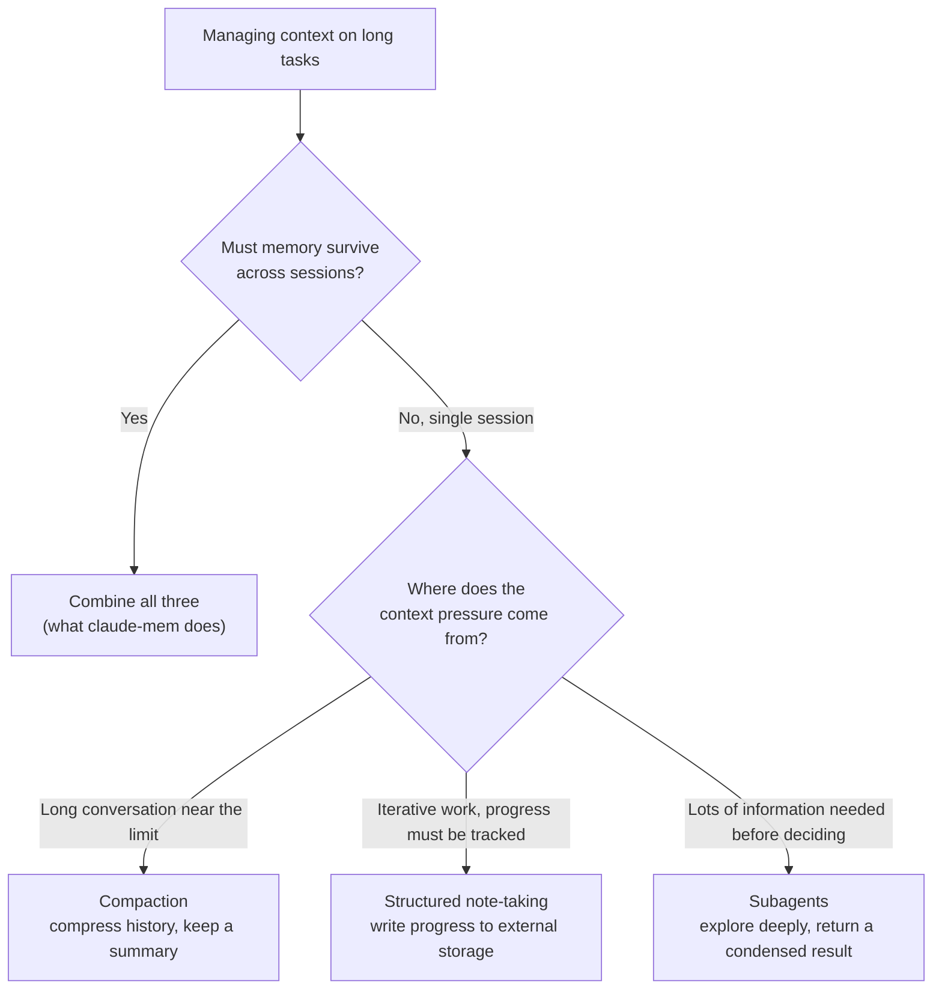
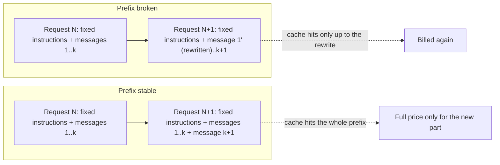

This chapter covers the core ideas of context engineering, the ideas that explain why claude-mem is built the way it is. Each idea is paired with something claude-mem actually does, so you can see the line from design principle to implementation.

## The Token Budget Is an Attention Budget

An LLM's context window has a property that's easy to overlook: **attention is spread unevenly across it, and it thins out as the context grows.**

Putting 100,000 tokens into context doesn't mean the model has "read" every one of them. The way transformer attention works means:

- Every token computes attention weights against every other token (an n² relationship)
- The longer the context, the less attention each token gets on average
- Information in the middle of a long sequence is easy to miss (the "lost in the middle" effect); models are more sensitive to the beginning and the end
- Models have seen far less training data at very long lengths than at short ones

Think of the context window as a budget:

| Budget term | What it means here |
|------|------|
| Total budget | Context window size (200K tokens, say) |
| Each expense | Each piece of context you inject |
| Return on investment | How much that piece helps finish the task |
| Opportunity cost | Space it takes from the real work |

On top of the budget there are hard delivery limits. Claude Code passes through only the first 10,000 characters of a hook's output unchanged. Go one character over and the whole block is replaced by a preview, and the model effectively receives nothing (Chapter 8). Context engineering isn't just "put in less." You also have to know where each channel's limits are.

claude-mem's design principle is to **get the most return out of every token.** Progressive disclosure, at bottom, lets the agent manage its own budget instead of having the system spend for it.

## Context Rot and Signal-to-Noise

Context rot is the name for something that comes up constantly in practice:

**As a conversation goes on, context injected early gradually stops being useful.**

There are several reasons:

1. The goal may have shifted (the user moved from fixing a bug to adding a feature)
2. The code that early context described may have changed
3. Large amounts of tool output in between dilute the key information
4. The model's attention to older tokens fades

Traditional RAG injects a big batch of "possibly relevant" content once, at the start of a session. In a short session that's fine. In a long multi-turn session, that content rots quickly: it keeps taking up space and stops providing value.

You can define signal-to-noise like this:

```
SNR = useful tokens / total tokens consumed
```

Injecting everything usually gives a low SNR: tens of thousands of tokens go in and only a small fraction get used. Progressive disclosure aims for the highest SNR possible, because every token the agent consumes is one it chose based on the task in front of it.

## The Right Altitude for a System Prompt

The system prompt is one of the most important pieces of context engineering. "The right altitude" means finding the balance between two extremes.

### Too Prescriptive

```
If the user says "fix bug", run git status first, then...
If the user says "add feature", check package.json first, then...
```

The problem: brittle, can't cover every case, expensive to maintain.

### Too Vague

```
You are a helpful coding assistant. Please do a good job.
```

The problem: gives no guidance the model can act on.

### The Right Altitude

```
You are a software engineering assistant. Read the relevant files before changing code.
Prefer the project's existing patterns and conventions. If you're unsure, ask.
```

claude-mem's context injection follows the same principle. It doesn't inject specific instructions ("when you fix the auth bug, remember to look at #342"). It provides an index and lets the agent judge for itself.

The lesson for memory systems: **injected context should inform the agent, not instruct it.**

There's one exception in v13's injection worth pointing out. The end of the startup context carries a short "how to use memory" section that tells the model plainly to search with `mem_search`, record with `save_memory`, and manage to-dos with `work_state_write` (`src/shared/memory-instructions.ts`). That is prescriptive, but what it prescribes is how to use the tools, not what task to do, so it's still at the right altitude.

## Just-in-Time Context vs. Pre-Inference Retrieval

There are two broad retrieval strategies.

### Pre-Inference Retrieval

```
User input → embedding → vector search → inject top-K → LLM inference
```

The system has decided what context to inject before the LLM starts thinking. This is how traditional RAG works.

**Good for:** Q&A over a static knowledge base, short sessions, cases where the relationship between query and context is clear.

**Limits:** The system doesn't know what the agent will do next. What was retrieved for step one may be useless by step three. It can't adapt when the task changes direction midway.

### Just-in-Time Context

```
User input → LLM starts reasoning → agent decides what it needs → calls a tool to retrieve → keeps reasoning
```

The agent pulls context dynamically, as it turns out to need it.

**Good for:** multi-step tasks, exploratory work, long sessions.

**Limits:** One more round of tool calls than pre-retrieval. The agent has to know to go and search. Tool descriptions themselves cost tokens.

### claude-mem's Hybrid

claude-mem uses both:

1. **Pre-inference:** SessionStart injects a "map," made of the to-do list and an index of recent observations, capped at 10,000 characters in total
2. **Just-in-time:** MCP retrieval tools let the agent fetch details while it reasons. And before the agent reads a code file, the PreToolUse hook attaches that file's observation history right then

claude-mem once tried going the other way. `CLAUDE_MEM_SEMANTIC_INJECT` runs a semantic search on every prompt the user submits and pre-injects the five most relevant observations. It is still off by default (Chapter 5).

## Three Techniques for Long Tasks

Software engineering tasks often take dozens of tool calls, and context can easily run out or rot along the way. There are three ways to deal with it.

### Technique 1: Compaction

When a conversation gets close to the context limit, have the model summarize the history and continue with the summary in place of the original messages.

```
Original conversation (90,000 tokens)
    ↓ compact
Summary (3,000 tokens) + last 5 turns (7,000 tokens)
    ↓
Continue from a 10,000-token base
```

**Tuning approach:**

- Maximize recall first (don't drop key information)
- Then improve precision (remove redundancy)
- Clear old tool outputs first (they're large and lose value fast)

**How claude-mem relates:** Session summaries are a form of compaction. The whole session is compressed into six fields: request, investigated, learned, completed, next_steps, and notes.

There's a more interesting case inside claude-mem. Its observer model is itself a conversation that keeps growing, with one message added per tool call. v13 chose not to compact that conversation. Instead, when it reaches about half of the model's window, the whole generation is retired and a new conversation starts, opening with the observations this session has already written (Chapter 6). As the source comments put it, continuity is carried by the memories the product is producing anyway, not by the raw conversation turns. If your system already keeps a structured record of the work, that record is often a ready-made, better-quality "compaction result."

### Technique 2: Structured Note-Taking

The agent writes notes to external storage while it works and reads them back when needed. The notes aren't in the context window, so they cost no tokens.

```typescript
// After the agent finishes phase one
await writeFile('PROGRESS.md', `
## Done
- Database schema design
- API route definitions

## To do
- Implement auth middleware
- Write tests
`);

// When the next step starts
const progress = await readFile('PROGRESS.md');
```

**How claude-mem relates:** The whole observation system is automated structured note-taking, except the agent doesn't have to remember to write. v13 adds the half where the agent does write on purpose: `work_state_write` stores to-dos and progress in claude-mem, and unfinished items appear at the top of every session; `save_memory` records preferences and decisions (Chapters 8 and 10). Keeping these in a database rather than in files in the repo means no merge conflicts. The cost is that they aren't versioned with the code.

### Technique 3: Subagents

Split a complex task among specialized subagents, each with its own clean context window.

```
Main agent (coordinator)
  ├── Subagent A: survey the existing implementation (reads 20 files, returns a 2,000-token summary)
  ├── Subagent B: analyze dependencies (checks 5 packages, returns a 1,000-token report)
  └── Subagent C: implement (works from A's and B's summaries, focuses on writing code)
```

Each subagent can explore deeply (tens of thousands of tokens) and return only a condensed result (1–2K tokens) to the main agent.

**How claude-mem relates:** The Knowledge Agent is a kind of subagent. A separate session reads every observation on a topic and hands only the answer back to the main session (Chapter 11). claude-mem's observer is also a subagent, except it returns nothing to the main session; its output goes into the database.

Subagents also generate memory noise. By default, v13 keeps observations produced by subagents out of the startup index (`CLAUDE_MEM_CONTEXT_MAIN_AGENT_ONLY=true`), and a subagent's stop event doesn't produce a summary. Search still finds them.

### Choosing a Technique

| Situation | Recommended technique |
|------|---------|
| A long conversation near the context limit | Compaction |
| Iterative development where progress has to be tracked | Structured note-taking |
| A decision that needs a lot of information gathered first | Subagents |
| Persistent memory across sessions | All three combined (what claude-mem does) |

Figure 3-1 draws the table as a flow: first decide whether memory has to survive across sessions, then look at where the context pressure within a session comes from.



*Figure 3-1: Choosing among the three long-task techniques*

## A Stable Prefix: Prompt Caching Is Context Engineering Too

Everything so far has been about what to put in. There's another dimension: **the order you put things in, and whether you can change them afterward.**

Most model providers offer prompt caching. If two requests start with byte-for-byte identical content, the second can reuse the computation from the first; the shared part is billed at a lower rate and comes back faster. There is exactly one condition for a cache hit: the prefix must be identical. That adds a constraint to context engineering. Don't change content you've already sent, append new content at the end, and put stable content first.

claude-mem v13 offers three examples.

**Example 1: Don't inject when resuming.** When a user resumes an old session with `claude --resume`, the model already has that session's full context. Before v13.30.1, SessionStart still injected a freshly rendered startup index. That new content changed the conversation's prefix and invalidated the host-side cache entirely. Resume no longer injects (`src/cli/handlers/context.ts` L74-79); only the startup, clear, and compact session starts do.

**Example 2: Fixed instructions go first.** The observer model's prompt has two parts: fixed instructions that depend only on the observation mode (role, recording criteria, output format), and content that differs per session (the user's request, the date, the project name). Before v13.30.0 the two were interleaved, and prompts from different sessions shared only their first 422 characters. After all the fixed instructions were moved to the front, the shared prefix in code mode grew to about 7,260 characters (#4415). The content didn't change. Only the order did.

**Example 3: What trimming history costs.** To keep the observer conversation from growing too long, v13.29.0 replaced older tool outputs with a short placeholder before each request. Requests did get smaller, but the step rewrote messages that had already been sent. From the fifth observation on, every request's prefix differed from the one before, the cache couldn't hit, and the rewritten part was billed as new input every time. v13.34.2 reverted the trimming. Within one generation of the conversation, messages already sent are resent exactly as they were, so each request extends the previous one, and the problem of conversations getting too long is left to generation retirement. The release notes are candid about the cost: without compressing old content, a generation fills up sooner and gets replaced more often, and the net effect on cost hasn't been measured in production yet.

Figure 3-2 shows the direction all three changes went.



*Figure 3-2: How rewriting sent content versus only appending affects the prompt cache*

Three practices come out of this:

1. Put stable content first and changing content last
2. Only append to what you've sent; never rewrite it. When you need it shorter, replace it wholesale (start a new conversation) rather than editing individual messages
3. Before injecting something new into an existing conversation, ask whether the model already knows it

## Summary

The core points of context engineering:

1. **Tokens are scarce**, and each channel has its own hard limit
2. **Injected context rots**: the earlier something was injected, the more likely it has lost its value in a long session
3. **Letting the agent manage its own context** works better than having the system decide for it
4. **Hybrids beat single strategies**: pre-inject a light index, then fetch depth on demand
5. **Keep the prefix stable**: append, don't rewrite, or you'll pay for the same content over and over

These principles are the basis for understanding claude-mem's architecture in the chapters ahead. Why progressive disclosure instead of traditional RAG? Why does a hook just write the event to a file and return? Why do the retrieval tools force a stepwise process?

---

**Questions to consider**

1. How would you measure context rot on your own project? Design an experiment: inject the same piece of information at different points in a long conversation, and plot how accurately the agent cites it.
2. If your model's context window were only 8K (a small local model, say), which of the three long-task techniques would you reach for first? How does claude-mem's observer adapt to small-window models? (Hint: "generations" in Chapter 6.)
3. In Example 3, trimming history saved tokens per request but broke the cache. Design an experiment that compares the total cost of trimming versus generation retirement over one long session. What metrics would you need to record?

---

The next chapter starts Part II with an overview of claude-mem's whole system, then takes each component apart layer by layer.

---

> From the open-source edition of *Engineering Agent Memory* by diguike.  
> Read online: [inferloop.dev](https://inferloop.dev) · Source: [github.com/diguike/book-claude-mem](https://github.com/diguike/book-claude-mem)
