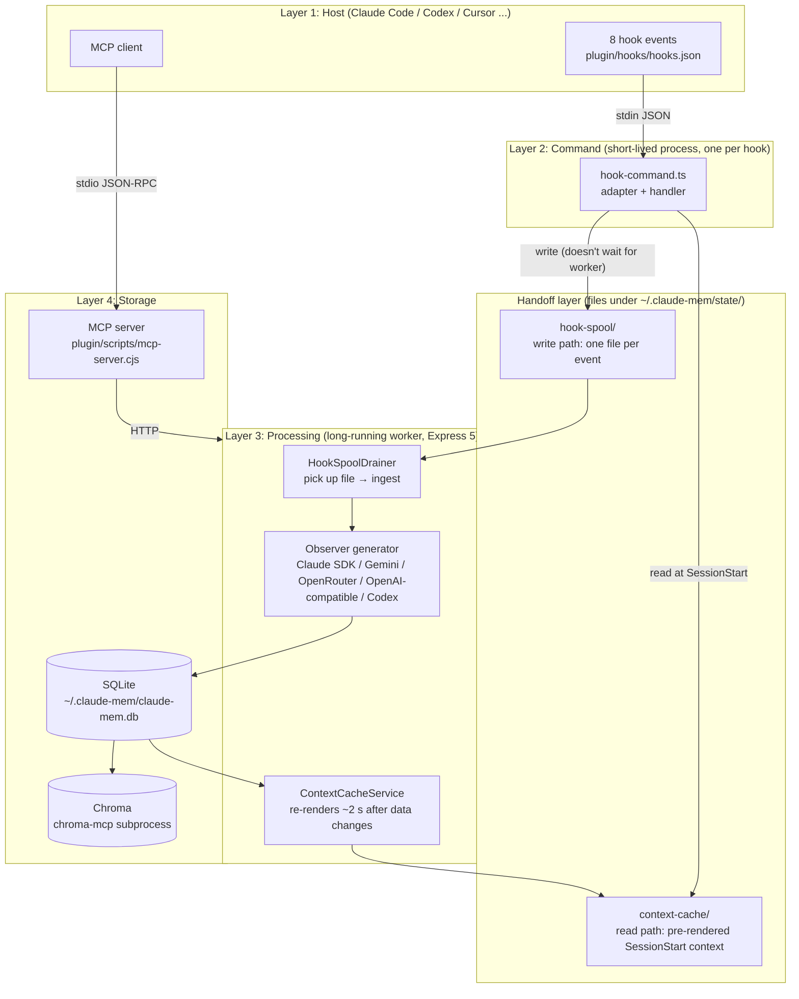
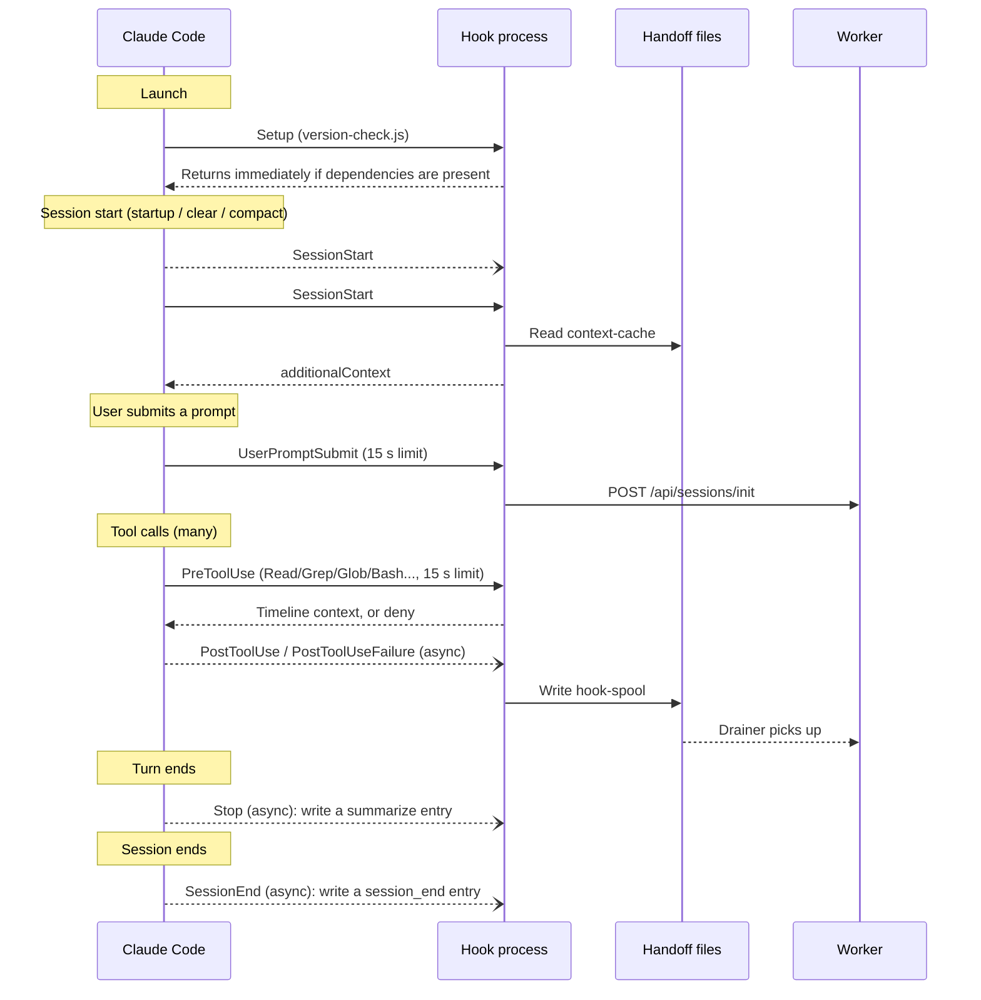
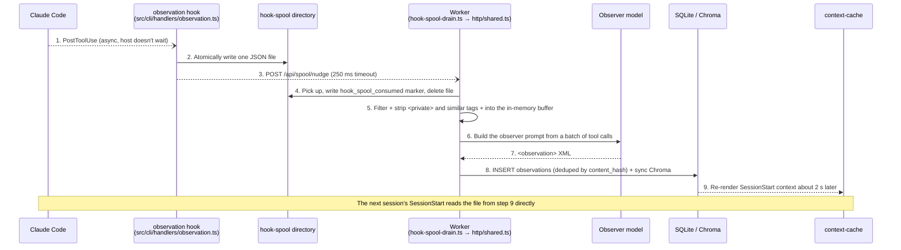

This chapter follows claude-mem v13.35.0. Between v12 and v13 the system's four-layer skeleton didn't change. What changed is how the layers hand work to each other. Writes went from "the hook POSTs directly to the worker" to "the hook writes to disk and the worker picks it up." Reads went from "query fresh every time" to "the worker pre-renders and the hook reads a file." Once you understand those two handoffs, everything in the next few chapters will slot into place.

## A Route Through the Source

If you want to read claude-mem's source yourself, follow one piece of observation data to its destination. It takes about 30 minutes:

```
1. plugin/hooks/hooks.json                  ← Entry point: which hooks are registered, which are async
   ↓ follow "hook claude-code observation" at the end of the command
2. src/cli/hook-command.ts                  ← Single entry point for every hook (171 lines)
   ↓ getEventHandler(event)
3. src/cli/handlers/observation.ts          ← The PostToolUse handler
   ↓ spoolHookEvent('observation', ...)
4. src/shared/hook-spool.ts                 ← One JSON file per event
   ↓ on the worker side, HookSpoolDrainer picks up the file
5. src/services/worker/hook-spool-drain.ts  ← Hands the file to ingestObservation
6. src/services/worker/http/shared.ts       ← Filters, strips privacy tags, puts it in the in-memory buffer
7. src/services/worker/ClaudeProvider.ts    ← The observer model compresses the tool call into an observation
8. src/services/sqlite/SessionStore.ts      ← Written to the database
```

At each step, ask where this piece of data goes next. Once you've walked the whole chain, most of the system's structure is clear.

## Four Layers and Two Handoffs

claude-mem still has four layers with clear boundaries between them. v13 adds a "handoff layer" between layers 2 and 3. It isn't a separate process; it's two sets of files under the data directory. Figure 4-1 shows the overall structure.



*Figure 4-1: v13's four layers plus the handoff layer. The write path is decoupled by hook-spool; the read path by context-cache*

### Layer 1: The Host

Claude Code is closed source, so claude-mem can only work through the two extension points it exposes.

**The hook system.** In v13.35.0, `plugin/hooks/hooks.json` registers eight events: Setup, SessionStart, UserPromptSubmit, PreToolUse, PostToolUse, PostToolUseFailure, Stop, and SessionEnd. v12.6.2 registered only six of them; it had neither PostToolUseFailure (failed tool calls, such as a Bash command exiting non-zero) nor SessionEnd. The other change is that PostToolUse, PostToolUseFailure, Stop, SessionEnd, and the worker-startup step inside SessionStart are all marked `"async": true`, so Claude Code no longer waits for them to return. Chapter 5 goes through them one by one.

**The MCP client.** claude-mem registers an MCP server named `mcp-search`. Under the local worker runtime, it exposes 19 tools to the model (Chapter 9).

It used to be true that claude-mem could only observe and inject, never intercept. Since v13.32 there's one exception. Under a strict set of conditions, the PreToolUse hook returns `permissionDecision: 'deny'`, refusing Claude's attempt to read a large code file whole and steering it toward a structured partial read instead (the File Read Gate, Chapter 8). This is currently the only place claude-mem actively changes what the host does.

The host isn't only Claude Code anymore, either. The host list in `npx claude-mem install` has 17 options, from Codex CLI, Cursor, and Windsurf to Pi, DeepSeek Harness, and OpenCode. Hosts connect in very different ways; Chapter 18 is devoted to the adapter layer.

### Layer 2: The Command Layer

When a hook fires, it runs the `hook` subcommand from a single bundled file. The entry point is `src/cli/hook-command.ts`. Here is its backbone with telemetry and comments removed:

```typescript
// src/cli/hook-command.ts (v13.35.0, simplified)
export async function hookCommand(rawPlatform: string, event: string): Promise<number> {
  const platform = canonicalIntegrationId(rawPlatform);

  // Environment variables can switch off the high-frequency tool hooks (CLAUDE_MEM_DISABLE_TOOL_HOOKS, etc.)
  if (isToolHookDisabledByEnv(event)) {
    emitModelContext(getPlatformAdapter(platform), buildNoOpResult(event));
    return HOOK_EXIT_CODES.SUCCESS;
  }

  // Buffer stderr so third-party library output can't leak into the model's context (L107)
  const stderrBuffer = installHookStderrBuffer();
  const adapter = getPlatformAdapter(platform);
  const handler = getEventHandler(event);

  try {
    const input = adapter.normalizeInput(await readJsonFromStdin());
    const result = await handler.execute(input);
    emitModelContext(adapter, result);      // the only place JSON is written to stdout
    await settleHookSpoolNudges();          // wait at most 250 ms so the "wake the worker" request goes out
    return result.exitCode ?? HOOK_EXIT_CODES.SUCCESS;
  } catch (error) {
    if (isWorkerUnavailableError(error)) {
      await recordWorkerUnreachable();      // count consecutive failures; warn once at the threshold
      return HOOK_EXIT_CODES.SUCCESS;
    }
    // Unexpected error: log it, write one diagnostic line, still return a no-op and exit 0 (L142-165)
    emitDiagnostic(`claude-mem: hook error, continuing without memory: ${String(error)}\n`);
    emitModelContext(adapter, buildNoOpResult(event));
    return HOOK_EXIT_CODES.SUCCESS;
  } finally {
    stderrBuffer.restore();
  }
}
```

The command layer does only four things: read stdin, normalize the input with a platform adapter, call the event handler, and write the result to stdout in the platform's format. `src/cli/handlers/index.ts` (L94-104) registers nine handlers:

| Handler | Event | What it does |
|---------|---------|--------|
| `context` | SessionStart | Reads the pre-rendered cache or asks the worker, then injects memory context |
| `session-init` | UserPromptSubmit | Synchronously registers the session and this turn's prompt with the worker |
| `observation` | PostToolUse / PostToolUseFailure | Writes the tool call into hook-spool |
| `file-context` | PreToolUse | Attaches a history timeline to file reads; denies whole-file reads when needed |
| `summarize` | Stop | Takes the last reply from the end of the transcript and writes it into hook-spool |
| `session-end` | SessionEnd | Writes a session_end entry into hook-spool |
| `file-edit` | Edit events from hosts like Cursor | Writes into hook-spool as a `write_file` tool call |
| `user-message` | Notice banners on some hosts | Produces a systemMessage for the user to see |
| `session-init-context` | UserPromptSubmit on Kimi | Combines session-init and context, because Kimi doesn't read SessionStart output |

The adapters live in `src/cli/adapters/` and cover claude-code, codex, cursor, kimi, windsurf, and antigravity-cli. Unrecognized platforms go through `raw`.

### The Handoff Layer: hook-spool and context-cache

In v12, the observation hook would `POST /api/sessions/observations` and wait for the worker to respond before exiting. If the worker was restarting, starting up, or stuck, the hook either waited until it timed out or lost the data. v13.30.0 (#4368, titled "Liveness over deadlines") changed the write path to write to disk:

```typescript
// src/cli/spool-hook-event.ts L174 (v13.35.0)
export function spoolHookEvent<K extends HookSpoolKind>(kind: K, payload: HookSpoolPayloadByKind[K]): string {
  const entryPath = new HookSpool().enqueue(kind, payload); // atomically write one JSON file
  void nudgeWorkerToDrainHookSpool();                       // POST /api/spool/nudge, 250 ms timeout, failure is fine
  return entryPath;
}
```

Files go under `~/.claude-mem/state/hook-spool/`, one per event. The file name is the deduplication key: "session hash, then tool-use ID" when a `tool_use_id` is present, otherwise the SHA-256 of the event content. If the host delivers the same event twice, it just overwrites the same file. Here is an entry produced by the test command in Chapter 5 (with synthetic input):

```json
{
  "kind": "observation",
  "payload": {
    "contentSessionId": "b",
    "platformSource": "claude",
    "toolName": "Edit",
    "toolInput": {},
    "toolResponse": {},
    "cwd": "/path/to/project",
    "toolUseId": "toolu_c1"
  },
  "enqueuedAtEpochMs": 1791791700841
}
```

On the worker side, `HookSpoolDrainer` (`src/services/worker/hook-spool-drain.ts`) picks up files from four triggers: once at startup, whenever a hook sends a wake-up request, whenever `fs.watch` sees the directory change, and a fallback sweep every 30 seconds (`SAFETY_SWEEP_INTERVAL_MS = 30_000`). For each consumed entry it records a marker in the worker database's `hook_spool_consumed` table, then deletes the file, so a crash between the two steps won't ingest it twice. Entries not consumed successfully within seven days are moved to `expired/`, and malformed ones to `corrupt/`. Nothing is deleted silently.

The read path works the same way. The worker's `ContextCacheService` re-renders the startup context two seconds after data changes (debounced, `CONTEXT_CACHE_RENDER_DEBOUNCE_MS = 2_000`) and writes it to `~/.claude-mem/state/context-cache/`. If the SessionStart hook finds a cache entry, it returns it directly, with no need for the worker to be up. A cache entry older than 24 hours is considered stale, and the hook falls back to a live request.

### Layer 3: The Processing Layer

The worker is a long-running Express 5 HTTP service run by Bun. It does everything slow:

- **Pickup and filtering**: takes events from hook-spool, runs them through a series of filters (excluded projects, skipped tools, subagents, private prompts, and so on), and puts them in each session's in-memory buffer
- **Observer generation**: hands buffered tool calls to the observer model, parses structured observations out of the response, and writes them to the database
- **Context pre-rendering**: maintains context-cache
- **Vector sync**: writes new records into Chroma
- **Optional external sync**: cmem.ai cloud sync (Chapter 19) and transcript watching (Chapter 18)
- **SSE broadcast**: pushes live updates to the Viewer
- **Process management**: port and health checks, a single spawn lock, graceful shutdown (Chapter 6)

The worker port defaults to `37700 + (uid % 100)` (`src/shared/SettingsDefaultsManager.ts` L375), so workers for different users on the same machine don't collide. Platforms without a uid (Windows) use 77, giving 37777.

### Layer 4: Storage

**SQLite** (`~/.claude-mem/claude-mem.db`): a fresh v13.35.0 database has a maximum `schema_versions` version of 64. The core tables are still `sdk_sessions`, `observations`, `session_summaries`, and `user_prompts`. There are also `tool_uses` (raw tool inputs and outputs), `work_state_entries` (the agent's to-do list), `hook_spool_consumed`, and a group of `sync_*` tables. The full-text indexes `observations_fts` and `session_summaries_fts` are created separately by the search layer. Chapter 7 goes through the tables.

**Chroma**: all projects share one collection named `cm__claude-mem` (`src/services/worker/DatabaseManager.ts` L45), filtered by the `project` field in each document's metadata. The worker starts a `chroma-mcp` subprocess through uvx and talks to it over stdio.

**MCP server**: `plugin/scripts/mcp-server.cjs` translates MCP JSON-RPC calls into HTTP requests to the worker.

### A Second Runtime: Server

v13.0.0 introduced an optional Server runtime: Postgres storage, BullMQ queues, API key authentication, and a `/v1` REST API. On the hook side, `src/services/hooks/runtime-selector.ts` decides where to write:

```typescript
// src/services/hooks/runtime-selector.ts L39-45
export function selectRuntime(): SelectedRuntime {
  const settings = loadFromFileOnce();
  const raw = (settings.CLAUDE_MEM_RUNTIME ?? 'worker').trim().toLowerCase();
  if (raw === 'server' || raw === 'server-beta') return 'server';
  return 'worker';
}
```

If you pick `server` but the server configuration is incomplete, `resolveRuntimeContext()` falls back to `worker`. And if the observation hook fails to post to `/v1/events` with an error that allows fallback, it reverts to the local spool. A default install is always `worker`, and that's what Chapters 2 through 15 discuss. The Server runtime is covered in Chapter 16.

## Eight Hooks in One Session

Figure 4-2 shows the order in which the eight events fire during a session. Solid arrows mean the host waits for the hook to return; dashed arrows mean async, and the host doesn't wait.



*Figure 4-2: The firing order of the eight hooks in one v13.35.0 session*

The figure shows the trade-off v13 made: apart from Setup, which runs once at launch, only three kinds of hook are still synchronous. SessionStart's context hook has to be synchronous because its output goes into the model's context. UserPromptSubmit has to register this turn's prompt first so later observations attach to the right turn. PreToolUse has to be synchronous to be able to deny a read. Every other write was changed to "write to disk and return," and made async, so Claude Code doesn't wait at all.

## The Full Data Path

Take PostToolUse, the most frequent event. From the moment an observation is produced to the moment the next session can use it, it travels the path in Figure 4-3.



*Figure 4-3: The full path of one PostToolUse observation, from creation to use in the next session*

Compared with v12, steps 2, 3, and 4 replace "the hook POSTs synchronously and the worker writes a `pending_messages` table." The in-memory buffer in step 5 is also new. v13.4.0 removed the `pending_messages` persistent queue; Chapter 6 explains why.

## Why Hooks Instead of Middleware

claude-mem collects data through hooks (external commands the host triggers) rather than by embedding itself to intercept calls. The constraints behind that choice haven't changed:

1. **Most hosts are closed source**, so there's no way to insert middleware
2. **A memory failure must never affect the host**; no error may freeze the user's session
3. **It has to cover several hosts**, and Claude Code, Codex, Cursor, and the rest each have their own event format
4. **Installation has to be simple**, touching nothing but the host's plugin configuration

What the hook model buys: the only thing between the host and claude-mem is JSON on stdin and stdout, so host upgrades don't break the plugin. Each hook can be tested on its own. Supporting a new host usually takes just one adapter (`src/cli/adapters/`).

The cost is just as clear: every hook is a process launch. Measured for this book on a 4-core Xeon 8255C with the v13.35.0 bundle, an empty Bun process starts in about 12 ms, but loading the 3.4 MB `worker-service.cjs` takes about 470 ms, and going through the extra `node bun-runner.js` hop brings the total to about 600 ms (Chapter 5 shows how to measure it). That overhead is unacceptable on a synchronous path, and it's the direct reason v13 made most write hooks async.

## Graceful Degradation: Broken Memory Must Not Break the IDE

v12 handled errors at two levels: exit 0 when the worker was unavailable, exit 2 on code errors (4xx, TypeError). In Claude Code, exit 2 means "block." A UserPromptSubmit that returns 2 drops the user's prompt, a PreToolUse that returns 2 denies the tool call, and a Stop that returns 2 wakes the agent back up. A bug in a memory plugin could therefore send the user's session into a loop. v13.29.0 (#3161) removed that level. Any unexpected error in `hook-command.ts` now returns a no-op with exit 0; the error goes to the log, one diagnostic line is written, and a content-free telemetry event is sent.

Whether the worker counts as unavailable is decided in `src/shared/worker-utils.ts` L1902:

```typescript
// src/shared/worker-utils.ts L1902 (v13.35.0, excerpt)
export function isWorkerUnavailableError(error: unknown): boolean {
  const lower = (error instanceof Error ? error.message : String(error)).toLowerCase();
  const transportPatterns = [
    'econnrefused', 'econnreset', 'epipe', 'etimedout', 'enotfound',
    'econnaborted', 'enetunreach', 'ehostunreach', 'fetch failed',
    'unable to connect', 'socket hang up', 'socket connection was closed', 'connection closed',
  ];
  if (transportPatterns.some(p => lower.includes(p))) return true;
  if (lower.includes('timed out') || lower.includes('timeout')) return true;
  if (/failed:\s*5\d{2}/.test(lower) || /status[:\s]+5\d{2}/.test(lower)) return true;
  if (/failed:\s*429/.test(lower) || /status[:\s]+429/.test(lower)) return true;
  return false;
}
```

This function now decides only one thing: whether to increment the "consecutive failures to reach the worker" counter. When the counter reaches `CLAUDE_MEM_HOOK_FAIL_LOUD_THRESHOLD` (3 by default), the user sees "please run `npx claude-mem restart`" once per session. Whichever branch is taken, the exit code is 0.

The degradation principle runs through every layer:

| Layer | Behavior on error |
|----|------------|
| Hook | Always exit 0; warn once only after 3 consecutive failures to reach the worker |
| Handoff | Even if the worker can't take it, the event is already on disk; if the worker comes back within 7 days, it catches up |
| Worker | When the observer runs out of quota, a circuit breaker trips; after cooldown, only one probe request is let through (Chapter 6) |
| Storage | If Chroma is down, search falls back to SQLite; if FTS5 is unavailable, it falls back to LIKE |

---

**Questions to consider**

1. v13 made the observation hook "write to disk and return," so data isn't lost when the worker is down. If you were designing a memory system for something that needs strong consistency (auditing, say), what guarantees is the spool-file layer still missing?
2. In the four-layer architecture, the handoff layer has no process of its own; it's just two sets of files. What does using files instead of a local message queue (a long-running Redis, for instance) buy you, and what does it give up?
3. The File Read Gate is the first time claude-mem refuses something the host tried to do. If you added a similar "intercept" to your own plugin, what conditions would it have to meet, at minimum, to avoid hurting the user?

---

The next chapter goes into the hook system and walks through the configuration, timeouts, and handling logic of all eight events.

---

> From the open-source edition of *Engineering Agent Memory* by diguike.  
> Read online: [inferloop.dev](https://inferloop.dev) · Source: [github.com/diguike/book-claude-mem](https://github.com/diguike/book-claude-mem)
