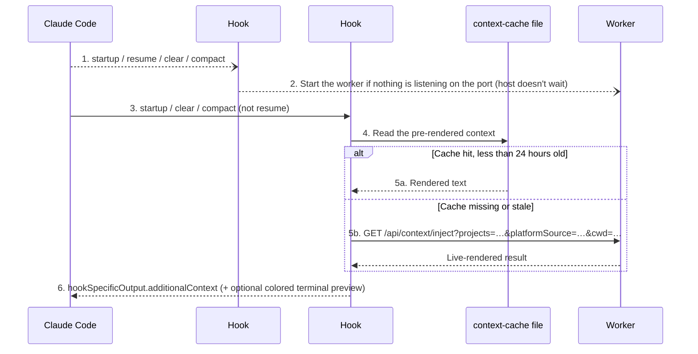
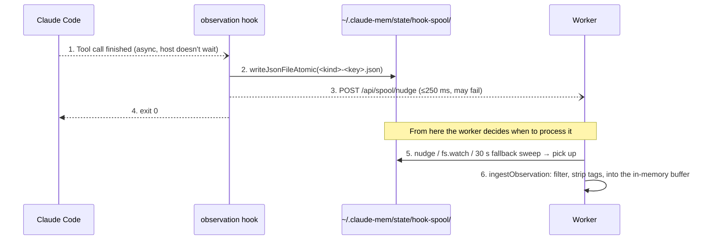

## How Claude Code Hooks Work

If you've used Git hooks (pre-commit, pre-push), Claude Code hooks are the same kind of thing: when a specific event happens, the host runs a registered command. The difference is that Git hooks care about commits, while Claude Code hooks care about AI session events: session start, prompt submission, before and after a tool call, the end of a turn, the end of a session.

The execution model:

```
Claude Code fires an event
  → finds the hook configurations whose matcher hits
  → builds a JSON payload and passes it to the hook command on stdin
  → synchronous hook: waits for JSON on stdout and the exit code, and acts on them
  → async hook: doesn't wait; the command finishes in the background
```

claude-mem v13.35.0's configuration lives in `plugin/hooks/hooks.json`. A single entry looks like this (the long PATH and plugin-directory resolution at the start of `command` is omitted):

```json
{
  "hooks": {
    "PostToolUse": [
      {
        "matcher": "*",
        "hooks": [
          {
            "type": "command",
            "shell": "bash",
            "command": "... node \"$_P/scripts/bun-runner.js\" \"$_P/scripts/worker-service.cjs\" hook claude-code observation ...",
            "timeout": 120,
            "async": true
          }
        ]
      }
    ]
  }
}
```

The key properties:

- `matcher`: the match rule. `"*"` matches every tool; `"startup|clear|compact"` matches SessionStart trigger sources. Regular expressions work too, such as PreToolUse's `Read|^Bash$|^Grep$|^Glob$|^memory_search$|^memory$|^mcp__.+__memory_search$`
- `timeout`: in seconds. When it expires, the host kills the hook process
- `async`: when `true`, the host doesn't wait for the hook to return. This usage is new in v13; all six hooks in v12.6.2 were synchronous
- `shell`: set to bash, so PATH handling and variable expansion behave consistently

### The Eight Events at a Glance

| Event | matcher | Handler | timeout | async | In v12.6.2 |
|------|---------|--------|---------|-------|-----------|
| Setup | `*` | version-check.js | 300 | No | Same |
| SessionStart #1 | `startup\|resume\|clear\|compact` | `worker-service.cjs start` | 60 | Yes | Synchronous, no resume |
| SessionStart #2 | `startup\|clear\|compact` | `hook … context` | 60 | No | Same |
| UserPromptSubmit | none | `hook … session-init` | 15 | No | 60 s |
| PreToolUse | regex above | `hook … file-context` | 15 | No | Matched only `Read`, 60 s |
| PostToolUse | `*` | `hook … observation` | 120 | Yes | Synchronous |
| PostToolUseFailure | `*` | `hook … observation` | 120 | Yes | Didn't exist |
| Stop | none | `hook … summarize` | 120 | Yes | Synchronous |
| SessionEnd | none | `hook … session-end` | host default | Yes | Didn't exist |

Every command ends with `|| { echo "claude-mem: hook command failed (exit $_S)" >&2; exit 0; }`. Even if Node, Bun, or the bundle itself is broken, the host still sees exit code 0. The one exception is Setup: if it can't find `version-check.js`, it returns 1 (a non-blocking error; Claude Code just shows stderr to the user).

### Input and Output

The fields Claude Code passes on stdin vary by event. These are the fields claude-mem's adapter (`src/cli/adapters/claude-code.ts`) actually reads:

```typescript
// Common fields
{ session_id, cwd, transcript_path, hook_event_name, agent_id?, agent_type? }

// SessionStart
{ source: 'startup' | 'resume' | 'clear' | 'compact' }
// UserPromptSubmit
{ prompt }
// PreToolUse / PostToolUse
{ tool_name, tool_input, tool_use_id, tool_response? }
// PostToolUseFailure (no tool_response; the adapter combines these two fields into tool_response)
{ tool_name, tool_input, tool_use_id, error, is_interrupt }
// Stop / SessionEnd
{ reason? }
```

`agent_id` and `agent_type` appear only when a subagent triggers the hook. claude-mem uses them to skip subagent observations and summaries.

Hook output goes on stdout. The common shapes:

```typescript
// Do nothing
{ continue: true, suppressOutput: true }

// SessionStart: inject text into the model's context
{ hookSpecificOutput: { hookEventName: 'SessionStart', additionalContext: '...' } }

// PreToolUse: attach context, or deny the call
{ hookSpecificOutput: { hookEventName: 'PreToolUse', additionalContext: '...' } }
{ hookSpecificOutput: { hookEventName: 'PreToolUse', permissionDecision: 'deny',
                        permissionDecisionReason: '...' } }

// Any event: a one-line notice for the user (doesn't enter the model's context)
{ systemMessage: '...' }
```

## Hook I/O Discipline

In v12, the first line of the hook entry point was `process.stderr.write = (() => true)`, which swallowed stderr entirely so warnings from dependencies couldn't get mixed into the output. The price was that real errors became invisible too. v13 replaced that with a set of conventions in `src/shared/hook-io.ts` that splits hook output into four intents:

| Intent | Where it goes | Purpose |
|------|------|------|
| MODEL_CONTEXT | JSON on stdout | Content for the model; written exactly once, by `emitModelContext` |
| USER_HINT | `HookResult.systemMessage` | A short notice for a human |
| DIAGNOSTIC | stderr | Operational logs; never reaches the model |
| EXIT_SIGNAL | exit code | Always 0 |

Handlers are required to be "pure": they return a `HookResult` and never touch `process.stdout`, `process.stderr`, `console.*`, or `process.exit` directly. While a handler runs, stderr is buffered by `installHookStderrBuffer()`, and every exit path discards the buffer. Diagnostics that really do need to come out go through `emitDiagnostic`, which bypasses the buffer. Third-party noise stays out of the model's context, and claude-mem's own diagnostics aren't lost.

## Setup: Self-Repair When Dependencies Are Missing

Setup runs once each time Claude Code starts. The script is `plugin/scripts/version-check.js` (398 lines in v13.35.0, up from 36 in v12.6.2).

v12's design was "don't bother the user." It compared an `.install-version` marker file and, if it didn't match, wrote `run: npx claude-mem repair` to stderr, leaving the fix to the user. v13 changed its mind. Users who installed from the plugin marketplace or upgraded with `claude plugin update` may never have had dependencies installed at all, so the worker crashed on a missing module the moment it started, and the user never got a chance to see the hint. The logic now:

- Dependencies complete: check only that the declared modules resolve, rewrite the marker file if needed, return immediately
- Dependencies incomplete: run `bun install` inside Setup (`BUN_INSTALL_TIMEOUT_MS = 120_000`), verify again afterward, and if it's still incomplete, print which modules are missing
- Whatever the outcome, finish with `process.exit(0)`

The reasoning comes from where Setup sits. It runs once per launch, has a 300-second timeout, and is not on the per-prompt path. Putting a potentially slow repair there costs less than letting every later hook run into a worker that can't start.

## SessionStart: Two Hooks, One Async and One Sync

SessionStart fires when a new session begins. claude-mem registers two entries for it, which run in the order shown in Figure 5-1.



*Figure 5-1: How the two SessionStart hooks divide the work (handler logic in `src/cli/handlers/context.ts`)*

Two things differ from v12.

**Starting the worker is now async.** In v12, hook #1 waited synchronously for the worker to come up, which could add several seconds to session start on a cold start. Now it runs in the background, and hook #2 reads the cache first, asking the worker only on a miss.

**Resume doesn't inject.** When a user restores an old session with `--continue`, `--resume`, or `/resume`, the model already has that session's full context. v13.30.1 (#4423) found that injecting a freshly rendered timeline at that point changed the conversation's prefix and invalidated the host-side prompt cache entirely. So hook #2's matcher dropped `resume`, and the handler has a second guard:

```typescript
// src/cli/handlers/context.ts L74-79
// --continue, --resume and /resume restore the existing conversation.
// A fresh timeline would change its prompt prefix and invalidate the cache.
if (input.platform === 'claude-code' && input.sessionSource === 'resume') {
  return emptyResult;
}
```

The rest of `contextHandler`:

1. Return empty if the current directory matches `CLAUDE_MEM_EXCLUDED_PROJECTS`
2. Compute the project keys with `getProjectContext(cwd)`. One checkout can map to several keys (a worktree's parent project, a name from before a rename), and all of them are sent to the worker
3. By default, take only memories produced by the current host (`platformSource`); `CLAUDE_MEM_SESSION_START_INCLUDE_ALL_SOURCES=true` merges all hosts
4. Read context-cache first; on a miss, go over HTTP
5. Append a "how to use memory" section to the result (`MEMORY_PLUGIN_INSTRUCTIONS`, which `CLAUDE_MEM_MEMORY_INSTRUCTIONS_ENABLED=false` turns off), telling the model to search with `mem_search`, record with `save_memory`, and manage to-dos with `work_state_write`
6. When `CLAUDE_MEM_CONTEXT_SHOW_TERMINAL_OUTPUT` is true (the default), fetch a second, colored version and put it in `systemMessage` so it shows in the user's terminal

What the injected text looks like, and why it's capped at 10,000 characters, is the subject of Chapter 8. Here are just the first few lines:

```
# Work state: your to-do lists and working state
...
# [my-app] recent context, 2026-10-12 3:45pm GMT+8
Mode: Code Development (code)

Legend: 🎯session ●bugfix ◆feature ↻refactor ✓change ○discovery ⚖decision ⚠security_alert ⚷security_note ⊘sensitive
Format: ID TIME TYPE TITLE
...
```

## UserPromptSubmit: Registering This Turn's Prompt

Each time the user submits a prompt, `sessionInitHandler` (`src/cli/handlers/session-init.ts`, 417 lines) runs synchronously. Its backbone:

```typescript
// src/cli/handlers/session-init.ts (v13.35.0, simplified)
if (!shouldTrackProject(cwd)) return noop;                         // excluded project
if (rawPrompt && isInternalProtocolPayload(rawPrompt)) return noop; // internal message containing only <task-notification>
if (isCodexInternalPrompt(rawPrompt)) return noop;                  // prompt Codex sends for its own helper threads

const initResult = await executeWithWorkerFallback('/api/sessions/init', 'POST', {
  contentSessionId: sessionId,
  project,
  prompt,
  platformSource,
  cwd,
}, { timeoutMs: sessionInitTimeoutMs });  // one budget for the whole round trip

if (initResult.skipped && initResult.reason === 'private') return noop; // the entire prompt is inside <private>
```

This step is still synchronous because every observation that follows has to attach to a particular prompt turn, so registration must happen before any tool call. v13 gives it a strict time budget. The host timeout went from 60 seconds to 15, and inside the handler the whole round trip gets only `CLAUDE_MEM_SESSION_INIT_TIMEOUT_MS` (10 seconds by default, 7 on Windows: process startup is slower there, and the time spent starting the process isn't counted against this budget).

v13 also dropped "one observer request per prompt." v12 sent each user prompt to the observer model on its own, and most of the time got back "nothing worth recording." v13.30.0 (#4336) sends the prompt along with the next tool-observation or summary request instead, saving a model call. To get the old behavior back, set `CLAUDE_MEM_OBSERVE_BARE_PROMPTS=true`.

This hook has one more capability that's off by default. With `CLAUDE_MEM_SEMANTIC_INJECT=true`, it uses this turn's prompt to query `/api/context/semantic` for the five most relevant observations and injects them as `additionalContext`. It's off by default for the reason discussed in Chapter 3: having the system pick memories for the model the instant the user finishes typing is rarely accurate.

## PostToolUse and PostToolUseFailure: Write to Disk and Return

This is the hook that fires most often, after every tool call. The v13.35.0 handler is 122 lines in total; here is its backbone:

```typescript
// src/cli/handlers/observation.ts (v13.35.0, simplified)
export const observationHandler: EventHandler = {
  async execute(input) {
    const { sessionId, cwd, toolName } = input;
    const platformSource = normalizePlatformSource(input.platform);

    if (!toolName) return noop;
    if (isRecursiveMemoryTool(toolName)) return noop;       // don't record claude-mem's own search tools
    if (!shouldTrackProject(cwd)) return noop;
    if (shouldSkipAgentObservation(input.agentId, input.agentType, settings).skip) return noop;

    const runtime = resolveRuntimeContext();
    if (runtime.runtime === 'server') {
      // Server runtime: POST /v1/events directly; errors that allow fallback continue to the local spool below
    }

    spoolHookEvent('observation', {
      contentSessionId: sessionId,
      platformSource,
      toolName,
      toolInput: input.toolInput,
      toolResponse: input.toolResponse,
      cwd,
      agentId: input.agentId,
      agentType: input.agentType,
      toolUseId: input.toolUseId,
    });
    return { continue: true, suppressOutput: true };
  },
};
```

The handler doesn't parse, doesn't compress, and doesn't wait for the worker. `spoolHookEvent` writes one file and returns, firing off a `POST /api/spool/nudge` with a 250 ms timeout to tell the worker to come and get it. If the worker is down and that request fails, it doesn't matter; the file is already on disk. Figure 5-2 shows the flow.



*Figure 5-2: The PostToolUse disk handoff (hook side in `src/cli/handlers/observation.ts`, worker side in `src/services/worker/hook-spool-drain.ts`)*

PostToolUseFailure reuses the same handler. For failed calls (Bash exiting non-zero, interruption by the user), Claude Code sends PostToolUseFailure, whose input has no `tool_response`, only `error` and `is_interrupt`. The adapter combines them into `{ error, is_interrupt }` and puts that in `toolResponse`, so the observer model can see that the command failed, why, and whether the user interrupted it on purpose. v12 never received these events at all, so failed attempts left no memory behind.

## PreToolUse: File Context and the File Read Gate

PreToolUse's matcher has grown from v12's `Read` to Read, Bash, Grep, Glob, and the host's own memory tools (`memory_search`, `memory`). `fileContextHandler` (`src/cli/handlers/file-context.ts`, 513 lines) does three things in order:

1. **Bridge memory tools.** If this call is the host's own memory search (Claude Code's native memory tool, say, or a read of notes under `~/.claude/projects/<dir>/memory/`), run the same query through claude-mem's progressive search in auto mode and attach the result as extra context. The host's tool still runs as usual
2. **File timeline.** If the file about to be read has observation history, list the titles of those observations by day and attach them ahead of the read. A file gets this timeline at most once per session, and again only if new observations about it appear
3. **File Read Gate.** When every condition is met, deny the read and steer the model toward `smart_outline` / `smart_unfold` and partial reads with `offset` and `limit`

Item 3 only works if it runs synchronously, so this hook is synchronous. But the worker round trip gets just a 3-second budget (`FILE_CONTEXT_WORKER_BUDGET_MS = 3_000`), and on timeout the read is allowed through. The gate's conditions, measured benefits, and failure safeguards are covered in Chapter 8.

## Stop and SessionEnd: No Waiting at the End Either

### Stop: Requesting a Summary

Stop fires when Claude finishes a turn's reply. `summarizeHandler`'s steps:

1. If `agent_id` is present (a subagent), skip. Producing a summary every time a subagent stops would only create noise
2. Get the last assistant message. If the host provides it in the input, use that; otherwise read backward from the end of the transcript file. Since v13.30.0 this reads in reverse chunks: a 2.16 GB transcript takes about 1 ms and about 27 MB of memory, whereas loading the whole file used to fail with `ENOMEM` above 2 GB
3. The same read also picks up which model the user's session is running (`observed_model`), for telemetry
4. With `CLAUDE_MEM_CAPTURE_ADVISOR_CALLS=true`, also record the original text of this turn's `advisor` tool advice (off by default)
5. Write `{ contentSessionId, lastAssistantMessage, ... }` into hook-spool with kind `summarize`

The worker generates the summary itself, and the observer model outputs a fixed XML structure:

```xml
<summary>
  <request>what the user wanted this turn</request>
  <investigated>what was looked into</investigated>
  <learned>what was found</learned>
  <completed>what was finished</completed>
  <next_steps>what comes next</next_steps>
  <notes>anything else</notes>
</summary>
```

When there's nothing worth summarizing, the observer is supposed to reply `<skip_summary reason="nothing durable" />` rather than a paragraph of prose (`buildSummaryPrompt` in `src/sdk/prompts.ts`). A summary has only these six fields. The `files_read` and `files_edited` columns in the `session_summaries` table are aggregated by the worker from this session's observations; the model doesn't write them.

### SessionEnd: A 1.5-Second Budget

v12's hooks.json had no SessionEnd hook. v13 registers SessionEnd, and the handler is only 40 lines:

```typescript
// src/cli/handlers/session-end.ts (v13.35.0, excerpt)
// Claude Code gives plugin SessionEnd hooks a 1.5-second budget, so this hook
// only spools the request and pokes the worker; it never waits on the worker.
spoolHookEvent('session_end', { contentSessionId: sessionId, platformSource });
```

The 1.5 seconds in that comment is the key constraint: that's all the time the host gives plugins at shutdown. So SessionEnd writes a single `session_end` entry whose key depends only on the session and platform; if the host delivers it twice, it just overwrites the same file. When the worker picks it up, it marks the session as ended, and any unfinished summary is still generated. The "SessionEnd replay queue" directory that existed in the v12 era to make up for the missing SessionEnd was migrated into hook-spool in v13.30.0 and then removed.

## Hook Performance

The upstream doc `docs/public/hooks-architecture.mdx` gives a timing table (PostToolUse averaging 8 ms, p95 15 ms, and so on), but includes no measurement script, and judging by the magnitudes it measures only the handler logic. What the user actually pays is the cost of the whole hook process. For this book I measured the v13.35.0 bundle locally:

| What was measured | Time (3 runs) |
|---------|------------|
| `node -e 0` (empty Node process) | 82–89 ms |
| `bun -e 0` (empty Bun process) | 12–15 ms |
| `bun worker-service.cjs hook claude-code <unknown event>` (load the bundle only, take the no-op path) | 466–480 ms |
| `bun worker-service.cjs hook claude-code observation` (load + write spool, no worker) | 501–554 ms |
| `node bun-runner.js worker-service.cjs hook claude-code observation` (how hooks.json actually calls it) | 591–639 ms |

Test environment: Intel Xeon Platinum 8255C (4 cores), Linux x86_64, Node 24.14.0, Bun 1.3.11, with `CLAUDE_CONFIG_DIR` and `CLAUDE_MEM_DATA_DIR` pointing at empty directories and `CLAUDE_MEM_WORKER_AUTOSTART=false`. To reproduce:

```bash
# Inside a checkout of claude-mem v13.35.0
IN='{"session_id":"b","cwd":"'$PWD'","tool_name":"Edit","tool_use_id":"toolu_1","tool_input":{},"tool_response":{}}'
time (echo "$IN" | CLAUDE_CONFIG_DIR=/tmp/cc CLAUDE_MEM_DATA_DIR=/tmp/cm \
  CLAUDE_MEM_WORKER_AUTOSTART=false \
  node plugin/scripts/bun-runner.js plugin/scripts/worker-service.cjs hook claude-code observation)
ls /tmp/cm/state/hook-spool/   # there should be a new observation-<session-hash>-toolu_1.json
```

Note `CLAUDE_CONFIG_DIR`: if your local Claude Code settings have the claude-mem plugin disabled, the hook exits immediately without writing anything, and the timing is meaningless.

The numbers say two things. First, handler logic accounts for only 30–50 ms; most of the time goes to loading the 3.4 MB bundle. That overhead has nothing to do with the work itself, and the only way to absorb it is to not make the host wait. Second, that is exactly why v13 made PostToolUse, PostToolUseFailure, Stop, and SessionEnd all async. A single turn can involve dozens of tool calls, and an extra 600 ms on each is a noticeable stall. Of the per-session hooks that remain synchronous, SessionStart runs once per session and UserPromptSubmit once per turn, but PreToolUse pays this startup cost on every call like Read. That's the price of the File Read Gate.

### Other Engineering Details

**PATH no longer comes from a login shell.** In v12, every command first ran `$SHELL -lc 'echo $PATH'` to get the user's full PATH, which dragged any slow work in the user's `.zshrc` into every hook. v13.24.9 (#3453) removed it and instead explicitly prepends a few common locations: the newest Node under nvm, `~/.local/bin`, `/usr/local/bin`, and `/opt/homebrew/bin`.

**The plugin directory is chosen by version number.** The long shell snippet in each command finds the plugin directory itself when `CLAUDE_PLUGIN_ROOT` isn't available. It walks the version directories under `~/.claude/plugins/cache/thedotmack/claude-mem/`, sorts them by semantic version, and skips old versions marked with `.orphaned_at`. Before v13.12.1 it sorted by directory modification time. When Claude Code marked an old version as orphaned, it updated that directory's mtime, so the old version got picked every time, which caused an incident where the worker kept restarting (#3371).

**The bun-runner.js bridge.** hooks.json uses `node` to start `bun-runner.js`, which then finds Bun and runs the bundle with it. The host guarantees Node is available but not that Bun is on PATH. `bun-runner.js` looks for Bun in the usual install locations, including `BUN_INSTALL` and Volta's shims.

---

**Questions to consider**

1. In the measurements above, loading the bundle dominates hook time. If you had to get the synchronous PreToolUse hook under 100 ms, where would you start? (Hint: does it really need to load the entire worker bundle?)
2. hook-spool uses "the file name is the dedup key" to keep the same event from being ingested twice. What happens if the host changes the event content between two deliveries (same `tool_use_id`, different `tool_response`)? Is that the behavior you'd want?
3. SessionEnd gets only 1.5 seconds. If your memory system had to do something at session end that absolutely must complete (pushing local data to a server, say), how would you design it?

---

The next chapter goes into the Worker Service: spool pickup, the in-memory buffer, the observer generator, and the process lifecycle.

---

> From the open-source edition of *Engineering Agent Memory* by diguike.  
> Read online: [inferloop.dev](https://inferloop.dev) · Source: [github.com/diguike/book-claude-mem](https://github.com/diguike/book-claude-mem)
