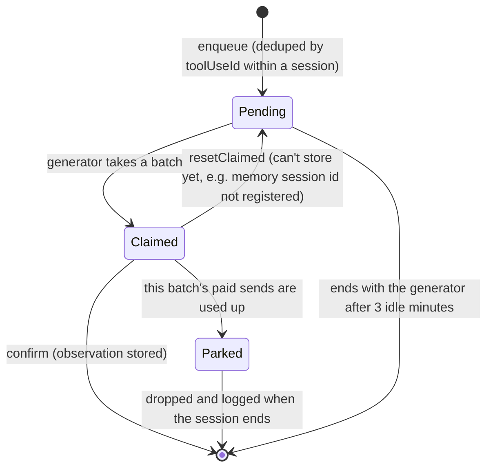
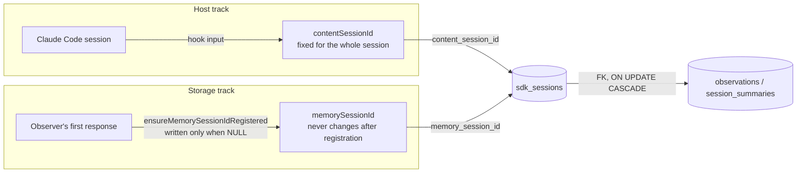
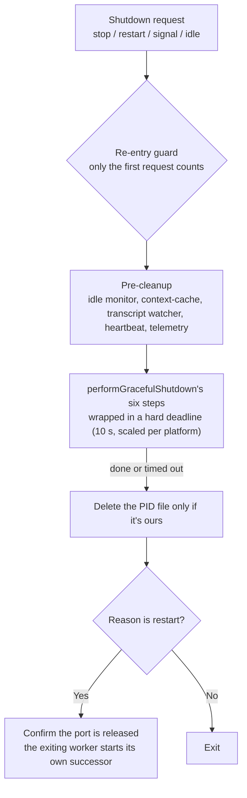

## Why a Background Worker

Chapter 5 measured it: a hook process spends several hundred milliseconds just loading the bundle, and the observer model takes anywhere from a few seconds to tens of seconds to compress a batch of tool calls into observations. Neither can sit on the path where the host is waiting. So claude-mem needs a long-running process to do the slow work:

```
Hook process (one per event)           Worker (long-running, one per user)
┌────────────────────────────┐         ┌─────────────────────────────────────┐
│ read stdin                 │  file   │ pick up from hook-spool             │
│ write hook-spool/xxx.json  │───────→ │ filter, strip privacy tags          │
│ wake the worker (may fail) │         │ put in this session's memory buffer │
│ exit 0                     │         │ observer compresses → write SQLite  │
└────────────────────────────┘         │ sync Chroma, refresh context-cache  │
                                       └─────────────────────────────────────┘
```

The worker is an Express 5 service run by Bun (`src/services/worker-service.ts`, 2,054 lines). A hook starts it on the first SessionStart, and it keeps running after that. Since v13.32, `CLAUDE_MEM_IDLE_EXIT_SEC` can make it exit on its own after being idle for a while; the next hook will start it again.

## The HTTP Layer: Routes Grouped by Caller

The worker listens on a per-user port on `127.0.0.1` (`37700 + uid % 100`). `registerRoutes()` in `worker-service.ts` (from L500) splits the routes into a dozen or so classes by function. Grouped by who calls them:

| Caller | Representative endpoints | Notes |
|--------|---------|------|
| Hooks | `POST /api/sessions/init`, `POST /api/spool/nudge`, `GET /api/context/inject` | Only session-init and context reads wait synchronously |
| MCP server | `POST /api/mem-search`, `GET /api/search`, `GET /api/timeline`, `POST /api/observations/batch`, `POST /api/tool-uses/batch`, `/api/work-state` | Chapter 9 |
| Knowledge Agent | `POST /api/corpus/:name/prime` and others | Chapter 11 |
| Viewer | `GET /stream` (SSE), `GET /api/observations`, `DELETE /api/observation/:id` | Browser UI |
| Operations | `/health`, `/api/health`, `/api/readiness`, `/api/ready`, `/restart`, `/api/admin/*` | Health checks and restart |
| Server runtime | `/v1/*` | Chapter 16 |

`/api/sessions/observations` and `/api/sessions/summarize`, which v12's hooks called, still exist. These days they're mainly used by integrations for other hosts and by direct API callers. Claude Code's hooks now go through hook-spool.

The worker listens only on the local address, but a browser can still reach it, which opens up DNS rebinding: a malicious web page resolves its own domain to `127.0.0.1` and can then call the worker's API from the browser. v13.29.0 (#3514) added a Host header check to the worker. It accepts only `localhost`, `*.localhost`, IP addresses, `CLAUDE_MEM_WORKER_HOST`, and origins declared in `CLAUDE_MEM_ALLOWED_ORIGINS`; everything else gets a 403. If you reach the Viewer through a reverse proxy or a `.local` hostname, you need to add that origin to the allowlist.

## Pickup: hook-spool's Exactly-Once Handoff

Files the hooks write are picked up by `HookSpoolDrainer` (`src/services/worker/hook-spool-drain.ts`, 147 lines). Four things trigger a pickup: worker startup, a hook's `POST /api/spool/nudge`, `fs.watch` noticing the directory changed, and a fallback sweep every 30 seconds.

"Exactly once" here describes the handoff from file to worker. Work after the handoff is at most once, as the end of this section shows.

Each entry goes to the same ingest functions the HTTP routes use (`ingestObservation`, `ingestSummarize`, `ingestSessionEnd`). The handoff point has to guard against two accidents: the worker crashes halfway through and the entry is lost, or it crashes, restarts, and processes the same entry twice. `HookSpool.drain` handles both with a small table, `hook_spool_consumed(entry_key, consumed_at_epoch_ms)`:

1. Check whether this entry's key is already in the table. If it is, the entry was handed off last time and only the file deletion didn't happen, so just delete the file
2. Call ingest. At the moment ingest puts the message into the in-memory buffer, it synchronously calls back `markHandedOff()`, which writes the marker into the table
3. Delete the file, then delete the marker

If the crash happens before step 2 writes the marker, the file is still there with no marker, and it gets processed again next time. If the crash happens after the marker is written but before the file is deleted, the next pass sees the marker and only deletes the file. The cost of the second case: the event had already entered the in-memory buffer and was lost with the process, so the corresponding observation never gets generated. "Exactly once" guarantees no duplicates and no gaps at the handoff point; it doesn't guarantee that processing after the handoff completes. The companion example `examples/ch06-worker-queue/` simulates both crash timings so you can see both outcomes. In `ingestObservation`, the marker is written deliberately after the message enters the buffer and before the generator is started (`src/services/worker/http/shared.ts`):

```typescript
// src/services/worker/http/shared.ts (v13.35.0, excerpt)
sessionManager.queueObservation(sessionDbId, { tool_name, tool_input, tool_response, ... });
// Enqueued: the hand-off point. Synchronously, before the generator kick.
handoff.markHandedOff?.();
await ensureGeneratorRunning?.(sessionDbId, 'observation');
```

Pickup also has to keep things in order. While a session still has observation entries that haven't been accepted, its summarize and session_end entries stay queued in the directory, so a summary never runs ahead of the work it's supposed to summarize. If session-init hasn't arrived yet, those two kinds of entry return `unknown_session` and also wait for the next pickup. Anything still unsuccessful after seven days moves to `expired/` with an error log entry.

## The In-Memory Buffer: Why the Persistent Queue Went Away

In v12, the worker wrote each incoming observation into SQLite's `pending_messages` table, moved it from pending to processing to deleted, and recovered from the table after a crash. v13.4.0 (commit 61fe70a20) removed that whole mechanism and replaced it with one in-memory buffer per session, `SessionMessageBuffer` (328 lines). The comment at the top of the file explains why. Paraphrased:

> Each message in the buffer is a fragment fed to a stateful, nondeterministic reducer: the observer model uses the conversation context it holds in memory to merge N tool calls into M observations. A persistent queue saved the fragments but threw away the reducer's state. Replaying those rows after a crash either produced different observations from last time, produced duplicates, or got stuck in a loop. That was the "retry storm." The real durable source of truth is Claude Code's transcript JSONL, and the recovery path is to replay the transcript.

The key point here is the judgment about persistence. Persisting an intermediate state only makes sense if replaying it gives a deterministic result. Observer generation doesn't meet that bar. So v13 persists only at the handoff from hook to worker (hook-spool), everything after the handoff happens in memory, and if the worker process dies, the buffer dies with it. The `pending_messages` table is still created in new databases, but no code writes to it anymore.

A message in the in-memory buffer has a simple lifecycle, shown in Figure 6-1.



*Figure 6-1: State transitions of one message in SessionMessageBuffer (`src/services/worker/SessionMessageBuffer.ts`)*

`Parked` is a state added in v13.30.0. When an observer request fails, it's sometimes impossible to tell whether the model actually processed it (say, the connection dropped mid-response), and resending could get billed twice. `PaidSendBudget` (`src/services/worker/paid-send-budget.ts`) gives each batch at most two paid sends: the first, plus one resend when the result is ambiguous. If that's used up and the batch still hasn't succeeded, it's "parked": no more retries, no longer counted as pending, and the messages behind it keep flowing.

## The Observer Generator

Each active session has a "generator" that feeds buffered messages to the observer model. For Claude, it's a long-running Agent SDK call whose prompt isn't a string but an async iterator:

```typescript
// src/services/worker/ClaudeProvider.ts (v13.35.0, simplified)
const messageGenerator = this.createMessageGenerator(session, ...); // pulls batches from the buffer and builds prompts
const queryResult = query({
  prompt: messageGenerator,
  options: buildHardenedSdkOptions({
    source: 'Observer',
    model: modelId,
    env: isolatedEnv,                       // isolated credentials from ~/.claude-mem/.env
    pathToClaudeCodeExecutable: claudePath,
    spawnClaudeCodeProcess: createSdkSpawnFactory(..., ['--no-session-persistence']),
  }),
});
for await (const message of queryResult) {
  // parse <observation> / <summary>, write to the database, confirm the matching buffered messages
}
```

A few key points:

**The observer can't act.** `buildHardenedSdkOptions` (`src/sdk/hardened-options.ts`) turns off every tool for the observer session, using six overlapping layers of restriction; Chapter 10 goes into them. `--no-session-persistence` stops the observer session from writing a transcript, so it doesn't pollute the user's project directory.

**More than one model.** `CLAUDE_MEM_PROVIDER` can be `claude` (the default, using the Claude Agent SDK and the user's Claude account), `gemini`, `openrouter`, `openai-compatible` (any OpenAI-compatible API, with built-in presets for deepseek, ollama, vllm, and others), or `codex` (through the Codex CLI and a ChatGPT subscription). In the worker, the last four share the session lifecycle of the `OpenAICompatibleProvider` base class.

**Model choice by batch complexity.** On the Claude path, if every pending message is a read-only tool like Read, Glob, or Grep, it uses `CLAUDE_MEM_TIER_SIMPLE_MODEL` (default `haiku`). If the batch includes a summary request, it uses `CLAUDE_MEM_TIER_SUMMARY_MODEL` (empty by default, meaning the default model). This logic is in `SessionRoutes.applyTierRouting()` and can be turned off with `CLAUDE_MEM_TIER_ROUTING_ENABLED=false`.

### Generations: When the Conversation Fills Up, Start a New One

Like the user's session, the observer is a conversation that keeps growing: every tool call appends a message. v12 set no limit on it, so a busy session would eventually hit "Prompt is too long," after which every request was guaranteed to fail. v13's answer isn't to trim the conversation but to use "generations" (`src/shared/observer-recycle.ts`):

- When a generation's character count gets close to the limit, end it deliberately and start a new one
- The limit defaults to 400,000 characters (about 100K tokens, half of a 200K window); for smaller model windows it's half the window
- The new generation doesn't start from nothing. It's seeded with the observations this session has already written, using the very same context that SessionStart injects into the user's session

One line in the source comments sums up the design: "Continuity is carried by the memory the product exists to produce, not by raw turns." What the memory system produces is exactly what it can use to compress its own working context. Chapter 3 previewed this example in its discussion of compaction.

### Quota Circuit Breaker: Don't Pay for Requests That Must Fail

The observer shares the account's quota with the user. Once the quota runs out, every tool call triggers a request that's bound to be rejected. The generator exits on the rejection, the next tool call starts a new generator, and that one gets rejected too. v13's fix notes record a data point: 11 users with exhausted quotas produced tens of thousands of rejections in a day, roughly 100 wasted requests for every observation written successfully.

`src/shared/quota-cooldown.ts` is a circuit breaker per provider:

- It opens on a "quota exhausted" response, and no requests go out during the cooldown
- When the cooldown ends, exactly one probe request is let through. If it succeeds, the breaker closes; if not, the cooldown continues
- The open state is stored on disk, so a worker restart doesn't clear it. The "who is probing" claim is not written to disk, so a process that has died can't hold the probe slot forever

The optional `CLAUDE_MEM_QUOTA_FALLBACK_PROVIDER` lets the worker switch temporarily to another provider while the main one cools down. Authentication failures are never routed around this way.

## Two Session IDs

claude-mem has two session IDs:

| ID | Where it comes from | Used for |
|----|------|------|
| `contentSessionId` | Assigned by the host (Claude Code's `session_id`) | Correlating hook input, querying by host session |
| `memorySessionId` | The `session_id` returned by the observer SDK session's first response | Foreign key for `observations` and `session_summaries` |

The two tracks meet in the `sdk_sessions` table, as Figure 6-2 shows.



*Figure 6-2: The two session ID tracks (`src/services/sqlite/SessionStore.ts`, from L2712)*

In the v12 era, `memorySessionId` was the resume handle for the observer's SDK session and got a new value after a worker restart. In v13 its meaning narrowed to "a storage key that's fixed after first registration," and the reason was an incident. Every generation of the v13 observer is a brand-new SDK process that never resumes (`shouldResume` is hard-coded to false in `ClaudeProvider`), so every round gets a new SDK session_id. The old code's condition was "if the new value differs from the stored one, overwrite it." So every round rewrote this foreign key, `ON UPDATE CASCADE` rewrote all of the session's observations along with it, and cloud sync's outbox queued a sync job for every rewrite. The source comments record what one user's database looked like: 1,100,783 rows backed up in `sync_outbox` for 6,930 prompts, an amplification of 158.8×, taking 393 MB. v13.24.17 (#4027) changed the condition to "write only when NULL."

## Process Management: Trust the Port and the Health Check

### Deciding Whether the Worker Is Alive

v12 used a PID file to decide whether the worker was alive. But the OS reuses PIDs, a process can be alive yet hung, and a worker on its way out could delete the PID file its successor had just written. v13.5.6 (#2894) changed the test to "is there a worker on the port that answers `/api/health`?" The PID file was demoted to diagnostic information, and every code path that deletes it must first confirm the file belongs to it.

Startup no longer relies on guesswork either. `GET /api/ready` streams startup progress (`src/services/server/init-phase.ts`):

```
starting → db_ready → routes_ready → ready
                                  ↘ failed{message}
```

A hook reads this stream once and knows whether the worker is still starting, ready, or failed, instead of applying a rule of thumb like "if startup takes more than 300 seconds, assume it's stuck."

### Only One Process May Start the Worker

Several hooks and the MCP server might notice at the same moment that the worker is down, each start one, and end up with several workers fighting over the same port. `src/shared/worker-spawn-gate.ts` serializes every startup path with a lock file, `<DATA_DIR>/spawn.lock`. It's created atomically with the `wx` flag (`O_CREAT|O_EXCL`). The process that creates it does the startup; the others wait for the result. A lock file not refreshed for 90 seconds is considered stale and can be taken over.

### Who Restarts on a Version Mismatch

After a plugin upgrade, the running worker may still be the old version. Before v13.12.3, the hook asked the old worker to restart itself, and the old worker launched its successor using the old version's code, so the successor was also old, the next hook asked for another restart, and so on. One user logged 2,424 recycles in a single day, with every UserPromptSubmit stuck for the full 40-second timeout. Now the hook does it itself: read the PID file after verifying its owner, send the old worker `SIGKILL`, wait until the port is actually released, and start the new version it resolved. `SIGKILL` is the only way to exit that guarantees no old-version code runs.

### Background Cleanup

- The supervisor clears dead entries out of the process registry every 30 seconds (`src/supervisor/health-checker.ts`)
- At startup, the worker scans the process table, finds `chroma-mcp` process trees that don't belong to any worker, and kills them (`src/supervisor/orphan-chroma-sweep.ts`). The comments record machines that had accumulated 619 and 808 pairs of such orphans
- The MCP server checks every 30 seconds whether its parent process is still alive, and exits if it isn't

Upstream's `docs/architecture-overview.md` describes an "Orphan Reaper that runs every 5 minutes." No such implementation exists in the code of either v12.6.2 or v13.35.0; this book goes by the code.

## Graceful Shutdown: Six Steps and a Hard Deadline

`performGracefulShutdown()` in `src/services/infrastructure/GracefulShutdown.ts` (93 lines) still has six steps, ordered from the outside in:

```typescript
// src/services/infrastructure/GracefulShutdown.ts (v13.35.0, simplified)
export async function performGracefulShutdown(config: GracefulShutdownConfig): Promise<void> {
  if (config.server) await closeHttpServer(config.server); // 1. drop connections, stop listening
  await config.sessionManager.shutdownAll();                 // 2. end all sessions and generators
  if (config.mcpClient) await config.mcpClient.close();      // 3. close the MCP client
  if (config.chromaMcpManager) await config.chromaMcpManager.stop(); // 4. stop chroma-mcp
  if (config.dbManager) await config.dbManager.close();      // 5. close SQLite
  await getSupervisor().stop();                              // 6. stop the child-process supervisor
}
```

`closeHttpServer` calls `closeAllConnections()` and then `close()`; on Windows it waits 500 ms before and after so the OS can reclaim the port. v13.12.4 fixed a detail: when `server.close()` returns `ERR_SERVER_NOT_RUNNING`, treat the server as already closed rather than as a fatal error that skips the remaining five steps (which had left the port occupied on Windows).

In v12 this flow had two gaps: no timeout backstop, and no PID file cleanup. v13.5.6 moved the outer call into `runShutdownSequence()` in `src/services/worker-shutdown.ts`, which fills both, as Figure 6-3 shows.



*Figure 6-3: v13's worker shutdown sequence (`src/services/worker-shutdown.ts`, 193 lines)*

The reason for the deadline is in the comments: session teardown had been observed taking 35–40 seconds. Once the deadline passes, nothing waits any longer; the remaining steps just run. On restart, the exiting worker starts its own successor, so the old and new processes never coexist, and no third process can sneak in and start during the gap after the port is released.

---

**Questions to consider**

1. v13 chose "persist at the handoff, process in memory." If observer generation were deterministic (pure rule-based extraction, say), would you still remove the persistent queue? State the criterion you'd use.
2. The paid-resend budget is fixed at two. If your observer ran on a free local model, how should that number change? In which situations is resending wrong in itself?
3. On a version mismatch, v13 would rather `SIGKILL` the old worker than let it exit gracefully. What does a graceful exit guarantee, and what does `SIGKILL` lose? Why is the latter acceptable here?

---

The next chapter goes into the storage layer: SQLite tables, FTS5 query construction, how documents are split for Chroma, and search routing.

---

> From the open-source edition of *Engineering Agent Memory* by diguike.  
> Read online: [inferloop.dev](https://inferloop.dev) · Source: [github.com/diguike/book-claude-mem](https://github.com/diguike/book-claude-mem)
