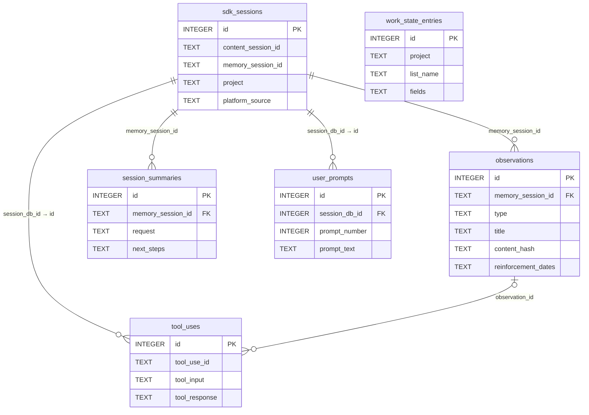
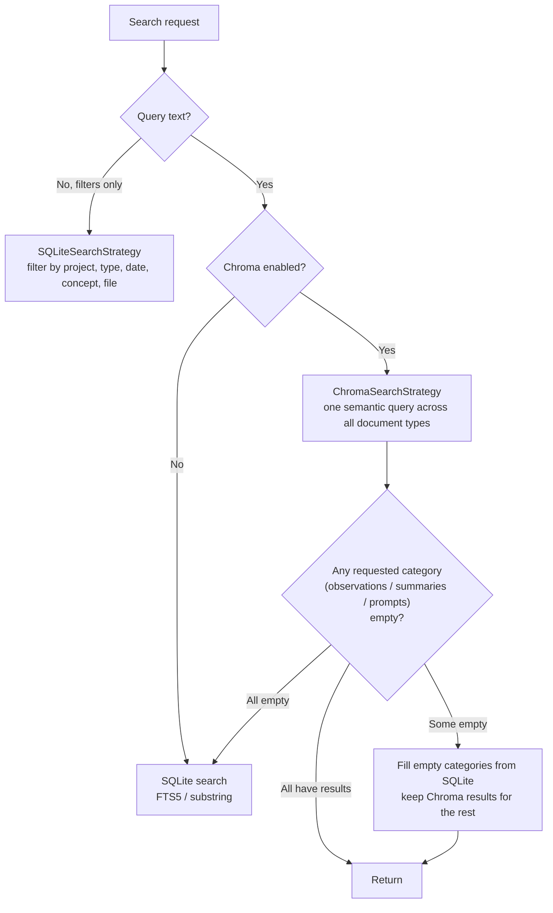

## SQLite: From 6 Tables to 21

claude-mem stores everything durable in one SQLite file, `~/.claude-mem/claude-mem.db`, accessed through Bun's built-in `bun:sqlite`. Rather than describe the schema from memory, I initialized an empty database with the `SessionStore` from v12.6.2 and from v13.35.0, then read back `sqlite_master`:

| | v12.6.2 | v13.35.0 |
|---|---|---|
| Max `schema_versions` version | 32 | 64 |
| Tables (including `schema_versions`; excluding FTS virtual tables and their shadow tables, and `sqlite_sequence`) | 6 | 21 |

The tables in a fresh v13.35.0 database, grouped by purpose:

| Purpose | Tables |
|------|----|
| Core memory | `sdk_sessions`, `observations`, `session_summaries`, `user_prompts` |
| Raw evidence | `tool_uses` (raw tool inputs and outputs), `advisor_calls` |
| Agent work state | `work_state_entries` |
| Handoff and dedup | `hook_spool_consumed`, `observation_dedup_candidates`, `dedup_meta`, `token_df` |
| Cloud sync | `sync_outbox`, `sync_content_outbox`, `sync_dead_letter`, `sync_entity_heads`, `sync_launch_exclusions`, `sync_pull_quarantine`, `sync_state` |
| Notifications | `telegram_wrapups` |
| Legacy | `pending_messages` (still created, no code writes to it) |

There are also two FTS5 virtual tables, `observations_fts` and `session_summaries_fts`, created by the search layer's `SessionSearch` constructor rather than by the initialization above. Some descriptions of claude-mem mention an `observation_feedback` table that records three usage signals: viewed, fetched, and cited. That table existed only in an uncalled migration file in v12.6.2 and in one architecture document. The real database setup never created it, and the related code is gone in v13. Chapter 10 covers the mechanism that actually plays the "usage feedback" role in v13.

### Fields in the Core Tables

Only the fields relevant to this book are listed here. `PRAGMA table_info(<table>)` gives the full column list:

```sql
-- Sessions: one row per session in the host
sdk_sessions (
  id, content_session_id, memory_session_id, project, platform_source,
  user_prompt, status, prompt_counter, custom_title,
  observed_model, observed_billing,        -- v13.22: model and billing type of the user's session (telemetry)
  cwd, project_key_source,                 -- how the project key was derived: path / git-remote / environment
  started_at_epoch, completed_at_epoch
)

-- Observations: the unit of memory after AI compression
observations (
  id, memory_session_id, project, type, title, subtitle, narrative, text,
  facts, concepts, files_read, files_modified,         -- JSON array strings
  prompt_number, discovery_tokens, content_hash, generated_by_model,
  agent_type, agent_id, merged_into_project, metadata,
  occurrence_count, title_norm_key,                     -- near-duplicate dedup
  reinforcement_dates, last_reinforced,                 -- ACT-R reinforcement history
  synced_at, origin_device_id, origin_local_id, sync_rev, -- cloud sync
  created_at, created_at_epoch
)

-- Session summaries: note it's files_edited, not files_modified
session_summaries (
  id, memory_session_id, project, request, investigated, learned, completed,
  next_steps, notes, files_read, files_edited, prompt_number, discovery_tokens, ...
)

-- User prompts
user_prompts (
  id, session_db_id, content_session_id, prompt_number, prompt_text,
  native_prompt_id, native_prompt_hash,    -- v13.34: the host's prompt identity, makes retries idempotent
  ...
)

-- Raw tool calls (since v51; the data source for get_tool_uses)
tool_uses (
  id, tool_use_id, content_session_id, memory_session_id, session_db_id, project,
  platform_source, tool_name, tool_input, tool_response, cwd, prompt_number,
  agent_type, agent_id, observation_id, content_hash, created_at_epoch, ...
)

-- The agent's to-dos and work state (since v61; append-only)
work_state_entries (id, project, list_name, fields, created_at, created_at_epoch)
```

Figure 7-1 shows how the tables relate.



*Figure 7-1: Core table relationships in v13.35.0 (key fields only; `work_state_entries` is stored per project, not under a session)*

The foreign keys from `observations` and `session_summaries` to `sdk_sessions` carry `ON UPDATE CASCADE`, so changing a session's `memory_session_id` rewrites all of its memories. As Chapter 6 described, that's exactly why v13.24.17 made the field "register once."

`tool_uses` is an important addition in v13. v12 kept only the summaries the observer wrote; the raw tool inputs and outputs were gone once the observation was generated. Now, as the worker puts a message into the buffer, it also writes the raw data to `tool_uses` (the "dual-write" in `ingestObservation`). When a summary doesn't make something clear, the model can get the original through the MCP tool `get_tool_uses`. This is layer 4 of progressive disclosure, which Chapter 8 covers.

### Migrations: Every Step Can Run Twice

v13 doesn't use separate migration files for schema changes. The `SessionStore` constructor calls a chain of `ensureXxx()` methods in order. Each one first checks whether its table or column already exists, runs only if it doesn't, and inserts a row into `schema_versions` when it's done. Running them again has no side effects, so upgrading an old database and initializing a new one follow the same path.

The cost of this style is a very long `SessionStore.ts` (4,637 lines in v13.35.0). The benefit is that a crash mid-upgrade can't leave a state where the version number was written but the column wasn't added: the next startup re-checks the columns instead of trusting the version number. v13 has also added several fallbacks to schema repair. For example, if the database contains orphan observations with no parent session, the migration first inserts a placeholder parent session and then rebuilds the table (v13.12.4). User data is never deleted.

### Indexes Built for SessionStart

SessionStart needs "the 50 most recent observations for this project." Before v13.31.0, the query pulled every observation for the project (including merged worktrees) and then sorted them. On a 1.2 GB database, each session start read about 21,700 rows (63 MB) and took 0.8–1.7 seconds with a cold cache. Schema versions 63 and 64 added composite indexes on project (case-insensitive) plus time descending, and covering indexes. The same query now reads a few hundred pages in about 4 ms, and the project-alias resolution query dropped from 7,499 pages read to 355, about 9 ms:

```sql
CREATE INDEX idx_observations_project_nocase_recent
  ON observations(project COLLATE NOCASE, created_at_epoch DESC);
CREATE INDEX idx_observations_merged_into_nocase_recent
  ON observations(merged_into_project COLLATE NOCASE, created_at_epoch DESC);
```

`COLLATE NOCASE` comes from a separate fix: directories whose names differ only in case (`MyApp` and `myapp`) are the same directory on macOS, so they should have the same project key (v13.29.0).

## PRAGMAs and Concurrency

SQLite connections are initialized in `src/services/sqlite/connection.ts`:

```typescript
// src/services/sqlite/connection.ts L44-55 (v13.35.0)
runRequiredPragma(db, 'PRAGMA busy_timeout = 5000', 'busy_timeout');
runRequiredPragma(db, 'PRAGMA foreign_keys = ON', 'foreign_keys');
runRequiredPragma(db, 'PRAGMA synchronous = NORMAL', 'synchronous');
runRequiredPragma(db, 'PRAGMA journal_size_limit = 4194304', 'journal_size_limit');
if (enableIncrementalAutoVacuum && !hasUserTables(db)) {
  runRequiredPragma(db, 'PRAGMA auto_vacuum = INCREMENTAL', 'auto_vacuum'); // can only be set on an empty database
}
if (enableWal) {
  runRequiredPragma(db, 'PRAGMA journal_mode = WAL', 'journal_mode');
}
```

Compared with v12.6.2, three settings were removed (`temp_store = memory`, `mmap_size = 256MB`, `cache_size = 10000`) and three were added:

- `busy_timeout = 5000`: the worker, hooks, and the MCP process all access this file at the same time. When one hits a write lock, it waits up to 5 seconds instead of throwing `SQLITE_BUSY` immediately (v13.10.2)
- `journal_size_limit = 4MB`: caps how large the WAL file stays after a checkpoint, so it can't grow forever
- `auto_vacuum = INCREMENTAL`: lets space be reclaimed gradually after deletions. This setting only takes effect before tables are created, so it's applied only to new databases

WAL mode does what it always did: readers and writers don't block each other. v13 also opens the database read-only when generating startup context (`new Database(DB_PATH, { readonly: true })`, #3233), so several sessions starting at once don't compete for the write lock.

## FTS5 Full-Text Search

### The Table

```sql
-- src/services/sqlite/SessionSearch.ts (v13.35.0)
CREATE VIRTUAL TABLE IF NOT EXISTS observations_fts USING fts5(
  title, subtitle, narrative, text, facts, concepts,
  content='observations',
  content_rowid='id'
);
```

No `tokenize` option is given, so it uses the default `unicode61` tokenizer. Three triggers keep it in sync. v13.29.0 (#3284) changed the update trigger to fire only when an indexed column changes:

```sql
CREATE TRIGGER IF NOT EXISTS observations_au
AFTER UPDATE OF title, subtitle, narrative, text, facts, concepts ON observations BEGIN
  INSERT INTO observations_fts(observations_fts, rowid, title, subtitle, narrative, text, facts, concepts)
  VALUES('delete', old.id, old.title, old.subtitle, old.narrative, old.text, old.facts, old.concepts);
  INSERT INTO observations_fts(rowid, title, subtitle, narrative, text, facts, concepts)
  VALUES (new.id, new.title, new.subtitle, new.narrative, new.text, new.facts, new.concepts);
END;
```

v12's trigger was `AFTER UPDATE ON observations`, so a change to any column deleted and reinserted the index entry. Every time cloud sync stamped a row with `synced_at`, and every time reinforcement ranking appended a date, it triggered a pointless rebuild, and the FTS index bloated. The same release also dropped `user_prompts_fts`, which had never been queried, and started merging existing index fragments in small steps one minute after the worker starts.

### Building the Query

v12.6.2 wrapped the whole user input as a single phrase:

```typescript
// v12.6.2 src/services/sqlite/SessionSearch.ts
const escapedQuery = '"' + query.replace(/"/g, '""') + '"';
```

Wrapping everything as one phrase blocks syntax injection, but it means `auth timeout` only matches records where the two words appear right next to each other. v13.29.0 (#4180) changed it to "every word must appear, in any position":

```typescript
// src/services/sqlite/SessionSearch.ts L360-371 (v13.35.0)
private static buildFTSMatchQuery(query: string): string {
  // Drop tokens with no letters or digits (a lone -, &, —): unicode61 doesn't index them,
  // so keeping one produces an empty phrase that never matches, and ANDing it in empties the whole query
  const tokens = (query.match(/\S+/g) ?? []).filter(token => /[\p{L}\p{N}]/u.test(token));
  if (tokens.length === 0) {
    return `"${query.replace(/"/g, '""')}"`;
  }
  return tokens
    .map(token => `"${token.replace(/"/g, '""')}"`)
    .join(' AND ');
}
```

Each token is still wrapped in its own double quotes with inner quotes doubled, so `NOT`, `OR`, `*`, `:`, and `.` are all just ordinary characters. The `AND` between them is added by the program, so users can't inject one. Given `auth.ts "timeout`, the generated MATCH expression is `"auth.ts" AND """timeout"`.

What happens if you skip this step? The companion example `examples/ch07-storage-layer/` (`npm run demo`) passes several common inputs straight to MATCH and compares them with the safely built version:

| User input | Passed straight to MATCH | After `buildFTSMatchQuery` |
|---------|---------------|-------------------------|
| `Next.js` | Error `fts5: syntax error near "."` | `"Next.js"`, 1 row |
| `claude-mem` | Error `no such column: mem` | `"claude-mem"`, 4 rows |
| `Express SQLite` | 1 row | `"Express" AND "SQLite"`, 1 row |
| `auth "unclosed` | Error `unterminated string` | `"auth" AND """unclosed"`, 0 rows |

The `claude-mem` row is the one people miss. The hyphen means something in FTS5 syntax, so a perfectly ordinary project name is enough to break the query.

### CJK Text: Substring Search When FTS5 Comes Up Empty

`unicode61` splits on whitespace and punctuation. Chinese, Japanese kana, Korean, and Thai don't put spaces between words, so an entire run of characters is treated as one token. The source comments record a direct test against `unicode61`:

```
설정   in 설정을               → 0 rows   # "settings" inside "settings" + object particle
项目   in 修改了项目配置       → 0 rows   # "project" inside "changed the project config"
```

In other words, searching in these scripts, FTS5 almost always returns nothing. v13's fix (#3801, #3810) has two parts:

1. When the query contains such characters, switch straight to `LIKE '%…%'` substring matching. The query is first split into runs of CJK characters and runs of everything else; each run produces a group `(title LIKE ? OR subtitle LIKE ? OR …)`, groups are ANDed together, and at most 500 runs are used. `%`, `_`, and `\` are escaped first
2. When the query is pure Latin script but FTS5 finds nothing, try again with substring matching. This covers text like `payload优先使用LLM` ("payload prefers the LLM"), where Latin letters run straight into Chinese characters: `unicode61` treats the whole string as one token, so searching for `payload` can never match it

Substring matching can't use an index and gets slow with a lot of data. For a personal memory store (tens of thousands of observations) the cost is acceptable. Chapter 13's mini-mem uses the same idea to fix its own CJK search problem.

On platforms where FTS5 isn't available (it wasn't compiled in), search falls back to Chroma plus `LIKE`.

## Chroma Vector Storage

### How Documents Are Split

`ChromaSync.formatObservationDocs()` (`src/services/sync/ChromaSync.ts`, from L512) splits one observation into several documents, each with its own embedding:

| Document ID | Content | When |
|--------|------|------|
| `obs_<id>_narrative` | narrative | If present |
| `obs_<id>_text` | text | If present |
| `obs_<id>_fact_<i>` | One document per fact | For each fact |
| `obs_<id>_title` | title (plus subtitle) | Fallback when none of the above exist |

Session summaries work the same way, with one document each for request, investigated, learned, completed, next_steps, and notes. Splitting means a specific fact can be matched on its own instead of being diluted into the "average meaning" of the whole observation. Every document's metadata carries fields like `doc_type`, `project`, and `type`, which queries use for filtering.

### Deployment and Model

- All projects share one collection, `cm__claude-mem`, filtered by the `project` metadata field
- The worker starts a `chroma-mcp` subprocess with uvx and talks to it over stdio using the MCP protocol, so no port is used; chromadb is pinned to 1.5.9 (v13.29.0)
- Writes get their own 10-minute timeout (`CLAUDE_MEM_CHROMA_MUTATION_TIMEOUT_MS = 600000`), so a large backfill doesn't get chroma-mcp killed by the default 60-second timeout
- Rows that fail to write are marked as pending sync and filled in later by the background backfill. When an index segment is confirmed corrupt, the collection is dropped and rebuilt from SQLite

The default embedding function is `default`, meaning all-MiniLM-L6-v2 running locally. That model was trained mostly on English, so semantic search in Chinese and other non-English languages is limited; keep that in mind if your memories aren't in English. `CLAUDE_MEM_CHROMA_EMBEDDING_FUNCTION` can also be openai, cohere, jina, or voyageai. Each needs that vendor's API key and sends your memory text to that vendor. Changing the setting only affects newly created collections; existing data needs to be reindexed.

## Search Routing: Chroma First, SQLite Fills the Gaps

Hybrid retrieval is often described as "run FTS5 and vector search in parallel, then merge and dedupe by score." That isn't what the source does. Figure 7-2 shows the actual routing logic of `SearchOrchestrator` (`src/services/worker/search/SearchOrchestrator.ts`) in v13.35.0.



*Figure 7-2: SearchOrchestrator's search routing (v13.35.0)*

A few points:

- When there's query text, semantic search is the main path, not one of two parallel paths
- One Chroma query returns the top N across all document types. The source comments note that for CJK queries, prompt documents tend to crowd out the slots, or date and type filters remove every hit, and a category ends up empty. SQLite then fills that category (`supplementEmptyCategories`), and it does so without the "last 90 days" window, because an exact keyword hit from 90 days ago is exactly what this step is meant to recover
- A class called `HybridSearchStrategy` does exist, but it's used for cases like "find observations by file": SQLite first narrows candidate IDs by exact file path, Chroma ranks those candidates, and the rows are then fetched in that order

How the two kinds of search divide the work:

| Situation | Mainly relies on |
|------|---------|
| Filters only (type, date, project) | SQLite |
| Natural-language description, phrased differently | Chroma |
| Exact keywords, file paths | SQLite (FTS5 or substring) |
| CJK text | SQLite substring, especially when Chroma returns nothing |

## Deduplication: Duplicates Become Evidence Instead of Being Dropped

### Exact Dedup Within a Session

The unique index on `observations` hasn't changed:

```sql
CREATE UNIQUE INDEX ux_observations_session_hash ON observations(memory_session_id, content_hash);
```

Neither has the `content_hash` algorithm (`src/services/sqlite/observations/store.ts` L16): join `memory_session_id`, `title`, and `narrative` with `\x00`, take the SHA-256, and keep the first 16 hex characters. The insert is still `ON CONFLICT(memory_session_id, content_hash) DO NOTHING`.

What changed is what happens after the conflict. v12 dropped the duplicate silently. v13 finds the existing row and records one more "reinforcement" on it:

```typescript
// src/services/sqlite/SessionStore.ts storeObservations() (v13.35.0, excerpt)
const existing = lookupExistingStmt.get(memorySessionId, contentHash);
// An exact duplicate re-confirms the stored observation instead of being
// dropped silently.
reinforceObservation(this.db, existing.id, reconfirmedOn);
```

`reinforceObservation` appends today's date to the row's `reinforcement_dates` (keeping at most 10, with repeats on the same day not counted). Observing the same thing again is itself evidence that the memory still holds. Under the default configuration this history affects nothing. Only when ACT-R ranking is turned on does it take part in SessionStart's selection, which Chapter 10 covers.

### Near-Duplicate Dedup Across Sessions (Off by Default)

The unique index can't catch duplicates across sessions. Fixing the same bug every day produces dozens of observations with nearly identical titles. v13.29.0 (#3038) added an optional two-level dedup that takes effect with `CLAUDE_MEM_DEDUP_ENABLED=true` (`src/services/dedup/`):

- **Level 0, exact normalized match**: if the titles are identical after lowercasing, removing punctuation, and collapsing whitespace, within the same project, same host, and same kind of agent (main session or subagent), the new one is merged into the existing row: `occurrence_count + 1`, plus one reinforcement, and no new row is inserted
- **Level 1, candidates**: split titles on whitespace and compute IDF-weighted cosine similarity. If it's above the threshold and no "veto rule" fires, record a near-duplicate candidate. The veto rule checks whether the parts where the titles differ contain rare words. For example, `fix ffmpeg-7.1.conf` and `fix ffmpeg-6.0.conf` are very similar, but the version numbers are rare words, so they must not be merged. Candidates are only recorded, never merged automatically, and can be viewed at `GET /api/dedup/candidates`

The module comments say the approach was validated on a real database of 7,651 observations, and that an approach using simhash on narrative text was dropped because it produced too many false positives. Tokens are split on whitespace only, not punctuation, so a compound identifier like `ffmpeg-7.1.conf` stays one rare word.

The split between the two levels follows a principle: deterministic, explainable duplicates can be handled automatically. Probabilistic judgments only produce suggestions, and whether to merge is left to a person or to a stronger judge later.

---

**Questions to consider**

1. The CJK substring fallback in this chapter can't use an index. If your memory store were shared by a team and held millions of Chinese observations, how would you change it? Give at least two approaches and compare their effect on the write path.
2. Chroma's default embedding model is mostly English. Without changing claude-mem's source, what can users who write in Chinese do to improve semantic search? What's the privacy cost of each option?
3. Level 0 dedup merges observations with the same title into one row and increments `occurrence_count`. If two observations have the same title but opposite narratives (say "approach X works," and later "approach X doesn't work," but the model gave both the same title), what problem does the merge create?

---

The next chapter starts Part III. It begins with the actual text SessionStart injects and takes progressive disclosure apart layer by layer.

---

> From the open-source edition of *Engineering Agent Memory* by diguike.  
> Read online: [inferloop.dev](https://inferloop.dev) · Source: [github.com/diguike/book-claude-mem](https://github.com/diguike/book-claude-mem)
