## From Observations to a Corpus

A single observation records one moment. What engineers often need is the whole picture: everything the project's history has accumulated about one topic.

The Knowledge Agent picks observations scattered along the timeline by some criteria, compiles them into a knowledge base focused on one topic (a corpus), has a dedicated model session "read" all of it, and then lets you ask it questions repeatedly. The feature consists of six MCP tools added in v12.1.0: `build_corpus`, `list_corpora`, `prime_corpus`, `query_corpus`, `rebuild_corpus`, and `reprime_corpus`. The worker-side code is in `src/services/worker/knowledge/`, five files and 672 lines.

## A Corpus Is a JSON File

A corpus holds more than a list of observation IDs. Each corpus is a file like `~/.claude-mem/corpora/<name>.corpus.json` (`CorpusStore`), structured like this:

```typescript
// src/services/worker/knowledge/types.ts (v13.35.0, selected fields)
interface CorpusFile {
  version: 1;
  name: string;
  description: string;
  created_at: string;
  updated_at: string;
  filter: CorpusFilter;          // build criteria: project / types / concepts / files / query / date_start / date_end / limit
  stats: {
    observation_count: number;
    token_estimate: number;      // token estimate for the full rendered text
    date_range: { earliest: string; latest: string };
    type_breakdown: Record<string, number>;
  };
  system_prompt: string;         // generated from filter and stats
  session_id: string | null;     // the model session ID after priming
  observations: CorpusObservation[]; // full snapshots of the observations: title, narrative, facts, concepts, files...
}
```

Three things to note:

- The file stores **full snapshots** of the observations, not ID references. If an original observation is later deleted or modified, an already-built corpus isn't affected until the next rebuild
- `filter` is the corpus's "definition," and a rebuild re-runs the query from it
- `session_id` ties the corpus to a model session that has already read all of its content

## Build → Prime → Query

### Build: Query by Criteria and Freeze the Result

```
build_corpus name="hooks-expertise"
  description="Everything about the hooks lifecycle"
  project="claude-mem"
  concepts="gotcha,how-it-works"
  limit=500
```

Parameters:

| Parameter | Description |
|------|------|
| `name` | Required; also used as the file name |
| `description` | What this knowledge base is about |
| `project` | Restrict to one project |
| `types` | Observation types, comma-separated. `CorpusFilter`'s type definition accepts only six: decision, bugfix, feature, refactor, discovery, change |
| `concepts` | Concept tags, comma-separated: how-it-works, gotcha, trade-off, and so on |
| `files` | File paths, comma-separated |
| `query` | Semantic query |
| `dateStart` / `dateEnd` | Date range (ISO format) |
| `limit` | Maximum number of entries; the tool description gives a default of 500 |

`CorpusBuilder.build()` (`src/services/worker/knowledge/CorpusBuilder.ts`) hands these criteria to Chapter 7's `SearchOrchestrator`, searching only observations (so summaries and prompts don't take up candidate slots), then fetches the full records in chronological order. There's one deliberate tweak:

```typescript
// The stored filter is the whole definition of a corpus; the 90-day window interactive
// search applies to date-less Chroma queries would shrink it on every rebuild.
searchArgs.ignoreDefaultRecencyWindow = true;
```

Interactive search, when no date criteria are given, looks only at semantic hits from the last 90 days by default. That's reasonable for a quick search, but for a knowledge base, every rebuild would quietly drop older content. So the window is turned off during builds (v13.29.0, #4168).

### Prime: Have a Model Session Read All of It

```
prime_corpus name="hooks-expertise"
```

Priming is an ordinary SDK call whose prompt is three pieces joined together:

```typescript
// src/services/worker/knowledge/KnowledgeAgent.ts (v13.35.0, simplified)
const primePrompt = [
  corpus.system_prompt,             // "You are a knowledge agent with access to N observations from the ... corpus." + the filter
  '',
  'Here is your complete knowledge base:',
  '',
  renderedCorpus,                   // every observation rendered as text
  '',
  "Acknowledge what you've received. Summarize the key themes and topics you can answer questions about.",
].join('\n');

const queryResult = query({
  prompt: primePrompt,
  options: buildHardenedSdkOptions({ source: 'KnowledgeAgent', model, env: isolatedEnv, ... }),
});
// take session_id from the returned messages and write it back to the corpus file
```

Like the observer, the Knowledge Agent's session has every tool turned off by `buildHardenedSdkOptions` (Chapter 10). It can only answer from what it has read; it can't read files or run commands.

Priming a corpus of several hundred observations can take a long time. Since v13.30.0, when the client supports it, `prime_corpus` and `query_corpus` stream their results with a heartbeat every 10 seconds, so a prime can run for up to 15 minutes instead of hitting the old 30-second request timeout. If the client disconnects, the background work stops.

### Query: Follow Up in the Same Session

```
query_corpus name="hooks-expertise"
  question="What is the SessionStart hook's timeout, and why was it set to that value?"
```

Each query is a new SDK call with `resume: corpus.session_id`, so the model keeps everything it read during priming plus the previous questions and answers, and you can ask follow-ups like "what exactly did you mean by X?" The `session_id` the SDK returns can change each time, and the Knowledge Agent writes the new value back to the file.

If the session can no longer be resumed (the CLI reports it can't find the session's record), `query()` automatically primes again before answering. The caller doesn't need to handle it.

## Filtering and Focus

**A focused corpus works far better than a broad one.** The model's context window is limited. Stuff 500 observations on all sorts of topics into it, and answering a specific question still means hunting through a lot of irrelevant material. The bigger the corpus, the slower the prime and the more each query costs (every query carries the whole session's context).

Recommended approaches:

| Situation | Criteria |
|------|---------|
| Understanding one module | `files="src/services/auth"` |
| Reviewing architecture decisions | `types="decision"` |
| Collecting pitfalls | `concepts="gotcha"` |
| Work during a period | `dateStart="2026-09-01" dateEnd="2026-09-30"` |
| Fix patterns for one kind of problem | `types="bugfix" query="timeout"` |

Combined criteria focus better than single ones: `types="decision" concepts="trade-off"` finds decisions that involved an explicit trade-off. Don't write `types="decision,trade-off"`: `trade-off` is a concept, not a type, so as a type filter it matches nothing.

After building, check `observation_count` and `token_estimate` with `list_corpora` before deciding whether to prime.

## Maintenance: Rebuild and Reprime

### Rebuild

New observations don't flow into existing corpora automatically. `rebuild_corpus` re-runs the query from the stored `filter` and overwrites the observation snapshots in the file with the results.

v13.29.0 added a safeguard to rebuild:

```typescript
// src/services/worker/http/routes/CorpusRoutes.ts (v13.35.0)
// A rebuild that keeps more than half of a non-trivial corpus is treated as a
// routine refresh; keeping half or less is a destructive shrink that must be confirmed.
private isDestructiveShrink(previousCount: number, newCount: number): boolean {
  return previousCount >= 4 && newCount <= previousCount / 2;
}
```

If a corpus that had four or more observations would be left with half or fewer after the rebuild, the rebuild is refused by default and the original file is kept. The response suggests checking the stored date criteria and, once you're sure, running it again with `force: true`. That kind of shrinkage usually doesn't mean the knowledge got smaller. It means something is wrong with the criteria: Chroma is temporarily unavailable, the project was renamed, or the 90-day window mentioned above kicked in.

### Reprime

Rebuild updates only the file. It doesn't touch the session that was already primed, which is still working from the old content. `reprime_corpus` clears `session_id` and primes again. It's also useful when the conversation has drifted off course, or when the session's context has grown long enough to hurt answer quality.

### State Transitions

Putting the tools together, Figure 11-1 shows the states a corpus moves through.

```mermaid
stateDiagram-v2
    [*] --> Built: build_corpus
    Built: Built (file has observation snapshots, session_id empty)
    Built --> Primed: prime_corpus
    Primed: Ready (session_id points to a session that has read everything)
    Primed --> Primed: query_corpus (resumes the session; session_id may change)
    Primed --> Primed: query primes again automatically if the session can't be resumed
    Primed --> Stale: rebuild_corpus
    Built --> Built: rebuild_corpus
    Stale: Snapshots updated, session still on old content
    Stale --> Primed: reprime_corpus
    Primed --> Primed: rebuild refused (shrinks by half or more without force), no change
```



*Figure 11-1: The lifecycle of a corpus (`src/services/worker/knowledge/` and `CorpusRoutes.ts`)*

Watch out for the in-between state after a rebuild: the snapshots are updated, but the session is still based on the old knowledge. You have to reprime before queries can use the new content.

## How the Knowledge Agent and mem_search Divide the Work

With the enforced stepwise `mem_search` in v13.35 (Chapter 8), the Knowledge Agent's role is clearer:

| | mem_search | Knowledge Agent |
|---|---|---|
| Good for questions like | "How did we fix that connection pool problem last time?" | "What decisions have we made about the auth module, and do any of them contradict each other?" |
| The answer comes from | The main session's model reading a few details and drawing its own conclusion | A dedicated model session that has read the entire topic |
| Cost | A few hundred to a few thousand tokens per call | One prime (possibly tens of thousands of tokens), then every query carries the whole session |
| Freshness | Live | Depends on the last rebuild and reprime |

The answer to the first kind of question sits in a handful of records. The second kind requires comparing dozens or hundreds of records side by side, which is exactly what a subagent that reads everything before answering is good at. Chapter 3 classified this as the subagent technique: a separate context window digests a large amount of material, and only the conclusion goes back to the main session.

---

**Questions to consider**

1. A corpus stores snapshots of observations, not IDs. After a user deletes an original observation in the Viewer, an already-built corpus still contains it. From a privacy and data-governance standpoint, is that a problem? If so, how would you change it?
2. For a corpus of 500 observations averaging 200 tokens each, roughly how many tokens does one prime cost? What about each query after that? When should you split it into several smaller corpora?
3. The rebuild shrink guard's thresholds are "at least 4 entries before, at most half after." Why have the floor of 4? How would you choose these two numbers for your own use?

---

That completes Part III. From the budget and format of injection, to an enforced stepwise retrieval protocol, to how observations are generated and corrected, to compiling knowledge bases, these four chapters cover claude-mem's core design for what to remember and how to get it back.

The next part walks you through building a working mini memory plugin from scratch.

---

> From the open-source edition of *Engineering Agent Memory* by diguike.  
> Read online: [inferloop.dev](https://inferloop.dev) · Source: [github.com/diguike/book-claude-mem](https://github.com/diguike/book-claude-mem)
