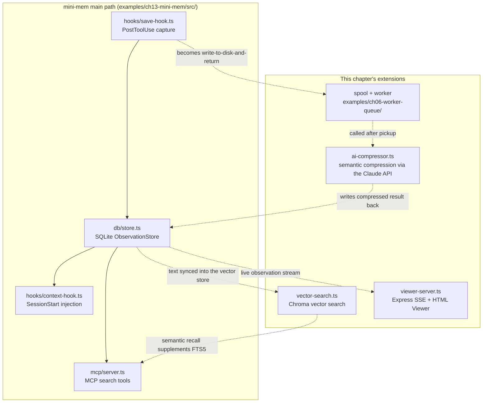

## The Big Picture

Chapter 13's mini-mem completed the smallest loop: capture → store → inject or retrieve. This chapter adds several extensions to that main path: asynchronous processing, AI compression, a timeline, vector search, a live Viewer, and project identification. Figure 14-1 marks where each one attaches.



*Figure 14-1: Where each extension attaches to mini-mem's main path. Solid lines are Chapter 13's existing path; dashed lines are the data paths added in this chapter*

The companion code in `examples/ch14-extensions/src/` has three demos that run on their own (`npm run demo:compress` / `demo:search` / `demo:viewer`). The asynchronous-processing demo is Chapter 6's `examples/ch06-worker-queue/`. Actually wiring them into mini-mem is design work, so the text distinguishes two kinds of code: snippets labeled with a file name are excerpts that run, and snippets labeled "design sketch" are left as exercises.

## Go Asynchronous First

AI compression takes several seconds per call, so it can't run in the hook process. Chapters 4 and 6 covered how claude-mem v13 handles this: the hook atomically writes the event to a file and exits, a long-running worker picks it up, and processing after pickup happens in memory. Converting mini-mem to that model takes three changes:

1. `save-hook.ts` stops writing to SQLite and instead writes the event to `~/.mini-mem/spool/<key>.json`. Use `session_id` plus `tool_use_id` as the key, so a duplicate delivery from the host overwrites the same file
2. Add a worker process that picks up files using `fs.watch` plus a periodic sweep, hands them to the compressor, and deletes each file after the database write succeeds
3. Between pickup and deletion, record a marker in a "handed off" table, so a crash and restart don't ingest anything twice

`examples/ch06-worker-queue/` is a runnable implementation of this pattern, including recovery after a simulated worker crash. As for why intermediate state isn't persisted after the handoff, the "In-Memory Buffer" section of Chapter 6 gives claude-mem's reasoning: observer generation isn't deterministic, so replaying a stretch of intermediate state won't produce the same result.

## Adding AI Compression

mini-mem's rule-based extraction can only produce titles like 编辑 src/index.ts ("Edit src/index.ts"). With a model, you can get informative titles like "Make JWT issuing asynchronous."

The companion code `examples/ch14-extensions/src/ai-compressor.ts` is a runnable compression demo (`npm run demo:compress`, which needs Anthropic API credentials). It compresses a batch of observations into one summary:

```typescript
// examples/ch14-extensions/src/ai-compressor.ts (excerpt)
import Anthropic from '@anthropic-ai/sdk';

const client = new Anthropic(); // reads credentials from ANTHROPIC_API_KEY and related environment variables
const MODEL = process.env.ANTHROPIC_MODEL || 'claude-opus-5-5';

const message = await client.messages.create({
  model: MODEL,
  max_tokens: 4096,
  output_config: { effort: 'low' },   // summarizing is a simple task; low effort keeps thinking costs down
  messages: [{ role: 'user', content: `你是一个记忆压缩助手……\n\nObservations:\n${observationText}` }],
});

if (message.stop_reason === 'refusal') throw new Error('请求被拒绝');
const summary = message.content
  .filter((block): block is Anthropic.TextBlock => block.type === 'text')
  .map((block) => block.text)
  .join('');
```

(The prompt and error strings in the shared example are in Chinese. The prompt opens with "You are a memory compression assistant…" and the error reads "request refused." Replace them with English if you want English summaries.)

The default model is `claude-opus-5-5`; an environment variable switches it to the cheaper `claude-haiku-5-5`. claude-mem's own observer defaults to the Haiku tier (`claude-haiku-4-5-20251001`), because with a high volume of observations, the per-token price of the model is the main cost.

When you wire this into mini-mem, the more practical form is to compress one tool call at a time and output one structured observation. This version borrows a few conventions from claude-mem's observer (Chapter 10):

```typescript
// Design sketch: semantic compression of a single tool call. Wiring it fully into mini-mem is left as an exercise
const TYPES = ['bugfix', 'feature', 'refactor', 'change', 'discovery', 'decision'] as const;

export async function compressObservation(toolName: string, toolInput: unknown, outcome: unknown) {
  const response = await client.messages.create({
    model: MODEL,
    max_tokens: 4096,
    output_config: { effort: 'low' },
    messages: [{
      role: 'user',
      content: `Analyze the tool call below and decide whether it's worth remembering.
If it is, output only one JSON object:
{"type": ${TYPES.map(t => `"${t}"`).join(' | ')}, "title": "one-line title", "narrative": "under 50 words", "facts": ["fact"]}
If it's routine (an empty status check, a listing with no output, a search with no results), output only {"skip": true}.

<what_happened>${toolName}</what_happened>
<parameters>${truncate(JSON.stringify(toolInput))}</parameters>
<outcome>${truncate(JSON.stringify(outcome))}</outcome>`,
    }],
  });
  // If parsing fails, don't retry forever: log it and skip this one
}

// Keep the first 60% and the last 30%, and note how many characters were dropped in between
// (the same approach as claude-mem's truncateObservationField)
function truncate(text: string, max = 4000): string {
  if (text.length <= max) return text;
  const head = text.slice(0, Math.floor(max * 0.6));
  const tail = text.slice(-Math.floor(max * 0.3));
  return `${head}\n... <elided chars="${text.length - head.length - tail.length}" /> ...\n${tail}`;
}
```

Three details are worth copying. Let the model say "this isn't worth recording" (`skip`), or every `ls` becomes a memory. Keep both ends of an oversized field, because paths and commands are usually at the start and error messages at the end. And list only real types; `how-it-works`, for example, is a concept, not a type.

## A Timeline View

A timeline gives the context before and after a given observation:

```typescript
// Design sketch: add to src/db/store.ts in ch13-mini-mem
getTimeline(anchorId: number, before = 3, after = 3) {
  const anchor = this.db.prepare('SELECT created_at, project FROM observations WHERE id = ?').get(anchorId) as
    { created_at: number; project: string } | undefined;
  if (!anchor) return { before: [], anchorId: null, after: [] };

  // Break ties on equal timestamps with id; otherwise rows written in the same second get skipped or
  // duplicated (claude-mem fixed the same class of bug in #4104)
  const beforeRows = this.db.prepare(`
    SELECT id, type, title, created_at FROM observations
    WHERE project = ? AND (created_at, id) < (?, ?)
    ORDER BY created_at DESC, id DESC LIMIT ?
  `).all(anchor.project, anchor.created_at, anchorId, before);

  const afterRows = this.db.prepare(`
    SELECT id, type, title, created_at FROM observations
    WHERE project = ? AND (created_at, id) > (?, ?)
    ORDER BY created_at ASC, id ASC LIMIT ?
  `).all(anchor.project, anchor.created_at, anchorId, after);

  return { before: beforeRows.reverse(), anchorId, after: afterRows };
}
```

mini-mem's `created_at` has one-second resolution, and when a hook writes in bulk, several rows can share the same second. The row-value comparison `(created_at, id) < (?, ?)` makes the ordering total.

When you register it in the MCP server, give the parameters bounds and declare it read-only:

```typescript
{
  name: 'timeline',
  description: 'Show observations before and after one ID from search.',
  inputSchema: {
    type: 'object',
    properties: {
      anchor: { type: 'integer', description: 'Observation ID from search' },
      before: { type: 'integer', minimum: 0, maximum: 5 },
      after: { type: 'integer', minimum: 0, maximum: 5 },
    },
    required: ['anchor'],
    additionalProperties: false,
  },
  annotations: { readOnlyHint: true },
}
```

## Integrating Vector Search

The companion code `examples/ch14-extensions/src/vector-search.ts` implements writes and queries with Chroma's Node.js client (chromadb 3.x). Embeddings are computed locally with `@chroma-core/default-embed`, which is all-MiniLM-L6-v2, the same model as claude-mem's default embedding function. The core:

```typescript
// examples/ch14-extensions/src/vector-search.ts (excerpt)
import { ChromaClient } from 'chromadb';
import { DefaultEmbeddingFunction } from '@chroma-core/default-embed';

const embeddingFunction = new DefaultEmbeddingFunction();
const url = new URL(process.env.CHROMA_URL || 'http://localhost:8000');
const chroma = new ChromaClient({ host: url.hostname, port: Number(url.port), ssl: url.protocol === 'https:' });

const collection = await chroma.getOrCreateCollection({ name: 'observations', embeddingFunction });
await collection.add({
  ids: observations.map((obs) => obs.id),
  documents: observations.map((obs) => obs.content),
  metadatas: observations.map((obs) => ({ category: obs.category, timestamp: obs.timestamp })),
});

const results = await collection.query({ queryTexts: ['用户的技术栈是什么'], nResults: 3 });
const filtered = await collection.query({
  queryTexts: ['部署方式'], nResults: 3,
  where: { category: { $eq: 'preference' } },
});
```

(The two queries are Chinese for "What is the user's tech stack?" and "deployment approach." The demo deliberately uses Chinese data, for reasons that become clear below.)

Start the Chroma server first:

```bash
# With uv (this is also how claude-mem starts chroma-mcp)
uvx --from chromadb chroma run --path ./chroma-data --port 8000
# Or with Docker
docker run -p 8000:8000 chromadb/chroma
```

When you wire this into mini-mem, two things from claude-mem's implementation are worth borrowing (Chapter 7):

- **Split documents by field.** An observation's narrative and each of its facts get their own documents, with IDs like `obs_<id>_fact_<i>`. A specific fact can then be matched on its own instead of being diluted into the average meaning of the whole observation
- **Semantic first, keywords to fill gaps.** When there's query text, query the vector store first, and if a category comes back empty (common with Chinese queries), fill it from FTS5 or substring search, rather than running both in parallel and forcing the results together by score

There's one more question to settle up front. The default all-MiniLM-L6-v2 was trained mostly on English and doesn't distinguish meaning well in other languages such as Chinese. I ran this demo on Chroma 1.5.9 (the version claude-mem pins) with five Chinese observations and the query 用户的技术栈是什么 ("What is the user's tech stack?"). The top three results (with translations):

```
[1] (distance: 0.3860) 用户正在写一本关于 LLM 基础设施的技术书籍
    (The user is writing a technical book about LLM infrastructure)
[2] (distance: 0.5830) 用户对 Agent 架构很感兴趣，正在研究多 Agent 协作模式
    (The user is interested in agent architecture and is studying multi-agent collaboration)
[3] (distance: 0.6536) 用户的包管理器是 npm，不用 yarn 或 pnpm
    (The user's package manager is npm, not yarn or pnpm)
```

The observation that actually answers the question, 用户是前端工程师，主要使用 React 和 TypeScript 开发 ("The user is a frontend engineer who mainly develops with React and TypeScript"), didn't make the top three. The first-place result only shares the characters 技术 ("technical/tech") with the query on the surface. For Chinese, this default model behaves more like a literal string matcher. A multilingual embedding model, or an external embedding API, works much better, but either one changes the privacy boundary: the first means deploying a model yourself, the second means sending your memory text to a third party.

When you run this demo, `@chroma-core/default-embed` downloads the model files from Hugging Face the first time. Its dependency `onnxruntime-node` also downloads CUDA runtime libraries by default when installing on Linux x64. On a restricted network, set `ONNXRUNTIME_NODE_INSTALL_CUDA=skip` to skip that (the CPU build is already in the npm package), and if you need a proxy, set `NODE_USE_ENV_PROXY=1` (supported since Node 24).

## The Viewer UI: A Live Dashboard

The companion code `examples/ch14-extensions/src/viewer-server.ts` implements a complete SSE service (start it with `npm run demo:viewer`). Here's the core:

```typescript
// examples/ch14-extensions/src/viewer-server.ts (excerpt)
import express from 'express';
import type { Request, Response } from 'express';

const app = express();
app.use(express.json());

const observations: Observation[] = [];
const sseClients: Set<Response> = new Set();

// SSE endpoint: send everything on connect, then receive incremental broadcasts
app.get('/api/stream', (req: Request, res: Response) => {
  res.setHeader('Content-Type', 'text/event-stream');
  res.setHeader('Cache-Control', 'no-cache');
  res.setHeader('Connection', 'keep-alive');
  res.write(`data: ${JSON.stringify({ type: 'init', observations })}\n\n`);
  sseClients.add(res);
  req.on('close', () => sseClients.delete(res));
});

function broadcast(observation: Observation) {
  const payload = `data: ${JSON.stringify({ type: 'new', observation })}\n\n`;
  for (const client of sseClients) client.write(payload);
}
```

The demo keeps observations in an in-memory array, accepts writes over POST, and broadcasts them live. To hook it up to mini-mem, replace the array with `ObservationStore` and poll for new data with `store.getAfter(lastId)`.

Two pitfalls claude-mem ran into:

- **One bad connection must not take everyone down.** If `write` throws for one client during a broadcast, remove that client from the set and keep sending to the others (v13.31.1)
- **Listening only on localhost still carries risk.** The Viewer is on `localhost`, but a malicious web page in the browser can reach it through DNS rebinding. claude-mem's worker checks the `Host` header and accepts only local names and allowlisted origins (Chapter 6). If your Viewer offers any write or delete endpoint, it should do the same

## Identifying Projects

mini-mem uses the last component of the working directory as the project name. As Chapter 2 described, claude-mem's rules are much more detailed. In order of priority (`src/utils/project-name.ts`):

1. **Named environments**: if a glob configured in `CLAUDE_MEM_PROJECT_ENVIRONMENTS` matches, use the environment's name
2. **git remote** (optional): with `CLAUDE_MEM_PROJECT_NAME_SOURCE=git-remote`, use origin's `org/repo`
3. **Derived from the directory**: the name of the git repository's root. A worktree uses `parent-project/worktree-name`, except that when the worktree name equals the parent project's name, just the parent name is used (Codex puts worktrees under `~/.codex/worktrees/<id>/<repo>`, which would otherwise give `repo/repo`). A git submodule uses `parent-project/submodule-relative-path`. A non-git directory searches upward for a `.claude-mem-project` marker file. If none of these apply, use the current directory's name

In addition, project keys are compared case-insensitively (`COLLATE NOCASE`), and one checkout can map to several keys (a worktree also reads its parent project's memory, and an old key from before a rename can still be found).

mini-mem can start with the two most common levels:

```typescript
// Design sketch: upgrade src/utils/project.ts in ch13-mini-mem
import { execFileSync } from 'node:child_process';
import path from 'node:path';

export function projectNameOf(cwd: string): string {
  try {
    // The git repository root, so starting in a subdirectory still gives the same project
    const top = execFileSync('git', ['rev-parse', '--show-toplevel'], { cwd, stdio: ['ignore', 'pipe', 'ignore'] })
      .toString().trim();
    return path.basename(top).toLowerCase();
  } catch {
    return path.basename(path.resolve(cwd)).toLowerCase();
  }
}
```

Reading the `name` field of `package.json` first might seem natural. claude-mem doesn't, and it's easy to see why. In a monorepo every subpackage has its own `name`, so one repository would be split into a dozen projects, and changing `name` once would cut off all the history. Defaulting to the git root and letting users declare exceptions explicitly is the more stable choice.

Use `execFileSync`, not `execSync`: it doesn't go through a shell, so special characters in a directory name can't be interpreted. The hook calls this every time, so keep in mind the cost of launching an extra git process.

---

**Questions to consider**

1. Compressing one tool call at a time means hundreds of model requests for a day with hundreds of calls. claude-mem's observer compresses a batch of calls within one conversation (Chapter 6). Compare the two approaches on cost, latency, and quality.
2. Vector search and FTS5 each have strengths and weaknesses. Design a routing strategy for your own project: when do you use only FTS5, when do you query the vector store first, and when do you query both?
3. In project identification, "the git root" merges every subproject of a monorepo into one. When is that what you want, and when isn't it? Which claude-mem setting handles the second case?

---

That covers the extension paths for mini-mem. Asynchronous processing has a runnable implementation in Chapter 6; AI compression, vector search, and the live Viewer each have their own demo; the timeline and project identification are given as designs. The next part discusses how to turn this kind of system from a personal tool into a platform for teams and organizations.

---

> From the open-source edition of *Engineering Agent Memory* by diguike.  
> Read online: [inferloop.dev](https://inferloop.dev) · Source: [github.com/diguike/book-claude-mem](https://github.com/diguike/book-claude-mem)
