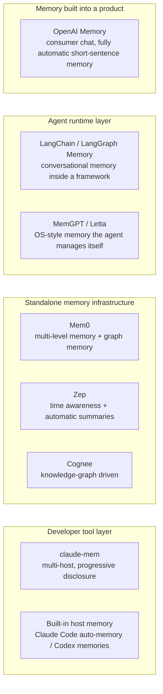

claude-mem is one answer among many. This chapter looks at six other approaches, from memory built into a consumer product to memory layers you run yourself, and asks the same questions of each: what is the unit of memory, who decides what to keep, how does it get back into context, and what does that cost? The last section lines them up side by side and pulls out what's worth borrowing for a team or enterprise platform.

## OpenAI Memory / ChatGPT Memory

The memory feature OpenAI added to ChatGPT in 2024 is the agent memory implementation with the widest reach today.

### Architecture

- **Explicit memory**: the user or the AI can create and delete memories deliberately
- **Implicit memory**: the AI extracts things worth remembering during conversation on its own
- **Memory format**: short sentences (each memory is a brief declarative statement)
- **Injection**: at the start of every conversation, all memories are concatenated into the system prompt

### Trade-offs

| Aspect | Choice | Cost |
|------|------|------|
| Granularity | Coarse (one sentence = one memory) | Can't keep complex contextual detail |
| Storage | Centralized in the cloud | Privacy risk, network dependence |
| Retrieval | Inject everything | Number of memories is capped by the token budget |
| Initiative | The AI decides what to remember | Users have little sense of control over their memory |

### What It Suggests for claude-mem

OpenAI's approach shows that "memories as short sentences" works for a consumer product, but it isn't enough for engineering work. A software decision needs a narrative and supporting facts; one sentence can't hold it. claude-mem's observation structure (type + title + narrative + facts) is a response to that limitation.

## LangChain / LangGraph Memory

LangChain's memory module is the agent memory framework developers run into most often.

### Architecture

```python
# LangChain memory types
ConversationBufferMemory      # full conversation history
ConversationSummaryMemory     # conversation summary
ConversationKGMemory          # knowledge-graph memory
VectorStoreRetrieverMemory    # vector retrieval memory
```

### Trade-offs

- **Framework coupling**: memory is tied closely to LangChain's Chain/Agent abstractions
- **Runtime scope**: it mainly manages context within a single run; persistence across runs needs extra wiring
- **Flexible**: several memory types can be combined
- **No notion of an observation**: the unit of memory is a message or a summary, not a structured observation of work

### Compared with claude-mem

LangChain memory manages conversational memory inside a framework. claude-mem manages working memory across sessions at the level of the developer's tools. They sit at different layers: LangChain at the agent runtime layer, claude-mem at the developer tool layer.

LangGraph's state persistence (the checkpointer) is closer to what claude-mem does. It persists the agent's execution state and supports resuming and replay. But it persists execution, and it does no semantic compression.

## Mem0: An Open-Source Memory Layer

Mem0 (formerly embedchain) is one of the most active open-source agent memory projects.

### Architecture

```python
from mem0 import Memory

m = Memory()
m.add("The user prefers TypeScript", user_id="alice", metadata={"category": "preference"})
results = m.search("programming language preference", user_id="alice")
```

Core components:
- **Memory store**: a vector database (Qdrant / ChromaDB / Pinecone)
- **LLM extraction**: an LLM pulls memories out of conversations
- **Graph memory**: an optional knowledge-graph layer (Neo4j)
- **Multiple levels**: memory separated into user, agent, and session levels

### Trade-offs

| Aspect | Mem0 | claude-mem |
|------|------|-----------|
| Unit of memory | Short sentences / facts | Structured observations |
| Retrieval | Vector similarity | FTS5 + vector hybrid |
| Injection | Pre-retrieval | Progressive disclosure |
| Where it runs | General purpose (any agent) | Plugins or integrations for 17 coding agents |
| Privacy | Needs configuring (local or cloud) | Local by default; cloud sync and the hosted observer must be turned on explicitly |

### Ideas Worth Borrowing

- **Memory levels** (user/agent/session) are a must for enterprise use
- **Graph memory** uses a knowledge graph to relate memories to each other, adding a layer of association that pure vector search lacks
- **Conflict detection**: handling it actively when a new memory contradicts an old one

## Zep: A Long-Term Memory Service

Zep positions itself as long-term memory infrastructure for agents.

### Architecture

- **Automatic summarization**: generates a running summary when a conversation gets too long
- **Entity extraction**: pulls people, organizations, concepts, and other entities out of conversations
- **Time awareness**: memories carry timestamps, supporting ranking that decays from recent to old
- **Multi-session**: a user profile shared across sessions
- **Fact extraction**: structured facts extracted from unstructured conversation

### What's Distinctive

Zep's time awareness is worth attention: memories aren't equal. A decision from last week is more likely to be relevant than a preference from last year. Zep uses a time-decay factor to influence retrieval ranking.

claude-mem later went down a similar road. v13.29.0 added optional ACT-R reinforcement ranking (`CLAUDE_MEM_REINFORCE_ALPHA`, off by default), so old observations that keep being confirmed can get back into the startup index (Chapter 10). The difference is that Zep uses decay to push old memories down, while claude-mem uses reinforcement to lift old memories that are still valid.

## MemGPT / Letta: OS-Style Memory Management

MemGPT (now Letta) brings the operating system's idea of virtual memory to agents.

### Architecture

```
Main context (working memory) ← → Archival memory (long-term)
        ↕                              ↕
  Conversation buffer            Vector database
  (current conversation window)  (all past information)
```

The core ideas:
- **Self-editing context**: the agent can move information from working memory to archival memory on its own
- **Paging**: like an OS's page in / page out
- **Persistent agents**: the agent's state is saved in full and can be paused and resumed
- **Driven by function calling**: memory operations are carried out through tool calls

### Trade-offs

MemGPT gives the agent full control over memory management. The agent decides what goes into working memory and what gets archived. The costs:
- The agent spends extra tokens on memory management
- Poor memory-management decisions can lose key information
- Debugging is hard (why did the agent forget that?)

### Compared with claude-mem

| Aspect | MemGPT | claude-mem |
|------|--------|-----------|
| Who manages memory | The agent itself | An external system |
| Operating model | Active page in / page out | Passive observation + on-demand retrieval |
| Source of information | Conversation content | Tool-use records |
| Context control | The agent edits its own | Injected by system hooks |

## Cognee: A Memory Engine Built on a Knowledge Graph

What sets Cognee apart is that it uses a knowledge graph as the underlying representation of memory.

### Architecture

- **Graph first**: every piece of information becomes nodes and edges in the graph
- **Relationship reasoning**: can answer "how are A and B related?"
- **Incremental updates**: new information is merged into the graph automatically, with conflicts handled
- **Multiple sources**: extracts knowledge from documents, code, conversations, and more

### What It Suggests for Enterprise Memory

Knowledge graphs are especially valuable for:
- Team knowledge management: who owns which module? How do modules depend on each other?
- Tracing decisions: which later implementations did this technology choice affect?
- Conflict detection: does a new decision contradict an old one?

## Memory Built into the Host: Claude Code and Codex

Everything above is a standalone memory layer. There's another kind that matters more and more: memory built into the agent host itself.

**Claude Code's auto-memory**: Claude Code writes what it thinks is worth remembering as Markdown files under `~/.claude/projects/<encoded working directory>/memory/`, indexed by a `MEMORY.md`, and reads them when a new session starts. **Codex** also has its own memory directory, `~/.codex/memories`. Both paths appear in claude-mem's source, for reasons covered below.

Built-in memory has the advantage of needing no installation and being integrated deeply with the host's context management. Its limits: the format and capabilities are whatever the host decides, the memory is only available in that one host, and there's no automatic observe-then-compress pipeline; what gets remembered is decided by the model on the spot.

claude-mem's stance toward it changed direction over the course of a year, and the change is telling:

- **v12.7.2 (2026-05)**: the installer set `CLAUDE_CODE_DISABLE_AUTO_MEMORY=1` for Claude Code by default, turning built-in memory off so that two memory systems wouldn't inject at the same time
- **From v13.29**: `npx claude-mem memory ingest` imports auto-memory's Markdown files as observations (with no model call, skipping `MEMORY.md` and any file over 64 KiB)
- **v13.35.0 (2026-10)**: the installer asks instead, recommending "keep it on." When the host reads its own memory files or calls a native memory tool like `memory_search`, the PreToolUse hook runs the same query through claude-mem and attaches the result as extra context. You can also configure a watched notes directory for continuous import (`docs/native-memory-bridge.md`)

The move from "replace" to "coexist and bridge" reflects a judgment: the host's native memory isn't going away, and users won't stick to a single host. More and more, a standalone memory layer earns its keep in the directions hosts don't cover themselves: across hosts, across devices, and across teams. Chapter 18 (multiple hosts) and Chapter 19 (multi-device sync) develop those directions.

## Quick Try: Five Minutes with Each

Want to see the differences for yourself? Here are the quickest ways in:

### Mem0

```bash
pip install mem0ai
python3 -c "
from mem0 import Memory
m = Memory()
m.add('The user prefers TypeScript and React', user_id='demo')
m.add('The project uses a PostgreSQL database', user_id='demo')
results = m.search('database stack', user_id='demo')
print(results)
"
```

### LangChain Memory

```bash
pip install langchain langchain-community
python3 -c "
from langchain.memory import ConversationSummaryBufferMemory
from langchain_community.llms import FakeListLLM
llm = FakeListLLM(responses=['Summary: the user is discussing database choices'])
memory = ConversationSummaryBufferMemory(llm=llm, max_token_limit=100)
memory.save_context({'input': 'Should we use PostgreSQL or MongoDB?'}, {'output': 'It depends on the shape of the data'})
print(memory.load_memory_variables({}))
"
```

### MemGPT / Letta

```bash
pip install letta
# Letta needs more configuration; this only shows the core concept
python3 -c "
from letta import create_client
client = create_client()
# You need to configure an LLM provider; see https://docs.letta.com
print('Letta client created. See docs for full setup.')
"
```

### Zep

```bash
# Zep needs a running server; Docker is recommended
docker run -p 8000:8000 ghcr.io/getzep/zep:latest
pip install zep-python
python3 -c "
from zep_python import ZepClient
client = ZepClient('http://localhost:8000')
print('Zep server running. Add messages via client.memory.add_memory()')
"
```

### Cognee

```bash
# Cognee depends on Neo4j (a graph database), so the bar is higher
# This snippet only checks the install; a real run needs an LLM key and a graph store
pip install cognee
python3 -c "
import cognee
# You need to configure an LLM and a graph database; see https://github.com/topoteretes/cognee
print('Cognee installed. Requires Neo4j for full graph features.')
"
```

> If you only want to try one, try **Mem0**. It's the easiest to install, its API is the most intuitive, and it doesn't need a separate database service.

## Side-by-Side Comparison and Takeaways

Classified by who manages memory and which layer it serves, the solutions fall out as shown in Figure 15-1:



*Figure 15-1: How agent memory solutions are positioned*

And compared by capability:

| Solution | Biggest strength | Biggest limitation | Best for | Open source | Stars (approx.) |
|------|---------|---------|---------|------|----------|
| OpenAI Memory | Zero configuration, fully automatic | Coarse granularity, small capacity | Consumer chat | No | - |
| LangChain Memory | Flexible combinations, works out of the box inside the framework | Tied closely to LangChain | Agents built on the framework | Yes | ~148K (LangChain main repo) |
| Mem0 | Multi-level memory, graph support | Needs infrastructure | General agent platforms | Yes | ~67K |
| Zep | Time awareness, automatic summaries | Complex to deploy | Products that need conversation history | Yes | ~5K |
| MemGPT/Letta | The agent manages itself, maximum autonomy | High token overhead, hard to debug | Research / long-running agents | Yes | ~25K |
| Cognee | Relationship reasoning, conflict detection | Graph database is hard to operate | Knowledge-intensive work | Yes | ~32K |
| claude-mem | Progressive disclosure, connects to 17 coding agents, self-hostable Server | Built for coding; team sharing needs the Server runtime or cloud sync | Engineers' development environments | Yes (Apache-2.0) | ~100K |

> Star counts were taken from the GitHub API on 2026-10-12 (claude-mem 99,871, LangChain 147,662, Mem0 67,025, Cognee 32,073, Letta 25,111, Zep 4,956) and rounded to the nearest thousand.

### Key Lessons for Building an Enterprise Platform

1. **From Mem0**: separate memory levels. Mem0 uses user / agent / session; for an organization the analogue is personal / team / organization
2. **From Zep**: time decay and automatic summarization
3. **From MemGPT**: the agent should be able to manage its own memory actively
4. **From Cognee**: a knowledge graph for tracing relationships and detecting conflicts
5. **From claude-mem**: progressive disclosure, non-intrusive hooks, and coexisting with the host's native memory instead of fighting it

---

**Questions to consider**

1. Both Mem0 and claude-mem support local storage. If you were building a memory migration tool (importing from Mem0 into claude-mem), how would the data models map onto each other? Which fields would be lost?
2. MemGPT lets the agent manage its own memory; claude-mem manages it automatically with an external system. For writing code, which approach fits better, and why?
3. If you were the tech lead choosing among these solutions, what would you weigh besides technical capability? (Hint: community activity, commercial sustainability, lock-in risk.)

---

The next chapter looks at what claude-mem itself built when it moved beyond a single-machine plugin: the official Server runtime, a multi-tenant memory service.

---

> From the open-source edition of *Engineering Agent Memory* by diguike.  
> Read online: [inferloop.dev](https://inferloop.dev) · Source: [github.com/diguike/book-claude-mem](https://github.com/diguike/book-claude-mem)
