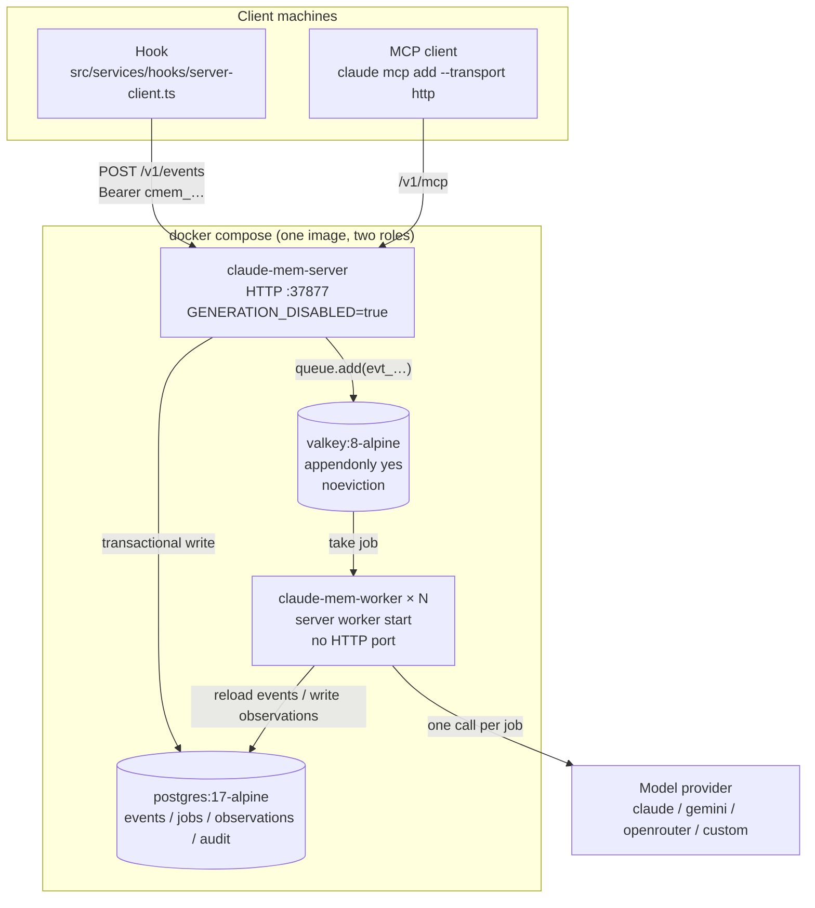
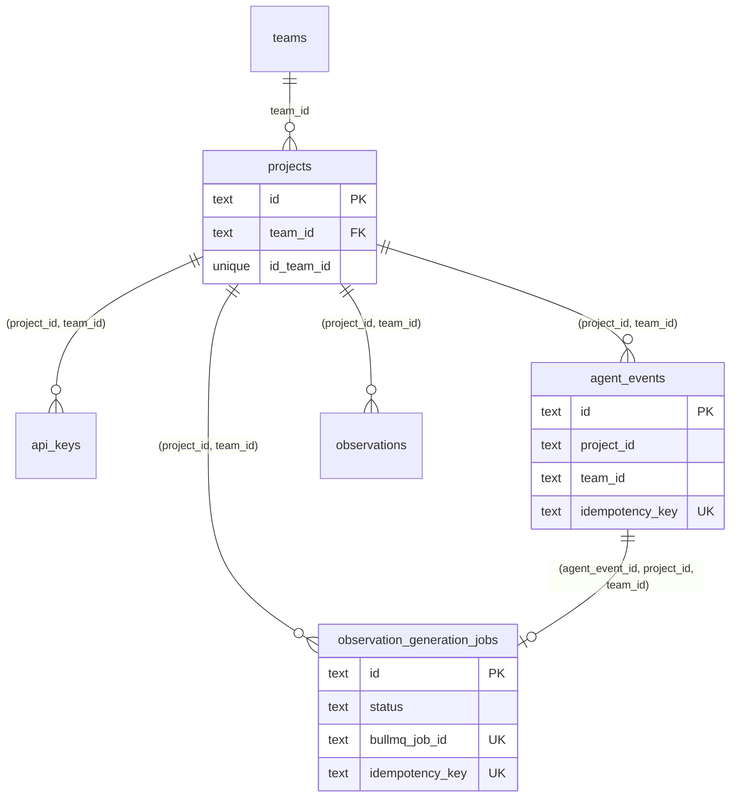
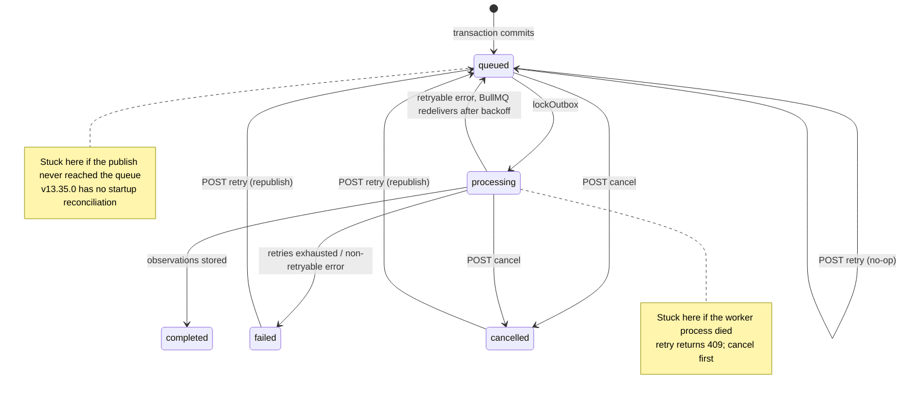

If you set out to turn a single-machine memory plugin into a multi-user platform, the obvious design looks like this: JWT authentication, PostgreSQL row-level security (RLS) for tenant isolation, pgvector for search, and a BullMQ queue per organization. By v13, claude-mem had built the platform itself. The Server runtime under `src/server/` has Postgres storage, BullMQ queues, and API key authentication, and was open-sourced along with v13's Apache-2.0 license. The official docs (`docs/server.md`) mark it as Beta.

This chapter walks through the official implementation and holds it up against that obvious design: where they agree, where claude-mem chose differently, and what it's still missing. The conclusions in this chapter come from the v13.35.0 source and from running it locally: a Postgres 16 container (the compose file below uses 17), Redis, and a fake provider that calls no model (`CLAUDE_MEM_SERVER_PROVIDER=custom`). I exercised event ingestion, generation, failures, and operator retries.

## Two Runtimes

In v13, claude-mem has two runtimes, selected by `CLAUDE_MEM_RUNTIME` in `settings.json`, with `worker` as the default. Everything in the earlier chapters was about the worker runtime. The Server runtime is a separate implementation. The two share the hook entry point, the observation XML format, and the parsing logic; almost everything else differs:

| | Worker runtime (default) | Server runtime |
|---|---|---|
| Storage | SQLite + Chroma | Postgres (14 tables, `src/storage/postgres/schema.ts`) |
| Queue | In-process `SessionMessageBuffer`, not persisted (Chapter 6) | BullMQ + Valkey/Redis, with two lanes: `event` and `summary` |
| Observation generation | One long-running, stateful observer session per session | Each job reloads its events from Postgres and makes a single, stateless provider call |
| Authentication | Listens only on loopback, plus a Host header check | API keys (stored as SHA-256, with scopes) |
| Multi-tenancy | None; single user | `team_id × project_id` |
| MCP | stdio; exposes 19 of 24 tools | HTTP `/v1/mcp`; 3 read-only tools: `search` / `context` / `recent` |
| Default port | `37700 + uid % 100` | `37877 + uid % 100` |

To choose the Server runtime at install time, use `npx claude-mem install --runtime server`. The Pi and DeepSeek Harness hosts currently support only the worker runtime, and the installer refuses them outright.

The deployment shape is in `docker-compose.yml` at the repository root, shown in Figure 16-1:



*Figure 16-1: Deployment topology of the Server runtime (`docker-compose.yml`, v13.35.0)*

The HTTP service and the generation workers are split into two containers because model calls take a long time and mustn't tie up the HTTP process. Generation capacity scales out with `docker compose up -d --scale claude-mem-worker=N`. When the HTTP service restarts, queued jobs are safe in Valkey, which has AOF persistence on. Valkey must be configured with `noeviction`: a BullMQ job is just a key in Redis, and if it's evicted when memory fills up, the job simply vanishes.

At startup, `validateServerEnv()` (`src/server/runtime/create-server-service.ts`) enforces hard checks. Inside Docker, `CLAUDE_MEM_QUEUE_ENGINE` must be `bullmq`, and `CLAUDE_MEM_AUTH_MODE` can't be `local-dev`. `local-dev` mode only checks that "the request comes from 127.0.0.1," which means nothing on a container network, so the server refuses to start.

## The Journey of One Event

At the heart of the Server runtime is a write path. As Figure 16-2 shows, between the hook sending an event and the observation being stored, there are two persistence steps and one queue publication:

```mermaid
sequenceDiagram
    participant H as Hook
    participant S as HTTP service<br/>ServerV1PostgresRoutes
    participant PG as Postgres
    participant Q as BullMQ (Valkey)
    participant W as Generation worker<br/>ProviderObservationGenerator
    participant P as Provider
    H->>S: 1. POST /v1/events
    S->>S: 2. Auth: look up api_keys by hash, check scopes and project
    S->>PG: 3. BEGIN; upsert agent_events;<br/>observation_generation_jobs (queued); COMMIT
    S->>Q: 4. queue.add(evt_<sha256>)
    S-->>H: 5. 201 event + generationJob
    Q->>W: 6. Deliver job
    W->>PG: 7. lockOutbox: queued → processing
    W->>PG: 8. Reload events by job row
    W->>P: 9. Generate observation XML
    W->>PG: 10. Write observations, job → completed, write audit
```

*Figure 16-2: The full path of `POST /v1/events`*

### The Transactional Outbox

The outbox is a common pattern for reliable delivery. A message that needs to go out is first written as a row in the same database transaction as the business data, and a separate step publishes it to the message queue. The transaction guarantees that the business data and the pending message either both exist or both don't, and if publishing fails, the message can be found in the table and sent again.

The order of steps 3 and 4 is what makes this path work. `IngestEventsService.ingestOne()` (`src/server/services/IngestEventsService.ts`) writes three rows in one Postgres transaction: the event row, the job row (which is the outbox), and one job-lifecycle record. Only after the transaction commits is the job published to BullMQ:

```typescript
const txResult = await withPostgresTransaction(this.options.pool, async (client) => {
  const inserted = await eventsRepo.create(input);
  // ...
  const outbox = await jobsRepo.create({
    id: outboxId,
    status: 'queued',            // written by the repository layer
    bullmqJobId: buildServerJobId({ kind: 'event', team_id, project_id,
                                    source_type: 'agent_event', source_id: inserted.id }),
    payload: bullmqPayload,      // the publish payload is stored in the row too, so an operator retry resends it unchanged
  });
  await eventsLogRepo.append({ generationJobId: outbox.id, eventType: 'queued', ... });
  return { event: inserted, outbox };
});
// Outside the transaction: publish to the queue; on failure, just log and return 'queued_only'
enqueueState = await this.publishEventJob(txResult.event, txResult.outbox);
```

Publishing first and committing second causes two kinds of trouble. The worker may receive the job before the transaction commits and fail to find the row. Or the publish succeeds, the transaction rolls back, and the queue now holds a job pointing at data that doesn't exist. The outbox pattern makes Postgres the single source of truth; the queue is only a notification, and a lost one can be recovered from the table.

"Can be recovered from the table" requires someone to do the recovering. That's covered in the section on failures below.

### Idempotency at Two Levels

Clients resending after a network timeout is normal in distributed writes. The Server runtime deduplicates at two levels.

**Events.** `agent_events.idempotency_key` has a unique constraint. On conflict, `ON CONFLICT DO UPDATE` merges only the metadata and returns the existing row. The key is computed by `buildAgentEventIdempotencyKey()` (`src/storage/postgres/agent-events.ts`): if a `sourceEventId` is present, it's used; otherwise the key is a hash of `(teamId, projectId, sourceAdapter, platformSource, contentSessionId, eventType, occurredAt, payload)` taken together.

There's a detail in v13.35.0 that's easy to trip over. The `/v1/events` request body is first validated by Zod's `CreateAgentEventSchema`, which has no `sourceEventId` field, and Zod strips undeclared fields by default. In my tests, a request body that included `sourceEventId` stored the field as `null`, and dedup fell back to the content hash:

| How the two requests differ | Result |
|---|---|
| Identical request bodies | Same event, same job |
| Only `occurredAtEpoch` differs, by 1 ms | Two events |
| Same `sourceEventId`, different `occurredAtEpoch` | Two events (`sourceEventId` was stripped) |

So a client that retries must resend the exact same request body; it can't take a fresh timestamp on retry. claude-mem's own hook client (`server-client.ts`) doesn't retry. A single failure goes to the fallback rules (see "A Scope Mismatch Trap" below), so this problem mostly shows up in clients you write yourself.

**Jobs.** BullMQ won't enqueue a duplicate `add` with the same `jobId`. `buildServerJobId()` (`src/server/jobs/job-id.ts`) serializes `kind / team_id / project_id / source_type / source_id` and takes the SHA-256, formatted as `evt_<64 hex chars>` or `sum_<…>`. The source comments explain specifically why it doesn't just join them into `event:team:project:…`: BullMQ uses colons internally to separate Redis keys, and colons inside a `jobId` break scanning and state checks. Hashing has a side benefit: tenant IDs aren't visible in Redis.

### Why Lock the Outbox Row

BullMQ guarantees that only one worker processes a job at a time, but a "stalled" job is redelivered to another worker, and the first worker may only have been slow, not dead. If two workers call the provider at the same time, you pay for the model twice.

`ProviderObservationGenerator.lockOutbox()` reads the job row in Postgres before calling the provider. If the status is `completed`, `cancelled`, or `failed`, it returns immediately. If it's `processing`, it also skips; the source comment says this is to keep a paid, rate-limited external call from happening twice. Only `queued` moves to `processing` and continues. The persistence layer has another terminal-state check, but that one can only discard a duplicate result after the call. The money has already been spent.

The worker doesn't trust the BullMQ payload either. It reloads the job row from Postgres by `generation_job_id`, and if the `team_id / project_id` in the payload don't match the job row, it refuses to generate and writes a `generation_job.scope_violation` audit entry. A tampered queue message can't cross a tenant boundary.

The queue's retry settings are in `ServerJobQueue` (`src/server/jobs/ServerJobQueue.ts`): at most 3 attempts, with exponential backoff starting at 5 seconds. Completed jobs are kept for 7 days or 1,000 entries, failed jobs for 30 days or 1,000 entries. Concurrency is controlled by `CLAUDE_MEM_SERVER_GENERATION_CONCURRENCY`, default 1, maximum 64, applied per lane: set it to N and the `event` and `summary` lanes together can run up to 2N model calls at once.

## Tenant Isolation Lives in the Schema

The obvious design uses PostgreSQL RLS: a policy on each table, filtering by a session variable. claude-mem took a different road. Its isolation has two layers, and neither relies on RLS.

The first layer is foreign keys. The `projects` table declares `UNIQUE (id, team_id)`. Six tables (`api_keys`, `audit_log`, `server_sessions`, `agent_events`, `observation_generation_jobs`, and `observations`) all carry both `project_id` and `team_id`, with a composite foreign key pointing at `projects(id, team_id)`, as Figure 16-3 shows. Child tables like `observation_sources` and `observation_generation_job_events` carry no tenant columns; they attach to those parent tables by foreign key and are deleted along with them by cascade:



*Figure 16-3: Composite foreign keys pin every row to one (project, team) pair (`src/storage/postgres/schema.ts`)*

A single-column foreign key only guarantees that the project exists and the team exists. It can't stop a row belonging to team A from pointing at team B's project. A composite foreign key requires the `(project_id, team_id)` pair to actually exist in `projects`, so mismatched data can't be written at the database level, even by SQL that bypasses the API. The jobs table goes further, pointing at events with a three-column foreign key `(agent_event_id, project_id, team_id)`, so a job and its event can never belong to two different tenants.

The second layer is the queries. Every read endpoint includes the `team_id` of the caller's API key in its `WHERE` clause, plus `project_id` for project-level keys. Cross-tenant access returns 404, not 403. `loadScopedById()` with `scopeMismatch: 'not-found'` makes "this ID belongs to another team" and "this ID doesn't exist" return identical responses, so a caller can't probe other tenants' data by watching for 403 versus 404.

| | RLS (the obvious design) | Composite FKs + application-level WHERE (claude-mem) |
|---|---|---|
| A forgotten filter | The database catches it | Leaks; depends on code review and tests |
| A mismatched write | A policy can block it, with a separate `WITH CHECK` | The foreign key rejects it outright |
| Connection pooling | Every request must `SET` a session variable, which is easy to mix up with transaction-level pooling | No extra requirements |
| Debugging | The same SQL returns different results in different sessions | What you see is what you get |

The two aren't mutually exclusive. If a team is especially worried about a forgotten WHERE clause, it can add RLS on top of the composite foreign keys.

## Authentication, Scopes, and Quotas

### API Keys

Keys issued from the command line (`server api-key create`) start with `cmem_`; read-only keys issued by `POST /v1/keys` start with `cm_`. The plaintext is shown only once, at creation, and the database stores only its SHA-256 (`api_keys.key_hash`). `requirePostgresServerAuth()` (`src/server/middleware/postgres-auth.ts`) looks the hash up in the database again on every request, checking `revoked_at`, `expires_at`, and scopes. There's no in-memory cache, so revocation takes effect immediately, and a whole class of cache-poisoning problems doesn't exist.

A missing key returns 401; an invalid key or insufficient scope returns 403. The scope check is "every required scope must be in the granted list," and only `*` is a wildcard:

```typescript
function hasRequiredScopes(grantedScopes: string[], requiredScopes: string[]): boolean {
  if (requiredScopes.length === 0 || grantedScopes.includes('*')) return true;
  return requiredScopes.every(scope => grantedScopes.includes(scope));
}
```

Read endpoints require `memories:read`, write endpoints `memories:write`. `memories:admin` doesn't imply read or write. It matters in exactly one place: `GET /v1/jobs?include=payload` requires the admin scope to return job payloads, so a read-only key can't casually export raw event content.

### A Scope Mismatch Trap

When you install with `npx claude-mem install --runtime server`, the installer calls `bootstrapServerApiKey()` (`src/services/hooks/server-bootstrap.ts`) to create a key for the hooks, with the scopes `events:write, sessions:write, observations:read, jobs:read`. But `/v1/events` requires `memories:write`. The two sets of scope names don't match.

In my test, calling `POST /v1/events` with a key carrying those scopes returned 403. The hook-side fallback rules make it worse. `isFallbackEligible()` in `server-client.ts` falls back to the local worker's spool only on transport errors, timeouts, a missing key, 5xx, and 429. Any other 4xx is treated as "the client has a bug": it logs an error and gives up. 403 falls in the second group, so the event reaches neither the Server nor the local worker, the hook exits with 0 as usual, and nothing in the session looks wrong.

The source already has a fix: `server-service.cjs server api-key migrate-scopes <id>` changes a key's scopes to `memories:read, memories:write`, and in my test the same key returned 201 afterward. But the `npx claude-mem server` command layer only forwards `api-key create|list|revoke`, not `migrate-scopes`. If you're using npx, it's simpler to create a new key:

```bash
npx claude-mem server api-key create --name hooks --scope memories:read,memories:write
# Put the key and projectId from the output into ~/.claude-mem/settings.json:
#   CLAUDE_MEM_SERVER_API_KEY / CLAUDE_MEM_SERVER_PROJECT_ID
```

Note that `create` without `--scope` defaults to `memories:read` only.

### Rate Limits, Quotas, and Metering

All of these are off by default and turned on by environment variables (`setupRoutes()` in `ServerV1PostgresRoutes.ts`):

| Environment variable | Effect |
|---|---|
| `CLAUDE_MEM_RATE_LIMIT_PER_MIN` | Per-API-key rate limit over a fixed 60-second window; over the limit returns 429 with `Retry-After` and `X-RateLimit-*` headers |
| `CLAUDE_MEM_MONTHLY_REQUEST_CAP` | Monthly request cap per team |
| `CLAUDE_MEM_MONTHLY_TOKEN_CAP` | Monthly token cap per team, **blocking only write endpoints**: a team over budget can still search its existing memory |
| `CLAUDE_MEM_USAGE_METERING=1` | Records usage; `GET /v1/usage` returns this month's totals |

Both rate limiting and quotas fail open. If reading or writing the counter tables fails, the request is let through rather than making the whole API unavailable. For a memory service that's a reasonable trade-off: letting a few extra requests through costs far less than every agent losing its memory at once.

### Auditing

Every write, generation, and operator action writes to `audit_log`, and every row carries `team_id / project_id / api_key_id / actor_id / request_id`. The `request_id` is generated at the HTTP entry point and travels with the BullMQ payload to the worker, so one `WHERE request_id = …` ties together everything that happened for a request. After one round of my local run, the actions in the audit table were:

```text
api_key.create
event.received
generation_job.processing
generation_job.completed
generation_job.cancelled_by_operator
generation_job.retried_by_operator
observation.created
observation.read
```

Each change in a job's status is also recorded in `observation_generation_job_events`. The audit table answers "who did what"; the lifecycle table answers "what did this job go through."

## What Happens When Things Fail

The outbox pattern assumes that "if the queue loses a message, it can be recovered from the table." Source comments in several places in v13.35.0 say "the row stays queued, and startup reconciliation will republish it," but that reconciliation logic is nowhere in the code; `reconcileOnStartup` appears only in comments. In other words, republishing currently depends entirely on an operator doing it by hand.

I staged several failures locally. Here's what happened:

| Failure | What actually happened |
|---|---|
| Redis down, HTTP service healthy | `POST /v1/events` hangs with no response for 30 seconds (BullMQ's connection queues commands while offline instead of erroring). The event row and job row are already committed, with status `queued`. When Redis comes back, the queued commands are sent automatically and the job completes normally |
| HTTP service process crashes while Redis is down | The commands queued offline vanish with the process. After restart, the job sits in `queued` forever; nothing republishes it |
| `retry` on a `queued` job | Returns 200 with `alreadyQueued: true`, writes one audit entry, and does not republish |
| `retry` on a `processing` job | 409: wait for it to finish or `cancel` it first |
| `retry` on a `completed` job | 409, on the grounds that model output isn't deterministic and rerunning would produce a parallel set of observations |
| `cancel`, then `retry` | The job goes back to `queued`, is republished, and then completes. The lifecycle table records `queued → cancelled → queued → completed` |

Figure 16-4 shows how a job's status moves and where it gets stuck:



*Figure 16-4: The generation job state machine and its two stuck points (`retryGenerationJob()` / `cancelGenerationJob()` in `ServerV1PostgresRoutes.ts`)*

Until reconciliation is implemented, a production deployment can cover the gap with a scheduled job: find jobs older than some threshold that are still in `queued` or `processing`, then `cancel` and `retry` them. These two steps don't have to go over HTTP. `npx claude-mem server jobs status|failed|retry|cancel` operates on Postgres directly (it needs `CLAUDE_MEM_SERVER_DATABASE_URL`) and also writes audit entries. Its `retry`, like the HTTP endpoint, is a no-op on `queued` jobs.

```sql
-- Jobs stuck for more than 10 minutes
SELECT id, status, attempts, created_at
FROM observation_generation_jobs
WHERE status IN ('queued', 'processing')
  AND updated_at < now() - interval '10 minutes'
ORDER BY created_at;
```

`cancel` is safe on a `processing` job: a worker that really is running checks the job's status again before writing results, and if it's been cancelled, it produces no side effects. The threshold must be longer than the longest a single job can run, or you'll cancel jobs that are running normally.

A Redis failure also affects the hook side. The HTTP request hangs, the hook client times out, and by the rules it falls back to the local worker's spool. Meanwhile the event is already stored on the HTTP service's side and will still be generated once Redis recovers. Put those two code paths together and, if a local worker is also running, one tool call can leave an observation both on the Server and locally. That's the "better to record twice than to miss one" trade-off, and it's worth remembering when you're tracking down duplicate data.

## Search: tsvector, and an Embedding Column Not Yet Used

The Server runtime searches with Postgres full-text search. The `observations` table has a generated column:

```sql
content_search TSVECTOR GENERATED ALWAYS AS (to_tsvector('english', content)) STORED
```

Queries use `websearch_to_tsquery('english', $query)`, ranked by `ts_rank`. The table also has an `embedding JSONB` column that can be written during generation, but v13.35.0's search path doesn't read it, and pgvector isn't used. Of the obvious design's "tsvector + vector hybrid search," the official implementation has so far done the first half.

The `'english'` configuration has the same problem with Chinese as Chapter 7's FTS5: it splits on whitespace and punctuation, so a whole run of Chinese characters becomes one word. My test (修复登录超时问题 means "fix the login timeout issue"; 登录 is "login"):

```text
to_tsvector('english', 'fake: 修复登录超时问题 generated')
  → 'fake':1 'generat':3 '修复登录超时问题':2
```

| Query | Hits |
|---|---|
| `修复登录超时问题` (the whole phrase) | 1 |
| `登录` ("login") | 0 |
| `登录超时` ("login timeout") | 0 |

A team writing in Chinese (or Japanese or Korean) that deploys the Server runtime has to add its own search support. The smallest change is `pg_trgm`. It can extract trigrams from Chinese text, so queries of three or more characters like `ILIKE '%连接池%'` ("connection pool") can use a GIN index. My test (Postgres 16, database `LC_CTYPE` of `en_US.utf8`, 20,000 rows):

```sql
CREATE EXTENSION pg_trgm;
CREATE INDEX observations_content_trgm ON observations USING gin (content gin_trgm_ops);
-- '%连接池%': Bitmap Index Scan on observations_content_trgm
-- '%登录%'  : Seq Scan (two characters can't form a trigram, so it falls back to a full scan; results are still correct)
```

For semantic search, change the `embedding` column to pgvector's `vector` type and add a vector-recall path to the search code. That requires changing claude-mem's search code and is beyond the scope of this chapter.

## Migrating from Worker to Server

The official migration doc (`docs/migration-worker-to-server.md`) is a single paragraph. Its gist is that the two runtimes will coexist for a long time and clients will migrate gradually. In practice there are three paths.

**Hooks choose a runtime from configuration and fall back on failure.** `runtime-selector.ts` reads `CLAUDE_MEM_RUNTIME`. If `server` is chosen but the URL, key, or project ID is missing, it logs a `[server-fallback]` line and uses the worker. If a request fails, the rules from "A Scope Mismatch Trap" decide whether to fall back to the local spool.

**There's a compatibility layer for the old hook protocol.** Two adapters under `src/server/compat/` mount `/api/sessions/observations` and `/api/sessions/summarize` on the Server and translate worker-era request bodies into `/v1/events` events, with the event's `sourceAdapter` recorded as `claude-code-compat`. The compatibility layer requires a project-level key, and cross-project calls get a 400.

**MCP moves to HTTP.** The Server offers an MCP endpoint at `/v1/mcp` over streamable HTTP, with the same authentication as `/v1/search` (`memories:read`) and only three tools: `search`, `context`, and `recent`. `GET /v1/connect` returns a ready-made command to connect:

```bash
claude mcp add --transport http claude-mem https://<your-host>/v1/mcp \
  --header "Authorization: Bearer <YOUR_API_KEY>"
```

`POST /v1/keys` can issue a read-only key for the current team, with an optional expiry, which is handy for team members who only need search. The installer's prompt text gives the endpoint as `<baseUrl>/mcp`, but the actual route is `/v1/mcp`; go by the route.

One capability currently stays on the worker: semantic context injection at the `UserPromptSubmit` stage (`/api/context/semantic`). The Server has no equivalent endpoint yet, and the official release assessment report lists it as a to-do.

## Compared with the Obvious Design

| Aspect | Obvious design | claude-mem v13.35.0 Server |
|---|---|---|
| Authentication | JWT, parsing `userId / orgId` | API keys, stored as SHA-256, looked up on every request |
| Isolation | RLS | Composite foreign keys + application-level WHERE; cross-tenant returns 404 |
| Event entry point | Enqueue directly in `/api/events` | `/v1/events`, transactional outbox, publish after commit |
| Idempotency | Not designed | Event content hash + deterministic job IDs + outbox row lock |
| Queue split | One queue per organization | Two lanes by job type: `event` / `summary` |
| Search | tsvector + pgvector | `'english'` tsvector only; embeddings are stored but unused |
| Quotas | Not designed | Rate limits / request quotas / token quotas / metering, all fail open |
| Operations | Autoscale on queue depth | Scale workers out; stuck jobs need a manual cancel + retry |

The most valuable part of claude-mem's implementation is the outbox and idempotency design, which the obvious design leaves out entirely. It decides whether a memory service loses data or pays twice when the network hiccups and processes restart. What both underestimate is the operational surface. Startup reconciliation isn't done yet. Stuck jobs depend on an operator running `cancel + retry` by hand. And `migrate-scopes`, which fixes key scopes, exists but isn't wired into the `npx claude-mem` command.

The open-source edition also has clear boundaries. `docs/ip-boundary.md` lists what won't go into the Apache-2.0 repository, including team/organization-level memory sync, SSO/SAML/SCIM, enterprise RBAC, an audit-log UI, and a DLP policy engine. The next chapter discusses these enterprise features: what you have to add on top of the open-source edition, and how.

## Running the Example

`examples/ch16-platform-arch` packs this chapter's designs into a single process using SQLite and Express 5, with no Postgres or Redis needed:

```bash
cd examples/ch16-platform-arch
npm install
npm run demo
```

The example covers six scenarios: outbox writes, dedup on an identical resend, skipping a duplicate delivery, tenant isolation and scopes, recovery with `cancel + retry` after a job never reaches the queue, and the audit log. Here's the tenant-isolation part of the output (the example prints in Chinese; the `#` comments are translations):

```text
[4] 租户隔离与作用域    # tenant isolation and scopes
  Globex 读 Acme 的事件：404    # Globex reads Acme's event
  Globex 读不存在的事件：404    # Globex reads a nonexistent event
  Globex 往 Acme 的项目写：403    # Globex writes to Acme's project
  只读 key 写事件：403    # read-only key writes an event
  只读 key 读事件：200    # read-only key reads an event
  绕过 API 直接写错配的租户：FOREIGN KEY constraint failed    # write a mismatched tenant directly, bypassing the API
```

The last line is the composite foreign key at work: even SQL written directly, bypassing the HTTP layer, can't store a row whose `(project_id, team_id)` don't match.

---

**Questions to consider**

1. The event idempotency key includes `occurredAt`, so clients must resend the request body unchanged. If your client were an SDK that rebuilds the request on retry, how would you fix it: change the client, change the server's idempotency key, or have the schema accept `sourceEventId`? What does each cost?
2. The fallback scheduled job in "What Happens When Things Fail" uses `updated_at` to decide a job is stuck. If some kind of job normally takes 15 minutes, what happens with a 10-minute threshold? Is there a more reliable test than a time threshold?
3. `CLAUDE_MEM_MONTHLY_TOKEN_CAP` blocks writes but not reads. When would the opposite design, blocking reads but not writes, make more sense?

---

> From the open-source edition of *Engineering Agent Memory* by diguike.  
> Read online: [inferloop.dev](https://inferloop.dev) · Source: [github.com/diguike/book-claude-mem](https://github.com/diguike/book-claude-mem)
