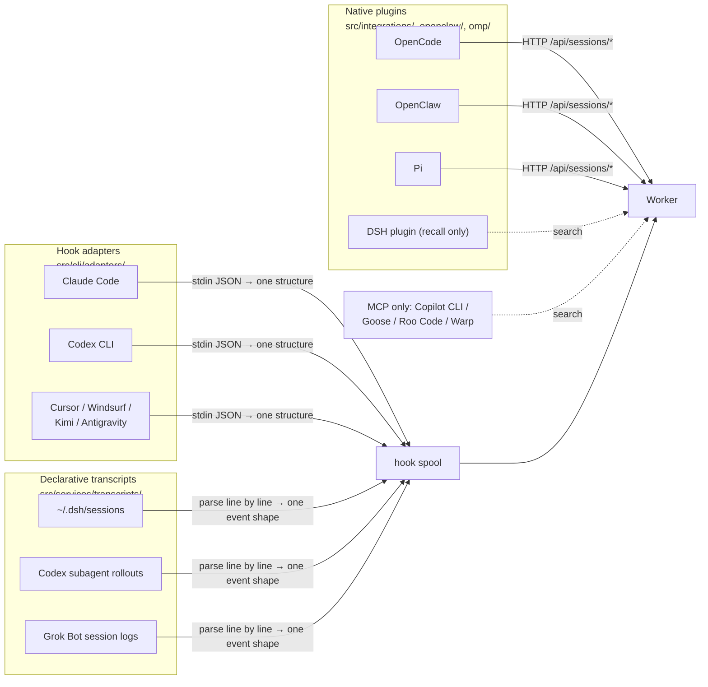

claude-mem has "Claude" in its name, but the v13.35.0 installer lists 17 hosts: Claude Code, Codex CLI, Cursor, Windsurf, Kimi Code, Antigravity, T3 Code, OpenCode, OpenClaw, OMP, Pi, DeepSeek Harness (DSH), Grok Bot, Copilot CLI, Goose, Roo Code, and Warp (`src/npx-cli/commands/ide-detection.ts`).

A developer fixes bugs in Claude Code during the day, runs a refactor with Codex in the evening, and reads code in Cursor on the weekend. The observations from all three land in the same database, and a new session in any of the hosts can see what the other two left behind. The hooks, the worker, and observation generation covered in the earlier chapters all centered on Claude Code. This chapter answers a different question: how do you connect hosts that look nothing alike to one memory system without copying the whole pipeline for each new host?

## Three Ways In

The biggest difference between hosts is how they expose what happens in a session to the outside world. claude-mem splits integration into three paths along that line, all converging on the same worker, as Figure 18-1 shows:



*Figure 18-1: Three capture paths plus read-only MCP access, all converging on one worker*

| Path | Hosts it fits | Capture | Startup context injection | Search |
|---|---|---|---|---|
| Hook adapter | The host offers command-style hooks (stdin in, stdout out) | Yes | Yes | MCP |
| Native plugin | The host has an in-process plugin API | Yes | Yes | Plugin tools or MCP |
| Declarative transcript | The host writes sessions to JSONL logs | Yes | Depends on the host | Configured separately |
| MCP only | The host supports only MCP | No | No | MCP |

The four MCP-only hosts can search existing memory, but their own sessions produce no new observations. That's the ceiling for this kind of host: with no hooks, no plugin API, and no readable session logs, claude-mem has no way to know what happened in a session.

## Hook Adapters: Translating Different stdin into One Structure

Each host borrowed Claude Code's hook design, but the field names all differ. Take Cursor: its tool results go in `result_json` instead of `tool_response`, and shell commands use a separate hook whose payload has only `command` and `output`, with no tool name.

An adapter's job is to smooth out those differences and translate the input into `NormalizedHookInput` (`src/cli/types.ts`). The core of `src/cli/adapters/cursor.ts`:

```typescript
normalizeInput(raw) {
  const r = (raw ?? {}) as any;
  const isShellCommand = !!r.command && !r.tool_name;
  const cwd = r.workspace_roots?.[0] || r.cwd || process.cwd();
  if (!isValidCwd(cwd)) throw new AdapterRejectedInput('invalid_cwd'); // reject an invalid directory outright
  const sessionId = r.conversation_id || r.generation_id || r.id;
  return {
    sessionId,
    cwd,
    toolName: isShellCommand ? 'Bash' : r.tool_name,
    toolInput: isShellCommand ? { command: r.command } : r.tool_input,
    toolResponse: isShellCommand ? { output: r.output } : r.result_json,
    toolUseId: typeof r.tool_use_id === 'string' ? r.tool_use_id
             : (typeof r.tool_call_id === 'string' ? r.tool_call_id : undefined),
    // Cursor's stop hook doesn't provide a transcript path, so derive its location on disk from cwd + session ID
    transcriptPath: deriveCursorTranscriptPath(cwd, sessionId),
  };
}
```

The working directory and the session ID both come from stdin, and the adapter validates them before using them. If `isValidCwd()` fails, it throws `AdapterRejectedInput` and the call is rejected. There's another detail when deriving the transcript path: the session ID also comes from stdin, so the code first checks it against `^[A-Za-z0-9_-]+$`, to stop a value like `../` from building a path outside `~/.cursor/projects`. The adapter is the first place external input enters the system, and any field that will be built into a file path must be validated first.

Shell commands are normalized to the tool name `Bash`. Everything downstream (the filter chain, the observer prompts, the File Read Gate from Chapter 8) is written against Claude Code's tool names, so none of it has to be rewritten for each host.

v13.35.0 has seven adapters: `claude-code`, `codex`, `cursor`, `kimi`, `windsurf`, `antigravity-cli`, and `raw`. `raw` is the fallback, and unknown platform names land on it too. Every host's hook configuration calls the same entry point; only the platform and event names differ:

```text
worker-service.cjs hook <platform> <event>
# e.g. Codex's PostToolUse
worker-service.cjs hook codex observation
```

Hosts' hook capabilities aren't equal either, so the configuration has to adjust. Codex's `PreToolUse` matcher doesn't include `Read`, because Codex reads files through the shell or MCP tools. The File Read Gate can only attach to tools like `^Bash$` and `mcp__…__read_file` (`plugin/hooks/codex-hooks.json`).

## Declarative Transcripts: Describing a Log Format in Configuration

Some hosts have no suitable hooks but write the whole session to JSONL logs: Codex writes to `~/.codex/sessions`, DeepSeek Harness to `~/.dsh/sessions`. For these hosts claude-mem built a general transcript watcher (`src/services/transcripts/`). Every difference between hosts lives in JSON configuration, and the code doesn't distinguish between hosts.

### Writing a Schema

A schema is a list of "match rule → action → field mapping" entries. Here are two from the Codex schema in `transcript-watch.example.json`:

```json
{
  "name": "user-message",
  "match": {
    "all": [
      { "path": "payload.type", "equals": "message" },
      { "path": "payload.role", "equals": "user" },
      { "path": "payload.content[0].text", "exists": true },
      { "path": "payload.content[0].text", "not_starts_with": "<recommended_plugins>" },
      { "path": "payload.content[0].text", "not_starts_with": "<skills_instructions>" }
    ]
  },
  "action": "session_init",
  "fields": { "prompt": "payload.content[0].text" }
},
{
  "name": "tool-use",
  "match": { "path": "payload.type", "in": ["function_call", "custom_tool_call", "web_search_call"] },
  "action": "tool_use",
  "fields": {
    "toolId": "payload.call_id",
    "toolName": { "coalesce": ["payload.name", "payload.type"] },
    "toolInput": { "coalesce": ["payload.arguments", "payload.input", "payload.command", "payload.action"] }
  }
}
```

Match rules support `equals / not_equals / in / not_in / exists / starts_with / not_starts_with / contains / regex`, combined with `all / any`. Notice the `not_starts_with` in the first rule. Codex puts skill instructions and plugin recommendations into the log as user messages, and without excluding them, that preset text would be recorded as the user's question. A comment in the type definitions makes a point of this: to exclude a preamble the host injects, use `not_starts_with`, not `not_contains`, or any user message that merely mentions the word gets excluded too.

A field can be a path string, `{ coalesce: [...] }` (the first non-empty candidate), `{ value: ... }` (a constant), or `{ path, default }`. There are nine actions in all: `session_init`, `session_context`, `user_message`, `assistant_message`, `tool_use`, `tool_result`, `observation`, `file_edit`, and `session_end`.

### Incremental Reads and Checkpoints

The watcher has to handle more than parsing; it also has to track where it has read up to. As Figure 18-2 shows, it reads incrementally by byte offset and advances its checkpoint only after the worker has accepted each line:

```mermaid
sequenceDiagram
    participant F as Session log JSONL
    participant T as TranscriptWatcher
    participant S as State file<br/>transcript-watch-state.json
    participant W as Worker
    T->>S: 1. Read the last offset and session state
    T->>F: 2. Read from the offset to the last newline
    loop Each line
        T->>T: 3. Match against the schema; hold tool_use until its tool_result arrives, then pair them
        T->>W: 4. Deliver a normalized event
        alt Worker accepts
            T->>T: 5a. Advance the offset to the next line
        else Worker rejects or is unreachable
            T->>T: 5b. Stop at this line and roll back session state
        end
    end
    T->>S: 6. Write back offsets, unpaired tool calls, cwd
```

*Figure 18-2: The transcript watcher's incremental reads and checkpoints*

The state file holds more than offsets (`src/services/transcripts/state.ts`):

| Field | Purpose |
|---|---|
| `offsets` | The byte position read up to in each file |
| `pendingTools` | Tools whose call has been seen but whose result hasn't, so the result line can still be paired after a restart |
| `cwds` | The last working directory each file reported. DSH writes cwd only on a session's first line, so a watcher resuming mid-file would otherwise never see it |
| `fileIdentities` + `checkpointFingerprints` | Device number / inode plus a hash of the 4 KiB before the checkpoint, to tell "the file was replaced" apart from "a sync tool did temp-file-plus-rename" |

The companion example `examples/ch18-multi-host` implements the same match rules and field syntax in about 150 lines of code, reusing claude-mem's two schemas directly. While writing it, I made a mistake at first: when the worker rejected a line, I only stopped the offset and didn't roll back the session state. The tool call had already been removed from the pending table while processing the result line, so on retry the result line couldn't find its call, and the observation was lost. The output after the fix (the example prints in Chinese; the `#` comments are translations):

```text
[4] 下游拒收（Worker 没起来）：检查点停在这一行，恢复后从这一行重试    # downstream rejects (worker not up): checkpoint stays on this line, retried after recovery
  Worker 离线：投递 0 条，停在字节偏移 848    # worker offline: 0 delivered, stopped at byte offset 848
  observation  [dsh-7f3a] read_file → # shop
  Worker 恢复：投递 1 条    # worker back: 1 delivered
```

The offset and the session state must advance together and roll back together. claude-mem persists pending tool calls into its state file to solve exactly this problem.

## Native Plugins

When a host has an in-process plugin API, a plugin can see more of the lifecycle than a hook can. The events a few plugins attach to:

| Host | Code | Capture | Injection |
|---|---|---|---|
| OpenCode | `src/integrations/opencode-plugin/` | `tool.execute.after`; summarizes on `session.idle` | `experimental.chat.system.transform` (V1) / `ctx.session.hook("context")` (V2) |
| OpenClaw | `openclaw/` | `after_tool_call`; summarizes on `agent_end` | Writes into the system prompt at `before_prompt_build` |
| Pi | `src/integrations/pi-extension/` | `tool_result` | Rewrites the first system message at the `context_with_system` stage |
| OMP | `omp/hooks/claude-mem.ts` | Reports in the REST V1 event format | Same |

The price of native plugins is that they track the host's version. OpenCode has two plugin contracts, old and new, and claude-mem implements both; the source comments stress that the two can't be converted mechanically, and every attachment point has to be re-registered on V2's imperative API. Pi's documentation is blunt: automatic capture has been checked against the source only for Pi 1.0.2 and 1.0.4. Version 0.79.6 lacks the `context_with_system` stage and supports only manual search, and other versions you have to verify yourself. A hook is a contract the host promises to the outside world; a plugin API is often internal implementation, and one refactor in the host can break the plugin.

## The Single-Writer Rule

One host can qualify for more than one path. Codex has native hooks and also writes session logs; DSH has a plugin API and also writes session logs. Turn on both paths and the same tool call is captured twice: duplicate observations in the database, and the observer called twice, doubling the cost.

claude-mem assigns exactly one writer per host:

**Codex: hooks handle top-level sessions; transcripts only fill in subagents.** Subagent threads that Codex spawns don't fire hooks and can only be read from rollout logs. `scopeNativeHookBackedCodexWatches()` (`src/services/transcripts/config.ts`) removes Codex's transcript watch entirely by default. With `CLAUDE_MEM_CODEX_SUBAGENT_INGESTION` on, the watch stays but is marked `subagentOnly`, reading only rollouts whose first line carries `payload.source.subagent.thread_spawn`. The switch is off by default, and the source comment gives cost as the reason: every tool call in every turn of every subagent is an observer request.

**DSH: transcripts handle capture; the plugin only handles recall.** The DSH plugin's `ingest` and `summarize` switches are off by default (`src/integrations/dsh-plugin/index.ts`), and capture is left to the watcher the installer configures. The plugin only provides the tools `mem_search`, `mem_timeline`, `mem_get_observations`, `mem_save`, and `mem_context`, plus startup-context injection at `agent/created`. In the documentation's words, "live capture has one writer."

Scenario 5 in the example demonstrates the Codex rule (the `#` comments are translations):

```text
[5] 单写者：Codex 原生 Hook 已经记录顶层会话，transcript 只补子代理会话    # single writer: native hooks record the top-level session; transcripts fill in subagents only
  顶层会话 codex-rollout.jsonl：投递 0 条（交给原生 Hook）    # top-level session: 0 delivered (left to native hooks)
  observation  [019a-codex-2] shell → Tests: 48 passed
  子代理会话 codex-subagent.jsonl：投递 1 条    # subagent session: 1 delivered
```

## Identity: Use the Session and Prompt IDs the Host Gives You

The easiest place to go wrong when connecting a new host is identity. An observation has to belong to a specific turn of a specific session. If the adapter makes those two IDs up itself, they stop lining up after a restart, a retry, or a fork.

v13.35.0 added an optional field to `/api/sessions/init`, `nativePromptId` (`docs/native-prompt-identity.md`): the host's own turn ID, passed through unchanged and never rewritten. The worker built a unique index on `(session_db_id, native_prompt_id)` in `user_prompts`, with these semantics:

| Case | Result |
|---|---|
| Same ID, same text, sent again (the response was lost, the worker restarted) | Returns the original prompt number |
| Same ID, different text | 409 |
| Different IDs, identical text, even within 10 seconds | Two separate turns |
| An older caller with no `nativePromptId` | The old rule: identical text within 10 seconds counts as a duplicate |

The last row is where the old rule breaks down. If a user types "continue" twice in a row, the second one is dropped as a duplicate. Only an ID from the host can tell "a retry of the same turn" apart from "two turns that happen to say the same thing."

The Pi plugin is the strictest about identity. It uses the real session ID from Pi's session manager and the entry ID of the last user message on the active branch, and its documentation states that it "never generates adapter IDs, and never derives identity from prompt text, timestamps, or turn numbers." If it can't get an ID, or the IDs don't line up, it would rather not capture that turn at all.

## A Checklist for Connecting a New Host

Here's this chapter condensed into a table. When you connect memory to a new agent host, answer these questions in order:

| Question | What it decides |
|---|---|
| Does the host have command-style hooks, a plugin API, JSONL session logs, or only MCP? | Which integration path to take |
| If several paths are available, which one is the single writer? | Whether you capture twice and pay twice |
| How do tool names and payload fields map onto Claude Code's names? | Whether the downstream filter chain, gates, and prompts can be reused as is |
| Where do the session ID and turn ID come from? Are they stable across retries, restarts, and forks? | Whether observations attach to the wrong turn |
| What preset text does the host inject into sessions? | Which "fake user messages" to exclude |
| Which fields get built into file paths or commands? | What the adapter must validate |
| Is the host's plugin API a public contract or internal implementation? | Whether you need to recheck after host upgrades |

## Running the Example

```bash
cd examples/ch18-multi-host
npm install
npm run demo
```

The example reads both Codex and DSH logs with the same engine. Output from the first two scenarios (the `#` comments are translations):

```text
[1] Codex 会话日志（schemas/codex.json）    # Codex session log
  prompt       [019a-codex-1] 支付回调偶尔重复入账，查一下    # "Payment callbacks occasionally credit twice; look into it"
  observation  [019a-codex-1] shell → src/pay/webhook.ts:42: export async function han
  summarize    [019a-codex-1] webhook 没有按事件 ID 去重，已加唯一索引。    # "The webhook didn't dedupe by event ID; added a unique index"

[2] DSH 会话日志（schemas/dsh.json），引擎代码完全相同    # DSH session log, same engine code
  prompt       [dsh-7f3a] 把订单导出改成流式    # "Make the order export streaming"
  observation  [dsh-7f3a] read_file → export function exportOrders() { const rows = aw
```

The second line of the Codex log is the host-injected `<skills_instructions>`. The `not_starts_with` rule excludes it, so it doesn't appear in the output.

---

**Questions to consider**

1. The watcher in "Declarative Transcripts" stops the whole file when the worker rejects a line. If some line will always be rejected because of its content (it exceeds a size limit, say), no later line will ever be read. How would you tell transient failures from permanent ones, and how should permanent ones be handled?
2. Under the single-writer rule, capture of Codex subagents is off by default. If a team uses subagents heavily, what information does leaving it off throw away? What metric would you use to decide whether to turn it on?
3. Suppose a host provides no turn ID, and there's none in its session log either, so you're stuck with "identical text within 10 seconds is a duplicate." How could you reduce false positives without inventing IDs yourself?

---

The next chapter goes from many hosts to many devices: the same person has a local database on a laptop and another on a desktop, and claude-mem's cloud sync has to keep the two consistent.

---

> From the open-source edition of *Engineering Agent Memory* by diguike.  
> Read online: [inferloop.dev](https://inferloop.dev) · Source: [github.com/diguike/book-claude-mem](https://github.com/diguike/book-claude-mem)
