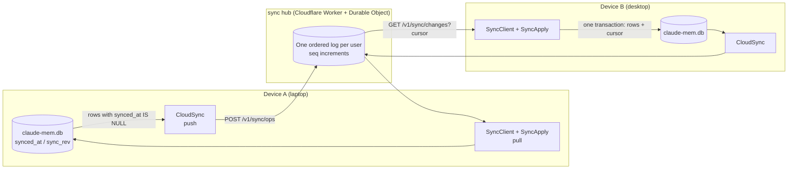
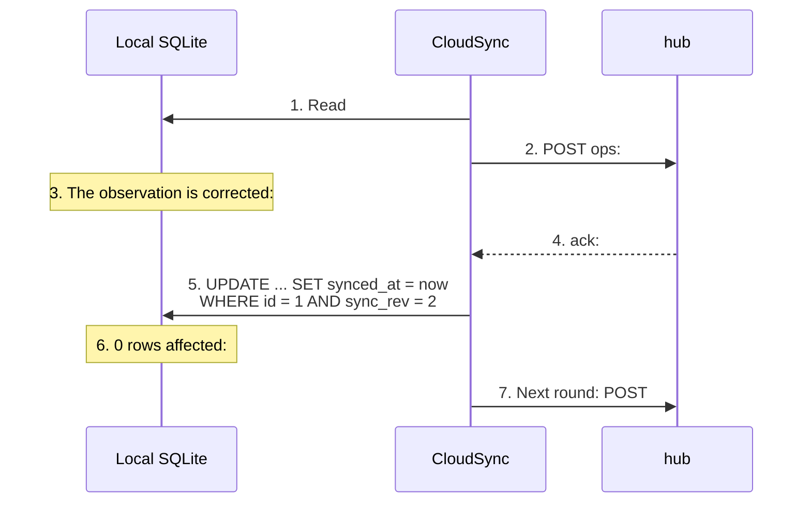

Chapter 16's Server runtime solves "several people sharing one memory." A more common case is "one person, several devices": you work on the office desktop during the day and pick up on the laptop at night. Each machine has its own `~/.claude-mem/claude-mem.db`, and neither can see the other's records.

v13 added cloud sync to the worker runtime (`src/services/sync/`). It doesn't replace the local database with a remote one. Each device still reads and writes its own SQLite, and sync only carries the rows each side has added or changed over to the other. Offline, everything keeps working; once back online, the devices catch up automatically.

This chapter takes the design apart. Sync is notoriously easy to get wrong, and claude-mem's source comments spell out every invariant, so this chapter goes through them one by one.

## The Overall Structure

Cloud sync is off by default: when `CLAUDE_MEM_CLOUD_SYNC_HUB_URL` is empty, it does nothing. Turning it on requires a cmem.ai account; the installer's Pro trial flow writes the token, user ID, and hub address (default `https://sync.cmem.ai`). The hub's code is in the repository under `workers/sync-hub/`, also open source under Apache-2.0, but token validation calls a cmem.ai endpoint, so self-hosting means implementing that part yourself.

The system has three parts, shown in Figure 19-1:



*Figure 19-1: Two devices syncing through one ordered log per user*

The hub is one Durable Object per user, holding an append-only ordered log in which every operation gets an increasing sequence number, `seq`. A device appends to the log when it pushes and reads forward from its own cursor when it pulls. A user can have at most 64 devices.

The hub doesn't merge conflicts. It does three things: keeps the log ordered; records each "entity version" only once; and projects appended data (that is, writes a copy synchronously) into cmem.ai's search service, returning 200 only once the projection's checkpoint covers the batch. All the merge rules live in the client's apply logic, covered below in two halves, push and pull.

The third point means that self-hosting a hub takes more than token validation. The projection service address (`INTERNAL_PROJECTOR_URL` in `wrangler.jsonc`) also points at a cmem.ai internal endpoint. You either implement it yourself or remove the "confirm only after projection completes" constraint.

## Push: The Database Is the Queue

### Two Layers: A Dirty Flag and Immutable Snapshots

The first sentence in the header of `CloudSync.ts` is "the database is the queue." Every synced table has a `synced_at` column, where `NULL` means "not yet in the hub's log." Finding the rows to push is a single query:

```sql
SELECT ... FROM observations
WHERE synced_at IS NULL AND origin_device_id IS NULL
```

`origin_device_id IS NULL` means the row was produced on this machine. Rows pulled from other devices carry their source device's ID and are never pushed back.

The selected rows aren't sent directly. `drainKind()` first freezes each row into a canonical snapshot written into the `sync_content_outbox` table (unique on `(entity_id, entity_rev)`), and then sends only the bytes stored in that snapshot. The comment gives the reason: later local edits can't change the request body or hash of a retry. Without the snapshot, reading the row fresh from the business table at send time could go wrong like this:

1. The first push of rev 2 times out, although the hub actually accepted it
2. Before the retry, the row is edited again
3. The retry sends rev 2 with different content and hits the hub's `revision_hash_conflict`

So there are two layers: `synced_at` flags which rows are dirty, and `sync_content_outbox` holds the exact content prepared for this version. Mutation operations like title changes and project remaps go through a separate table, `sync_outbox`.

After each local write, `notify()` is called, and after a 1.5-second debounce one `flush()` runs, draining 40 rows per page. The comment points out the advantage of this design: real-time sync once online, catching up after being offline, and retrying after a failure are all the same mechanism. There's no history backfill, no second process, no cursor file. If a device is offline for three days, the rows with `synced_at IS NULL` when it comes back are naturally those three days' backlog.

The figure of 40 rows per page came from a production incident. The client used to push 200 at a time, the hub's projection couldn't keep up, and requests timed out at 30 seconds. The client timeout is now 90 seconds, matching the length of the hub's projection lease. The projection lease is a time-limited lock the hub holds while processing a batch of projections; only the lock holder can write projections at any moment. If a client gives up partway through the lease and retries immediately, it runs into "projection busy."

### Every Row Has a Stable Identity and Version

A row pushed to the hub needs an ID that's globally unique and identical on every device. claude-mem doesn't use a UUID column. It computes the ID from "which row on which device" (`stableDocumentId()` in `CanonicalContent.ts`):

```typescript
const input = canonicalJson(['cmem-doc-id-v1', 'device', kind, deviceId, localId]);
return `${kind}:${sha256Base64Url(input)}`;
```

The device ID is a UUID generated the first time sync starts and written back to `settings.json` immediately; it never changes after that. If the write-back fails, sync is turned off for that run, rather than uploading with an ID that wasn't saved. The next startup would generate a different UUID, and one device would split into two identities (`resolveDeviceId()`).

The version number `sync_rev` starts at 1 and increments with each change. The operation body is canonical JSON (keys sorted, 64-bit integers written as decimal strings), and its SHA-256 is the `operation_sha256`. The hub deduplicates on `(origin_device, kind, origin_id, rev)`, first writer wins. If the same key arrives with a different hash, the hub rejects it outright (`revision_hash_conflict`).

### Stamp Only After the ack

The crux of pushing is when to write `synced_at`. The comments describe two checks:

1. In a complete 200 response, the acks must form **exactly the same multiset** as the pushed `(id, kind, rev, operation_sha256)`. The hub can return them out of order, but can't return more or fewer. If anything is missing, extra, or malformed, nothing in this round is stamped, and it goes into backoff and retries
2. The stamp is conditional: `synced_at` is written only if the row's **current** `sync_rev` still equals the version in the ack

The second check handles a very real race. As Figure 19-2 shows, while the push request is in flight, the row gets edited locally again:



*Figure 19-2: The stamp condition `sync_rev = confirmed version` keeps an in-flight edit from being lost*

Without the version condition in step 5, the rev 3 edit would be treated as synced and never pushed. The comments call this part of the livelock protection: the drain loop can only advance through acks, and no incomplete response can change what's been confirmed.

Scenario 2 of the example `examples/ch19-cloud-sync` reproduces this. (The example prints in Chinese; the `#` comments are translations.)

```text
[2] 推送请求还在路上时，笔记本又改了第一条    # while the push is in flight, the laptop edits row 1 again
  第一次推送（rev 2）：{"pushed":1,"stamped":0,"deadLettered":0}    # first push (rev 2): pushed, not stamped
  第一条现在：{..., "rev":3, "synced":0, ...}    # row 1 is now rev 3, unsynced
  下一轮推送（rev 3）：{"pushed":1,"stamped":1,"deadLettered":0}    # next push (rev 3): pushed and stamped
```

### Classifying Failures

Different failures need different handling, or one bad row can jam the whole queue:

| Failure | Handling |
|---|---|
| A single operation body over 256,000 bytes, or failing field validation | Moved to the dead-letter table with the reason recorded; later rows keep pushing |
| The hub rejects a specific operation by name (`invalid_ops`, `revision_hash_conflict`, `stale_revision`) | After the same operation is rejected 3 times, it goes to dead letters; more than 25 rejections in one round is treated as a systemic problem, and pushing stops and backs off |
| 401 / 403 | Can only succeed with new credentials, so pushing pauses and rechecks once an hour (it resumes automatically after a trial is renewed) |
| 429 | Waits per `Retry-After`; a Cloudflare HTML 429 waits at least 10 minutes |
| Other network errors, 5xx | Starts at 30 seconds, doubling up to 10 minutes |

Each request also has overall limits: at most 4,000,000 bytes and 500 operations.

## Pull: Apply the Data and the Cursor in One Transaction

### Exactly Once

`SyncClient` polls `GET /v1/sync/changes` and hands the results to `SyncApply.applyOps()`. The first paragraph of the header in `SyncApply.ts`:

> A pulled batch of operations is applied to local SQLite in **one transaction**, and the pull cursor advances in **that same transaction**. Either the batch's rows and the cursor land together, or neither does. Applying is idempotent: re-applying any prefix of the log converges to the same state, so on an epoch reset it can simply pull again from seq 0.

An epoch here is the hub log's "generation." When the hub's log is rebuilt, it gets a new epoch and sequence numbers start over; a client that sees the epoch has changed pulls everything again from seq 0.

The two guarantees stack. The transaction ensures a crash can never leave "rows half written, cursor unmoved," and idempotency ensures that applying something twice has no side effects. The cursor is written in exactly one place, `SyncApply`; `SyncClient` never writes the cursor itself.

Scenario 4 of the example throws an error on the second item of a batch:

```text
[4] 拉取中途崩溃：整批回滚，游标不动    # crash mid-pull: whole batch rolls back, cursor unchanged
  第二条处理时：模拟崩溃    # simulated crash on the second item
  游标：5 → 5    # cursor
  台式机行数：3    # desktop row count
  重新拉取：{"applied":2,"skipped":0}    # pull again
  台式机行数：5    # desktop row count
```

A single operation that can never be applied doesn't fail the whole page. It goes into `sync_pull_quarantine`, and the cursor advances as usual. It's the same idea as dead letters on the push side.

### Version Rules

Whether a remote operation overwrites local data depends on versions:

| Operation | Condition |
|---|---|
| Row operations (inserting and updating observations, summaries, and prompts, including deletion tombstones) | Applied only if `op.rev > local sync_rev`; skipped if the versions are equal |
| Mutation operations `set_prompt_session`, `remap_project` | Applied only if `op.rev >= the target row's sync_rev` |
| Mutation operation `set_title` | Ignores versions; follows log order, last one wins |

Row operations are skipped when versions are equal because the hub's dedup guarantees that a given `(device, kind, row, version)` has only one content. Applying it again would just fire the FTS triggers for nothing.

The sender mints mutation-operation versions by rule. Take `remap_project`. The sender first finds R, the highest version among the affected rows, sets all those rows to R + 1 in the same transaction, and sends the operation as R + 1. That's what makes the receiver's `>=` check hold. The comments warn specifically that if the sender sends rev 1 when it needed to bump the version, the receiver will silently skip it.

### Echo Protection Is Structural

Operations device A pushes will show up in A's own next pull. Left unhandled, A would apply its own data again as if it were remote, or worse, push it again, creating a loop.

`SyncApply` blocks this with two rules, which the comments stress are "structural, not heuristic":

- Operations whose source device is this device are skipped outright
- When a remote row is applied, `synced_at = now` is written in advance. The push query only selects `synced_at IS NULL`, so a pulled row structurally cannot be pushed back

Scenario 3 of the example:

```text
[3] 回声：台式机写一条推上去，再拉一次    # echo: the desktop writes a row, pushes it, then pulls
  台式机推送：{"pushed":1,"stamped":1,"deadLettered":0}    # desktop push
  台式机自己拉：{"applied":0,"skipped":1}    # desktop pulls its own row: skipped
  笔记本拉：{"applied":1,"skipped":4}    # laptop pulls: applied
```

### Pull Cadence

| State | Poll interval |
|---|---|
| Active session | 30 seconds |
| Idle | 5 minutes |
| No session activity for 1 hour | Stops completely, disconnecting the real-time channel too |

Two other signals trigger an early pull. Push responses include the hub's current `head_seq`, and if it's ahead of the local cursor, a pull happens right away. The optional real-time channel (`CLAUDE_MEM_CLOUD_SYNC_WS`, on by default, built on Supabase Realtime) pushes only a single notification, "the log advanced," with no data, and a normal HTTP pull still follows. If the real-time channel drops, sync is still correct; latency just falls back to the polling level. The hub's deployment doc states the principle as "cost guardrails are structural: tripping a breaker falls back to polling, never to not working."

## What Doesn't Sync

What syncs is memory content, not device state. These fields stay on the local machine (the exclusion list in the header of `SyncApply.ts`):

| Field | Why it doesn't sync |
|---|---|
| `synced_at`, `origin_device_id`, `origin_local_id`, `sync_rev` | Sync's own bookkeeping; the last three travel as operation metadata |
| `relevance_count` | A local usage count |
| `occurrence_count`, `title_norm_key` | Local dedup bookkeeping (Chapter 7), recomputed locally by the dedup scan |
| `reinforcement_dates`, `last_reinforced` | ACT-R reinforcement history: each replica ranks by its own confirmations |
| `session_db_id` | A local row number, re-resolved locally on apply |

Not syncing reinforcement history is an interesting choice. If one observation has been reconfirmed five times on the laptop and never on the desktop, the two devices' startup indexes will rank differently. The designer's judgment is that reinforcement reflects "this knowledge keeps coming up in the work done on this machine," so it belongs to the device, not to the knowledge itself. Scenario 5 of the example:

```text
[5] 设备本地字段：强化次数不同步    # device-local fields: reinforcement counts don't sync
  笔记本 reinforced：5    # laptop
  台式机 reinforced：0    # desktop
  笔记本待推送：{"pushed":0,"stamped":0,"deadLettered":0}    # laptop's pending push: nothing
```

The `sdk_sessions` table doesn't sync either. When a remote observation references a session that doesn't exist locally, `SyncApply` first creates a minimal placeholder session row to satisfy the foreign key. A session's custom title can arrive before the session itself; in that case the title is "parked" in `sync_state` and claimed when the session appears.

The Chroma vector index doesn't take part in sync. Remote rows are sent to the local Chroma asynchronously after the transaction commits, and failures are filled in by the backfill scan at startup.

## Deletion and Tombstones

In a sync system, a deletion is a write: the deleted row has to go out as a tombstone so other devices know to delete it when they receive it. The deletion restrictions mentioned in Chapter 17 all trace back to this:

- **You can only delete rows produced on this machine.** The worker's delete endpoint accepts only rows with `origin_device_id IS NULL`. An observation synced from the laptop to the desktop has to be deleted on the laptop
- **Deletion is refused when sync state is unavailable.** If a row has already been confirmed by the hub but the local sync identity temporarily can't be read, the delete endpoint returns 503, so no deletion happens that other devices would never learn about
- **Browser pages can't send deletions.** A DELETE carrying an `Origin` header is accepted only from the Viewer's own page, because a deletion generates a tombstone that affects every device

Tombstones go first when pushing: already-frozen content drains first, and mutation operations drain before new row snapshots. Scenario 6 of the example:

```text
[6] 删除：墓碑同步到另一台设备    # deletion: the tombstone syncs to the other device
  笔记本推送墓碑：{"pushed":1,"stamped":1,"deadLettered":0}    # laptop pushes the tombstone
  台式机拉取：{"applied":1,"skipped":0}    # desktop pulls
  台式机剩下：["订单导出改流式","Windows 下路径大小写","Redis 宕机时请求挂起","pg_trgm 两个字不走索引"]    # left on the desktop: four observations
  台式机删笔记本同步来的行：#2 不是本机产生的行    # desktop deletes a row synced from the laptop: "#2 was not produced on this machine"
```

## Compared with Chapter 16's Server Runtime

Both mechanisms deal with memory living on more than one machine, but they make very different choices:

| | Cloud sync (worker runtime) | Server runtime |
|---|---|---|
| Problem solved | One person, several devices | One team, one shared memory |
| Source of truth | Each device's local database + the ordered log on the hub | A central Postgres |
| Offline | Keeps working, catches up once online | Hooks fall back to the local worker |
| Conflicts | By row version; the later, higher version wins | None: there's only one write point |
| Outbox | `synced_at` flags dirty rows + `sync_content_outbox` holds immutable snapshots | A separate `observation_generation_jobs` table |
| Exactly once | Multiset check of acks + cursor advanced inside the transaction | Event content hash + deterministic job IDs + outbox row lock |
| Openness | Client and hub code are open source; the service is provided by cmem.ai | Fully open source, self-hosted |

Team/organization-level memory sync is listed as a reserved area in `docs/ip-boundary.md`. Judging from the design in this chapter, extending it to teams isn't just "a few more users sharing one log." The version rules are designed around "device + row." In a team setting you'd need new rules for two people editing the same observation, for who may delete someone else's observation, and for whether reinforcement history belongs to a person or a device.

## Running the Example

```bash
cd examples/ch19-cloud-sync
npm install
npm run demo
```

The example runs seven scenarios with two in-memory SQLite databases and an in-process hub: pushing after offline writes, an edit during a push, echo, a crash mid-pull, device-local fields, deletion tombstones, and an oversized row going to dead letters.

---

**Questions to consider**

1. In "Stamp Only After the ack," the stamp condition is "current version equals the confirmed version." If it were changed to "current version is less than or equal to the confirmed version," when would it go wrong?
2. Reinforcement history doesn't sync, so two devices' startup indexes can rank differently. If you believed reinforcement should travel with the knowledge, how would you sync it? How would you merge two devices reinforcing the same observation at the same time?
3. The hub deduplicates on `(device, kind, row, version)`, first writer wins. Suppose a device's database is restored from backup and its `sync_rev` values roll back by a week. New edits after that will produce keys that already exist on the hub, with different content. What happens? Which claude-mem mechanism would catch it?

---

The next chapter is the last in the book. It looks at where agent memory is heading: interoperability, forgetting, multimodality, and how host-native memory relates to add-on memory systems.

---

> From the open-source edition of *Engineering Agent Memory* by diguike.  
> Read online: [inferloop.dev](https://inferloop.dev) · Source: [github.com/diguike/book-claude-mem](https://github.com/diguike/book-claude-mem)
